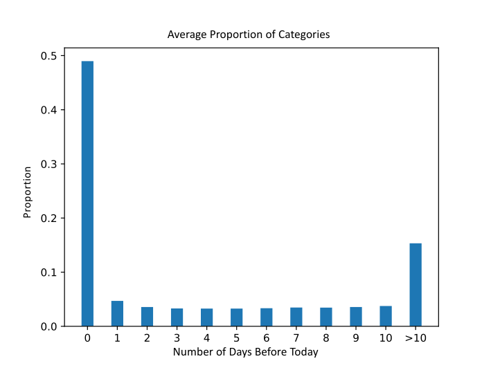
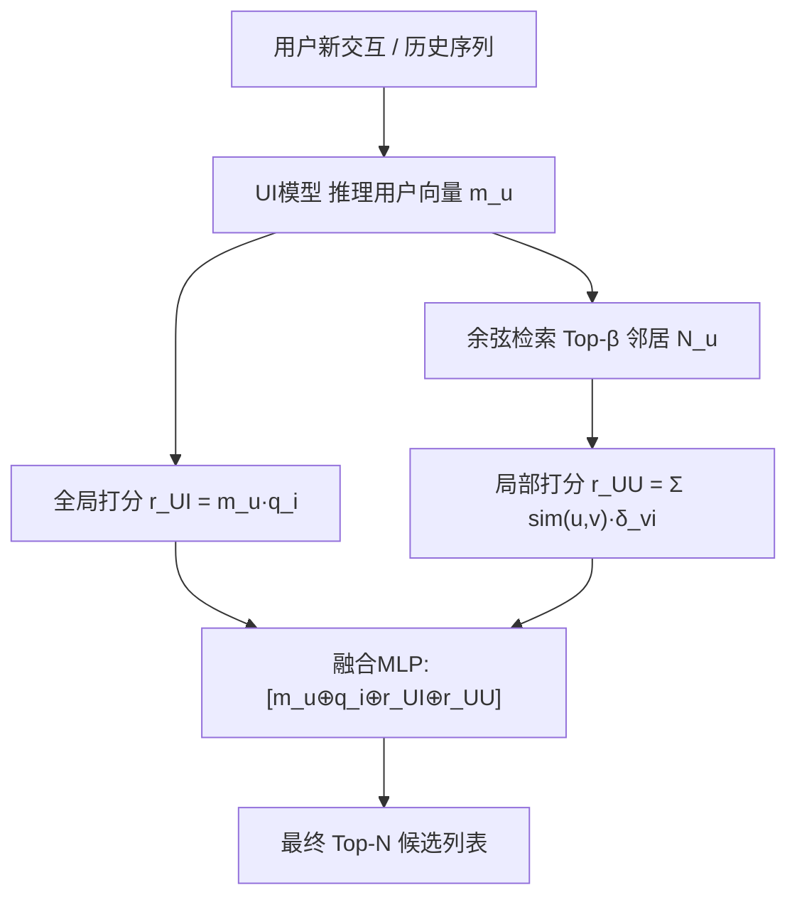

# Explore User Neighborhood for Real-time E-commerce Recommendation (探索实时电商推荐中的用户邻域)

- **会议/期刊**: ICDE 2021
- **作者与机构**: Xu Xie, Fei Sun, Xiaoyong Yang, Zhao Yang, Jinyang Gao, Wenwu Ou, Bin Cui（北京大学 / 阿里巴巴）
- **推荐链路定位**: 召回（Candidate Generation / Top-N）
- **研究方向**: 协同过滤 / 序列推荐
- **论文原文**: [https://arxiv.org/abs/2103.00442v1](https://arxiv.org/abs/2103.00442v1)
- **开源代码**: 暂未开源

## TL;DR (1分钟核心速览)

UI（用户-物品）双塔类方法只建模全局物品关联，忽视相似用户群体内部的局部模式；而传统 UserKNN/矩阵分解式的用户邻域法属直推模型，来一条新交互就得重算或重训，无法实时上线。本文提出 SCCF 框架：借用归纳式 UI 模型（FISM / SASRec）在线即时推理用户向量，再以余弦相似度实时检索邻居做用户邻域打分，最后用 MLP 融合全局与局部两路得分。在 4 个公开数据集的 Leave-One-Out 全库排序协议下，SASRec+SCCF 平均取得 8.90% HR@20 与 12.75% NDCG@20 提升，淘宝线上 A/B 点击 +2.5%、成交 +2.3%。

## Background & Motivation (背景与核心矛盾)

- **主流范式**: 工业召回普遍采用"双塔式"UI 方法，把用户与物品映射到共享隐空间，用内积检索近邻物品；学术界对应 FISM、SASRec 等强基线。
- **前人局限**: ①UI/Item-based 方法把物品关系投影到全体用户的"平均位置"，啤酒与纸尿裤对"新晋父母"这一子群高度相关，但全局相似度很低，局部信号被稀释；②UserKNN 需在高维稀疏向量上算 $|I|$ 规模相似度，SVD++/LRec 等分解式方法为直推模型，用户一有新品点击就需重分解用户-物品矩阵，实时性不可接受。
- **核心洞察 (Key Insight)**: 作者统计淘宝行为发现，用户当天点击的类目中约 50% 是近两周内从未碰过的新类目（图 1），兴趣漂移极快，故"实时"并非锦上添花而是硬约束。关键判断是：只要用户向量能**归纳式（inductive）在线推断**，邻域检索就能退化为低维稠密向量的近似最近邻搜索，实时用户邻域法即可落地。

<figure class="paper-figure" markdown="span">
  <figcaption>图1. 用户今天点击且在过去两周内也点击过的类别的平均分布。第 x 天的每个值表示其在今天之前 x 天首次点击的类别数量。</figcaption>
</figure>

- **本文切入点**: 把 UI 模型当作"用户向量发生器"，在其上叠加一个无额外参数的邻域检索模块，兼取全局与局部视角，并保持实时。

## Method (核心方法设计)

### 1. 整体框架 (Overall Architecture)

SCCF 由三部分组成。**UI 模型**（可选 FISM 或 SASRec）从用户历史交互中归纳出用户向量 $\boldsymbol{m}_u$与物品向量$\boldsymbol{q}_i$，并在新交互到达时即时前向推理出最新$\boldsymbol{m}_u$，无需重训。**邻域模块**对$\boldsymbol{m}_u$做余弦相似度计算，取 Top-$\beta$邻居构成$\mathcal{N}_u$，聚合邻居点击过的物品得到局部打分。**融合模块**将 UI 打分与局部打分及各路原始特征拼接，经若干全连接层输出最终排序分。推理时两路各自产出 Top-$N$ 候选，合并后由融合网络重排给出最终候选列表，整体可视为一种生成式后处理插件。

### 2. 关键设计拆解 (Key Designs)

1. **归纳式实时用户邻域检索**：痛点在于直推模型的用户向量绑定于当前交互矩阵，无法在线更新。SCCF 复用 UI 模型的归纳能力，令邻居判定退化为稠密向量检索：$\text{sim}(u,v)=\cos(\boldsymbol{m}_u,\boldsymbol{m}_v)$，$\hat{r}^{UU}_{ui}=\sum_{v\in\mathcal{N}_u}\delta_{vi}\,\text{sim}(u,v)$，其中$\delta_{vi}=\mathbb{I}(i\in R_v^+)$。直觉上，低维向量点积/余弦远比高维稀疏交集可算，可交给 Faiss 类工具，且邻域随$\boldsymbol{m}_u$ 每次推理自动更新，天然适应兴趣漂移，故无需任何额外可学习参数即可捕获局部模式。

2. **逐用户归一化的全局-局部融合**：UI 打分与邻域打分尺度差异大（前者为内积、后者为相似度加权和），直接拼接会让数值大的分支主导。SCCF 对两路分数做**逐用户**标准化 $\tilde{r}=(r-\bar{r}_u)/\sigma(r_u)$，再与$\boldsymbol{m}_u$、$\boldsymbol{q}_i$拼接送入 MLP：$\hat{r}^{fi}_{ui}=f(\boldsymbol{m}_u\oplus\boldsymbol{q}_i\oplus\tilde{r}^{UI}_{ui}\oplus\tilde{r}^{UU}_{ui})$。按用户而非全局做归一化可消除用户间热度差异，使融合网络真正学到"何时信全局、何时信邻居"的样本级切换。

3. **训练目标与负采样**：UI 主干沿用二分类负采样损失（式 9，正样本为观测交互、负样本从剩余物品均匀采样，$\ell_2$正则，mini-batch Adam）；融合网络训练集限定在两路候选并集$C_I=C^{UI}_I\cup C^{UU}_I$上，仅当真实下一物品命中并集时才计入损失，等权优化$-\sum_u\frac{1}{|C_I|}\big(\sum_{i\in I_u^+}\log\sigma+\sum_{i\in I_u^-}\log(1-\sigma)\big)$。该设计避免融合网络在无关物品上浪费容量，专注于"候选内谁该排前"。推理开销极低：邻域检索 + 融合前向仅毫秒级。

## Experimental Setup & Evaluation Protocol (实验设置与评估协议)

- **数据集与预处理**: 4 个公开集，评分/评论存在性二值化为隐式反馈；Amazon 系列沿用 SASRec 协议，过滤交互 < 5 的用户与物品（5-core），再二次剔除交互 < 5 的用户。

| 数据集 | #Users | #Items | #Interactions | 密度 | 特征/场景说明 |
| :--- | :---: | :---: | :---: | :---: | :--- |
| ML-1M | 6,040 | 3,416 | 1.0M | 4.79% | 电影评分，稠密 |
| ML-20M | 138,493 | 26,744 | 20M | 0.54% | 超大规模电影 |
| Games | 29,341 | 23,464 | 0.3M | 0.04% | 亚马逊高稀疏 |
| Beauty | 40,226 | 54,542 | 0.4M | 0.02% | 亚马逊极稀疏 |

- **数据划分与防穿越 (Splitting Strategy)**: 采用 `Leave-One-Out`，每用户最后一条交互为测试、倒数第二条为验证、其余训练，天然按时间因果排列防穿越。
- **排名评测协议 (Ranking Protocol)**: 无偏 `Full-Ranking`——对全库未交互物品打分后排序取 Top-$N$；指标为 HR@$\{20,50,100\}$与 NDCG@$\{20,50,100\}$。
- **对比基线与超参设置**: 基线含 Pop、ItemKNN、UserKNN、BPR-MF，以及两类 UI 主干 FISM、SASRec（SOTA）。嵌入维度 $d\in\{16,32,64,128\}$，邻居数$\beta\in\{50,100,200\}$，Adam lr=0.001，SASRec 取 2 层、1 头，FISM$\alpha=0.5$；当基础方法 `Improv.` 相对增益以各 UI 主干为基准。

## Key Experimental Results (实验关键数据)

### 1. 主实验对比 (Main Results)

HR@20 全库排序对比（括号内为相对对应 UI 主干的提升）：

| 模型 | ML-1M | ML-20M | Games | Beauty |
| :--- | :---: | :---: | :---: | :---: |
| Pop | 0.0596 | 0.0675 | 0.0333 | 0.0134 |
| ItemKNN | 0.1179 | 0.1279 | 0.0736 | 0.0422 |
| UserKNN | 0.1308 | — | 0.1227 | 0.0676 |
| BPR-MF | 0.1424 | 0.1099 | 0.1210 | 0.0600 |
| FISM | 0.2189 | 0.2022 | 0.0974 | 0.0425 |
| **FISM+SCCF** | **0.2677** (+22.29%) | **0.2558** (+26.51%) | **0.1413** (+45.07%) | **0.0628** (+47.76%) |
| SASRec | 0.3447 | 0.2524 | 0.1325 | 0.0648 |
| **SASRec+SCCF** | **0.3613** (+4.82%) | **0.2939** (+16.44%) | **0.1464** (+10.49%) | **0.0673** (+3.86%) |

### 2. 消融实验 (Ablation Study)

对比"仅全局 UI""仅局部邻域 $\text{UU}$""SCCF 融合"三者（HR@20）：

| 配置 | ML-1M | ML-20M | Games | Beauty |
| :--- | :---: | :---: | :---: | :---: |
| FISM (仅 UI) | 0.2189 | 0.2022 | 0.0974 | 0.0425 |
| FISM$_{\text{UU}}$ (仅局部) | 0.2374 | 0.2220 | 0.1157 | 0.0574 |
| FISM+SCCF | **0.2677** | **0.2558** | **0.1413** | **0.0628** |
| SASRec (仅 UI) | 0.3447 | 0.2524 | 0.1325 | 0.0648 |
| SASRec$_{\text{UU}}$ (仅局部) | 0.2639 | 0.2327 | 0.1241 | 0.0505 |
| SASRec+SCCF | **0.3613** | **0.2939** | **0.1464** | **0.0673** |

**实时效率对比**（单次新交互端到端耗时，ms）：

| 数据集 | 方法 | 推理向量 | 检索邻居 | 总耗时 |
| :--- | :--- | :---: | :---: | :---: |
| ML-1M | UserKNN | 0 | 6.83 | 6.83 |
| ML-1M | **SCCF** | 1.66 | 0.72 | **2.38** |
| Videos | UserKNN | 0 | 51.95 | 51.95 |
| Videos | **SCCF** | 0.79 | 0.75 | **1.54** |

### 3. 关键实验发现 (Key Findings)

1. **局部信号在弱主干的增益远大于强主干**：FISM+SCCF 在 Beauty 上 HR@20 提升 47.76%、NDCG@20 提升 52.63%，而 SASRec+SCCF 仅 +3.86%；说明 SASRec 已隐式学到部分局部模式，SCCF 更多是"补齐短板"而非"叠加冗余"。
2. **数据越充足，邻域越准**：SASRec+SCCF 在 ML-20M 上取得最大增益（HR@20 +16.44%、NDCG@20 +26.38%），显著高于 ML-1M 的 4.82%；原因是 ML-20M 样本充足，SASRec 学到的用户表征能支撑精准邻居检索，而稀疏的 Beauty/Games 邻域噪声更大。
3. **邻域规模存在"小而精"最优**：$\beta$ 从 50 增至 100 普遍提升（如 FISM+SCCF 在 Games 上 NDCG@50 由 0.0778→0.0798），但继续增至 200 后多数数据集持平甚至回落（Beauty 0.0348→0.0349 波动），印证"扩大邻域引入噪声用户"的论断。

## Highlights & Limitations (亮点、对比与审稿批判)

- **与代表作对比 (vs. Prior Work)**: 相比 UserKNN/LRec 用高维稀疏向量做直推式邻域计算，SCCF 复用归纳式 UI 向量，把邻居检索降到毫秒级并可在线更新；相比 CMN（同样利用用户邻域）依赖 Memory Network 且邻居定义宽泛（有任何共现即算），SCCF 的邻居是精确 Top-$\beta$ 余弦近邻且无额外参数，可插拔到 FISM/SASRec 等任意归纳式 UI 模型。
- **可迁移亮点**: ①"UI 表征即用户向量"的思路可直接复用到图召回/双塔模型，把邻域检索作为轻量二阶召回路；②逐用户分数归一化 $\tilde{r}=(r-\bar{r}_u)/\sigma(r_u)$ 是融合多路异构打分的低成本通用技巧，可迁移到多路召回融合与重排。
- **审稿级局限批判**: ①邻域质量完全依赖 UI 表征，若基础模型在稀疏集上表征不准，SCCF 增益有限甚至需靠融合网络纠偏；②论文未引入用户画像等辅助信息，且融合网络依赖"真实物品落在并集内"才训练，缺失样本导致训练信号偏少；③局部打分 $\hat{r}^{UU}$ 基于邻居点击的原始计数与相似度加权，未做时间衰减，与文中强调的"兴趣快速漂移"存在潜在不一致。

## Rating (四维评分)

- **方法创新性 (Novelty)**: ⭐⭐⭐⭐ （首次把用户邻域法做进实时召回，用归纳式推理替代重训，思路简洁且切中工业痛点）
- **评估协议与实验扎实度 (Protocol & Experiments)**: ⭐⭐⭐⭐ （4 数据集 + 全库排序 + 消融 + 效率 + 淘宝线上 A/B，闭环完整，但缺少显著性检验与更细的稀疏分桶）
- **写作与数学规范度 (Clarity & Rigor)**: ⭐⭐⭐⭐ （三组件公式清晰，复杂度分析对比直推模型到位，但融合损失与邻居聚合的时间建模略欠严谨）
- **工业落地与复现价值 (Industrial & Practical Value)**: ⭐⭐⭐⭐⭐ （毫秒级延迟、可插拔到任意归纳式 UI 模型、线上点击 +2.5% 成交 +2.3%，落地价值极高；可惜未开源）

