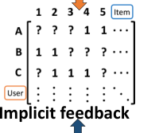
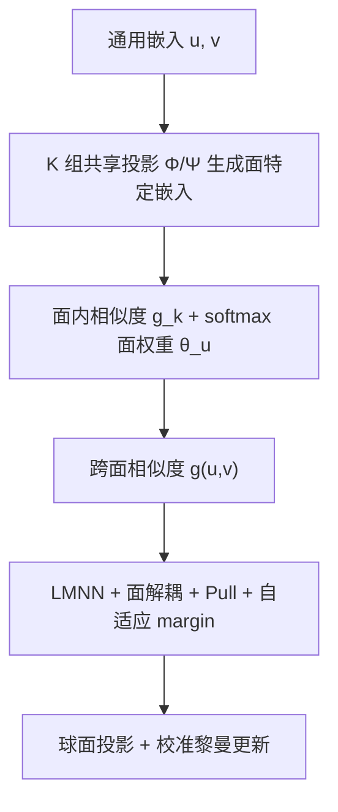
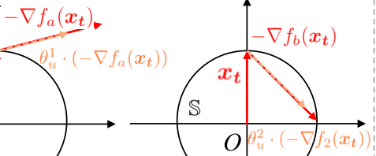

# Multi-Facet Recommender Networks with Spherical Optimization (多面推荐网络与球面优化)

- **会议/期刊**: IEEE ICDE 2021
- **作者与机构**: Yanchao Tan, Carl Yang, Xiangyu Wei, Yun Ma, Xiaolin Zheng（浙江大学 / Emory University）
- **推荐链路定位**: 召回（隐式反馈协同排序，Metric Learning 范式）
- **研究方向**: 协同过滤与双塔召回 / 自监督对比学习与交互去噪（正则化视角）
- **论文原文**: [https://arxiv.org/abs/2103.14866v1](https://arxiv.org/abs/2103.14866v1)
- **开源代码**: [https://github.com/Melinda315/MARS](https://github.com/Melinda315/MARS)

## TL;DR (1分钟核心速览)

隐式反馈推荐中，用户有多重偏好、物品有多重属性（multi-facet），但 CML/TransCF/LRML 等度量学习方法把所有用户物品压进**单一度量空间**，导致"物品 2 与 4 既要近又要远"的几何冲突无解。本文提出 MARS：以可学习投影矩阵把用户/物品投到 $K$ 个面空间，用 cross-facet 加权相似度只在合适空间比较；再用**严格球面约束 + 校准黎曼梯度下降**避免"懒惰嵌入"退化解。在 6 个基准数据集、Leave-One-Out + 1:100 采样排序协议下，HR@10/nDCG@10 相对最优基线最高提升 **47.07%/47.02%**（Ciao）。

## Background & Motivation (背景与核心矛盾)

- **主流范式**: 隐式反馈推荐由 MF（BPR/NeuMF）转向度量学习（CML/MetricF/TransCF/LRML/SML），用欧氏距离替代内积，从而同时刻画 user–user 与 item–item 细粒度相似性。
- **前人局限（矛盾一·几何冲突）**: 单一度量空间维度再高也无法同时满足"电影《真爱至上》对用户 C 与用户 A/B 分别属于近/远"的双向约束（图 1(b)），冲突不可调和。
- **前人局限（矛盾二·迁移缺失）**: 多空间表征在通用网络中已有探索（MCNe 等），但均依赖图聚类、类别标签或预定义文本模式等**外部知识**，稀疏二部图上的推荐场景并不具备。
- **核心洞察 (Key Insight)**: 度量的"面"应由数据本身无监督推断——保留$K$个共享但互不相同的投影空间即可分离冲突；同时真正的问题在于现有 LMNN 目标只约束$\|u\|_2\le 1$（单位球内），模型会把"困难用户/物品"推到球面上"躺平"以回避梯度，多空间下这种容量浪费被进一步放大。
- **本文切入点**: 多空间投影 + 面间解耦正则 + 自适应 margin 解决冲突；以 $\|u_k\|_2=1$ 的严格球面约束与校准黎曼更新逼迫模型充分利用每个面的表达力。

<figure class="paper-figure" markdown="span">
  <figcaption>图 1. 一个说明单面推荐局限性的玩具示例。(a) 展示了隐式反馈数据以及推荐系统需建模的其潜在多面分布。(b) 展示了单一度量空间中的用户和物品。假设用户 (A, B) 和物品 (1-5) 被安排在黑色与绿色位置，其中蓝色箭头忠实保留了用户 (A, B) 与物品 (1-5) 之间的交互，那么如红色箭头所示，在不违背用户 C 与物品 (2-4) 的交互的情况下，就不可能将用户 C 放置在该空间中的任何位置。(c) 展示了同一用户</figcaption>
</figure>

## Method (核心方法设计)

### 1. 整体框架 (Overall Architecture)

MARS 由"通用嵌入 → 多面投影 → 跨面相似度 → 多目标优化 → 球面更新"五段构成。先为每个用户/物品学习一个通用向量 $\boldsymbol{u},\boldsymbol{v}$（承载活跃度、流行度等跨面共享信息），再经$K$组共享投影矩阵$\Phi=\{\boldsymbol{\varphi}_k\}$、$\Psi=\{\boldsymbol{\psi}_k\}$生成面特定嵌入$\boldsymbol{u}_k=\boldsymbol{u}^\top\boldsymbol{\varphi}_k$、$\boldsymbol{v}_k=\boldsymbol{v}^\top\boldsymbol{\psi}_k$；然后用用户专属 softmax 权重$\theta_u^k$聚合各面相似度得到总分，并以 LMNN 推拉目标 + 面解耦正则 + pull 正则联合训练；最终所有面嵌入被严格约束在单位球面，用校准黎曼梯度下降更新，推理时按$\sum_k\theta_u^k\cos(\boldsymbol{u}_k,\boldsymbol{v}_k)$ 全库/采样排序。

### 2. 关键设计拆解 (Key Designs)

1. **跨面相似度度量 (Cross-facet Similarity)**：解决单空间冲突。把面内相似度 $g_k(\boldsymbol{u}_k,\boldsymbol{v}_k)=-\|\boldsymbol{u}_k-\boldsymbol{v}_k\|_2^2$按用户面权重$\theta_u^k=\mathrm{softmax}(\cdot)$ 加权：
$g(u,v)=-\sum_{k=1}^{K}\theta_u^k\left\|\boldsymbol{u}^\top\boldsymbol{\varphi}_k-\boldsymbol{v}^\top\boldsymbol{\psi}_k\right\|_2^2$直觉：冲突的相似性被分派到不同子空间，只要某一面可分，模型就能通过$\theta_u$选择性"看见"该面；共享投影矩阵而非每人$K$ 套参数，使参数量与计算量保持与单空间同阶。

2. **面解耦 + 自适应 margin + 探索式采样**：单空间 LMNN 的目标不鼓励面间差异，会退化为 $K$份冗余拷贝。故加面分离损失$\mathcal{L}_{\text{facet}}=\frac{1}{\alpha}\sum_{i,j}\log\left(1+e^{-\alpha(\|\boldsymbol{u}_i-\boldsymbol{u}_j\|^2+\|\boldsymbol{v}_i-\boldsymbol{v}_j\|^2)}\right)$迫使各面近正交；并把固定 margin$m$换成用户级$\gamma_u=1-\frac{\sum_{v\in V_u}|U_v|}{N}$（二跳邻居越多样 → 采纳度越高 → margin 越小），配合按$\Pr(u)\propto \text{freq}(u)^{\beta}$偏向活跃用户的负采样（$\beta=0.8$），缓解隐式反馈正负失衡与负样本歧义。

3. **训练目标、球面化与推理效率**：总损失
$\min\ \mathcal{L}_{\text{push}}+\lambda_{\text{pull}}\mathcal{L}_{\text{pull}}+\lambda_{\text{facet}}\mathcal{L}_{\text{facet}},\ \text{s.t. }\|\boldsymbol{u}_k\|_2=\|\boldsymbol{v}_k\|_2=1$其中$\mathcal{L}_{\text{push}}=\sum_{(u,v_p)}\sum_{(u,v_q)}[\gamma_u-g_s(u,v_p)^2+g_s(u,v_q)^2]_+$，$\mathcal{L}_{\text{pull}}=-\sum_{(u,v_p)}g_s(u,v_p)$，球面下$g_s=\sum_k\theta_u^k\cos(\boldsymbol{u}_k,\boldsymbol{v}_k)$（可由 vMF 分布的最大似然导出，$\log p(v_k|u_k)\propto\cos(v_k,u_k)$）。优化用校准黎曼 SGD：
$\boldsymbol{x}_{t+1}=\mathcal{R}_{\boldsymbol{x}_t}\Big(-\eta_t\big(1+\tfrac{\boldsymbol{x}_t^\top\nabla f(\boldsymbol{x}_t)}{\|\nabla f(\boldsymbol{x}_t)\|}\big)(\mathbf{I}-\boldsymbol{x}_t\boldsymbol{x}_t^\top)\nabla f(\boldsymbol{x}_t)\Big)$即把切空间投影梯度乘以"角度校准因子"，让偏离目标方向越远的参数步长越大。负采样为每正样本配随机负样本（非 in-batch），无额外内存开销，推理仅多$K$次$D\times D$ 投影乘法，运行时与主流度量学习基线同量级。

<figure class="paper-figure" markdown="span">
  <figcaption>图 4. 球面空间中用于优化 MARS 的校准黎曼梯度下降示意图。(a) 和 (b) 展示了单空间中的不同梯度。对单空间梯度进行加权组合后，(c) 展示了多空间梯度。在 (c) 和 (d) 中，z = grad f(xt) 是原始的</figcaption>
</figure>

## Experimental Setup & Evaluation Protocol (实验设置与评估协议)

- **数据集与预处理**:

| 数据集 | #Users | #Items | #Interactions | Density | 场景说明 |
| :--- | :---: | :---: | :---: | :---: | :--- |
| Delicious | 1K | 1K | 8K | 0.61% | 稠密社交书签 |
| Lastfm | 2K | 175K | 92K | 0.28% | 音乐收听 |
| Ciao | 7K | 11K | 147K | 0.19% | 含类别标签，用于案例研究 |
| BookX | 20K | 40K | 605K | 0.08% | 图书，稀疏 |
| ML-1M | 6K | 4K | 1M | 4.52% | 电影，稠密 |
| ML-20M | 62K | 27K | 17M | 1.02% | 大规模电影 |

- **数据划分与防穿越**: `Leave-One-Out`——每用户最后 1 次交互作测试、倒数第 2 次作验证；无时间戳数据集（Delicious）随机抽 1 条作测试。
- **排名评测协议**: `Sampled Ranking`，每用户随机采 **100 个未交互物品** 与 1 个测试正样本共同排序（正负比 1:100），报告 HR@10/20 与 nDCG@10/20。**注意：非无偏 Full-Ranking**，绝对数值偏乐观，跨论文比较需谨慎。
- **对比基线与超参设置**: 8 个基线——MF 系 BPR/NMF/NeuMF + 度量学习系 CML/MetricF/TransCF/LRML/SML。嵌入维度 $d\in\{32,\dots,1024\}$，面数$K\in[1,6]$，学习率$\{0.0005\sim0.1\}$，$\lambda_{\text{pull}},\lambda_{\text{facet}}\in\{0.001\sim1\}$，batch 1000，$\alpha=0.1,\beta=0.8$ 固定；网格搜索于验证集，基线按其原论文调优。未明确报告显著性检验。

## Key Experimental Results (实验关键数据)

### 1. 主实验对比 (Main Results)

| 数据集 | 指标 | BPR | NeuMF | CML | TransCF | LRML | SML | **MARS** | Improv. |
| :--- | :--- | :---: | :---: | :---: | :---: | :---: | :---: | :---: | :---: |
| Delicious | HR@10 | 0.1981 | 0.1164 | 0.2470 | 0.2586 | 0.2124 | 0.2071 | **0.3311** | +28.04% |
| Delicious | nDCG@10 | 0.1122 | 0.0558 | 0.1389 | 0.1475 | 0.1199 | 0.1114 | **0.1869** | +26.71% |
| Lastfm | HR@10 | 0.2073 | 0.1489 | 0.1975 | 0.2211 | 0.2171 | 0.2280 | **0.2818** | +23.62% |
| Ciao | HR@10 | 0.1569 | 0.1535 | 0.2085 | 0.2292 | 0.2122 | 0.2307 | **0.3393** | +47.07% |
| Ciao | nDCG@10 | 0.0751 | 0.0741 | 0.1053 | 0.1167 | 0.1102 | 0.1208 | **0.1776** | +47.02% |
| BookX | HR@10 | 0.2425 | 0.2286 | 0.2885 | 0.3329 | 0.3168 | 0.3367 | **0.4162** | +23.61% |
| ML-1M | HR@10 | 0.7237 | 0.6861 | 0.7216 | 0.7233 | 0.7397 | 0.7126 | **0.7603** | +2.78% |
| ML-20M | nDCG@10 | 0.6346 | 0.5815 | 0.6256 | 0.6239 | 0.6377 | 0.6257 | **0.6714** | +5.28% |

### 2. 消融实验 (Ablation Study)

以 nDCG@10 为口径，面数 $K$ 与球面优化的逐项拆解（Imp1 = MAR vs CML，Imp2 = MARS vs CML，Imp3 = MARS vs MAR）：

| 数据集 | CML | MAR (最优 K) | MARS (最优 K) | Imp1 | Imp2 | Imp3 |
| :--- | :---: | :---: | :---: | :---: | :---: | :---: |
| Delicious | 0.1389 | 0.1828 (K=2) | **0.1869** (K=2) | +31.61% | +34.56% | +2.24% |
| Lastfm | 0.1231 | 0.1755 (K=2) | **0.1882** (K=2) | +45.89% | +56.44% | +7.24% |
| Ciao | 0.1053 | 0.1625 (K=4) | **0.1776** (K=4) | +54.32% | +68.66% | +9.29% |
| BookX | 0.1663 | 0.2176 (K=4) | **0.2349** (K=5) | +30.85% | +39.75% | +20.90% |

### 3. 关键实验发现 (Key Findings)

1. **多空间的增益远大于单空间堆维度**：Ciao 上 $d$从 128→1024 时 TransCF HR@10 仅 0.2251→0.2292（+1.82%），而同总维度下 MARS（$d=256,K=4$，总 1024）达 0.3393，相对 TransCF/SML 分别提升 **52.56%/47.59%**；$d=1024$时两个单空间基线已轻微过拟合，MARS 仍随$K$ 增益——证明"分面"而非"加宽"才是突破表征瓶颈的路径。
2. **球面优化在难场景补偿效应最强**：MARS 相对 MAR 的增益（Imp3）与 MAR 相对 CML 的增益呈**负相关**——Delicious 上 Imp1 高达 31.61% 而 Imp3 仅 2.24%，BookX $K=6$ 时 Imp1 跌至 8.60% 而 Imp3 升至 28.46%，直接验证"宽松范数约束下困难样本躺平"的假设被严格球面约束修复。
3. **面数与面解耦的超参规律清晰**：$K$的 rule-of-thumb 为 **3 或 4**（Ciao 上$K=4$最优，$K=6$回落至 0.1620），超过最优值后训练不足/冗余导致下降；$\lambda_{\text{facet}}=0.01$在所有数据集上一致最优，$\lambda_{\text{pull}}$则数据集相关（Delicious/BookX ≈0.1，Ciao 0.001，Lastfm 0），说明 pull 正则强度需随稀疏度调整。案例研究（表 V/VI）显示$K=2$面收敛为"Ciao Cafe/美食"、$K=4$面收敛为"软件工程师/互联网"等可解释的用户刻板印象，且用户权重$\theta_u$ 呈长尾分布（Bob: 0.56/0.05/0.04/0.35）。

## Highlights & Limitations (亮点、对比与审稿批判)

- **与代表作对比 (vs. Prior Work)**: 相比 CML（首个单空间度量学习，仅推负样本）与 MetricF（仅拉正样本），MARS 同时保留 push+pull 并把冲突分配到多空间；相比 TransCF（为每对 user-item 学 translation 向量，参数随交互数爆炸）与 SML（对称 margin 但仍是单空间），MARS 的共享投影参数量与单空间同阶却获得 $K$ 倍表征容量；相比多空间网络表征 MCNe，本文完全不需要图聚类/类别标签等外部监督，纯靠隐式反馈与面解耦正则自发分化。
- **可迁移亮点**: ① "面解耦正则 + softmax 面权重"可作为任意多塔/多兴趣召回模型的即插即用正则（如 MIND 的多兴趣向量去冗余）；② 用二跳邻居多样性构造用户级自适应 margin（$\gamma_u$）的思路可直接搬到难样本挖掘与课程学习；③ 球面 + 角度校准黎曼更新对任一归一化嵌入的双塔召回（含温度系数对比学习）都适用。
- **审稿级局限批判**: ① 评估用 **1:100 采样排序** 而非全库 Full-Ranking，且负样本随机采（未过滤曝光/popularity bias），在 175K 物品的 Lastfm 上采样协议与真实线上排序差距大，绝对提升幅度可能被放大；② 球面约束+黎曼优化增加实现复杂度（需手写 retraction 与切空间投影），论文自承运行时与基线同量级但未给出 $K$增大后的显存/时延开销曲线，$K\cdot D$存储也是实际部署成本；③$\lambda_{\text{pull}}$ 跨数据集最优值跨越 2 个数量级（0 ~ 0.1），超参敏感度高且未做显著性检验，6 个数据集均为小规模学术基准，缺乏工业级 A/B 验证。

## Rating (四维评分)

- **方法创新性 (Novelty)**: ⭐⭐⭐⭐ （多面度量空间 + 严格球面黎曼优化首次结合，几何冲突的动机论证与 vMF 概率解释扎实，但多空间嵌入本身源自通用网络表征）
- **评估协议与实验扎实度 (Protocol & Experiments)**: ⭐⭐⭐ （6 数据集 + 8 基线 + K 与 $\lambda$ 双超参研究充分，但仅 1:100 采样排序、无全库排序与显著性检验，削弱结论外推力）
- **写作与数学规范度 (Clarity & Rigor)**: ⭐⭐⭐⭐ （跨面相似度、自适应 margin、校准黎曼梯度推导链条清晰，符号统一，复杂度对照交代到位）
- **工业落地与复现价值 (Industrial & Practical Value)**: ⭐⭐⭐⭐ （代码已开源、共享投影使参数量与单空间同阶、无需外部知识易接入现有双塔召回，但黎曼优化实现门槛与球面约束的工程改造成本需评估）

