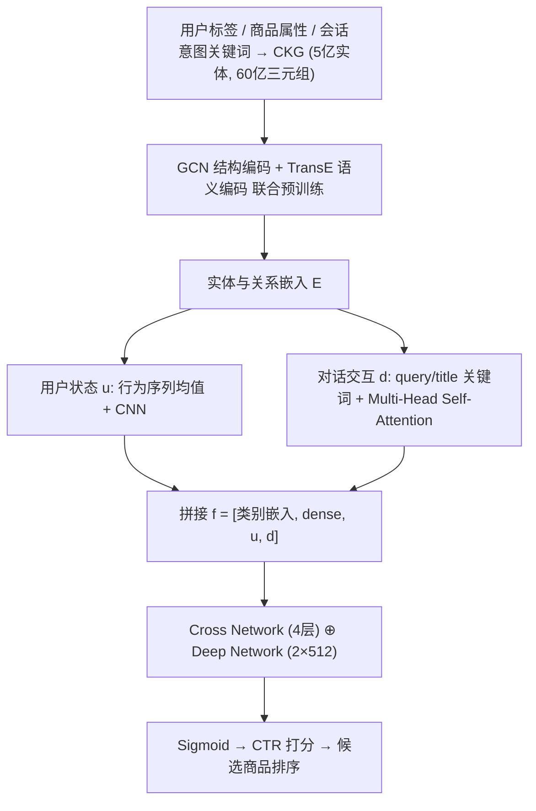

# Improving Conversational Recommendation System by Pretraining on Billions Scale of Knowledge Graph (基于十亿级知识图谱预训练的会话推荐系统改进)

- **会议/期刊**: IEEE ICDE 2021 (Industry Track)
- **作者与机构**: Chi-Man Wong, Fan Feng, Wen Zhang, Hui Chen, Yichi Zhang, Peng He, Kun Zhao, Huan Chen, Huajun Chen 等（阿里巴巴集团 / 澳门大学 / 浙江大学）
- **推荐链路定位**: 精排（会话式导购机器人中的候选商品 CTR 排序）
- **研究方向**: CTR/CVR 预估与特征交叉 / 图神经网络与知识图谱推荐
- **论文原文**: [https://arxiv.org/abs/2104.14899v1](https://arxiv.org/abs/2104.14899v1)
- **开源代码**: 暂未开源

## TL;DR (1分钟核心速览)

会话推荐（CRS）的精排环节严重依赖用户—商品行为共现，而在淘宝客服机器人场景中新用户/新会话占比极高，CTR 模型面临极端稀疏与过拟合。本文把用户标签、商品属性与**对话意图/关键词**统一建模为 5 亿实体、60 亿三元组的会话知识图谱 CKG，用 GCN（结构）与 TransE（语义）联合预训练实体嵌入，再据此构造"用户状态表征 $\mathbf{u}$"（行为序列均值 + CNN）与"对话交互表征$\mathbf{d}$"（query/title 关键词多头自注意力），与常规类别、统计特征拼接后送入 Cross+Deep 网络（K-DCN）。在 Alime 真实数据 10 个类目上平均 AUC 0.652 vs. DCN 0.640（+1.9% rel），低资源类目 Digital Accessories 提升 2.6 个点，线上 A/B 相对 DCN 提升 4.2%。

## Background & Motivation (背景与核心矛盾)

- **主流范式**: CRS 采用"语义解析 → 候选召回 → 深度 CTR 精排"三段式流水线；精排侧以 DCN、DeepFM、Wide&Deep 等特征交叉网络为主，输入仅依赖用户行为与商品属性两类稀疏 ID 特征。
- **前人局限**: 其一，淘宝百万级店铺的客服机器人会话高度分散，单个用户的点击序列极短，纯 ID embedding 在冷启动/低资源类目下严重过拟合；其二，DCN/DeepFM 完全无视用户当前**这一轮对话说了什么**，模型对"用户此刻的意图"不可感知。
- **核心洞察 (Key Insight)**: 对话中的 query 关键词、商品 title、会话意图与商家关系本身就是可沉淀的稠密监督信号——把它们组织成 KG，可以让"稀疏行为"通过图谱邻居（同类目、同意图、同关键词）获得语义与结构上的补全。
- **本文切入点**: 不做端到端 CRS 对话策略，而是**只在排序侧**用十亿级 CKG 预训练实体嵌入，把对话与用户状态编码成两个新特征块注入 DCN，实现"预训练—微调"两阶段。

## Method (核心方法设计)

### 1. 整体框架 (Overall Architecture)

先离线构建 CKG：用户侧 `(user, has, user_tag)`；商品侧 `(item, belong_to, category)`、`(seller, has, item)`、`(item, has, value)`、`(property, has, value)`；会话侧 `(user, created, session)`、`(session, relate_to, seller)`、`(session, has, intention)`、`(intention, has, keywords)`。随后联合预训练结构模块与语义模块得到实体/关系嵌入 $\mathbf{E}$。在线微调阶段，对候选商品抽取历史点击序列与当前 query/title 关键词，分别经 CNN 与多头自注意力得到$\mathbf{u}$、$\mathbf{d}$，与类别嵌入、dense 统计特征（价格、销量）拼接为$\mathbf{f}$，进入 Cross 与 Deep 双分支，Sigmoid 输出 CTR 供候选排序。

### 2. 关键设计拆解 (Key Designs)

1. **结构与语义联合预训练（Joint GCN + TransE）**：纯 KGE（TransE/DistMult）只学到三元组语义，丢失图谱拓扑鲁棒性；纯 GCN 只聚合邻居，学不到关系语义。作者令 GCN 第 $i$层输出直接充当 TransE 的实体嵌入$\mathbf{e}_k=\mathbf{X}^{(i)}_k$：

$$\mathbf{X}^{(i+1)}=\sigma\!\left(\hat{\mathbf{D}}^{-\frac{1}{2}}\hat{\mathbf{A}}\hat{\mathbf{D}}^{-\frac{1}{2}}\mathbf{X}^{(i)}\mathbf{W}^{(i)}\right),\quad f(e_i,r,e_j)=\lVert\mathbf{e}_i+\mathbf{r}-\mathbf{e}_j\rVert$$

$$\mathcal{L}=\sum_{(e_i,r,e_j)\in\mathcal{T}}\left[f(e_i,r,e_j)+\gamma-f(e'_i,r',e'_j)\right]_+$$

直觉上，margin 损失把"真实三元组距离拉近、随机替换头/尾的负样本推远"，同时把梯度反传进 GCN 权重，使三层以内的邻居聚合被语义约束"锚定"，避免 GCN 在超大规模异质图上向流行度节点塌缩。

2. **用户状态表征 $\mathbf{u}$（行为序列的局部卷积）**：痛点是对$k$条点击序列直接平均会抹平兴趣漂移。作者先对每条行为内商品嵌入取均值$\mathbf{b}_i=\frac{1}{|b_i|}\sum_{e\in b_i}\mathbf{e}$，把$k$个行为向量纵向拼成$\mathbf{B}\in\mathbb{R}^{d\times k}$，再用卷积核尺寸$N\in\{2,4\}$的 CNN 提取跨行为局部模式：$\mathbf{u}=f_{\mathrm{CNN}}(\mathbf{B}\ast\mathbf{w}+b)$。相比 RNN，卷积在此只需捕获"相邻两次行为"的共现，计算开销恒定且可并行。

3. **对话交互表征 $\mathbf{d}$（query–title 交叉注意力）**：候选商品是否匹配，取决于 query 关键词与 title 关键词的对齐。将两侧关键词嵌入并置为$\mathbf{W}$，用多头自注意力建模词间关系：

$$a_{ij}=\frac{\exp\left((\mathbf{M}_a\mathbf{w}_i)\circ(\mathbf{M}_b\mathbf{w}_j)\right)}{\sum_{t}\exp\left((\mathbf{M}_a\mathbf{w}_i)\circ(\mathbf{M}_b\mathbf{w}_t)\right)},\qquad \tilde{\mathbf{w}}_i=\sum_{j}a_{ij}\mathbf{W}_v\mathbf{w}_j$$

拼接得 $\mathbf{d}=[\tilde{\mathbf{w}}^{(1)},\dots,\tilde{\mathbf{w}}^{(m+n)}]$。注意力让"意图词"（如"送女友"）与 title 中的属性词（"口红/礼盒"）自动互增强，等于给 DCN 注入了显式的 query-item 语义匹配信号。

4. **训练目标与推理开销**：融合特征 $\mathbf{f}=[\mathbf{c}_e^{(1)},\dots,\mathbf{c}_e^{(k)},\mathbf{x}_{dense},\mathbf{u},\mathbf{d}]$后，交叉层递推$\mathbf{x}_c^{(i+1)}=\mathbf{x}_c^{(i)}+\mathbf{w}_i^{\top}f(\mathbf{x}_c^{(i)})+\mathbf{b}_i$，最终$p=\sigma([\mathbf{x}_c^{(n_c)},\mathbf{x}_d^{(n_d)}]\mathbf{W}_{logits})$，以逐样本 BCE 损失$\mathcal{L}_{K\text{-}DCN}=-\frac{1}{N}\sum_i\left[y_i\log p_i+(1-y_i)\log(1-p_i)\right]$ 训练。CTR 微调阶段**不使用负采样器**（直接用曝光未点击作负例）；在线推理仅需查表取预训练嵌入，新增开销为一次 CNN + 一次 4 头注意力，与候选数线性相关。

## Experimental Setup & Evaluation Protocol (实验设置与评估协议)

- **数据集与预处理**: 私有 Alime 销售机器人会话日志，按商品一级类目切分为 10 个子数据集；CKG 侧剔除出现次数 < 5000 的稀疏属性，邻居采样 10 个。

| 数据集(类目简写) | #Train | #Test | 说明 |
| :--- | :---: | :---: | :--- |
| BS 美妆/精油 | 157,027 | 16,028 | 10 类目中最大，行为最稠密 |
| MW 女装 | 139,167 | 14,205 | 高频、类目宽泛 |
| SS 运动鞋 | 104,182 | 10,634 | — |
| MC 男装 | 57,263 | 5,845 | 中等稀疏 |
| DA 数码配件 | 49,455 | 5,048 | **最小样本量，验证数据稀缺鲁棒性** |
| KA 厨房家电 | 55,069 | 5,621 | — |
| 合计 | ≈900K | ≈91.9K | CKG：5–6 亿实体、60 亿三元组 |

- **数据划分与防穿越 (Splitting Strategy)**: 按类目做**比例划分**（约 9:1 train/test），论文未披露是否按全局时间戳切分，也未说明 CKG 构建是否与测试期会话存在时间穿越风险。
- **排名评测协议 (Ranking Protocol)**: 采用 **AUC** 做点式（point-wise）CTR 判别评估，负例来自曝光未点击（隐式反馈），**未采用 Full-Ranking 全库排序**，也未报告 Sampled Ranking 的正负比与候选规模。
- **对比基线与超参设置**: 基线为 LR、GBDT(LightGBM)、DNN、Wide&Deep、DCN 五个工业标准模型；K-DCN 用 TF 实现，grid search 得 2 层 512 维 Deep + 4 层 Cross，行为序列数 $k=4$，卷积核 2/4 双路拼接，注意力 4 头，batch 512，Adam，嵌入维度$d=64$；CKG 预训练用 50 个参数服务器 + 200 GPU、5 epoch、约 2 天。未报告显著性检验。

## Key Experimental Results (实验关键数据)

### 1. 主实验对比 (Main Results)

| 类目 | K-DCN | DCN | WDL | DNN | GBDT | LR | Improv. (vs 最优基线) |
| :--- | :---: | :---: | :---: | :---: | :---: | :---: | :---: |
| BS | **0.617** | 0.608 | 0.600 | 0.598 | 0.584 | 0.580 | +1.5% |
| MW | **0.652** | 0.636 | 0.630 | 0.633 | 0.611 | 0.592 | +2.5% |
| SS | **0.658** | 0.652 | 0.650 | 0.649 | 0.619 | 0.603 | +0.9% |
| MC | **0.647** | 0.630 | 0.628 | 0.626 | 0.603 | 0.574 | +2.7% |
| DA | **0.706** | 0.680 | 0.677 | 0.671 | 0.675 | 0.646 | **+3.8%** |
| KA | **0.654** | 0.640 | 0.642 | 0.640 | 0.638 | 0.622 | +1.9% |
| **Average** | **0.652** | 0.640 | 0.636 | 0.633 | 0.617 | 0.590 | **+1.9%** |

线上 A/B（Alime 真实流量）：

| 平台 | 指标 | K-DCN vs. DCN |
| :--- | :---: | :---: |
| Alime 导购机器人 | 线上收益指标 | **+4.2% (相对)** |

### 2. 消融实验 (Ablation Study)

原文**未提供逐组件的严格消融**；下表由主实验表与 DCN 同构对照重构得到（同层数、同优化器，仅去掉知识增强输入）：

| 变体 | 平均 AUC | Δ (rel) | 说明 |
| :--- | :---: | :---: | :--- |
| K-DCN（GCN+TransE 预训练 + $\mathbf{u}$+$\mathbf{d}$） | **0.652** | — | 完整模型 |
| w/o 知识表征 $\mathbf{u},\mathbf{d}$（退化为 DCN） | 0.640 | −1.9% | 仅保留类别 + dense 特征 |
| w/o Cross 分支（Wide&Deep 结构） | 0.636 | −2.5% | 显式高阶交叉贡献 |
| w/o 全部深度结构（DNN） | 0.633 | −3.0% | 深度非线性贡献 |
| 特征交叉退化为线性（LR） | 0.590 | −10.5% | 基线下界 |

### 3. 关键实验发现 (Key Findings)

1. **增益与数据量强负相关**：样本最少的 DA（49K 训练样本）拿到 +3.8% 相对提升、+2.6 个绝对点，而样本最多的 BS 仅 +1.5%，说明 CKG 预训练嵌入主要在"ID 共现不足"处提供边际信息，正是作者宣称的缓解稀疏性。
2. **知识带来的初始化加速收敛**：收敛曲线（原文 Fig. 5）显示 K-DCN 用预训练嵌入初始化后收敛明显快于 DCN，等价于用 60 亿三元组做了一次大规模"冷启动预热"，这对工业侧的每日重训成本是实打实的收益。
3. **线上与离线方向一致但幅度放大**：离线平均 +1.9% 相对 AUC，线上 Alime 相对提升 4.2%，说明 query-item 语义匹配在真实长尾会话流量中比在类目内均匀采样的离线测试集上更有价值。

## Highlights & Limitations (亮点、对比与审稿批判)

- **与代表作对比 (vs. Prior Work)**: 与 DCN / Wide&Deep / DeepFM 相比，本文的核心差别不在网络结构（K-DCN 的 Cross+Deep 几乎照搬 DCN），而在**特征来源**——把对话文本与图谱邻居变成 $\mathbf{u},\mathbf{d}$ 两个可微特征块；与 DKN 类知识感知 CTR 相比，本文把知识图谱从"新闻实体"扩展到"用户—会话—意图—关键词"四层异质结构，规模达 60 亿三元组，这一工程量是主要贡献；与同期 CRS 工作（如 KBRD、TG-ReDial）相比，本文不做对话策略/生成，只做排序侧增强，更贴近工业落地。
- **可迁移亮点**: (1) "GCN 输出直接作为 TransE 实体嵌入"的联合预训练写法，可低成本迁移到任何已有 KGE 流水线的推荐场景，无需额外对齐层；(2) 用 CNN 在"行为序列矩阵 $\mathbf{B}\in\mathbb{R}^{d\times k}$"上做局部卷积，作为 RNN/Transformer 的廉价替代，在序列长度短（$k=4$）时几乎无损。
- **审稿级局限批判**: 其一，**评估协议披露不足**：仅用类目内 AUC、负例定义与候选规模均未说明，缺少 Full-Ranking 或 GAUC 等排序一致性指标，且未做显著性检验；其二，**缺少逐组件消融**（单独去掉 CNN、去掉注意力、仅 GCN 或仅 TransE 的效果均未知），使得"结构+语义联合预训练优于单独任一方"这一核心论点在本文中**并未被实验直接证明**；其三，数据集私有、代码未开源，实体规模在正文（6 亿）与实现细节（5 亿）处自相矛盾，可复现性弱；其四，预训练消耗 200 GPU × 5 epoch × 2 天，中小团队难以复制。

## Rating (四维评分)

- **方法创新性 (Novelty)**: ⭐⭐⭐ （GCN 与 TransE 的联合预训练 + 两张对话侧特征表征属工程组合创新，网络结构本身沿用 DCN，缺少理论或谱分析支撑）
- **评估协议与实验扎实度 (Protocol & Experiments)**: ⭐⭐ （10 个类目 + 线上 A/B 具备工业说服力，但仅有 AUC、无 Full-Ranking/显著性检验、无逐模块消融，评估披露明显不足）
- **写作与数学规范度 (Clarity & Rigor)**: ⭐⭐⭐ （公式与损失定义清晰、流水线图完整，但符号冗余较多、注意力式 6 的下标与 $\mathbf{W}_v$ 转置书写有笔误，实体规模前后不一致）
- **工业落地与复现价值 (Industrial & Practical Value)**: ⭐⭐⭐⭐ （已在 Alime 上线并给出 +4.2% 线上收益，两阶段架构与现有 CTR 系统解耦良好；扣分点在于代码未开源与预训练算力门槛高）

