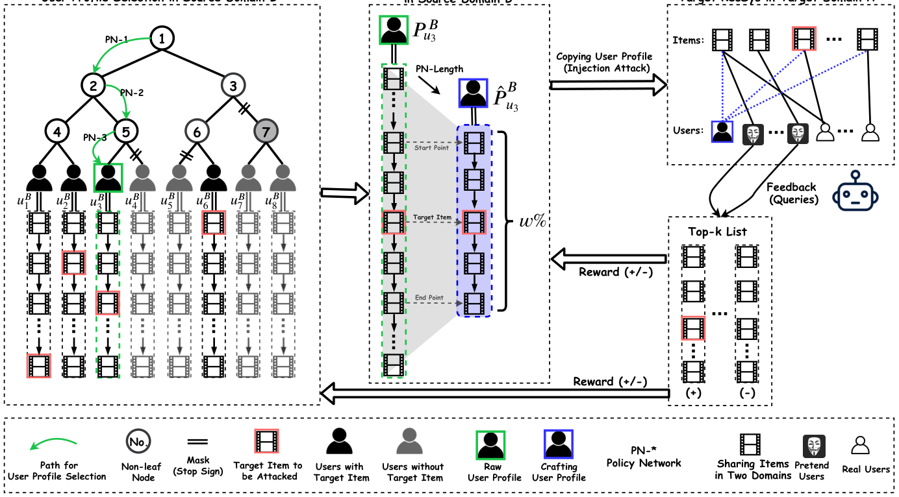
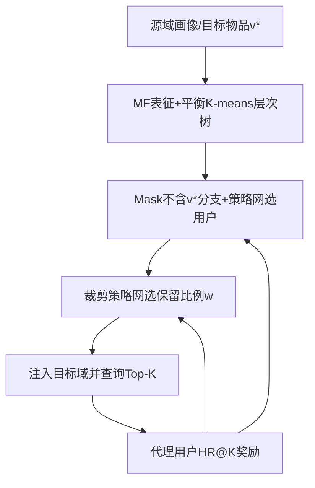

# Attacking Black-box Recommendations via Copying Cross-domain User Profiles (跨域用户画像复制黑盒推荐攻击)

- **会议/期刊**: ICDE 2021 (Full paper)
- **作者与机构**: Wenqi Fan, Tyler Derr, Xiangyu Zhao, Yao Ma, Hui Liu, Jianping Wang, Jiliang Tang, Qing Li；香港城市大学、密歇根州立大学、香港理工大学
- **推荐链路定位**: 黑盒 Top-K 推荐输出（数据注入/投毒攻击）
- **研究方向**: 去偏公平、可信隐私与工业架构 / 跨域与多场景推荐
- **论文原文**: [论文原文链接](https://arxiv.org/abs/2005.08147v2)
- **开源代码**: 暂未开源

## TL;DR (1分钟核心速览)

针对伪造画像易被防御识别的问题，CopyAttack 不生成假用户，而是从有重叠物品的源域复制真实画像到目标域，并用层次策略梯度选择用户、裁剪画像，仅依赖 Top-K 查询反馈优化 HR@K 奖励。在 ML10M-FX/ML20M-NF 上，以 PinSage 为目标模型、100 负样本采样排序，HR@20 较最强基线提升 34.1%/166.1%。

## Background & Motivation (背景与核心矛盾)

- **主流范式**: 数据投毒/Shilling Attack 通过生成假用户画像提升目标物品，主流方法多假设白盒，依赖目标模型梯度或参数。
- **前人局限**: 生成画像的行为模式与真实用户差异大，易被检测；白盒攻击要求模型结构与数据完全可见，不符合真实平台。
- **核心洞察 (Key Insight)**: 跨域平台常共享物品与相似偏好，源域真实用户画像天然更“真”；攻击难点转为“选谁复制、裁多少”。
- **本文切入点**: 将跨域画像选择与裁剪建模为 MDP，用层次策略梯度与 mask 在有限黑盒查询下最大化目标物品命中率。

## Method (核心方法设计)

### 1. 整体框架 (Overall Architecture)

输入源域用户画像 $P_U^B$、目标物品$v^*$与目标域代理用户$U^{A*}$；先用 MF 学习用户/物品表征，构建平衡 K-means 层次聚类树，每个非叶节点对应一个策略网络。按目标物品 mask 不含$v^*$的分支，沿根到叶采样源域用户；第二策略网在$\{10\%,\dots,100\%\}$中选择保留窗口，围绕$v^*$ 裁剪画像；将裁剪画像注入目标域，查询黑盒 PinSage 对代理用户的 Top-K，计算 HR@K 奖励并回传更新两策略网。

图2：CopyAttack 三阶段框架（源域选择、画像裁剪、注入查询）。
<figure class="paper-figure" markdown="span">
  <figcaption>图2：所提框架概览。包含三个主要部分：𝐵领域中的用户画像选择、用户画像构造，以及注入攻击与查询。</figcaption>
</figure>

### 2. 关键设计拆解 (Key Designs)

1. **层次聚类树 + Mask 的用户选择**：痛点是大规模离散动作空间使直接策略网复杂度 $O(n)$，ML20M-NF 上 48h 跑不完。做法是平衡 K-means 树，路径概率分解为$p_u(a_t^u|s_t^u)=\prod_{j=1}^d p_{u,j}(a_t^{u,[j]}|s_t^u)$，节点输入$[q_{v^*}\oplus x_{v^*}]$，$x_{v^*}$由已选用户 RNN 编码；mask 移除不含$v^*$的分支。直觉：把$O(n)$决策降为$O(cd)$，并聚焦可攻击用户。

2. **围绕目标物品的画像裁剪**：痛点是整段画像噪声大、注入交互成本高，过长画像反而降低成功率。做法是把保留比例离散为 $W=\{10\%,\dots,100\%\}$，第二策略网$p_l(\cdot|s_t^l)=\mathrm{softmax}(\mathrm{MLP}([p_i^B\oplus q_{v^*}^B]|\theta_l))$选择$w$，围绕$v^*$ 取前后窗口裁剪。直觉：保留与目标物品时间近邻的交互，既降预算又维持真实行为序列。

3. **训练目标、奖励与推理**：状态为已注入画像，动作为“选用户 + 裁剪比例”，奖励 $r(s_t,a_t)=\frac{1}{|U^{A*}|}\sum_{i=1}^{|U^{A*}|}\mathrm{HR}(u_i^{A*},v^*,k)$，其中目标物品在 Top-$k$中则 HR=1。优化$\max_\theta \mathbb{E}[\sum_t \gamma^t r(s_t,a_t)]$；攻击侧免目标梯度、免负采样，仅每 3 次注入查询一次，在线开销主要是查询与树搜索$O(cd)$。

## Experimental Setup & Evaluation Protocol (实验设置与评估协议)

- **数据集与预处理**: 仅保留评分=5 的交互，按同名电影对齐重叠物品；目标域 80%/10%/10% 随机划分，训练后固定 PinSage 作为黑盒。

| 数据集 | #Users | #Items | #Interactions | 稀疏度/密度 | 特征/场景说明 |
| :--- | :---: | :---: | :---: | :---: | :--- |
| ML10M-FX（目标 ML10M） | 19,267 | 6,984 | 437,746 | 0.33% | 源域 Flixster：93,702 用户、4.68M 交互，重叠物品 5,815 |
| ML20M-NF（目标 ML20M） | 38,087 | 8,325 | 838,491 | 0.26% | 源域 Netflix：478,471 用户、62.94M 交互，重叠物品 5,193 |

- **数据划分与防穿越**: 目标域采用 80%/10%/10% 随机划分；攻击目标为 50 个交互少于 10 次的物品，预算最多复制 30 个源域画像。
- **排名评测协议**: `Sampled Ranking`，每个用户随机采 100 个未交互物品与测试正样本共同排序；报告 HR@20/10/5、NDCG@20/10/5；未报告显著性检验。
- **对比基线与超参**: 目标模型 PinSage，嵌入维度 $d=8$、学习率 0.001；代理用户 50 个，每 3 次注入查询一次；树深 Flixster 3、Netflix 6，折扣因子 0.6。

## Key Experimental Results (实验关键数据)

### 1. 主实验对比 (Main Results)

| 数据集 | 方法 | HR@20 | HR@10 | NDCG@20 | 平均画像物品数 |
| :--- | :--- | ---: | ---: | ---: | ---: |
| ML10M-FX | Without Attack | 0.0378 | 0.0228 | 0.0231 | 0 |
| ML10M-FX | RandomAttack | 0.0391 | 0.0230 | 0.0233 | 46 |
| ML10M-FX | TargetAttack40 | 0.1203 | 0.0583 | 0.0353 | 495 |
| ML10M-FX | TargetAttack70 | 0.1772 | 0.0854 | 0.0569 | 818 |
| ML10M-FX | TargetAttack100 | 0.1166 | 0.0520 | 0.0369 | 1350 |
| ML10M-FX | PolicyNetwork | 0.1936 | 0.0665 | 0.0570 | 705 |
| ML10M-FX | CopyAttack-Length | 0.0857 | 0.0434 | 0.0282 | 1280 |
| ML10M-FX | **CopyAttack** | **0.2596** | **0.1103** | **0.0799** | 695 |
| ML20M-NF | Without Attack | 0.0461 | 0.0043 | 0.0115 | 0 |
| ML20M-NF | RandomAttack | 0.0468 | 0.0050 | 0.0118 | 124 |
| ML20M-NF | TargetAttack40 | 0.1016 | 0.0405 | 0.0288 | 203 |
| ML20M-NF | TargetAttack70 | 0.1006 | 0.0402 | 0.0285 | 321 |
| ML20M-NF | TargetAttack100 | 0.0581 | 0.0006 | 0.0139 | 593 |
| ML20M-NF | PolicyNetwork | — | — | — | 48h 超时 |
| ML20M-NF | CopyAttack-Length | 0.0655 | 0.0018 | 0.0158 | 496 |
| ML20M-NF | **CopyAttack** | **0.2704** | **0.1240** | **0.0969** | 255 |

相对最强基线：ML10M-FX 的 HR@20 提升 34.1%（0.2596 vs 0.1936），HR@10 提升 29.2%（vs TargetAttack70 的 0.0854）；ML20M-NF 的 HR@20 提升 166.1%（0.2704 vs 0.1016），HR@10 提升 206.2%（vs 0.0405）。

### 2. 消融实验 (Ablation Study)

| 数据集 | 变体 | HR@20 | HR@10 | NDCG@20 | 说明 |
| :--- | :--- | ---: | ---: | ---: | :--- |
| ML10M-FX | CopyAttack | **0.2596** | **0.1103** | **0.0799** | 完整模型 |
| ML10M-FX | w/o masking | 0.0376 | 0.0227 | 0.0230 | 近似无攻击，几乎不聚焦目标物品 |
| ML10M-FX | w/o crafting | 0.0857 | 0.0434 | 0.0282 | 画像过长、噪声与预算上升 |
| ML10M-FX | w/o hierarchy | 0.1936 | 0.0665 | 0.0570 | 扁平策略网，动作空间大 |
| ML20M-NF | CopyAttack | **0.2704** | **0.1240** | **0.0969** | 完整模型 |
| ML20M-NF | w/o masking | 0.0500 | 0.0045 | 0.0125 | 失去目标物品约束 |
| ML20M-NF | w/o crafting | 0.0655 | 0.0018 | 0.0158 | 噪声与成本拖累 |
| ML20M-NF | w/o hierarchy | — | — | — | 48h 内未完成 |

### 3. 关键实验发现 (Key Findings)

1. **Mask 是决定性组件**：ML10M-FX 去掉 masking 后 HR@20 从 0.2596 跌至 0.0376，接近无攻击的 0.0378，说明源域画像若不含目标物品，注入几乎无信号。
2. **裁剪同时降噪与降预算**：去掉 crafting 后 ML10M-FX HR@20 仅 0.0857，平均画像物品数从 695 升至 1280；围绕 $v^*$ 裁剪比整段复制更有效。
3. **层次树解决可扩展性并随预算增益**：扁平 PolicyNetwork 在 ML10M-FX 为 0.1936，在 ML20M-NF 48h 超时；CopyAttack 在 ML20M-NF 达 0.2704，且预算增大时 TargetAttack 饱和而 CopyAttack 持续获益；高流行 Top 30% 物品更易被攻击。

## Highlights & Limitations (亮点、对比与审稿批判)

- **与代表作对比 (vs. Prior Work)**: 相比 GAN+PGD 类白盒投毒需模型梯度与参数，CopyAttack 仅用 Top-K 查询；相比 TargetAttack 随机选含目标物品画像，本文用层次策略网自适应选择并裁剪；相比假画像生成，复制真实画像更接近真实分布。
- **可迁移亮点**: 用层次聚类树 + mask 处理大规模离散动作空间，可迁移到候选集选择/负采样；围绕目标物品的窗口裁剪可用于成本感知的画像压缩与去噪。
- **审稿级局限批判**: 依赖跨域重叠物品与源域真实画像，真实平台未必满足；实验仅固定 PinSage、100 负样本采样排序，未测防御策略与显著性；树深、查询预算敏感，且未开源代码，复现与工业落地成本需进一步评估。

## Rating (四维评分)

- **方法创新性 (Novelty)**: ⭐⭐⭐⭐ （跨域真实画像复制 + 层次策略梯度攻击组合新颖，但 RL/聚类组件本身较成熟）
- **评估协议与实验扎实度 (Protocol & Experiments)**: ⭐⭐⭐ （两数据集、基线与消融较完整，但仅单目标模型、采样排序且无显著性/防御测试）
- **写作与数学规范度 (Clarity & Rigor)**: ⭐⭐⭐⭐ （MDP、奖励与策略公式清晰，部分实现细节与负采样说明不足）
- **工业落地与复现价值 (Industrial & Practical Value)**: ⭐⭐⭐ （黑盒查询假设贴近现实，但跨域重叠与查询成本限制强，代码未开源）

