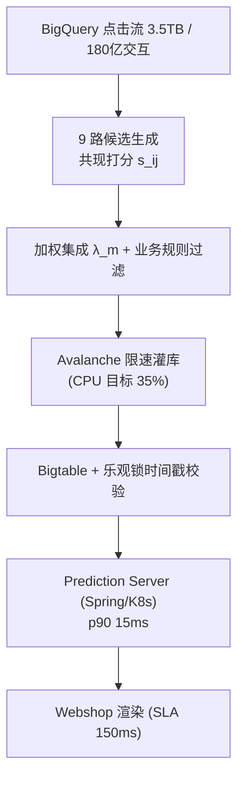
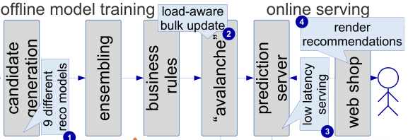
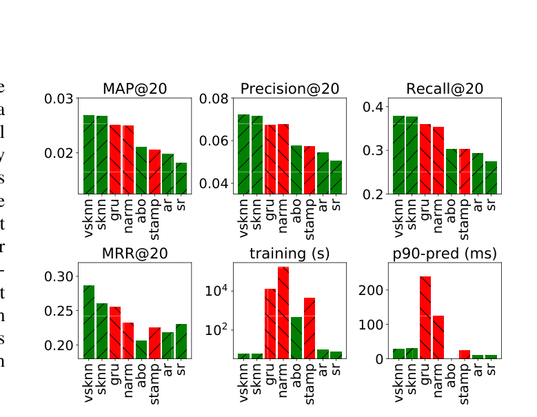

# Learnings from a Retail Recommendation System on Billions of Interactions at bol.com (十亿级交互电商推荐系统的实践教训)

- **会议/期刊**: IEEE ICDE 2021 (pp. 2447–2452, 工业与应用 track)
- **作者与机构**: Barrie Kersbergen (bol.com / Ahold Delhaize Research), Sebastian Schelter (University of Amsterdam)
- **推荐链路定位**: 召回（商品详情页 "Anderen bekeken ook" 相似商品位）+ 在线服务链路
- **研究方向**: 去偏公平、可信隐私与工业架构 / 序列与会话推荐
- **论文原文**: [论文原文链接](https://pure.uva.nl/ws/files/71693230/bol_reco.pdf)
- **开源代码**: 暂未开源

## TL;DR (1分钟核心速览)

本文是一篇工业实证型论文，直面"算法越复杂是否线上越有用"这一核心痛点：作者在欧洲电商 bol.com 的 ABO 系统上（180 亿交互、7000 万商品）复现会话推荐基准，发现轻量近邻方法 VS-KNN 在 MAP/P/R/MRR@20 上全面胜过 GRU4REC、NARM、STAMP 等神经模型，且训练/推理开销低 1–2 个数量级；随后通过机房迁移把服务 p90 延迟从 32ms 降到 15ms，在 1900 万会话的在线 A/B 中取得订单类指标 +2.19%、收入类指标 +2.31% 的显著提升（卡方检验）。结论：系统级延迟优化是比换模型更高性价比的收益来源。

## Background & Motivation (背景与核心矛盾)

- **主流范式**: 电商推荐普遍采用 item-based 协同过滤的共现共视统计（"看了又看"），在大规模场景以 Spark 离线预计算 + KV 存储在线查表的方式落地；学术界则持续提出 GRU4REC/NARM/STAMP/NEXTITNET 等神经会话推荐模型。
- **前人局限**: (i) 神经会话模型在电商数据上相对近邻方法并无稳定精度优势（Ludewig 等已在公开数据上质疑），但缺乏**工业级私有数据 + 可部署性维度**的验证；(ii) 已有工作几乎只从算法侧追求指标，忽略了**服务响应延迟**这一与用户行为强相关的系统变量，且难以在真实平台上做因果实验。
- **核心洞察 (Key Insight)**: 推荐系统的业务收益不只由离线排序质量决定——当延迟超过阈值时请求被前端直接丢弃（150ms circuit breaker），此时"推荐内容完全相同但更快返回"就能改变用户购买决策。
- **本文切入点**: 用同一套生产数据同时做"算法侧复现实验"与"系统侧延迟 A/B 实验"，把两类改进放到同一成本–收益坐标系下比较。

## Method (核心方法设计)

### 1. 整体框架 (Overall Architecture)

系统分离线训练与在线服务两段，全部构建在 Apache Spark / Beam + Google Cloud（BigQuery、Bigtable、Dataproc）之上。离线侧以 24 小时滑窗清洗点击流（剔除异常高频浏览用户），按天分布式自连接收集 item 共现，与目录/报价数据 join 得到可推荐商品；九路候选生成器（Related-Products、Order-After-Click、Purchased-Together、Family、tf-idf 相似、Trending、Creator/Brand/Publisher）各自产出 item-to-item 列表，经加权集成与人工业务规则过滤（如成人品类隔离）后由 Avalanche 组件以限速方式灌入 Bigtable；在线侧由 Java Spring 服务在 Kubernetes 上弹性伸缩，从 Bigtable 读表返回（单条响应固定上限 21 个商品以保证反序列化速度），全站约 1500 QPS、其中 400 QPS 打到推荐服务。

<figure class="paper-figure" markdown="span">
  <figcaption>图 1</figcaption>
</figure>

### 2. 关键设计拆解 (Key Designs)

1. **带时间衰减与行为加权的共现打分**：朴素共现计数把"上周的点击"和"去年的购买"等同看待，且无法区分点击/加购/下单的意图强度。本文把用户在窗口 $t$内对$(i,j)$的共现记为 0/1 指示$c^{(t)}_{uijg}$（$g$ 为交互类型），最终相似度为
$$s_{ij}=\sum_{u}\sum_{t}\sum_{g}\gamma(t)\,w_g\,c^{(t)}_{uijg}$$
其中 $\gamma(t)$为按天数流逝的衰减函数、$w_g$ 为交互类型权重；对低于支持度阈值的商品对直接截断。直觉：衰减核让推荐跟随商品生命周期漂移，类型权重把"买后推荐互补品"与"浏览后推荐替代品"解耦，同时天然对刷单式高频用户鲁棒（前置清洗已过滤）。
2. **负载感知的批量更新限速（Avalanche 控制律）**：每日全量刷新 7000 万商品的推荐会瞬时打爆 Bigtable CPU，使在线查询 p90 突破 SLA。作者用每分钟采样的 BT 平均 CPU 负载 $c$做闭环反馈：设$r_{max}=b\cdot 10000/d$（$b$为 BT 节点数、$d$为 Dataflow worker 数，10000 为单机保证 QPS），偏差$\delta_{cpu}=40-c$，则
$$r\leftarrow\begin{cases}\max(1,\,r+20\delta_{cpu}), & c\ge 40\\ r, & 35\le c<40\\ \min(r_{max},\,r+\delta_{cpu}), & 30\le c<35\\ \min(r_{max},\,r+3\delta_{cpu}), & c<30\end{cases}$$
非对称增益（超载时快速刹车、低载时缓慢加速）保证写入吞吐在 35% CPU 目标附近平稳震荡，避免"越写越慢、越慢越积压"的正反馈。
3. **训练目标、负采样与推理开销**：本文方法**无参数训练、无负采样**——"损失函数"实为阈值截断后的 top-k 保留（$s_{ij}>\tau$），九路模型按$\lambda_m$加权融合$S_{ij}=\sum_m \lambda_m s^{(m)}_{ij}$，权重由离线 NDCG（在转化/收入/点击三套留出数据上）+ 线上 A/B + 业务专家定性评估共同确定，并特意保留 tf-idf 内容路以覆盖协同过滤无法处理的冷启动物品。推理为单次 KV 查表（O(1)），全量离线训练（9 路 + 集成 + 规则过滤）在 75 节点 Dataproc 上约 2 小时完成。

## Experimental Setup & Evaluation Protocol (实验设置与评估协议)

- **数据集与预处理**（离线会话推荐研究，取自 bol.com 真实点击流）：

| 数据集 | #Sessions 规模 | #Items | 交互量 | 说明 |
| :--- | :---: | :---: | :---: | :--- |
| 5 个样本（跨季节） | 每样本约 1.2M actions | 120K | 约 1.2M/样本 | 31 天窗口；按用户历史购买数分桶后**分层采样**，覆盖全谱系客户 |
| 生产全量（系统侧） | 1900 万+ 会话（A/B） | 7000 万商品 | 180 亿 / 3.5TB | 点击、加购、购买；24h 滑窗清洗高频异常用户 |

- **数据划分与防穿越 (Splitting Strategy)**: `全局时间戳切分`——每个样本前 30 天训练、第 31 天测试，与生产"每日重训"节奏一致，杜绝未来交互泄漏。
- **排名评测协议 (Ranking Protocol)**: 采用 Ludewig 等的 session-rec 框架，`Full-Ranking`（对全库候选打分排序，无负采样），逐条回放测试会话中的每个交互并对其余交互做 top-20 预测；指标 MAP@20、P@20、R@20、MRR@20。
- **对比基线与超参设置**: 8 个方法——神经类 GRU4REC（ranking loss）、NARM、STAMP、NEXTITNET（因实现依赖问题训练崩溃，未报告结果）；近邻类 AR（关联规则）、SR（序列规则）、S-KNN、VS-KNN（强调近期事件）；另加作者系统 ABO（仅用会话最后一个 item，属会话推荐的特例，且预测耗时含跨机房网络通信故未计入延迟对比）。所有方法在 10 万交互子集上做 100 组随机超参搜索、以 MRR@20 选优；训练在 n1-highmem-8 + Tesla T4 上完成。

## Key Experimental Results (实验关键数据)

### 1. 主实验对比 (Main Results)

原文仅以五样本均值柱状图（Fig. 2）呈现，未给数值表；下表以图中排名与量级标注（① 最优，— 表示未报告）：

| 方法 | 类型 | MAP@20 | P@20 | R@20 | MRR@20 | 训练耗时 | p90 推理 |
| :--- | :--- | :---: | :---: | :---: | :---: | :---: | :---: |
| **VS-KNN** | 近邻 | **① (≈0.030)** | **① (≈0.070)** | **① (≈0.40)** | **① (≈0.30)** | **≈10² s 级** | **＜10 ms** |
| S-KNN | 近邻 | ② | ② | ② | ② | 10² s 级 | ＜10 ms |
| GRU4REC | 神经 | ③ | ③ | ③ | ③ | 10³ s 级 | **＞100 ms** |
| NARM | 神经 | ④ | ④ | ④ | ④ | 10³–10⁴ s 级 | **＞100 ms** |
| STAMP | 神经 | ⑤ | ⑤ | ⑤ | ⑤ | 10³ s 级 | ≈10 ms |
| ABO（本文系统） | 近邻(1-item 会话) | 高于 STAMP/AR/SR | 高于 STAMP/AR/SR | 中游 | 中游 | — | — |
| AR | 近邻 | 低于 STAMP | — | — | — | 10² s 级 | ＜10 ms |
| SR | 近邻 | 最低 | — | — | — | 10² s 级 | ＜10 ms |

**在线延迟 A/B 实验（1900 万+ 会话，两周，持久化 cookie 分组，两侧推荐内容完全一致）**：

| 指标 | 旧架构 DC | 新架构 GCP | 变化 | 显著性 |
| :--- | :---: | :---: | :---: | :--- |
| 响应延迟 p90 | 32 ms | **15 ms** | −17 ms (−53%) | — |
| 订单类业务指标 | baseline | — | **+2.19%** | 卡方检验 $p<0.05$ |
| 收入类业务指标 | baseline | — | **+2.31%** | 卡方检验 $p<0.05$ |

<figure class="paper-figure" markdown="span">
  <figcaption>图 2</figcaption>
</figure>

### 2. 消融实验 (Ablation Study)

本文为系统实证论文，未做组件消融；其"消融"体现在**同等内容、仅改延迟**的受控 A/B（这是消除算法混杂的最强消融形式）与**仅改批量更新限速**的工程对照：

| 对照设置 | 变化量 | 观测结果 |
| :--- | :--- | :--- |
| 无 Avalanche 限速，全速灌 BT | 写入不受控 | 灌库期间 BT CPU 冲高、p90 逼近/突破 150ms SLA，请求被前端丢弃 |
| 加限速（目标 35% CPU） | 写入速率动态调整 | 灌库期间延迟稳定在 SLA 内，全量刷新仍约 2h 完成 |
| 内容相同、延迟 32ms→15ms | 仅系统栈 | 订单 +2.19%、收入 +2.31%（显著） |
| 神经 vs 近邻（同等数据/调参预算） | 仅算法族 | 近邻族精度更高且训练快 1–2 个数量级 |

### 3. 关键实验发现 (Key Findings)

1. **近邻方法在"为神经模型设计"的指标上反超**：VS-KNN 不但在 MAP/P/R@20 领先，连神经方法专门优化的 MRR@20 也排名第一，说明电商会话的短期转移结构高度局部化、统计共现已足以捕获，序列建模的额外容量未被数据信噪比所支撑。
2. **成本差距是数量级的，而非百分比**：NARM 仅 10 万交互的超参搜索就耗时 **6 天以上**（VS-KNN 全流程 ＜2 小时），GRU4REC/NARM 在小数据上 p90 推理已 **＞100ms**，而生产 SLA 要求"低毫秒级"；这直接否决了其在数十亿交互规模下的可部署性。
3. **延迟是与算法正交的第二增长曲线**：在推荐内容完全一致的前提下，17ms 的 p90 延迟下降带来 **+2.19% 订单 / +2.31% 收入**，其相对增益量级与多数离线排序改进的线上收益相当，但改造成本仅是一次机房/数据库迁移与限速控制律，提示工业界应把延迟纳入与精度并列的优化目标。

## Highlights & Limitations (亮点、对比与审稿批判)

- **与代表作对比 (vs. Prior Work)**: 相较 Ludewig & Jannach 在公开数据集上的"近邻优于 RNN"复现，本文的增量在于**用私有生产数据 + 可部署性四维度（精度、训练时间、超参成本、推理延迟）**重新裁决，并额外给出 ABO 作为"未针对该任务优化"的近邻系统仍能超过 AR/SR/STAMP 的旁证；相较 Arapakis 等对搜索引擎延迟的研究（人为**加大**延迟），本文借机房迁移实现了延迟**自然下降**的正向因果实验，外部效度更高。
- **可迁移亮点**: (i) 用"目标 CPU 负载 + 非对称增益"的闭环限速替换"固定批量/固定间隔"的灌库策略，可直接迁移到任何"离线全量刷新 + 在线读 KV"的推荐架构；(ii) 把人工业务规则（品类隔离、支持度阈值）放在集成层而非模型内，是工业系统保证可控性与合规性的低成本手段。
- **审稿级局限批判**: (i) 离线实验仅有柱状图、无具体数值表与方差/显著性检验，且 NEXTITNET 因实现问题缺席，神经方法一侧的调参预算（100 组随机搜索、单一 MRR 选优标准）是否公平难以复核；(ii) A/B 实验将延迟下降与 Java 版本升级、Cassandra→Bigtable、VMWare→Docker 等多重变更**捆绑**在一起，虽推荐内容相同，但前端渲染等其他环节的差异未被完全隔离，2.19%/2.31% 的归因存在混杂风险。

## Rating (四维评分)

- **方法创新性 (Novelty)**: ⭐⭐⭐ （无新模型，创新在"系统级延迟闭环控制律 + 算法族可部署性裁决"的实证范式，理论深度有限但结论反直觉）
- **评估协议与实验扎实度 (Protocol & Experiments)**: ⭐⭐⭐⭐ （5 个跨季节分层样本 + 严格时间切分 + Full-Ranking 复现框架，1900 万会话真实 A/B 属稀缺资源；扣分于离线仅图示无表格、NEXTITNET 缺失、A/B 存在多重变更混杂）
- **写作与数学规范度 (Clarity & Rigor)**: ⭐⭐⭐⭐ （共现打分与限速算法伪码清晰、系统链路交代完整；但缺少复杂度分析与关键指标的数值表，公式量偏少）
- **工业落地与复现价值 (Industrial & Practical Value)**: ⭐⭐⭐⭐⭐ （完整给出 Spark/Beam/Bigtable/K8s 技术栈、18 亿→180 亿规模参数与 SLA 治理细节，是可直接对标的架构蓝本；唯未开源代码、私有数据不可复现）

