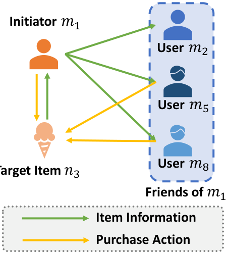
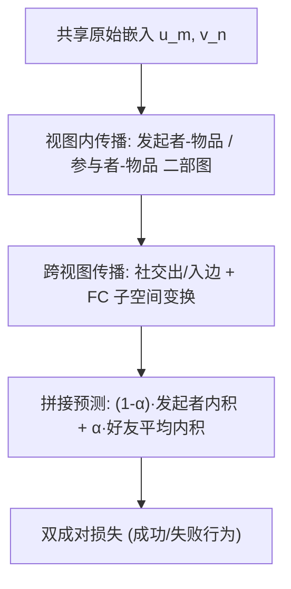
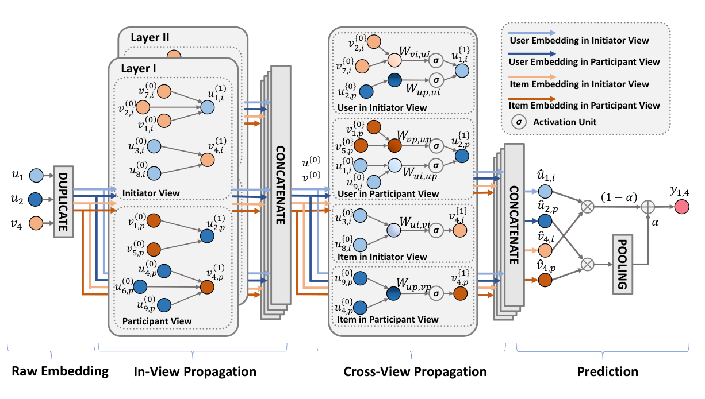

# Group-Buying Recommendation for Social E-Commerce (社交电商团购推荐)

- **会议/期刊**: IEEE International Conference on Data Engineering (ICDE) 2021
- **作者与机构**: Jun Zhang, Chen Gao (通讯), Depeng Jin, Yong Li — 清华大学电子工程系/北京信息科学与技术国家研究中心
- **推荐链路定位**: 召回（发起团购时的商品候选排序）
- **研究方向**: 图神经网络与知识图谱推荐 / 社交与群组推荐
- **论文原文**: [https://arxiv.org/abs/2010.06848v2](https://arxiv.org/abs/2010.06848v2)
- **开源代码**: [https://github.com/Sweetnow/group-buying-recommendation](https://github.com/Sweetnow/group-buying-recommendation)

## TL;DR (1分钟核心速览)

社交电商团购推荐是一个从未被建模的新问题：用户（发起者）分享商品、好友（参与者）加入，人数达阈值才成团，成团概率同时取决于发起者兴趣、好友兴趣与社交影响。本文提出 GBGCN，将"发起-物品""参与-物品""发起者→参与者"组织为三类有向图，用视图内无 FC 传播学角色偏好、跨视图 FC 传播学社交影响，并以双成对损失挖掘失败团购的强负反馈。在贝贝工业数据集、留一法 1:999 采样排序协议下，Recall@K/NDCG@K 相对最优基线提升 2.69%–7.36%（$p<0.05$）。

## Background & Motivation (背景与核心矛盾)

- **主流范式**: 最相关的是社交推荐（SocialMF/DiffNet 等，假设好友趣味同质以正则或图扩散增强用户表征）与组推荐（AGREE/SIGR 等，向预设固定群体推荐一件商品）。
- **前人局限**: ①社交推荐只处理"用户-物品"单一行为，无法刻画"发起 vs 参与"两种动机迥异的角色；②组推荐中群体是固定的（如家庭），而团购群体是从社交网络中**动态采样**出的子集，需推断潜在参与者；③成团与否是多用户偏好的联合函数，普通 BPR 只用一个正样本，无法利用"失败"里蕴含的丰富信号。
- **核心洞察 (Key Insight)**: 一次团购是一组用户对同一商品的联合交互；发起者喜欢但好友不响应的**失败团购**，恰恰暴露了"发起者偏好强、社交影响弱"的细粒度负反馈。
- **本文切入点**: 把多角色、多路交互显式表达为有向异构图，用多视图 GCN 分离建模角色兴趣与社交影响，再设计双成对损失把失败行为蒸馏进训练。

<figure class="paper-figure" markdown="span">
  <figcaption>图1：一名用户发起团购、将目标物品分享给好友并完成团购的过程示意图。</figcaption>
</figure>

## Method (核心方法设计)

### 1. 整体框架 (Overall Architecture)

模型按"原始嵌入 → 视图内传播 → 跨视图传播 → 加权预测"级联。先为用户/商品各初始化一套共享的原始嵌入 $\mathbf{u}_m,\mathbf{v}_n\in\mathbb{R}^d$；视图内层在发起者-物品与参与者-物品两个二部图上分别做 LightGCN 式无 FC 的对称归一化聚合，得到角色专属表示；跨视图层用有向社交边（出边=分享给谁，入边=谁分享给我）做信息交换，并用 FC 将参与者子空间变换到发起者子空间；最后把"发起者-商品"内积与"好友-商品"平均内积按角色系数$\alpha$ 加权输出成团得分。

<figure class="paper-figure" markdown="span">
  <figcaption>图2：我们提出的 GBGCN 模型架构，该模型由原始嵌入层、视图内传播、跨视图传播和预测级联而成。此处以用户1（仅有一个好友用户2）对物品4的预测为例；用户1作为发起者曾与物品1、2、7交互；用户2作为参与者曾与物品1、5交互；物品4曾与作为发起者的用户3、8交互，并与作为参与者的用户4、6、9交互。受篇幅限制，跨视图传播部分中的偏置等细节未展示。（建议彩色查看）</figcaption>
</figure>

### 2. 关键设计拆解 (Key Designs)

1. **有向异构图与视图内传播**：将每条团购记录 $\langle m_i,n,\mathcal{M}^p\rangle$拆成$\mathcal{G}_i$（$m_i\leftrightarrow n$）、$\mathcal{G}_p$（$m^p_j\leftrightarrow n$）与共享边$\mathcal{G}_s$（$m_i\to m^p_j$），避免把两种动机混为一谈。每层传播为
$u^{(l)}_{m,i}=\frac{1}{|\mathcal{N}_i(m)|}\sum_{n'\in\mathcal{N}_i(m)}v^{(l-1)}_{n',i}$，物品侧对称；层间拼接$u^{\{0\}}_{m,i}=u_m\|u^{(1)}_{m,i}\|\cdots\|u^{(L)}_{m,i}$。关键取舍是两视图**共享同一套原始嵌入**，既避免模型容量偏斜，又迫使嵌入同时学到角色共性与差异。

2. **跨视图传播建模社交影响**：视图内只用了自身偏好，跨视图层让用户沿分享边把信息传给参与者、同时聚合参与者的响应，并混入各自交互过的商品：
$u^{\{1\}}_{m,i}=\sigma\Big(\tfrac{1}{|\mathcal{N}_i(m)|}\sum_{n'}{v^{\{0\}}_{n',i}}W_{v_i,u_i}+b\Big)+\sigma\Big(\tfrac{1}{|\mathcal{N}^O_s(m)|}\sum_{m'\in\mathcal{N}^O_s(m)}{u^{\{0\}}_{m',p}}W_{u_p,u_i}+b\Big)$，
参与者侧对称地用入边 $\mathcal{N}^I_s$。用 FC 而非直接相加，是因为社交影响与偏好处于不同子空间，必须先变换再融合。

3. **双成对损失与训练**：标准 BPR 丢弃了失败行为。对失败记录定义
$\mathcal{L}^-(b)=-\ln\mu(y_{m_i n}-y_{m_i n'})-\beta\sum_{m'}S_{mm'}\ln\mu(y_{m'n'}-y_{m'n})$，
即"发起者仍偏好正样本，但其好友应更偏好负样本"；成功记录则为
$\mathcal{L}^+(b)=-\ln\mu(y_{m_i n}-y_{m_i n'})-\sum_{m'\in\mathcal{M}^p}\ln\mu(y_{m'n}-y_{m'n'})$。总损失$\mathcal{L}=\sum_{b\in\mathcal{B}^+}\mathcal{L}^+(b)+\sum_{b\in\mathcal{B}^-}\mathcal{L}^-(b)$，外挂 L2 正则与社交正则。负采样按 1:1 均匀抽取未交互商品，先用 Adam 在去掉传播层的简化版上预训练原始嵌入，再用 SGD 微调，缓解数据稀疏与初始化敏感。

## Experimental Setup & Evaluation Protocol (实验设置与评估协议)

- **数据集与预处理**: 取自母婴电商贝贝（Beibei）生产库，按通用做法过滤低交互用户/商品并做 ID 重映射。

| 数据集 | #Users | #Items | #Interactions | 稀疏度 | 特征/场景说明 |
| :--- | :---: | :---: | :---: | :---: | :--- |
| Beibei | 190,080 | 30,782 | 932,896 次团购行为 | 99.84% 稀疏 | 748,233 条社交边；成功 721,605 / 失败 211,291 |

- **数据划分与防穿越 (Splitting Strategy)**: `Leave-One-Out`，每条用户保留最后一条行为作测试；另从训练集随机抽 1 条作验证集调参。
- **排名评测协议 (Ranking Protocol)**: `Sampled Ranking`——每个测试用户随机采 999 个未交互商品，与 1 个正样本共同排序（正负比 1:999），并指出候选列表长度为 1000，故 K 取 {3,5,10,20}。
- **对比基线与超参设置**: 四类基线共 8 个——CF（MF、NCF、NGCF）、社交（SocialMF、DiffNet）、组推荐（AGREE、SIGR）、团购（GBMF，直觉式"好友平均+加权"矩阵分解）。全部嵌入维度 $d=32$、层数$L=2$、批大小 4096、负采样比 1:1；$\alpha\in[0.1,0.9]$步长 0.1，$\beta\in\{0.01,0.02,0.05,0.1,0.2,0.5\}$，报告$p<0.05$ 的显著性检验结果。

## Key Experimental Results (实验关键数据)

### 1. 主实验对比 (Main Results)

| 类别 | 方法 | Recall@3 | Recall@10 | Recall@20 | NDCG@10 | NDCG@20 |
| :--- | :--- | :---: | :---: | :---: | :---: | :---: |
| CF | MF | 0.1086 | 0.2106 | 0.2886 | 0.1208 | 0.1405 |
| CF | NCF | 0.1231 | 0.2327 | 0.3142 | 0.1351 | 0.1556 |
| CF | NGCF | 0.1171 | 0.2190 | 0.2958 | 0.1284 | 0.1478 |
| 社交 | SocialMF | 0.1135 | 0.2202 | 0.3013 | 0.1268 | 0.1472 |
| 社交 | DiffNet | 0.1249 | 0.2332 | 0.3153 | 0.1366 | 0.1573 |
| 组推荐 | AGREE | 0.1036 | 0.2097 | 0.2806 | 0.1175 | 0.1355 |
| 组推荐 | SIGR | 0.1038 | 0.2034 | 0.2809 | 0.1159 | 0.1354 |
| 团购 | GBMF | 0.1262 | 0.2350 | 0.3141 | 0.1379 | 0.1578 |
| 团购 | **GBGCN** | **0.1341** | **0.2444** | **0.3237** | **0.1456** | **0.1656** |
| — | Improv. | +6.29% | +4.04% | +2.69% | +5.64% | +4.97% |

### 2. 消融实验 (Ablation Study)

| 变体 | Recall@10 | Δ | Recall@20 | Δ | NDCG@10 | Δ |
| :--- | :---: | :---: | :---: | :---: | :---: | :---: |
| GBGCN (完整) | **0.2444** | — | **0.3237** | — | **0.1456** | — |
| w/o Item Roles（双视图物品嵌入均值池化） | 0.2422 | -0.93% | 0.3226 | -0.36% | 0.1439 | -1.17% |
| w/o User Roles（双视图用户嵌入均值池化） | 0.2430 | -0.59% | 0.3218 | -0.59% | 0.1447 | -0.66% |
| w/o User & Item Roles | 0.2408 | -1.49% | 0.3189 | -1.49% | 0.1439 | -1.18% |
| $\beta=0$（退化为标准 BPR） | 0.2401 | -1.76% | — | — | 0.1421 | -2.40% |

### 3. 关键实验发现 (Key Findings)

1. **小 K 增益更大**：GBGCN 相对最优基线 GBMF 的 Recall@3 提升 6.29%、NDCG@3 提升 7.36%，而 Recall@20 仅提升 2.69%，说明多视图角色建模主要在排序头部精判"发起者是否会成团"上起效，这恰是线上首屏展示最关心的区间。
2. **物品角色比用户角色更关键、双视图互补而非冗余**：单独移除物品角色损失 -0.93%（NDCG@10 -1.17%）大于移除用户角色的 -0.59%，而两者同时移除退化到 -1.49%，说明同一商品在"发起视野"与"参与视野"下的属性差异是团购建模的主要矛盾。
3. **失败行为是可蒸馏的强信号，但需加权**：启用双成对损失（$\beta=0.05$最优）使 Recall@10 从 0.2401 升至 0.2444（+1.79%）、NDCG@10 从 0.1421 升至 0.1456（+2.46%），优于标准 BPR；但$\beta$ 过大会因"用户误操作/购后未分享"等噪声导致性能回落，验证了对失败反馈做可信度加权的必要性。

## Highlights & Limitations (亮点、对比与审稿批判)

- **与代表作对比 (vs. Prior Work)**: 相比 SocialMF/DiffNet 只建模社交同质性、无法区分双向行为；相比 AGREE/SIGR 依赖"固定群体+注意力聚合"，无法处理团购中动态、稀疏且角色时变的群体；相比 GBMF 的"直觉式好友得分加权平均"，GBGCN 用有向异构图显式编码分享方向与高阶结构，是首个把该问题形式化并端到端学习的方案。
- **可迁移亮点**: ①双成对损失思想可迁移到任何"多方共同决策"场景（拼团、拼单、协同下单），把"失败"而非仅"成功"转化为训练信号；②"视图内无 FC + 跨视图 FC 子空间变换"的分层传播范式，可复用于多行为/多场景推荐中以抑制表征混淆。
- **审稿级局限批判**: ①**推理效率最差**——GBGCN 测试耗时 88.36 s/epoch，远超 MF（4.75 s）与 NCF（4.47 s），根源是每个用户好友数不一致、破坏批并行度；②评估仅在**单数据集 + 1:999 采样排序**下完成，未验证工业级全库 Full-Ranking 与在线 A/B，而作者也仅在结论中将其列为 future work；③$\alpha$、$\beta$ 依赖验证集网格搜索且对数据分布敏感，缺少自适应设定方案。

## Rating (四维评分)

- **方法创新性 (Novelty)**: ⭐⭐⭐⭐ （首次形式化团购推荐问题，双视图有向异构图 + 双成对损失组合自然，但单点 GCN 算子属增量式改进）
- **评估协议与实验扎实度 (Protocol & Experiments)**: ⭐⭐⭐ （消融/效率/超参/嵌入可视化齐全且显著性检验达标，但仅单数据集、采样排序而非全库排序、缺线上验证）
- **写作与数学规范度 (Clarity & Rigor)**: ⭐⭐⭐⭐ （符号表完整、式 1–12 推导链条清晰、复杂度与效率实测并列，跨视图子空间变换的动机解释充分）
- **工业落地与复现价值 (Industrial & Practical Value)**: ⭐⭐⭐⭐ （代码与工业数据集全部开源，问题定义贴近拼多多/贝贝真实业务，但推理开销与调参成本限制了大规模部署）

