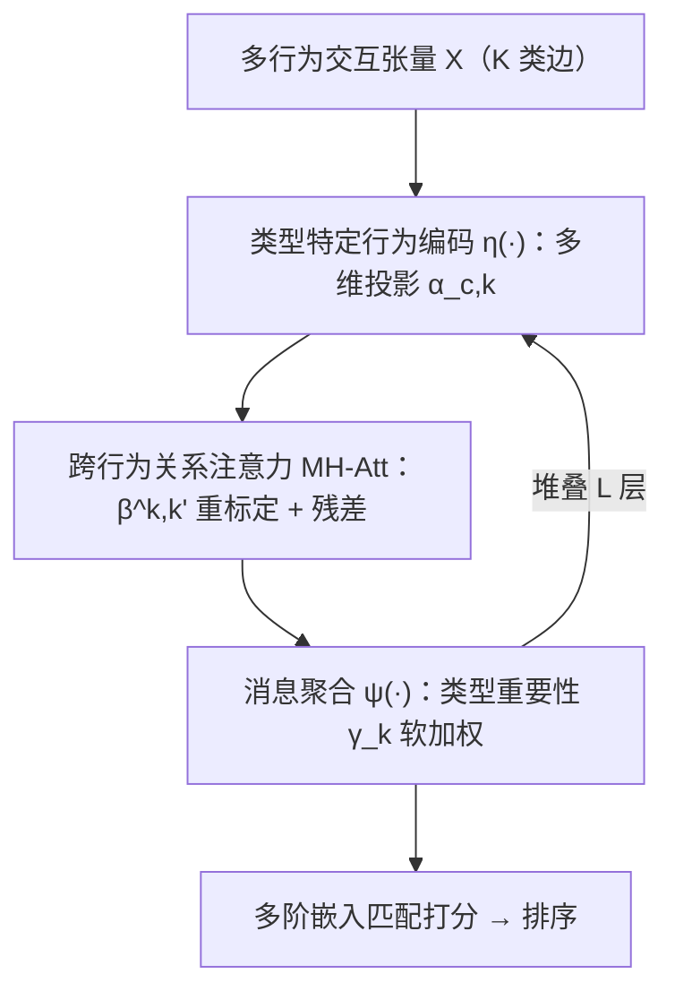

# Multi-Behavior Enhanced Recommendation with Cross-Interaction Collaborative Relation Modeling (跨交互协同关系建模的多行为增强推荐)

- **会议/期刊**: ICDE 2021
- **作者与机构**: Lianghao Xia, Chao Huang, Yong Xu, Peng Dai, Mengyin Lu, Liefeng Bo（华南理工大学、京东金融美国）
- **推荐链路定位**: 召回/排序（图嵌入传播式全候选打分）
- **研究方向**: 图神经网络与知识图谱推荐 / 跨域与多场景推荐
- **论文原文**: [https://arxiv.org/abs/2201.02307v1](https://arxiv.org/abs/2201.02307v1)
- **开源代码**: [https://github.com/akaxlh/GNMR](https://github.com/akaxlh/GNMR)

## TL;DR (1分钟核心速览)

现有深度推荐几乎只建模单一类型交互（如评分），无法蒸馏浏览/加购/收藏/购买等异构行为间的互补信号，且已有做法（NMTR 级联多任务、DIPN 注意力 RNN）都丢掉高阶协同关系。GNMR 把多行为交互张量拆成 K 张子图，在消息传播中先用"类型特定多维投影"编码各行为语义，再用多头注意力在**行为类型之间**做关系重标定与软加权融合。在 ML10M/Yelp/Taobao 上按正负 1:99 采样排序协议评估，HR@10 相对最优基线提升 4.6%–27.7%。

## Background & Motivation (背景与核心矛盾)

- **主流范式**: 以 NCF/AutoRec/CDAE 为代表的神经 CF，把用户-物品交互压成单一关系建模；图侧代表 NGCF 通过邻域传播捕获高阶协同信号。
- **前人局限**: ① 多行为被"拍平"为同一张图，行为语义（浏览 vs 购买）在传播中被不可逆地混同；② NMTR 用级联多任务、DIPN 用 RNN 注意力，只在浅层建立行为关联，无法利用高阶跨类型协同。
- **核心洞察 (Key Insight)**: 不同类型行为之间存在隐式依赖（浏览常先于购买），这种依赖既需在**边消息编码阶段**保留类型语义，也需在**类型之间**做可学习的关系建模，而非简单拼接或级联。
- **本文切入点**: 把"类型特定编码"与"跨类型关系注意力"嵌入同一套图传播算子，逐层递归。

## Method (核心方法设计)

### 1. 整体框架 (Overall Architecture)

输入为三阶交互张量 $\mathbf{X}\in\mathbb{R}^{I\times J\times K}$（K 种行为），先用自编码器预训练得到 0 阶用户/物品嵌入$\mathbf{H}^{(0)}$。每层传播分三级：**类型特定行为编码层**按行为$k$从其$k$-子图邻居聚合消息；**跨行为关系注意力**（MH-Att）在 K 个类型表示之间做多头 relevance 重标定并加残差保留原始语义；**消息聚合层**用前馈网络生成类型重要性权重$\hat{\gamma}_k$做软融合，得到$\mathbf{H}^{(l+1)}$。堆叠 L 层后用多阶嵌入匹配打分（含对各层表示的点积求和），BPR 式成对损失 + Adam 端到端训练，推理时对候选物品全量打分排序。

### 2. 关键设计拆解 (Key Designs)

1. **类型特定行为编码 (Type-specific Behavior Embedding)**：若直接用共享权重的 GCN 聚合，浏览与购买消息会被压成同一分布。GNMR 引入 C 个潜在维度的软记忆投影，用邻居消息自身决定各维度权重：$\alpha_{c,k}=\delta(\sum_{j\in\mathcal{N}(i,k)}\mathbf{W}_1\mathbf{H}^{k,(l)}_j+\mathbf{b}_1)^{(c)}$，再$\eta(\cdot)=\sum_{c=1}^{C}\alpha_{c,k}\mathbf{W}_{2,c}\sum_{j\in\mathcal{N}(i,k)}\mathbf{H}^{k,(l)}_j$。直觉：不同类型行为的"频次/强度"上下文被压缩为 C 维系数，起到行为专属门控的作用，避免异构边互相污染。
2. **跨行为关系注意力 (Cross-type Relation Attention)**：行为依赖是双向且非对称的（购买暗示高兴趣，浏览则不然），故引入 Q/K 在类型间建模：$\beta^{s}_{k,k'}=\frac{(\mathbf{Q}_s\mathbf{H}^{k}_i)^{\top}(\mathbf{K}_s\mathbf{H}^{k'}_i)}{\sqrt{d/S}}$，softmax 后在 S 个子空间拼接$\sum_{k'}\beta^{s}_{k,k'}\mathbf{V}_s\mathbf{H}^{k'}_i$，并与原表示逐元素残差相加$\hat{\mathbf{H}}^{k}=\tilde{\mathbf{H}}^{k}\oplus\mathbf{H}^{k}$。多头子空间让"哪些辅助行为对目标行为有用"可被数据驱动地挑选，残差则防止辅助信号淹没目标行为语义。
3. **训练目标、负采样与推理效率**：类型融合权重由 $\gamma_k=\mathbf{w}_2^{\top}\delta(\mathbf{W}_3\hat{\mathbf{H}}^{k}_i+\mathbf{b}_2)+b_3$、$\hat{\gamma}_k=\text{softmax}(\gamma_k)$给出，$\mathbf{H}^{(l+1)}_i=\sum_{k}\hat{\gamma}_k\hat{\mathbf{H}}^{k}_i$。总损失为成对 hinge：$\mathcal{L}=\sum_{i}\sum_{s}\max(0,1-\hat{r}_{i,p_s}+\hat{r}_{i,n_s})+\lambda\|\Theta\|_F^2$，每用户采样$S$正$S$ 负（均匀随机）；无额外负采样网络，训练开销集中在 K 倍子图稀疏矩阵乘，推理为 L 层稀疏传播 + 内积，在线可用预计算嵌入。

## Experimental Setup & Evaluation Protocol (实验设置与评估协议)

- **数据集与预处理**:

| 数据集 | #Users | #Items | #Interactions | 稀疏度/密度 | 特征/场景说明 |
| :--- | :---: | :---: | :---: | :---: | :--- |
| Yelp | 19,800 | 22,734 | 1.4×10⁶ | 0.31% | 行为：Tip / Dislike / Neutral / Like（评分为 3 段离散化） |
| ML10M | 67,788 | 8,704 | 9.9×10⁶ | 0.17% | 行为：$r\le2$差评、$2<r<4$中立、$r>4$ 好评 |
| Taobao | 147,894 | 99,037 | 7.6×10⁶ | 0.05% | 行为：Page View / Favorite / Cart / Purchase |

- **数据划分与防穿越 (Splitting Strategy)**: 原文未显式声明划分细节，按代码与评测形式推断为**每用户留一（Leave-One-Out）**式正样本 + 随机负采样，目标行为统一为"Like/Purchase"。
- **排名评测协议 (Ranking Protocol)**: **Sampled Ranking**——每个正样本配 **99 个用户未交互负样本**（1:99），指标 HR@N 与 NDCG@N，主表 N=10，另在 Yelp 上扫描 N∈{1,3,5,7,9}。
- **对比基线与超参设置**: 基线覆盖 MF 系（BiasMF、DMF）、神经 CF 系（NCF-M/G/N、AutoRec、CDAE、NADE、CF-UIcA）、图系（NGCF）、多行为系（NMTR、DIPN）。嵌入维度 $d=16$，记忆潜维$C=8$，batch=32，学习率 1e-3，衰减 0.96，TensorFlow + Adam。

## Key Experimental Results (实验关键数据)

### 1. 主实验对比 (Main Results)

| Model | ML10M HR@10 | ML10M NDCG@10 | Yelp HR@10 | Yelp NDCG@10 | Taobao HR@10 | Taobao NDCG@10 |
| :--- | :---: | :---: | :---: | :---: | :---: | :---: |
| BiasMF | 0.767 | 0.490 | 0.755 | 0.481 | 0.262 | 0.153 |
| NCF-N | 0.801 | 0.518 | 0.771 | 0.500 | 0.325 | 0.201 |
| CDAE | 0.659 | 0.392 | 0.750 | 0.462 | 0.329 | 0.196 |
| NGCF | 0.790 | 0.508 | 0.789 | 0.500 | 0.302 | 0.185 |
| NMTR | 0.808 | 0.531 | 0.790 | 0.478 | 0.332 | 0.179 |
| DIPN | 0.791 | 0.500 | 0.811 | 0.540 | 0.317 | 0.178 |
| **GNMR** | **0.857** | **0.575** | **0.848** | **0.559** | **0.424** | **0.249** |
| Improv. | +6.06% | +8.28% | +4.56% | +3.52% | +27.7% | +23.9% |

（Improv. 取相对各自最优基线的 HR/NDCG 提升：ML 对 NMTR，Yelp 对 DIPN，Taobao 对 NMTR/CF-UIcA。）

### 2. 消融实验 (Ablation Study)

| 变体 | ML10M HR@10 | ML10M NDCG@10 | Yelp HR@10 | Yelp NDCG@10 | 说明 |
| :--- | :---: | :---: | :---: | :---: | :--- |
| GNMR | **0.857** | **0.575** | **0.848** | **0.559** | 完整模型 |
| w/o 类型特定编码 (GNMR-be) | 下降 | 下降 | 下降 | 下降 | 去掉 Eq.2 多维投影，各行为共享聚合 |
| w/o 关系聚合 (GNMR-ma) | 下降更多 | 下降更多 | 下降更多 | 下降更多 | 去掉跨行为 MH-Att 依赖建模 |
| w/o dislike | 0.834 | 0.549 | 0.833 | 0.542 | 移除一类辅助行为 |
| w/o neutral | 0.816 | 0.532 | 0.831 | 0.532 | 移除一类辅助行为 |
| only like（仅目标行为） | 0.835 | 0.559 | 0.821 | 0.527 | 退化为单行为图 CF |

### 3. 关键实验发现 (Key Findings)

1. **辅助行为的边际收益在稀疏数据上被放大**：ML10M 上 GNMR 相对 NMTR 提升 6.06%/8.28%，而在密度仅 0.05% 的 Taobao 上提升达 27.7%/23.9%——多行为子图实质是给稀疏目标行为补了额外的协同边，稀疏场景收益最大。
2. **"跨类型关系"比"类型内编码"更关键**：移除关系聚合（GNMR-ma）的掉点明显大于移除类型特定投影（GNMR-be），说明行为语义的融合方式（注意力软选择）而非单纯区分，才是性能主要来源；`only like` 变体在两数据集分别掉至 0.835/0.821 HR，也印证辅助行为整体不可替代。
3. **传播深度 2–3 层即饱和**：以 GNMR-2 为基准，GNMR-2/-3 优于 GNMR-1（1 层高阶协同不足），继续加深则因引入噪声而下降——多行为图本身已含大量异构边，过深传播会放大行为间噪声。

## Highlights & Limitations (亮点、对比与审稿批判)

- **与代表作对比 (vs. Prior Work)**: 与 NGCF 的本质区别是把单一邻接矩阵拆为 K 张行为子图并做**类型间注意力**（NGCF 无行为概念，Taobao 上仅 0.302 HR，远低于 GNMR 的 0.424）；与 NMTR 的区别是从"多任务级联预测"转为"嵌入空间的跨类型关系重标定"，不再受任务顺序与浅层共享限制；与 DIPN 的区别是不依赖行为序列顺序，而用图上的高阶协同替代 RNN 注意力。
- **可迁移亮点**: ① "C 维软记忆系数 + 分类型权重矩阵"的行为门控可直接移植到多场景/多业务图（如 STAR、PEPNet 的子网思路）；② 类型间 Q/K 注意力 + 残差的可学习关系矩阵，可推广到社交关系类型或知识图谱多种边类型的融合。
- **审稿级局限批判**: ① 评估采用 1:99 采样排序，HR@10 高达 0.857 存在明显乐观偏差，缺少 Full-Ranking 与显著性检验；② 传播需按 K 张子图分别做稀疏矩阵乘，Taobao 上 14.7 万用户 × 4 行为的显存/时延开销未见报告，且 K、C、层数、注意力头数等超参敏感度分析缺失。

## Rating (四维评分)

- **方法创新性 (Novelty)**: ⭐⭐⭐⭐ （把行为异质性显式拆成"类型内编码 + 类型间注意力"两级算子，思路清晰但整体仍是 NGCF 式传播框架的扩展，理论分析偏弱）
- **评估协议与实验扎实度 (Protocol & Experiments)**: ⭐⭐⭐ （三数据集 + 行为组合消融 + 深度分析较完整，但 1:99 采样排序、缺 Full-Ranking 与显著性检验削弱说服力）
- **写作与数学规范度 (Clarity & Rigor)**: ⭐⭐⭐⭐ （公式与三级模块对应明确，符号统一；部分算子（如多阶匹配打分）细节留白，缺少复杂度分析）
- **工业落地与复现价值 (Industrial & Practical Value)**: ⭐⭐⭐⭐ （代码开源、TensorFlow 实现清晰，K 子图传播可预计算，适合电商多行为场景，但大规模图上的训练成本需评估）

