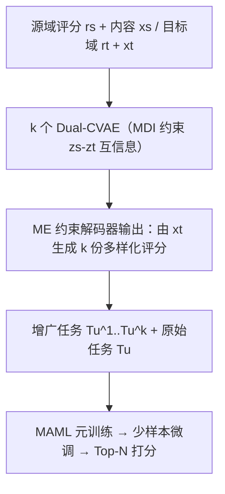
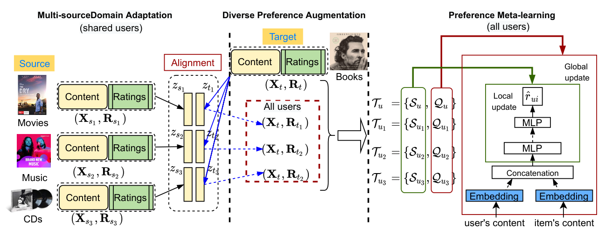
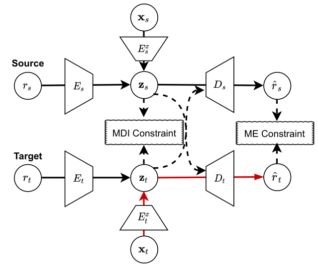

# Diverse Preference Augmentation with Multiple Domains for Cold-start Recommendations (多源域多样化偏好增广的冷启动推荐)

- **会议/期刊**: ICDE 2022
- **作者与机构**: Yan Zhang, Changyu Li, Hui Xu, Lixin Duan, Wen Li, Jie Shao (电子科技大学)；Ivor W. Tsang (UTS AAII / A*STAR CFAR)；Hongzhi Yin (昆士兰大学)
- **推荐链路定位**: 召回（冷启动场景下的 Top-N 偏好预测）
- **研究方向**: 冷启动与长尾推荐 / 跨域与多场景推荐
- **论文原文**: [https://arxiv.org/abs/2204.00327v1](https://arxiv.org/abs/2204.00327v1)
- **开源代码**: 暂未开源

## TL;DR (1分钟核心速览)

现有元学习推荐（MeLU/MetaCF）把"用户偏好"当任务做 MAML，但在极稀疏交互上极易元过拟合；跨域方法又受限于域间共享用户过少（Amazon Books 与 Electronics 仅共享约 5% 用户）。本文提出 MetaDPA：用 k 个 Dual-CVAE 从 k 个源域适配到目标域，在隐表征上加 **MDI**（多域 InfoMax）保留域共享+域特有偏好，在解码器输出上加 **ME**（互斥/多样化）约束，从而仅凭目标域**内容**即可生成 k 份互不相同的评分，与真实评分一起送入 MAML 元训练。在 Amazon Books/CDs 的 1:99 采样排序协议下，C-I 场景 NDCG@10 相对最优基线提升 23.6%/40.7%。

## Background & Motivation (背景与核心矛盾)

- **主流范式**: 三条路线并行——内容感知推荐（CoNN、DAML 用评论/画像补表征）、跨域迁移（TDAR、CATN、CMF/MCF）以及元学习推荐（MeLU、MetaCF 用 MAML 学偏好先验以便几步微调）。
- **前人局限 (1)**: 内容感知方法存在**内容-偏好不一致**——同画像用户对同物品打分不同、同内容物品被同一用户打不同分，仅靠内容对齐无法消除该 gap。
- **前人局限 (2)**: 跨域/多源方法的知识迁移能力被**共享用户比例**硬约束（Books–Electronics 仅 5%），且部分多源方法只能服务共享用户；而元学习方法则在稀疏评分上**元过拟合**（MeLU 在 CDs 上几乎全面崩盘）。
- **核心洞察 (Key Insight)**: meta-augmentation 通过在标签 $y$上加噪而不改输入$x$来避免两类过拟合（记忆型过拟合与元学习器过拟合），其本质是把"非互斥任务集"转为"互斥任务集"。但严格互斥（同一$x$的全部标签两两不同）在评分任务上不可得，且每次迭代校验需$O(k^2)$ 操作。
- **本文切入点**: 松弛严格互斥为"多样化"——用 k 个源域的解码器对同一目标域内容 $x_t$ 生成 k 份**连续评分**作为增广标签，把"加噪增广"换成"偏好增广"，且只要能拿到内容，冷启动用户/物品也能被增广。

## Method (核心方法设计)

### 1. 整体框架 (Overall Architecture)

MetaDPA 三段式：①**多源域适配**——对每个源域 $s_j$与目标域$t$训一个 Dual-CVAE（共享用户为桥），编码评分与内容得隐变量$z_s,z_t$，加 MDI 约束最大化互信息、加交叉重构损失对齐；②**多样化偏好增广**——丢弃评分侧编码器，只用学到的目标域内容编码器$E_t^{x}$与 k 个解码器$D_t^{j}$，由内容$x_t$前向生成 k 份评分$\hat{r}_t^{1..k}$，ME 约束保证彼此不同；③**偏好元学习**——把$T_u=(c_t,r_t)$与$T_u^j=(c_t,\hat r_t^j)$ 一并作为元训练任务，用 MAML 学一个能在少量真实评分上快速微调的偏好模型（MLP 打分）。

<figure class="paper-figure" markdown="span">
  <figcaption>图2. 基于元学习的多源域多样化偏好增强框架（MetaDPA）包含三个模块：多源域适应、多样化偏好增强和偏好元学习。首先训练多源域适应框架；然后根据内容数据为目标域生成多样化评分；最后基于元学习优化框架MAML学习构建为多层架构的偏好模型。</figcaption>
</figure>

### 2. 关键设计拆解 (Key Designs)

1. **MDI：多域 InfoMax 约束（保住域特有信号）**：常规域适配只做交叉重构，易把隐空间压成"仅共享"的表示，生成评分趋于同质。本文在隐表征上追加 $\mathcal{L}_{\text{MDI}}(\phi_s,\phi_t)=-I_{\phi_s,\phi_t}(z_s,z_t)$，与交叉重构$\mathcal{L}_{\text{Rec}}$（用$z_t$重构$r_s$、用$z_s$重构$r_t$）联合：前者保留域特有可分信息，后者保证跨域可迁移。直觉是"互信息最大化 = 不丢弃任何对评分预测有用的域内信息"，从而 k 个解码器天然带不同偏好偏置。

<figure class="paper-figure" markdown="span">
  <figcaption>图1. 基于Dual-CVAE的跨域适应框架。对潜在表示 zs 和 zt 施加MDI约束；对两个解码器 Ds 和 Dt 的输出施加ME约束。给定评分 rs、rt 和内容数据 xs、xt，Dual-CVAE的目标是学习领域共享与领域特定的偏好信息，然后通过 k 个Dual-CVAE的解码器生成多样化评分。</figcaption>
</figure>

2. **ME：互斥→多样化约束（把标签增广变成偏好增广）**：由于目标域解码器都对齐到同一 $x_t$，k 份生成评分本会高度相似，增广失效。作者对两个解码器输出$r_s,r_t$的互信息做**最小化**（以 InfoNCE 实现）$\mathcal{L}_{\text{ME}}=-I(r_s,r_t)$，迫使同一内容在不同源域视角下给出不同评分；并把严格互斥松弛为带权约束（权重$\beta_2$），绕开$O(k^2)$ 的逐对校验。这样"多样化样本"替代"互斥样本"，既避免记忆型过拟合，又避免学习器在少数任务上过拟合。

3. **训练目标、负采样与推理开销**：单源适配目标为
$\mathcal{L}_{\text{Dual-CVAE}}=\mathcal{L}_{\text{ELBO}}+\mathcal{L}_{\text{MSE}}+\mathcal{L}_{\text{Rec}}+\beta_1\mathcal{L}_{\text{MDI}}+\beta_2\mathcal{L}_{\text{ME}}$，k 个源域并行独立训练；元学习层沿用 MAML 双层目标$\min_\theta\sum_{T_u\sim\mathcal{T}_{tr}} L_{T_u}(\theta-\alpha\nabla_\theta L_{T_u}(\theta,S_u),Q_u)$，增广任务只进元训练集，元测试集仅保留真实任务（防止信息泄漏）。元学习器为 2 层 MLP + 内容嵌入层，无负采样模块（隐式反馈用 BCE）。复杂度$O(B(l+m))$，仅第一段随数据线性增长，增广与元学习段为常数时间。

## Experimental Setup & Evaluation Protocol (实验设置与评估协议)

- **数据集与预处理**（Amazon 子集；评分 >0 视为正反馈，其余为 0；源域适配阶段丢弃正评少于 20 的用户/物品）：

| 数据集 | #Users | #Items | #Interactions | 稀疏度 | 特征/场景说明 |
| :--- | :---: | :---: | :---: | :---: | :--- |
| Electronics (源) | 28,505 (与 Books 共享) | 6,260 | 63,001 | 99.98% | 源域 $S_1$ |
| Movies (源) | 37,387 (与 Books 共享) | 18,031 | 50,052 | 99.97% | 源域 $S_2$ |
| Music (源) | 1,952 (与 Books 共享) | 5,331 | 64,705 | 99.67% | 源域 $S_3$ |
| Books (目标) | 603,374 | 348,957 | 8,575,000 | 99.99% | 目标域 $T_1$ |
| CDs (目标) | 25,400 | 24,904 | 43,903 | 99.99% | 目标域 $T_2$ |

- **数据划分与防穿越**: 域适配阶段按 **80%/20% 比例划分**训练/评估；推荐阶段用 **Leave-One-Out** 式任务划分（每任务分 support/query 两集合）；冷启动定义严格按交互数阈值——existing user/item 为 $\ge 5$ 条评分，否则为 new；评测四场景：`Warm-start`(Ue×Ie)、`C-U`(Un×Ie)、`C-I`(Ue×In)、`C-UI`(Un×In)。冷启动测试前只允许用 support set 微调，query set 才计分。
- **排名评测协议**: **Sampled Ranking** —— 每个正样本采样 **99 个未观测负样本**（正负比 1:99），报告 HR@10、MRR@10、NDCG@10、AUC；显著性用单侧 Wilcoxon signed-rank（30 次独立重划分），全部指标 $p<0.05$（多数$p\approx5.96\times10^{-8}$）。
- **对比基线与超参**: 7 个基线覆盖四类——CF（NeuMF）、内容感知（CoNN、DAML）、跨域（TDAR、CATN）、元学习（MeLU、MetaCF）；$\beta_1=0.1,\ \beta_2=1$（Books/CDs 相同，网格$\{10^{-2},10^{-1},1,10,10^{2}\}^{\otimes2}$ 搜索），batch size 32。

## Key Experimental Results (实验关键数据)

### 1. 主实验对比 (Main Results)

NDCG@10（其余指标见原文 Table III；**粗体=最优**，`Improv.` 为相对最强基线的提升）：

| 模型 | Books C-U | Books C-I | Books C-UI | Books Warm | CDs C-U | CDs C-I | CDs C-UI | CDs Warm |
| :--- | :---: | :---: | :---: | :---: | :---: | :---: | :---: | :---: |
| NeuMF | 0.0515 | 0.0536 | 0.0408 | 0.0616 | 0.0478 | 0.0589 | 0.0568 | 0.0512 |
| MeLU | 0.0834 | 0.0891 | 0.0872 | 0.1059 | 0.0617 | 0.0616 | 0.0480 | 0.0696 |
| MetaCF | 0.1014 | 0.0807 | 0.0644 | 0.1070 | 0.0979 | 0.1252 | 0.1104 | 0.1859 |
| CoNN | 0.0683 | 0.0716 | 0.0404 | 0.0813 | 0.0813 | 0.0932 | 0.0776 | 0.0940 |
| DAML | 0.0860 | 0.0839 | 0.0590 | 0.1000 | 0.0886 | 0.1030 | 0.0774 | 0.0995 |
| TDAR | 0.0298 | 0.0556 | 0.0504 | 0.1219 | 0.0748 | 0.0688 | 0.1016 | 0.0722 |
| CATN | 0.0500 | 0.0581 | 0.0579 | 0.0610 | 0.0585 | 0.0539 | 0.0451 | 0.0684 |
| **MetaDPA** | **0.1042** | **0.1101** | **0.0971** | **0.1396** | **0.1660** | **0.1762** | **0.1407** | **0.2187** |
| Improv. | +2.8% | +23.6% | +11.4% | +14.5% | +69.6% | +40.7% | +27.4% | +17.6% |

### 2. 消融实验 (Ablation Study)

原文以 Fig.5（CDs 四场景 NDCG@k 曲线）呈现，未给表格数值，此处按原图趋势整理（同场景内排序）：

| 变体 | 保留约束 | Books / CDs 表现 | 结论 |
| :--- | :---: | :--- | :--- |
| MetaDPA | MDI + ME | 最优（$k$=5→30 全程领先） | 两约束互补 |
| MetaDPA-MDI | 仅 MDI | 次优，明显下降 | 生成评分过于贴近真值、多样性不足 |
| MetaDPA-ME | 仅 ME | 最差（低于上述两者） | 多样性有余但语义失真，给元训练引入无用偏置 |
| MeLU / MetaCF 等 | — | 均低于两个消融变体 | Dual-CVAE 本身即带来基础增益 |

### 3. 关键实验发现 (Key Findings)

1. **增广而非迁移是主要收益来源**：去掉 ME（MetaDPA-MDI）即掉到次优、去掉 MDI 掉到最差，说明"多样性"与"域特有信息保留"缺一不可；但两变体仍强于 MeLU，证明 Dual-CVAE 提供了"弱但足够"的域适配底座。
2. **稀疏度越极端，增益越大**：CDs 密度与 Books 相近（均 99.99%）但交互量仅为其 1/200，MetaDPA 在 CDs 上 C-U 提升达 69.6%，而在信息较足的 Books C-U 仅 +2.8%（且 HR@10/AUC 仍为次优），说明方法主要在"元过拟合最严重"的场景释放价值。
3. **超参敏感度不对称**：$\beta_1$（MDI）显著比$\beta_2$（ME）敏感——MDI 同时影响域适配与生成，ME 只影响生成；且 Warm-start 比冷启动更敏感，因冷启动前经过少样本微调，泛化已被"磨平"。

## Highlights & Limitations (亮点、对比与审稿批判)

- **与代表作对比**: 相比 TDAR/CATN 的"表征对齐式迁移"，本文迁移的是**可解码成评分的生成能力**，不受共享用户比例直接限制；相比 MeLU/MetaCF 的"加噪/子图采样式增广"，本文增广的是**标签分布本身（k 份多样化评分）**，且严格互斥被松弛为可优化的多样化约束，训练效率远高于 MetaCF 的潜在交互扩充。
- **可迁移亮点**: ①"内容→评分"的 CVAE 解码路径，使**完全无评分**的新用户/新物品也能被增广，可直接套用到冷启动召回的数据增广；②把 multi-view 的互信息最小化当作"多样性正则"，可用于任何多源/多视图集成的推荐增广。
- **审稿级局限批判**: ①评测仅用 **1:99 采样排序**，未给 Full-Ranking 结果，且负样本为均匀采样、无流行度校正，绝对数值可比性弱；②k 与 $\beta_1,\beta_2$需网格搜索，且需为每个源域独立训练一个 Dual-CVAE，源域数增多时训练与存储开销线性上升；③生成评分虽在$[0,1]$，但语义可信度缺乏人工/分布层面校验，"多样化"与"噪声"的边界只靠下游指标间接验证。

## Rating (四维评分)

- **方法创新性 (Novelty)**: ⭐⭐⭐⭐ （把 meta-augmentation 的"标签加噪"重构为"多源域解码器生成多样化评分"，并用 MDI/ME 两个互信息约束把共享性与多样性显式解耦，思路清晰且有理论动机支撑）
- **评估协议与实验扎实度 (Protocol & Experiments)**: ⭐⭐⭐ （四种冷启动设定划分严谨、7 个跨四类基线 + Wilcoxon 检验到位，但仅采样排序评估、消融只给曲线无表格数值、无 Full-Ranking 与线上验证）
- **写作与数学规范度 (Clarity & Rigor)**: ⭐⭐⭐⭐ （三段式结构与公式编号清楚，互斥/多样化定义交代充分，复杂度分析到位；但 Eq.3–4 符号 $u_s$/$z_t$/$x_t$ 混用略乱）
- **工业落地与复现价值 (Industrial & Practical Value)**: ⭐⭐⭐ （复杂度线性、增广段常数开销，适合冷启动冷启池预热；但需多源域数据与逐域训练、无开源代码、超参对数据敏感，落地需重调）

