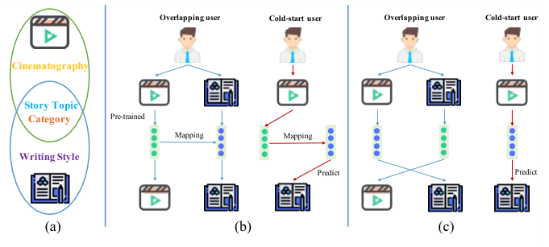
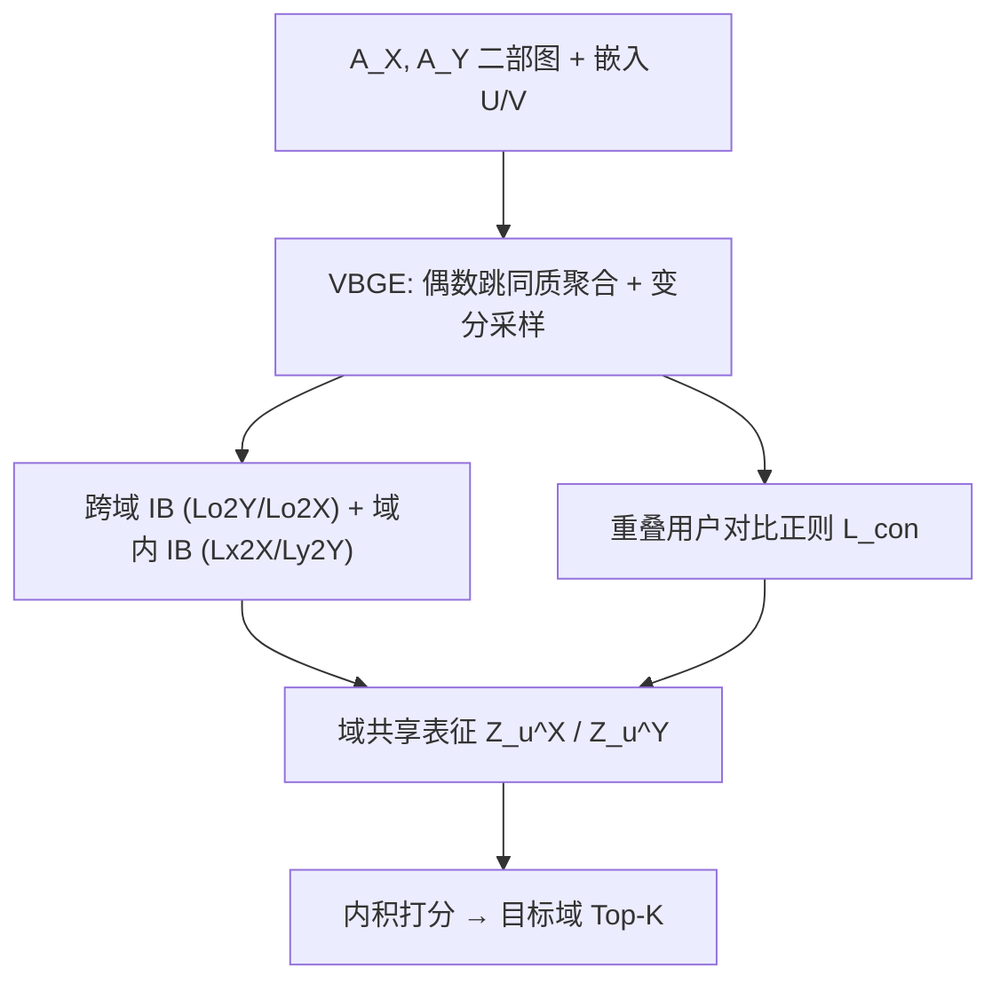

# Cross-Domain Recommendation to Cold-Start Users via Variational Information Bottleneck (基于变分信息瓶颈的冷启动用户跨域推荐)

- **会议/期刊**: ICDE 2022
- **作者与机构**: Jiangxia Cao, Jiawei Sheng, Xin Cong, Tingwen Liu (中科院信息工程研究所/UCAS), Bin Wang (小米 AI Lab)
- **推荐链路定位**: 召回（冷启动用户跨域表征生成 + 内积打分）
- **研究方向**: 跨域与多场景推荐 / 冷启动与长尾推荐
- **论文原文**: [https://arxiv.org/abs/2203.16863v1](https://arxiv.org/abs/2203.16863v1)
- **开源代码**: [https://github.com/cjx96/CDRIB](https://github.com/cjx96/CDRIB)

## TL;DR (1分钟核心速览)

本文针对 EMCDR 类跨域冷启动推荐的痛点：源/目标域表征各自独立预训练，必然混入域特有信息，映射函数学到的是"有偏表征→有偏表征"的错位对齐，造成负迁移。作者提出 CDRIB，把信息瓶颈（IB）原则引入跨域推荐：用变分二分图编码器（VBGE）生成高斯隐变量，并以跨域 IB $I(Z_u^{xo},Z_v^{Y};Y)$、域内 IB 与重叠用户对比正则三类约束，强迫表征只保留"域共享"信息，从而无需映射即可直接在目标域打分。在 4 组 Amazon 双向场景、留一法 + 999 负采样排序协议下，MRR 平均提升 34.38%。

## Background & Motivation (背景与核心矛盾)

- **主流范式**: EMCDR 两阶段流水线——先分域预训练 CF 表征（CML/BPRMF/NGCF/VBGE），再用 MLP 或元学习（TMCDR）、V AE（SA-VAE）学一个跨域映射函数，把重叠用户表征从源域"翻译"到目标域。
- **前人局限**: ① 两域交互从不同时参与优化，预训练表征被域特有信息（如电影的"摄影 Cinematography"、书的"写作风格 Writing Style"）污染，映射函数在冷启动用户上直接放大负迁移；② 映射函数表达力有限，Phone、Game 等交互稀疏域上 EMCDR 甚至不如单域方法（如 Phone 域 EMCDR(NGCF) MRR 6.93 < PPGN 8.07 量级）。
- **核心洞察 (Key Insight)**: CDR 的真正问题是"**跨域应该共享什么信息**"。若把跨域交互与域内交互同时纳入一个联合目标，并用 IB 的"最小充分统计量"约束——压缩对源域输入 $X_u$的依赖、保留对目标域交互$Y$ 的重构能力——则可自动剥离域特有信息。
- **本文切入点**: 以变分推断（重参数化 + KL 上界 + 重构下界）使 IB 可端到端训练，形成"联合编码 + 免映射"的单阶段框架（图 1(c) 对比图 1(b) 的流水线）。

<figure class="paper-figure" markdown="span">
  <figcaption>图 1：(a) Film 和 Book 领域中偏好的一个示例。(b) 基于 EMCDR 的方法通过预训练/映射嵌入的流程框架。(c) 我们的 CDRIB 通过联合学习跨域嵌入的联合框架。在 CDR 中，重叠用户桥接两个领域，而我们的任务是为冷启动用户进行推荐。</figcaption>
</figure>

## Method (核心方法设计)

### 1. 整体框架 (Overall Architecture)

CDRIB 为每个域配一个 VBGE。输入为用户/物品嵌入矩阵与二部图邻接矩阵 $A_X,A_Y$；VBGE 先借$(A_X)^\top$聚合偶数跳同质邻居得到临时表征，再经变分头采样出用户/物品隐变量$Z_u^X,Z_v^X$（同理$Z_u^Y,Z_v^Y$）。随后三类正则同时作用：跨域 IB 让$Z_u^{xo}$（重叠用户）与$Z_v^Y$共同重构目标域交互、域内 IB 让$Z_u^{x}$（非重叠/冷启动用户）与$Z_v^X$重构本域交互、对比正则对齐两域重叠用户表征。推理阶段冷启动用户只需把源域学到的$z_u^{x}$ 与目标域物品表征做内积排序，无需任何映射网络。

### 2. 关键设计拆解 (Key Designs)

1. **变分二分图编码器 VBGE（让用户聚合到同质用户，而非只聚合物品）**：传统 GCN 在二部图上只能 1 跳聚合异质邻居，用户-用户同质性被丢失。VBGE 第一步用转置邻接矩阵构造临时表征 $\hat{U}_X=\delta(\mathrm{Norm}((A_X)^\top)U_X W_u^X)$，第二步再前向聚合出$\mu_u^X,\sigma_u^X$并采样$z_{u_i}^X=\mu_{u_i}^X+\sigma_{u_i}^X\odot\epsilon,\ \epsilon\sim\mathcal{N}(0,\mathrm{diag}(I))$。这样 2 跳同质信息被显式编码，同时方差项天然给出 IB 所需的随机性。

2. **跨域/域内双重信息瓶颈正则（去偏核心）**：以源域用户预测目标域交互为例，$\mathcal{L}^{o2Y}=\underbrace{\beta_1 I(Z_u^{xo};X_u)+\beta_2 I(Z_v^{Y};Y_v)}_{\text{Minimality}}-\underbrace{I(Z_u^{xo},Z_v^{Y};Y)}_{\text{Reconstruction}}$。前两项以$\mathrm{KL}(q_\phi(Z|X)\Vert\mathcal{N}(0,I))$上界实现"遗忘"域特有信息，后一项以 BPR 式对数似然（sigmoid 内积 + 负样本）下界实现"保留"跨域可预测性；域内项$\mathcal{L}^{x2X}$ 结构相同但改用非重叠用户，保证冷启动用户在本域仍有判别力。直觉上这是"压缩域无关噪声、保留跨域共有因子"的信息论版解耦。

3. **对比信息正则与整体优化**：$\mathcal{L}_{con}=-I(Z_u^{xo};Z_u^{yo})$，用三层 MLP 判别器$D=\mathrm{sigmoid}(\mathrm{MLP}(z^{xo}_u\oplus z^{yo}_u))$做 InfoNCE 式估计，以同用户跨域正对、批内他用户为负对，显式拉齐重叠用户语义。总损失$\mathcal{L}=\mathcal{L}^{x2X}+\mathcal{L}^{o2Y}+\mathcal{L}^{o2X}+\mathcal{L}^{y2Y}+\mathcal{L}_{con}$，负采样为逐正例随机负采样（无硬负样本）；训练复杂度$O((|E_X|+|E_Y|)F^2)$，与常规 GNN 同阶，推理无映射网络开销。

## Experimental Setup & Evaluation Protocol (实验设置与评估协议)

- **数据集与预处理**: Amazon 2014 四个双向场景（Music-Movie、Phone-Elec、Cloth-Sport、Game-Video）；过滤交互数 <10 的物品与 <5 的用户，随机取约 20% 重叠用户作为验证/测试的冷启动用户（双向各 10%），其余用于训练：

| 域 | #Users | #Items | #Train | #Overlap | #Cold-start | 密度 |
| :--- | :---: | :---: | :---: | :---: | :---: | :---: |
| Music | 50,841 | 43,858 | 674,233 | 15,081 | 1,893 | 0.32% |
| Movie | 87,875 | 38,643 | 1,127,424 | 28,589 | 1,885 | 0.34% |
| Phone | 27,519 | 9,481 | 148,271 | 16,337 | 2,049 | 0.61% |
| Elec | 107,984 | 40,460 | 821,301 | 15,199 | 2,042 | 0.19% |
| Cloth | 41,829 | 17,943 | 187,880 | 7,857 | 990 | 0.25% |
| Sport | 27,328 | 12,655 | 163,291 | 3,589 | 981 | 0.49% |
| Game | 25,025 | 12,319 | 155,036 | 1,737 | 226 | 0.51% |
| Video | 19,457 | 8,751 | 156,091 | 1,435 | 217 | 0.93% |

- **数据划分与防穿越 (Splitting Strategy)**: `Leave-One-Out`（每位冷启动用户保留 1 个真实交互作测试正例），验证/测试用户与训练重叠用户严格不交叉。
- **排名评测协议 (Ranking Protocol)**: `Sampled Ranking`——1 个正例 + 随机 999 个负例组成 1000 候选列表（正负比 1:999），报告 MRR / NDCG@{5,10} / HR@{1,5,10}；未采用 Full-Ranking 全库排序。
- **对比基线与超参设置**: 单域 CML、BPRMF、NGCF、VBGE；跨域 CoNet、STAR、PPGN；EMCDR 冷启动方法 EMCDR(CML/BPRMF/NGCF)、SSCDR、TMCDR、SA-VAE。统一 $F=128$、batch 1024、Adam；CDRIB 网格搜索$\beta_1,\beta_2\in\{0.5,1,1.5,2\}$、dropout$\{0.1\sim0.4\}$、学习率$\{0.001,0.005,0.01\}$、层数$\{1,2,3,4\}$，每实验 5 次随机种子取验证集 MRR 最优，配对 t 检验$p<0.05$。

## Key Experimental Results (实验关键数据)

### 1. 主实验对比 (Main Results)

四场景单向（源→目标域）结果（%，MRR / HR@10）；每列最优加粗，`Improv.` 相对该列最强基线：

| 方法 | Music (←Movie) | Phone (←Elec) | Cloth (←Sport) | Game (←Video) |
| :--- | :---: | :---: | :---: | :---: |
| BPRMF | 4.51 / 8.74 | 7.10 / 11.98 | 3.02 / 6.75 | 2.09 / 3.77 |
| NGCF | 4.04 / 8.86 | 6.48 / 13.62 | 3.24 / 7.07 | 2.94 / 5.14 |
| CoNet | 4.63 / 9.27 | 7.18 / 11.86 | 3.41 / 6.42 | 2.07 / 3.69 |
| EMCDR(NGCF) | 4.36 / 8.95 | 6.93 / 13.84 | 4.89 / 7.91 | 2.47 / 5.07 |
| TMCDR | 4.78 / 9.48 | 6.74 / 13.95 | 4.84 / 8.11 | 2.52 / 5.36 |
| SA-VAE | 4.23 / 8.57 | 6.85 / 14.35 | 4.43 / 7.21 | 2.78 / 5.84 |
| VBGE | 4.30 / 9.23 | 6.70 / 14.25 | 3.56 / 7.54 | 2.99 / 5.60 |
| **CDRIB** | **7.01 / 14.29** | **9.05 / 18.87** | **6.29 / 12.19** | **4.50 / 8.51** |
| Improv. (MRR) | +46.7% | +32.1% | +28.6% | +50.5% |
| Improv. (HR@10) | +50.7% | +31.5% | +50.3% | +45.7% |

### 2. 消融实验 (Ablation Study)

（保留跨域 IB，逐步去掉域内 IB 与对比项；MRR / NDCG@10 / HR@10，%）

| 变体 | Music | Phone | Cloth | Game |
| :--- | :---: | :---: | :---: | :---: |
| w/o In-IB & Con | 5.89 / 6.58 / 12.37 | 6.20 / 6.98 / 13.48 | 4.28 / 4.69 / 9.89 | 3.63 / 3.78 / 7.27 |
| w/o Con | 6.59 / 7.21 / 13.68 | 7.98 / 9.00 / 16.87 | 5.26 / 5.77 / 11.15 | 4.18 / 4.12 / 8.05 |
| **CDRIB (full)** | **7.01 / 7.68 / 14.29** | **9.05 / 10.29 / 18.87** | **6.29 / 6.81 / 12.19** | **4.50 / 4.58 / 8.51** |

### 3. 关键实验发现 (Key Findings)

1. **仅保留跨域 IB 就足以超越所有 EMCDR 基线**：w/o In-IB&Con 在 Phone 上 MRR 6.20、Game 上 3.63，已逼近或超过 TMCDR（6.74）与 VBGE（2.99），说明"联合学习 + 去偏"比"改进映射函数"更关键；补上域内 IB 后 Phone 涨至 7.98（+28.7%），证明非重叠用户的本域重构约束是冷启动泛化的主要来源。
2. **对比正则贡献稳定但幅度较小**：加回 $\mathcal{L}_{con}$ 后 Cloth MRR 5.26→6.29（+19.6%）、Game 4.18→4.50（+7.7%），说明重叠用户级对齐提供的是"锦上添花"的用户粒度校准，而域级信息压缩才是去偏主干。
3. **对重叠用户稀缺与源域交互量鲁棒**：仅用 20% 重叠用户训练时，Movie→Music 的 MRR 6.13、HR@10 12.71，仍高于 100% 重叠用户下的全部基线（如 TMCDR 4.78/9.48）；且 β 最优值与交互规模反相关（大交互场景宜取小 β），VBGE 层数 3 层最优、4 层因过平滑下降。

## Highlights & Limitations (亮点、对比与审稿批判)

- **与代表作对比 (vs. Prior Work)**: 与 EMCDR 系（EMCDR / SSCDR / TMCDR）本质差异在于"改数据流而非改映射器"——后者在冻结的有偏表征上拟合函数，本文让两域交互同时进入目标函数并用 IB 显式压制域特有信息；与 SA-VAE 同为变分路线，但 SA-VAE 仍是 VAE + 后置映射的两阶段，本文把变分推断放进图编码器并直接跨域打分；与 CoNet/STAR/PPGN 面向重叠用户不同，本文目标用户是目标域零交互者。
- **可迁移亮点**: ① "偶数跳同质聚合 + 重参数化"的 VBGE 可作为通用二部图编码器替换 BPR/NGCF 主干；② 把 $\mathrm{KL}(q_\phi(Z|X)\Vert\mathcal{N}(0,I))$ 当作"去域偏"正则项，可低成本迁移到多场景/多任务共享塔的解耦训练。
- **审稿级局限批判**: ① 评测采用 1:999 采样排序而非 Full-Ranking，绝对指标偏高（MRR 7 左右），且仅 1 个测试正例，指标方差大；② 只覆盖两域成对场景，未验证多域（>2）扩展与三方信息冲突时的 β 平衡，且 β、层数对交互规模敏感需逐场景调参；③ 判别器为三层 MLP + 逐样本负采样，重叠用户规模大时的额外开销与 Full-Ranking 下的排序成本未做在线时延分析。

## Rating (四维评分)

- **方法创新性 (Novelty)**: ⭐⭐⭐⭐ （首次把 IB 的"最小充分统计"用于跨域冷启动，把去偏问题转化为可优化的互信息项，思路清晰且有信息论支撑）
- **评估协议与实验扎实度 (Protocol & Experiments)**: ⭐⭐⭐ （四场景双向 + 显著性检验 + 重叠比例/交互量/超参分析较完整，但采样排序而非全库排序、单正例留一法削弱说服力）
- **写作与数学规范度 (Clarity & Rigor)**: ⭐⭐⭐⭐ （IB 分解、变分上下界推导链条完整，符号表齐备；个别近似假设如 $Z_u^{xo}\perp Z_v^Y$ 缺乏讨论）
- **工业落地与复现价值 (Industrial & Practical Value)**: ⭐⭐⭐⭐ （代码开源、复杂度与 GNN 同阶、推理免映射网络，适合冷启动召回；但需双域联合训练与重叠用户桥接，跨业务数据打通成本较高）

