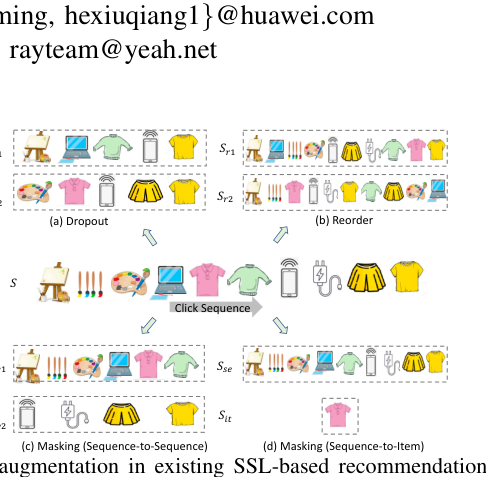
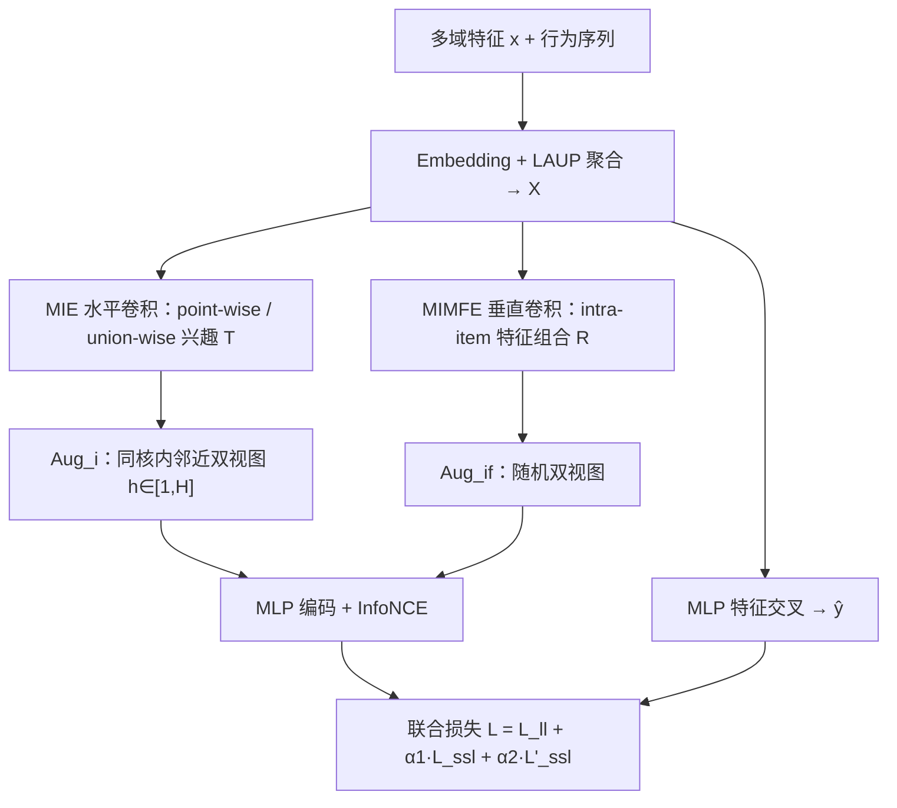
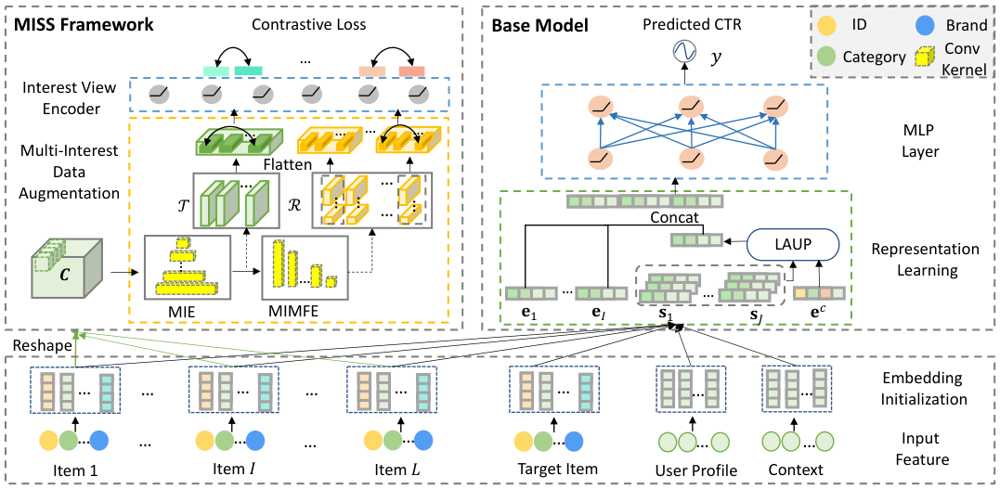

# MISS: Multi-Interest Self-Supervised Learning Framework for Click-Through Rate Prediction (MISS：面向点击率预估的多兴趣自监督学习框架)

- **会议/期刊**: ICDE 2022
- **作者与机构**: Wei Guo, Can Zhang, Zhicheng He, Jiarui Qin, Huifeng Guo, Bo Chen, Ruiming Tang, Xiuqiang He, Rui Zhang（华为诺亚方舟实验室、NUS、SJTU）
- **推荐链路定位**: 精排（CTR 预估）
- **研究方向**: CTR/CVR 预估与特征交叉 / 自监督对比学习与交互去噪
- **论文原文**: [https://arxiv.org/abs/2111.15068v2](https://arxiv.org/abs/2111.15068v2)
- **开源代码**: 暂未开源

## TL;DR (1分钟核心速览)

CTR 模型长期受标签稀疏、标签噪声与样本间领域知识未充分利用之困。MISS 摒弃 S3Rec/CL4SRec 式的样本级 dropout/重排/掩码增广，改用水平 CNN 抽取 point-wise 与 union-wise 多兴趣、垂直 CNN 抽取 item 内特征组合，并在**同一卷积分支的兴趣视图**间做 InfoNCE 对比，作为即插即用模块与任意 CTR 模型端到端联合训练。在 Amazon-Cds/Books、Alipay 上 AUC 较最强基线 DMR 分别提升 9.27%、13.55%、1.96%，Logloss 降低 17.62%、29.38%、9.53%。

## Background & Motivation (背景与核心矛盾)

- **主流范式**: 一条线做高阶特征交叉（DeepFM、DCN-M、xDeepFM），另一条线做用户兴趣建模（DIN、DIEN、SIM、DMR），二者均以观测到的 user-item 点击作为唯一监督。
- **前人局限**: ① 标签稀疏——交互相对百万级特征空间极度稀疏，冷启用户/长尾物品尤甚，马太效应下监督信号愈发匮乏；② 标签噪声——误点击与"潜在兴趣但未曝光"混杂，随机负采样会把后者误判为负。
- **核心洞察 (Key Insight)**: 已有 SSL 推荐工作（S3Rec、CL4SRec、IRSSL）把 CV/NLP 增广原样搬来，**强制同一条行为序列的两个视图相似**；但用户行为天然多兴趣，两视图可能来自完全不同的兴趣，这种"一视同仁"的对比反而注入噪声。
- **本文切入点**: 把对比学习从 sample-level 下沉到 interest-level——只在"同一兴趣"内部构造正对，兴趣之间不做对比。

<figure class="paper-figure" markdown="span">
  <figcaption>图1. 现有基于自监督学习的推荐模型中的数据增强。(a) 丢弃，(b) 重排序，(c) 序列到序列掩码，(d) 序列到物品掩码。</figcaption>
</figure>

## Method (核心方法设计)

### 1. 整体框架 (Overall Architecture)

输入为多域特征 $x=[f_1,\dots,f_I,s_1,\dots,s_J]$，经 embedding 表与 DIN 的 LAUP 聚合得到定长表示$X$，送入 base CTR 模型的 MLP 得到$\hat{y}$。旁路新增两个 CNN 提取器：MIE 沿时间轴生成兴趣序列$\mathcal{T}$，MIMFE 沿特征轴生成细粒度表示$\mathcal{R}$；二者分别经随机双采样增广、MLP 编码后用 InfoNCE 对比，与主 Logloss 端到端联合优化。推理时仅走 base model，增广分支不参与前向。

<figure class="paper-figure" markdown="span">
  <figcaption>图3. 我们提出的MISS框架概览。右侧展示了一个典型的深度CTR模型，左侧是应用于该模型的所提出的多兴趣自监督学习组件。</figcaption>
</figure>

### 2. 关键设计拆解 (Key Designs)

1. **多兴趣水平卷积与兴趣级增广（MIE + Aug_i）**：针对"样本级增广跨兴趣假正例"痛点，将序列 embedding 组织为 $C\in\mathbb{R}^{J\times L\times K}$，用$M$组宽度为$m$ 的水平核滑动：

   $G^{m}_{j,l,k}=\mathrm{ReLU}(C_{j,l:l+m-1,k}\circ g_m)$ $m=1$捕获 point-wise 兴趣，$m>1$捕获 union-wise 兴趣，共$|\mathcal{T}|=\sum_m (L-m+1)$个表示。同一核的输出视为同一兴趣族，在其中随机取距离$h\in[1,H]$的两点作正对，$h$ 的取值同时覆盖短程与长程依赖。直觉：卷积窗口天然把"邻近即同兴趣"的先验编码进正对构造，正对必同兴趣、负对来自 batch 内其他样本，从而消除跨兴趣噪声。

2. **细粒度垂直卷积与特征级增广（MIMFE + Aug_if）**：水平卷积只建模 inter-item 相关，忽略同一兴趣内不同特征域的敏感度差异（如日用品看价格、鞋看价格+品类）。对 $G^m$再用$N$组高度为$n$ 的垂直核：

   $\hat{G}^{m,n}_{j,l,k}=\mathrm{ReLU}(G^{m}_{j:j+n-1,l,k}\circ \hat{g}_{m,n})$得到$\Omega=\sum_n (J-n+1)$ 个特征级表示；因特征域相对独立，此处改用完全随机双采样，避免错误假设特征邻近性。

3. **训练目标、负采样与推理效率**：总损失 $\mathcal{L}=\mathcal{L}_{ll}+\alpha_1\mathcal{L}_{ssl}+\alpha_2\mathcal{L}'_{ssl}$，其中兴趣级对比项为

   $\mathcal{L}_{ssl}=-\frac{1}{|\mathcal{B}|P}\sum_{x\in\mathcal{B}}\sum_{p=1}^{P}\log\frac{\exp(s(\mathbf{z}^{i,1}_p,\mathbf{z}^{i,2}_p)/\tau)}{\sum_{x'\in\mathcal{B}}\exp(s(\mathbf{z}^{i,1}_p,\mathbf{z}^{\prime i,2}_p)/\tau)}$负样本全部来自 in-batch，无需显式负采样器；新增参数仅$\frac{M(M-1)}{2}+\frac{N(N-1)}{2}$ 个卷积核参数加两个轻量 MLP，相对 embedding 表可忽略，推理零额外开销。

## Experimental Setup & Evaluation Protocol (实验设置与评估协议)

- **数据集与预处理**: Amazon-Cds 过滤交互 <5 的用户/物品，Books 与 Alipay 阈值取 10，行为按时间戳排序。

| 数据集 | #Users | #Items | #Instances | #Features | 特征/场景说明 |
| :--- | :---: | :---: | :---: | :---: | :--- |
| Amazon-Cds | 75,258 | 64,443 | 150,516 | 140,167 | 5 域，十余年跨度，极度稀疏 |
| Amazon-Books | 158,650 | 128,939 | 317,300 | 288,577 | 5 域，长周期评论数据 |
| Alipay | 326,577 | 451,631 | 653,154 | 788,166 | 7 域，仅半年日志 |

- **数据划分与防穿越 (Splitting Strategy)**: 逐用户按时间排序的 `Leave-One-Out` 式切分——$[1,L-3]$训练预测第$L-2$项，$[1,L-2]$验证预测$L-1$，$[1,L-1]$测试预测$L$，严格防穿越。
- **排名评测协议 (Ranking Protocol)**: 非 full-ranking；每个用户随机采 1 个未交互物品作负样本，以 AUC / Logloss 衡量二分类 CTR 精度（存在单负采样偏差）。
- **对比基线与超参设置**: 覆盖特征交叉（LR/FM/DeepFM/IPNN/DCN/DCN-M/xDeepFM）、兴趣建模（DIN/DIEN/SIM(soft)/DMR）、GNN/Transformer（AutoInt+/FiGNN）三类；embedding 维 $d=10$，batch 128，MLP$\{40,40,40,1\}$，Adam，学习率$\{10^{-1},\dots,10^{-4}\}$，$\alpha_1=\alpha_2$、$\tau$均搜$\{0.05,0.1,0.5,1,5\}$，$M\in\{1..4\}$、$N\in\{1,2\}$、$H\in\{1..4\}$；5 次重复取均值，$p<0.05$ 显著性检验。

## Key Experimental Results (实验关键数据)

### 1. 主实验对比 (Main Results)

| 模型 | Cds AUC | Cds Logloss | Books AUC | Books Logloss | Alipay AUC | Alipay Logloss |
| :--- | :---: | :---: | :---: | :---: | :---: | :---: |
| DeepFM | 0.8039 | 0.5369 | 0.8056 | 0.5310 | 0.8718 | 0.4464 |
| IPNN | 0.8053 | 0.5364 | 0.8051 | 0.5308 | 0.8823 | 0.4299 |
| DCN-M | 0.8050 | 0.5363 | 0.8070 | 0.5293 | 0.8757 | 0.4403 |
| xDeepFM | 0.8034 | 0.5370 | 0.8028 | 0.5336 | 0.8777 | 0.4382 |
| DIN | 0.8055 | 0.5357 | 0.8074 | 0.5289 | 0.9098 | 0.3734 |
| DIEN | 0.7928 | 0.5479 | 0.8016 | 0.5352 | 0.9004 | 0.3950 |
| DMR | 0.8115 | 0.5289 | 0.8082 | 0.5282 | 0.9148 | 0.3642 |
| FiGNN | 0.8012 | 0.5391 | 0.8006 | 0.5366 | 0.8716 | 0.4467 |
| **MISS** | **0.8867** | **0.4357** | **0.9180** | **0.3730** | **0.9327** | **0.3295** |
| Improv.% (vs DMR) | +9.27% | -17.62% | +13.55% | -29.38% | +1.96% | -9.53% |

### 2. 消融实验 (Ablation Study)

以 DIN 为 backbone，逐项移除兴趣级组件（原文命名 MISS/F 表示移除对应项）：

| 变体 | Cds AUC | Books AUC | Alipay AUC |
| :--- | :---: | :---: | :---: |
| DIN（base） | 0.8055 | 0.8074 | 0.9098 |
| w/o M,F,U,L（全移除） | 0.8429 | 0.8425 | 0.9188 |
| w/o F,U,L | 0.8514 | 0.8717 | 0.9222 |
| w/o F,L | 0.8568 | 0.8937 | 0.9236 |
| w/o F,U | 0.8636 | 0.8978 | 0.9260 |
| w/o F | 0.8813 | 0.9136 | 0.9300 |
| **Full MISS** | **0.8867** | **0.9180** | **0.9327** |

### 3. 关键实验发现 (Key Findings)

1. **收益与兴趣多样性正相关**：Amazon 两集（十余年跨度、兴趣更分散）AUC 相对提升 9.27%/13.55%，远高于仅半年日志的 Alipay（1.96%）；同时 Logloss 降幅（17.62%/29.38%/9.53%）大于 AUC 涨幅，说明自监督不仅抬排序头部，更显著改善概率校准。
2. **组件互补且"多兴趣"最关键**：移除 F 仅掉 0.0054（Cds 0.8867→0.8813），再叠加移除 U/L 后掉至 0.8514，全移除掉到 0.8429（仍高于 DIN 的 0.8055）；同一模块挂到 IPNN、FiGNN 上 AUC 分别从 0.8053→0.8858、0.8012→0.8828，验证 model-agnostic 的 plug-in 属性。
3. **CNN 是"可区分正对"的必需品，且鲁棒性随稀疏/噪声加剧而放大**：LSTM/SA 生成视图的余弦相似度贴近 1，对比信号退化，AUC 仅 0.8106/0.8042；CNN 因滑动窗口小（≤3–4）使相似度落在 0.7–0.8，AUC 达 0.8867。训练样本降至 80% 时相对提升由 10.08% 升至 10.94%；20% 标签翻转时 Books 相对提升由 13.70% 升至 17.52%，证实对比正则确实在补监督、滤噪声。

## Highlights & Limitations (亮点、对比与审稿批判)

- **与代表作对比 (vs. Prior Work)**: S3Rec 在随机子序列与整序列间做互信息，语义偏差使其仅微增益（IPNN-S3Rec 0.8065）；IRSSL 只掩码 item 特征，特征稀少时几乎失效（0.8050≈IPNN）；CL4SRec 的 crop/mask/reorder 保留大部分序列不变，效果次优（0.8372）。MISS 首次把对比粒度降到兴趣级，故领先幅度最大。
- **可迁移亮点**: ①"同卷积核输出内邻近采样构造正对"可迁移到多兴趣召回与序列推荐的增广设计；② 垂直卷积做特征级视图、水平卷积做序列级视图的"双轴增广"思路，可低成本嵌入任意多域 CTR 模型。
- **审稿级局限批判**: ① 评估为每用户单随机负样本的 AUC/Logloss，非 full-ranking，负样本分布敏感、可比性受限；② 训练期需额外两路 CNN + 两路 MLP 与大批次 in-batch 负样本，论文未报告吞吐/延迟，工业收益需扣训练成本；③ 超参 $M,N,H,\alpha,\tau$多且敏感（$\alpha>1$即退化、$\tau=0.1$ 最优），调参开销大；④ "兴趣邻近"假设对跨会话兴趣漂移、长期演化建模不足；⑤ 无开源代码，复现门槛偏高。

## Rating (四维评分)

- **方法创新性 (Novelty)**: ⭐⭐⭐⭐ （首次提出兴趣级而非样本级对比损失，把"多兴趣"先验编码进正对构造，思路新颖；但 CNN+InfoNCE 组合本质是精巧的架构迁移，缺理论/谱分析支撑。）
- **评估协议与实验扎实度 (Protocol & Experiments)**: ⭐⭐⭐ （三数据集 + 5 次重复 + $p<0.05$ + 稀疏/噪声切片分析较完整，但单负采样评估非全库排序，且无线上 A/B。）
- **写作与数学规范度 (Clarity & Rigor)**: ⭐⭐⭐⭐ （框架图、四类兴趣建模实践与公式定义清晰，给出参数量级复杂度分析；符号偏多、部分变体命名易混淆。）
- **工业落地与复现价值 (Industrial & Practical Value)**: ⭐⭐⭐ （推理零额外开销、可与 DIN/IPNN/FiGNN 无缝组合，落地友好；但训练开销、超参敏感与未开源削弱复现价值。）

