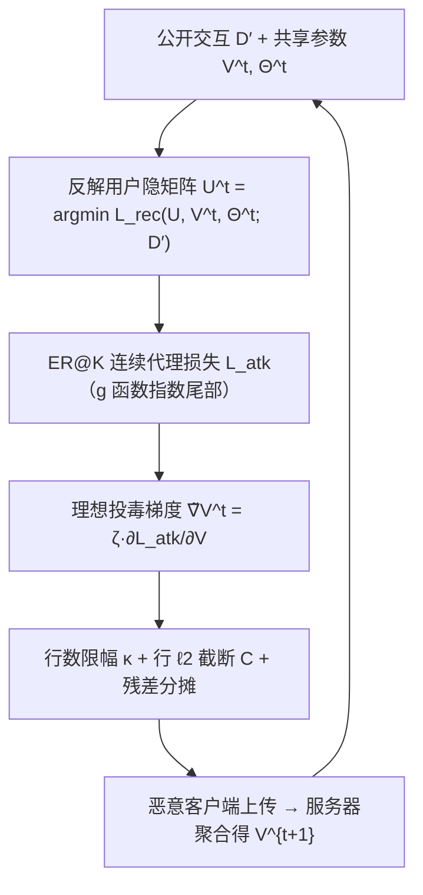
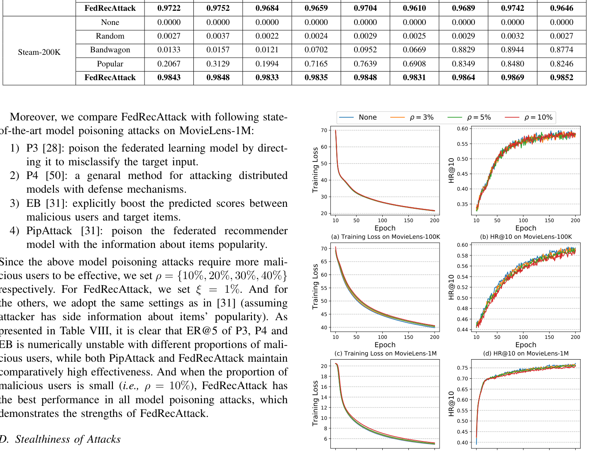

# FedRecAttack: Model Poisoning Attack to Federated Recommendation (面向联邦推荐的模型投毒攻击)

- **会议/期刊**: IEEE ICDE 2022 (Second Research Round)
- **作者与机构**: Dazhong Rong, Shuai Ye, Ruoyan Zhao, Hon Ning Yuen, Jianhai Chen, Qinming He (浙江大学计算机学院 / 工程师学院)
- **推荐链路定位**: 端到端联邦训练（服务器聚合阶段注入投毒梯度，影响召回/排序打分）
- **研究方向**: 去偏公平、可信隐私与工业架构 / 协同过滤与双塔召回
- **论文原文**: [https://arxiv.org/abs/2204.01499v2](https://arxiv.org/abs/2204.01499v2)
- **开源代码**: [https://github.com/rdz98/FedRecAttack](https://github.com/rdz98/FedRecAttack)

## TL;DR (1分钟核心速览)

联邦推荐 (FR) 因用户交互与用户隐向量全部本地化，长期被视为天然免疫投毒攻击。本文提出 FedRecAttack：仅利用社交平台上公开的少量交互 (ξ=1%) 与服务器每轮下发的共享物品矩阵 $V$，通过求解 BPR 子问题反解出全局用户隐矩阵$U$，再以"刚好超越 top-K 末位分数"的指数尾部代理损失生成投毒梯度，并按$\kappa$ 行限幅 + 残差分摊的方式让恶意客户端伪装上传。在 3 个真实数据集的 Leave-One-Out 全库排序协议下，3% 恶意用户即可将 ER@5 提升至 0.70–0.98，而 HR@10 仅下降 <2.5%。

## Background & Motivation (背景与核心矛盾)

- **主流范式**: FR 中服务器维护共享的物品矩阵 $V$与网络参数$\Theta$，每个用户端本地保存私有隐向量$u_i$与交互集$V_i^+$，上传梯度前还叠加差分隐私噪声$\mathcal{N}(0,\mu^2C^2I)$，服务器仅能聚合梯度、无法还原单个用户的正反馈。
- **前人局限**: 数据中心投毒 (P1/P2) 依赖攻击者掌握 20%–100% 的完整交互先验；FL 模型投毒 (P3/P4/EB) 要求访问包括用户隐向量在内的全部参数；唯一的 FR 攻击 PipAttack 需 10% 恶意用户且未受约束地抬高目标分数，导致 HR@10 从 0.594 崩至 0.438（-26%），极易被"训练精度异常下降"类检测器捕获。
- **核心洞察 (Key Insight)**: 现实平台中点赞、关注、评论等交互本身是公开的；由于 BPR 损失按用户完全解耦，只要给定当前 $V^t,\Theta^t$，用极稀疏的公开交互$D'$对$U$做梯度下降，就能得到逼近真实$U^*$ 的估计——共享参数把"1% 的公开信息"放大成了攻击杠杆。
- **本文切入点**: 先反解 $U$ 再算梯度；并把攻击目标从"分数越高越好"改为"恰好压过推荐列表末位"，用可导代理损失 + 上传限幅换取隐蔽性。

## Method (核心方法设计)

### 1. 整体框架 (Overall Architecture)

每轮训练开始时，攻击者用服务器广播的 $V^t,\Theta^t$与公开交互$D'$反解用户隐矩阵$U^t$；据此计算目标物品曝光率的连续代理损失$L^{atk}$，并对其关于$V$求导得到全局理想投毒方向$\tilde{\nabla}V^t$。随后被选中的恶意客户端从$\tilde{\nabla}V^t$中"领走"自己那份（行数受$\kappa$限制、行范数受$C$截断），上传后从剩余池中扣除，形成残差分摊；服务器按普通 FedAvg 聚合，$V^{t+1}$被逐步拉向让目标物品进入所有用户 top-K 的方向。整个攻击只投毒共享的$V$，不动可学习交互函数$\Upsilon$，故对 MF/NCF/GNN 类 CF 模型通用。

### 2. 关键设计拆解 (Key Designs)

1. **用户隐矩阵反解 (Shadow-U Reconstruction)**：痛点是在 FR 中 $U$完全不可见，任何依赖它的梯度都无法计算。本文把"训练收敛后的$U^*$"改写为给定$V^*,\Theta^*$时$U$的条件极小点（式 18），再把$D$换成$D'$得$U^t\approx\arg\min_U \mathcal{L}^{rec}(U,V^t,\Theta^t;D')$，用若干步 SGD 求解。直觉上 BPR 对每个$u_i$ 是独立子问题，缺失 99% 正样本只会让该用户的估计略偏，而不会破坏跨用户结构，因此估计误差在聚合中被平均掉。
2. **"刚好超越"的代理损失与 $g$函数**：ER@K 是排序指示函数不可导。本文对每个良性用户取"目标物品分数$\hat{x}_{it}$"与"候选集中非目标物品的 top-K 竞争分数线$\min_{v_j\in V_i^{rec\prime}\setminus V^{tar}}\hat{x}_{ij}$"之差，令$L^{atk}_i=\sum_{v_t\in V^{tar}} g(\min_{v_j}\hat{x}_{ij}-\hat{x}_{it})$，其中$g(x)=x\,(x\ge 0)$、$g(x)=e^{x}-1\,(x<0)$。当目标已被推到分数线之上时$x>0$、梯度恒为常数；当$x$很负时$g'(x)=e^x\to 0$，梯度随差距指数衰减——于是目标分数只会被抬到"恰好压线"，不会无限膨胀，这正是副作用极小的机制来源。
3. **限幅与残差分摊上传、训练目标与开销**：为了不破坏差分隐私下的梯度统计特征，要求每个恶意客户端的梯度 $\|\tilde{v}^t_{ij}\|_2\le C$且非零行数$\sum_j \delta(\tilde{v}^t_{ij})\le\kappa$。每个恶意用户首次参与时按$V_i=V^{tar}\cup R(\tilde{\nabla}V^t,\kappa-|V^{tar}|)$抽样，物品$v_j$被选中概率正比于$\|\tilde{v}^t_j\|_2$；上传后执行$\tilde{\nabla}V^t\leftarrow\tilde{\nabla}V^t-\tilde{\nabla}V^t_i$，防止多个恶意客户端重复污染同一批行、浪费预算。$\kappa=60$恰好对应普通用户约 30 条交互产生的 60 行正负梯度，伪装自然。攻击侧每轮仅需一次$U$的 SGD 反解 + 一次反向传播，**无需额外负采样**（沿用 FR 的$|V_i^-'|=|V_i^+|$ 采样）。

## Experimental Setup & Evaluation Protocol (实验设置与评估协议)

- **数据集与预处理**: 全部交互统一转成隐式反馈并去重；两个完全不同的业务域（电影 / 游戏）。

| 数据集 | #Users | #Items | #Interactions | 平均交互数 | 稀疏度 |
| :--- | :---: | :---: | :---: | :---: | :---: |
| MovieLens-100K | 943 | 1,682 | 100,000 | 106 | 93.70% |
| MovieLens-1M | 6,040 | 3,706 | 1,000,209 | 166 | 95.53% |
| Steam-200K | 3,753 | 5,134 | 114,713 | 31 | 99.40% |

- **数据划分与防穿越**: `Leave-One-Out`（每用户留一条作测试）；攻击者可见的公开交互按每用户随机抽取 $\xi$比例的正反馈模拟（$\xi\in\{0,1\%,2\%,3\%,5\%,10\%\}$，默认 1%）。
- **排名评测协议**: `Full-Ranking`——对每个用户在全部未交互集 $V_i^-$ 上按预测分排序取 top-K，指标为 ER@5、ER@10、NDCG@10；副作用用 HR@10 衡量，训练收敛判定 200 epochs。
- **对比基线与超参**: 数据投毒类 Random / Bandwagon / Popular / P1(MF) / P2(DL)；模型投毒类 P3(Bhagoji) / P4(Barreuch) / EB / PipAttack；超参 $k=32$,$\eta=0.01$,$\rho=5\%$,$\xi=1\%$,$\kappa=60$,$C=1$,$\zeta=1$。原文未报告重复实验的显著性检验。

## Key Experimental Results (实验关键数据)

### 1. 主实验对比 (Main Results)

$\rho=5\%$、$\xi=1\%$ 时三个数据集上的攻击效果（FedRecAttack 全指标最优）：

| 攻击方法 | ML-100K ER@5 / NDCG@10 | ML-1M ER@5 / NDCG@10 | Steam ER@5 / NDCG@10 |
| :--- | :---: | :---: | :---: |
| None（无攻击） | 0.0000 / 0.0000 | 0.0000 / 0.0000 | 0.0000 / 0.0000 |
| Random | 0.0000 / 0.0000 | 0.0002 / 0.0001 | 0.0024 / 0.0025 |
| Bandwagon | 0.0000 / 0.0006 | 0.0000 / 0.0000 | 0.0702 / 0.0669 |
| Popular | 0.0011 / 0.0011 | 0.0393 / 0.0349 | 0.7165 / 0.6908 |
| **FedRecAttack** | **0.9400 / 0.9411** | **0.9659 / 0.9610** | **0.9835 / 0.9831** |

模型投毒横向对比（MovieLens-1M，同时看 ER@5 与副作用 HR@10，None 的 HR@10=0.5940）：

| 攻击方法 | ρ=10% HR@10 / ER@5 | ρ=20% HR@10 / ER@5 | ρ=40% HR@10 / ER@5 |
| :--- | :---: | :---: | :---: |
| P3 (Bhagoji) | 0.4434 / 0.0000 | 0.4430 / 0.0000 | 0.4454 / 0.0298 |
| P4 (Baruch) | 0.4392 / 0.0000 | 0.4386 / 0.9625 | 0.4425 / 1.0000 |
| EB | 0.4432 / 0.0000 | 0.4449 / 1.0000 | 0.4432 / 1.0000 |
| PipAttack | 0.4384 / 0.9513 | 0.4412 / 1.0000 | 0.4349 / 1.0000 |
| **FedRecAttack** | **0.5901 / 0.9689** | **0.5800 / 0.9735** | **0.5800 / 0.9786** |

作为对照，依赖全量交互的数据投毒 P1/P2 在 $\rho=5\%$ 的 ML-100K 上 ER@10 仅为 0.0033 / 0.0206，说明"数据投毒范式迁移到 FR"整体失效。

### 2. 消融实验 (Ablation Study)

| 配置 | ML-100K ER@5 / ER@10 | ML-1M ER@5 / ER@10 | Steam ER@5 / ER@10 |
| :--- | :---: | :---: | :---: |
| 完整模型 ($\xi=1\%$) | 0.9400 / 0.9475 | 0.9659 / 0.9704 | 0.9835 / 0.9848 |
| w/o 公开交互 ($\xi=0\%$) | 0.0000 / 0.0000 | 0.0000 / 0.0000 | 0.0000 / 0.0000 |
| $\rho=1\%$ | 0.0011 / 0.0011 | — | — |
| $\rho=2\%$ | 0.0043 / 0.0075 | — | — |
| $\rho=3\%$ | 0.6988 / 0.7449 | 0.9722 / 0.9752 | 0.9843 / 0.9848 |
| $\kappa=20$/$\kappa=100$ | 0.9475 / 0.9453 | — | — |

### 3. 关键实验发现 (Key Findings)

1. **1% 公开交互是必需的"点火器"，但收益迅速饱和**：$\xi=0$时攻击完全失效（所有指标 0），而$\xi$从 1% 升到 10% 带来的提升不足 5%（ER@5 由 0.9400→0.9914），这直接证明了"反解$U$ 需要的是全局结构先验而非样本量"。
2. **恶意用户比例存在明显阈值效应，3% 即可越线**：$\rho$从 1%/2% 的 0.0011/0.0043 跃迁到 3% 的 0.6902、5% 的 0.9400，说明每轮被选中的恶意客户端数必须超过由$\kappa$ 与物品数决定的临界覆盖度，之后收益饱和（10% 仅 0.9475）。
3. **隐蔽性优势来自 $g$函数而非运气**：P3/P4/EB/PipAttack 一律把 HR@10 打到 0.43–0.44（跌幅 >25%），而 FedRecAttack 在$\rho=40\%$下 HR@10 仍为 0.5800（仅 -2.4%），训练损失与 HR@10 曲线与无攻击几乎重合——因为$g'(x)=e^x\to0$ 使目标分数只能被抬到"恰好压过推荐列表末位"，不做无谓的分数膨胀，从而绕过"精度异常下降"检测。

<figure class="paper-figure" markdown="span">
  <figcaption>图3. 在MovieLens-100K、MovieLens-1M和Steam-200K上，不同比例恶意用户下FedRecAttack的副作用。</figcaption>
</figure>

## Highlights & Limitations (亮点、对比与审稿批判)

- **与代表作对比 (vs. Prior Work)**: 相比 P1/P2 这类数据投毒需要 20%+ 交互先验、P3/P4/EB 这类 FL 模型投毒需要完整参数访问，FedRecAttack 是首个在"仅共享参数 + 极稀疏公开交互"约束下成立的攻击；相比 PipAttack，恶意用户需求从 10% 降到 3%，且把副作用从 -26% HR@10 压到 -2.5% 以内，本质上把攻击从"暴力抬分"改写成了"约束最优化 + 梯度伪装"。
- **可迁移亮点**: ①"用共享参数 + 稀疏辅助信号反解私有本地参数"这一条件极小点思路，可直接迁移到联邦场景下的用户画像推断、隐私审计与鲁棒性红队测试；②"恰好压线"的指数尾部代理损失是提升任何操纵式排序攻击隐蔽性的通用技巧（也提示防御方：仅监控分数分布的异常高峰不足以发现此类攻击）。
- **审稿级局限批判**: ①把多层级的全局最优攻击松弛为逐轮贪心，且 $g$函数形式与真实 ER@K 之间的代理误差缺乏理论界；②攻击假设攻击者知道目标模型结构、学习率与物品侧共享参数，且每次被选中才能取到最新$V$，在部分参与（partial participation）与安全聚合（Secure Aggregation）下有效性未被验证；③实验仅在 MF+BPR 基础模型、三个中小规模数据集上进行，未包含鲁棒聚合（Krum/Trimmed-Mean/Median）等防御组合，也未报告重复运行的方差。

## Rating (四维评分)

- **方法创新性 (Novelty)**: ⭐⭐⭐⭐ （首次在 FR 中把"公开交互反解私有隐向量"公式化为条件极小点，并用 $g$ 函数指数尾部实现精度保真投毒，攻击建模层次明显高于前作）
- **评估协议与实验扎实度 (Protocol & Experiments)**: ⭐⭐⭐⭐ （三数据集两业务域 + Leave-One-Out 全库排序 + 4 类数据投毒与 4 类模型投毒基线，攻击与副作用双维度评价完整；但缺少显著性检验与防御机制对抗实验）
- **写作与数学规范度 (Clarity & Rigor)**: ⭐⭐⭐⭐ （式 9–24 从优化问题到可解贪心形式推导连贯，$\rho/\xi/\kappa/C$ 四约束刻画清晰；贪心近似与代理损失缺少误差分析）
- **工业落地与复现价值 (Industrial & Practical Value)**: ⭐⭐⭐⭐ （代码开源、攻击仅需 3% 客户端与每轮一次 SGD 反解，成本极低；也正因此提示联邦推荐工业部署必须重新设计梯度级异常检测与鲁棒聚合）

