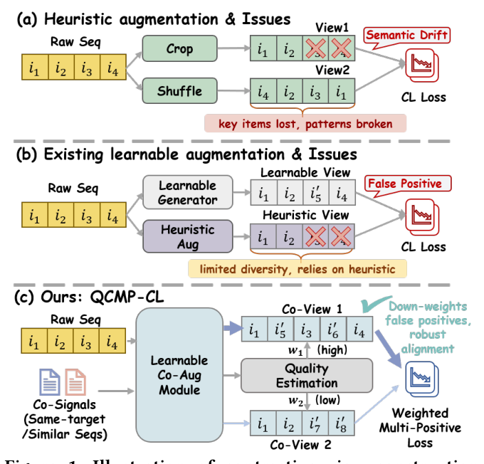
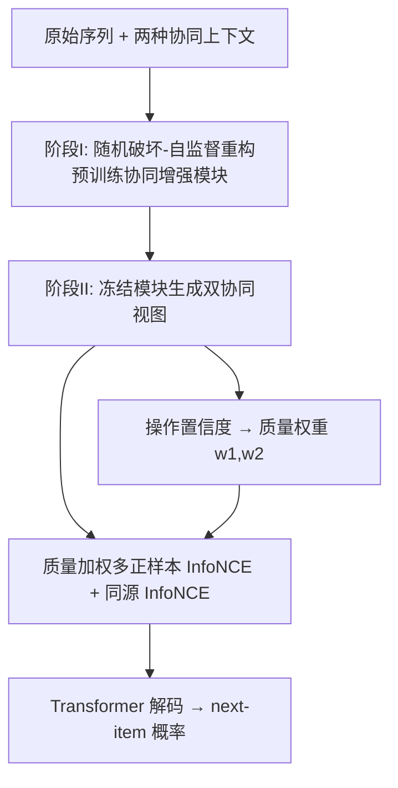
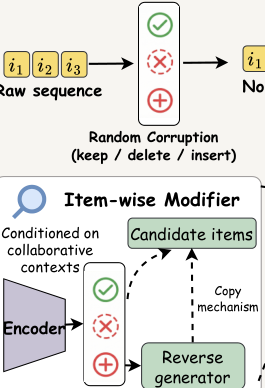

# Quality-Aware Collaborative Multi-Positive Contrastive Learning for Sequential Recommendation (质量感知的协同多正样本对比学习序列推荐)

- **会议/期刊**: ICDE
- **作者与机构**: Wei Wang, Yujie Lin, Moyan Zhang, Huan Huo, Xianye Ben, Pengjie Ren, Yujun Li, Jianli Zhao（山东科技大学、山东大学、之江实验室、悉尼科技大学）
- **推荐链路定位**: 召回（序列编码器式 next-item 预测 + 自监督对比预训练）
- **研究方向**: 自监督对比学习与交互去噪 / 序列与会话推荐
- **论文原文**: [https://arxiv.org/abs/2605.11707v2](https://arxiv.org/abs/2605.11707v2)
- **开源代码**: 暂未开源

## TL;DR (1分钟核心速览)

针对启发式序列增强（crop/mask/reorder）易删关键物品、扭曲转移模式导致语义漂移与假阳性，以及现有可学习增强视图单一、未建模视图质量差异的痛点，本文提出 QCMP-CL：用"同目标序列 + Jaccard 相似序列"两种互补协同上下文驱动可学习增强模块生成两条视图，并以增强操作置信度自适应加权多正样本 InfoNCE。在 Beauty/Yelp/Sports 的 5-core + Leave-One-Out + 99 负采样协议下，HR@10 相对 CL4SRec 提升 11.39%/5.77%/12.82%，相对最强基线 TCLARec 仍稳定提升 2%–4%。

## Background & Motivation (背景与核心矛盾)

- **主流范式**: CL4SRec/DuoRec/CoSeRec 等以随机裁剪、掩码、重排构造两条视图，用 InfoNCE 拉近同源视图、推远 in-batch 负样本，为稀疏序列补充自监督信号。
- **前人局限 1（视图质量）**: 启发式扰动是"盲编辑"，会删除决定下次点击的关键物品并破坏转移模式，视图与真实意图不一致；TCLARec 等可学习增强虽更可靠，但只产出单视图、多样性不足，仍需启发式视图兜底配对。
- **前人局限 2（质量无差别）**: 现有方法把所有正视图当作等权正样本、以统一力度对齐，低质量视图被强行拉近锚点，反而放大假阳性（false-positive）污染。
- **核心洞察 (Key Insight)**: 增强模块对每个位置 keep/delete/insert 的**操作置信度**可作为视图质量的可计算代理——统计显示高置信视图的目标共现质量在 65%–69% 的样本上更高。
- **本文切入点**: 用协同信号（同目标 + 相似序列）作为条件做"可学习、可解释"的编辑，并把置信度直接注入对比损失的权重，替代硬过滤/固定权重。

<figure class="paper-figure" markdown="span">
  <figcaption>图1：序列推荐中对比视图构建范式的图示。(a)和(b)分别说明启发式方法和现有可学习方法的局限性，(c)展示我们的方法。</figcaption>
</figure>

## Method (核心方法设计)

### 1. 整体框架 (Overall Architecture)

QCMP-CL 采用两阶段流水线。阶段 I：对每条原始序列按 $[p_k,p_d,p_i]$随机执行 keep/delete/insert 得到含噪序列，再以采样的协同序列为条件，训练增强模块把含噪序列**重构回原序列**，从而学会"删噪声、补漏交互"。阶段 II：冻结该模块，分别以同目标协同序列与相似协同序列为条件，为每条原序列生成两条互补视图$V_u^1,V_u^2$，同时用操作置信度算出质量权重$w_1,w_2$，与 SASRec 式 next-item 预测损失联合优化。推理阶段不再需要增强模块，仅保留序列编码器与解码器，线上开销与 SASRec 持平。

<figure class="paper-figure" markdown="span">
  <figcaption>图2：QCMP-CL 概览。阶段 I 以协同上下文为条件，通过自监督重构随机损坏的序列来预训练协同增强模块。阶段 II 冻结协同增强模块以生成两个协同视图，根据操作置信度计算质量权重，并将推荐损失与对比目标联合优化。</figcaption>
</figure>

### 2. 关键设计拆解 (Key Designs)

1. **协同条件增强模块（Collaborative Augmentation）**：痛点是把增强从"随机规则"变成"有据可依的编辑"。以注意力聚合 $K$条协同序列构造联合表示$H_e^{j}=H_e+\frac{1}{K}\sum_{k=1}^{K}a_k H_{col}^{k}$（$a_k=\mathrm{softmax}(H_e (H_{col}^{k})^{\top})$），再逐位置输出$P(\hat{o}_t|S_u)=\mathrm{softmax}(Wh_t)$决定 keep/delete/insert；插入项由带 copy 机制的反向生成器产生，候选概率随其在协同序列中的出现次数$N_j$ 增长。直觉：协同序列提供了"同类意图该长什么样"的先验，使编辑既保意图一致又因两种上下文而天然多样。

2. **质量感知多正样本对比（Quality-aware Multi-Positive CL）**：痛点是正视图不等质却被等权对齐。取每个位置最大操作概率的序列级均值作质量分 $q_k=\frac{1}{|S_u|}\sum_{t=1}^{|S_u|}\max_{o\in\{k,d,i\}}P(\hat{o}_t=o|S_u)$，经温度归一化得权重$[w_1,w_2]=\mathrm{softmax}([q_1,q_2]/q_{temp})$，代入加权多正 InfoNCE：
$\mathcal{L}_{qmp}=-\sum_{k\in\{1,2\}}w_k\log\frac{\exp(s(S_u,V_u^{k}))}{\exp(s(S_u,V_u^{k}))+\sum_{\mathcal{N}(u)}\exp(s(S_u,\mathcal{N}(u)))}$。
额外保留同源 InfoNCE $\mathcal{L}_{cl}$约束$V_u^1$与$V_u^2$ 不漂移，作为弱正则在 MRR/NDCG 上收益明显。

3. **训练目标、负采样与推理效率**：总损失 $\mathcal{L}_{joint}=\mathcal{L}_{rec}+\alpha\mathcal{L}_{qmp}+\beta\mathcal{L}_{cl}$，取$\alpha=0.2$、$\beta=0.05$、$q_{temp}=0.5$；负样本完全来自 in-batch（$2N-2$ 条他人视图）与 99 随机负采样，无额外难负挖掘。阶段 I 每条序列采 30+30 条协同上下文、阶段 II 各采 10 条，增强序列最长 60、单点最多插入 5 项。

## Experimental Setup & Evaluation Protocol (实验设置与评估协议)

| 数据集 | #Users | #Items | #Interactions | 平均长度 | 密度 | 特征/场景说明 |
| :--- | :---: | :---: | :---: | :---: | :---: | :--- |
| Beauty | 22,362 | 12,101 | 194,682 | 8.7 | 0.07% | Amazon 美妆评论，短序列高稀疏 |
| Yelp | 22,844 | 16,552 | 236,999 | 10.4 | 0.06% | Yelp 商户签到，序列较长 |
| Sports | 35,597 | 18,357 | 294,483 | 8.3 | 0.05% | Amazon 运动户外，最稀疏 |

- **数据集与预处理**: 三数据集均做 `5-core` 过滤，按交互时间排序成序列，最大长度截断至 50。
- **数据划分与防穿越**: `Leave-One-Out`——最后一项为测试、倒数第二项为验证、其余训练，无时间戳泄漏风险（序列本身按时间排序）。
- **排名评测协议**: `Sampled Ranking`——每个验证/测试正样本随机配 99 个未交互物品（1:99），指标 HR/MRR/NDCG@{5,10,20}。
- **对比基线与超参**: 8 个基线覆盖三类——朴素（SASRec、BERT4Rec）、对比学习（CL4SRec、DuoRec、CoSeRec、ICSRec、TCLARec）、序列纠错（STEAM）；嵌入维度 $d=64$，Transformer 2 层 2 头，dropout 0.5，学习率 0.001，batch 256（Sports 128），最优结果以$p<0.05$ 显著性标注。

## Key Experimental Results (实验关键数据)

### 1. 主实验对比 (Main Results)

| 数据集 | 指标 | SASRec | BERT4Rec | CL4SRec | DuoRec | ICSRec | STEAM | TCLARec | **QCMP-CL** | Improv. vs CL4SRec |
| :--- | :--- | :---: | :---: | :---: | :---: | :---: | :---: | :---: | :---: | :---: |
| Beauty | HR@10 | 0.4639 | 0.4728 | 0.5056 | 0.5187 | 0.5188 | 0.5256 | 0.5460 | **0.5632** | +11.39% |
| Beauty | NDCG@10 | 0.3182 | 0.2907 | 0.3422 | 0.3494 | 0.3586 | 0.3508 | 0.3810 | **0.3922** | +14.61% |
| Beauty | MRR@10 | 0.2732 | 0.2478 | 0.2916 | 0.3015 | 0.3087 | 0.3028 | 0.3297 | **0.3391** | +16.28% |
| Yelp | HR@10 | 0.7833 | 0.7972 | 0.8223 | 0.8263 | 0.8337 | 0.8460 | 0.8569 | **0.8698** | +5.77% |
| Yelp | NDCG@10 | 0.4756 | 0.4870 | 0.5188 | 0.5245 | 0.5434 | 0.5461 | 0.5630 | **0.5761** | +11.04% |
| Yelp | MRR@10 | 0.3808 | 0.4013 | 0.4251 | 0.4334 | 0.4533 | 0.4531 | 0.4716 | **0.4845** | +13.97% |
| Sports | HR@10 | 0.4597 | 0.4791 | 0.5152 | 0.5192 | 0.5459 | 0.5496 | 0.5645 | **0.5813** | +12.82% |
| Sports | NDCG@10 | 0.2883 | 0.2862 | 0.3324 | 0.3335 | 0.3508 | 0.3479 | 0.3673 | **0.3787** | +13.92% |
| Sports | MRR@10 | 0.2357 | 0.2323 | 0.2762 | 0.2758 | 0.2906 | 0.2858 | 0.3064 | **0.3160** | +14.40% |

### 2. 消融实验 (Ablation Study)

| 变体 (Sum = 9 指标之和) | Beauty | Yelp | Sports | 相对全模型 |
| :--- | :---: | :---: | :---: | :---: |
| QCMP-CL (完整) | **3.8803** | **5.6661** | **3.8251** | — |
| w/o $\mathcal{L}_{cl}$ | 3.8514 | 5.6425 | 3.7957 | −0.7% ~ −0.8% |
| w/o 质量权重 (等权对齐) | 3.7984 | 5.5675 | 3.7391 | −2.1% ~ −2.3% |
| w-col1（仅同目标视图 + 随机视图） | 3.6972 | 5.4565 | 3.5816 | −4.7% ~ −6.4% |
| w-col2（仅相似视图 + 随机视图） | 3.6758 | 5.4406 | 3.5611 | −4.7% ~ −6.9% |
| Heuristic（双视图均随机增强，≈CL4SRec） | 3.4594 | 5.1919 | 3.4066 | −8.4% ~ −10.9% |

### 3. 关键实验发现 (Key Findings)

1. **质量加权是第二大增益来源**：去掉 $w_k$ 的等权对齐在 Beauty 上 Sum 从 3.8803 掉到 3.7984（−2.1%），且 MRR@5 跌幅（0.3252→0.3136）明显大于 HR@5（0.4590→0.4519），说明假阳性主要损伤细粒度排序而非粗召回，印证"低置信视图按统一力度对齐有害"。
2. **双协同视图必须互补成对**：只保留单一协同视图并与随机视图配对（≈TCLARec 设定）时性能下降 3.7%–6.9%，且 w-col1 始终略优于 w-col2，说明"同目标"上下文与 next-item 意图更直接对齐，而 Jaccard 相似上下文覆盖面广但更易引入语义漂移，必须靠质量权重兜底。
3. **协同增强带来抗噪鲁棒性**：在 4:3:3 keep/delete/insert 模拟噪声测试集上，QCMP-CL 绝对性能仍居首，性能衰减 dist 为 −3.26%/−3.16%/−4.00%，优于 TCLARec 的 −3.17%/−3.88%/−4.29% 与 SASRec 的 −6.07%/−7.91%/−7.56%，说明阶段 I 的"破坏-重构"预训练本身就是一种噪声不变性正则。

## Highlights & Limitations (亮点、对比与审稿批判)

- **与代表作对比**: 相较 CL4SRec（随机裁剪/掩码，视图质量不可控），本文把增强交给可学习模块；相较 TCLARec（单可学习视图 + 启发式视图兜底、三 triplet 约束），本文用两种协同上下文产出双可学习视图并以置信度软加权替代硬性三元组排序；相较 SimDCL/CLEM4Rec 的外挂过滤或外部解释器，本文质量分完全由模型内部操作分布给出，零额外推理成本。
- **可迁移亮点**: ①"操作置信度均值 → softmax 温度加权"这一轻量质量打分可直接移植到图对比学习（SGL/SimGCL）的边丢弃/节点丢弃增广上；②阶段 I 的 corrupt-and-reconstruct 预训练可迁移到序列纠错、会话去噪等需要清洗隐式反馈的场景。
- **审稿级局限批判**: ①阶段 I 需对每条序列采样 30+30 条协同序列并做重构训练，构建相似序列池涉及 Jaccard 两两比较，离线训练开销显著高于 CL4SRec，论文未给出训练时长/FLOPs 对比；②质量分与语义质量只是统计相关（65%–69%），受物品流行度偏置影响，且阶段 II 冻结增强模块限制了其与推荐目标的端到端适配；③负样本仍为 in-batch 随机负，未评估假阴性（false negative），且评测为 1:99 采样排序而非全库 Full-Ranking，Yelp 上 HR@20 已被 ICSRec 追平（0.9582 vs 0.9551），增益边际递减明显。

## Rating (四维评分)

- **方法创新性 (Novelty)**: ⭐⭐⭐⭐ （把"增强可信度"显式参数化为操作置信度并注入对比权重，机制简洁新颖，但双视图+加权 InfoNCE 的整体骨架仍属既有范式的组合式改进）
- **评估协议与实验扎实度 (Protocol & Experiments)**: ⭐⭐⭐⭐ （三数据集 + 8 基线 + 消融 + 统计检验 + 模拟噪声鲁棒性分析齐全，扣分点在于仅用 1:99 采样排序、缺少全库排序与效率对比）
- **写作与数学规范度 (Clarity & Rigor)**: ⭐⭐⭐⭐ （两阶段流程与公式链条清晰、copy 机制与质量权重推导完整，但阶段 I 重构损失的下标与操作序列符号略冗赘）
- **工业落地与复现价值 (Industrial & Practical Value)**: ⭐⭐⭐⭐ （推理阶段完全复用 SASRec，零额外在线开销；但离线协同序列采样成本高、代码未开源，落地需自建相似序列索引）

