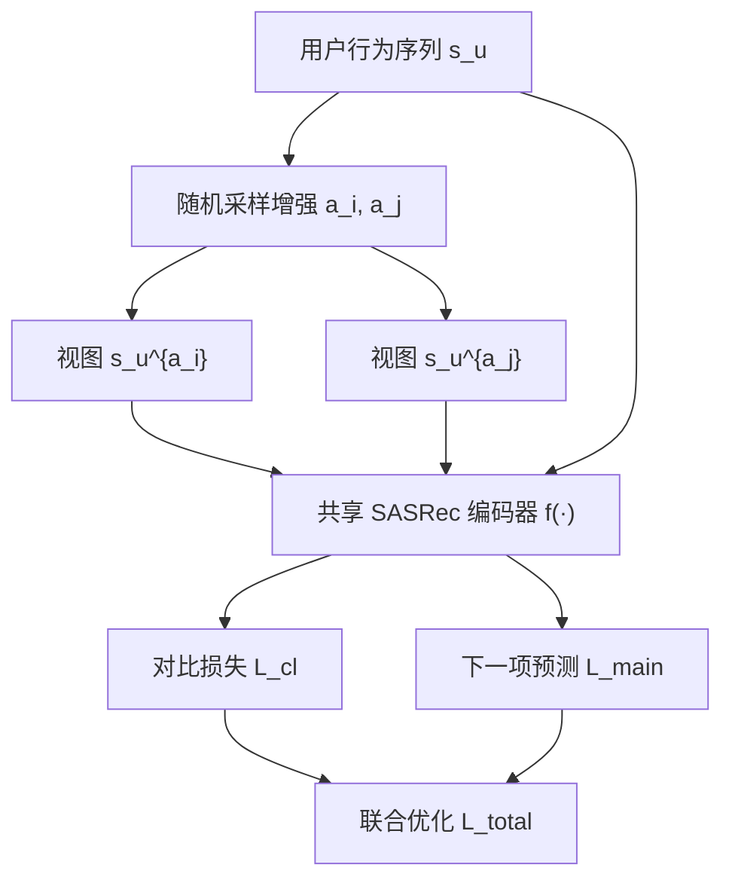
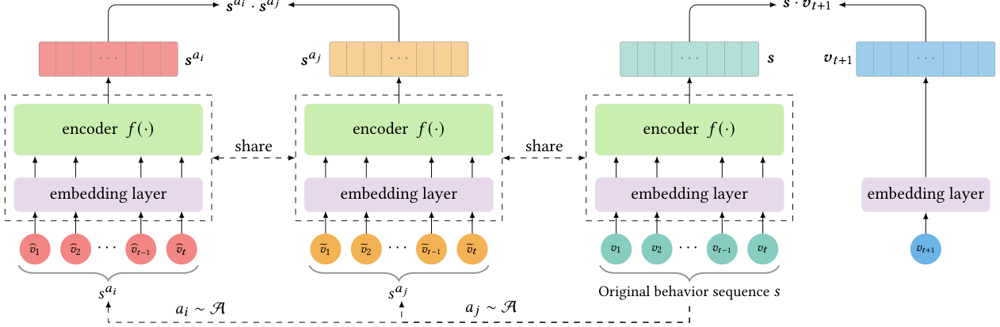
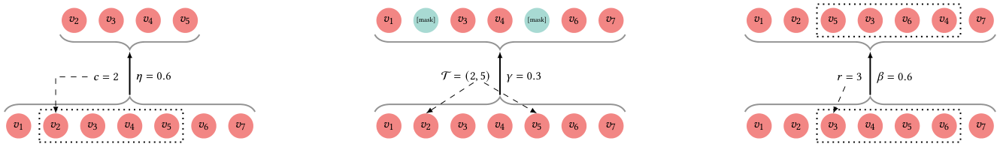

# Contrastive Learning for Sequential Recommendation (对比学习用于序列推荐)

- **会议/期刊**: SIGIR 2021
- **作者与机构**: Xu Xie, Fei Sun, Zhaoyang Liu, Shiwen Wu, Jinyang Gao, Bolin Ding, Bin Cui；北京大学 & 阿里巴巴
- **推荐链路定位**: 召回（序列召回）
- **研究方向**: 序列与会话推荐 / 自监督对比学习与交互去噪
- **论文原文**: [https://arxiv.org/abs/2010.14395v2](https://arxiv.org/abs/2010.14395v2)
- **开源代码**: [https://github.com/THUwangcy/ReChorus](https://github.com/THUwangcy/ReChorus)

## TL;DR (1分钟核心速览)

序列推荐模型通常只用下一项预测任务优化海量参数，交互稀疏时用户表示质量差。CL4SRec 提出多任务框架：对同一用户序列施加裁剪、掩码、重排三种增强，得到两个相关视图，用 InfoNCE 对比损失拉近正对、推远 batch 内负样本，并与下一项预测联合训练。在四个公开数据集、`5-core` + `Leave-One-Out` + `Full-Ranking` 协议下，HR@5 相对最强基线平均提升 11.02%，稀疏 Sports 上提升 18.38%。

## Background & Motivation (背景与核心矛盾)

- **主流范式**: 以 GRU4Rec、Caser、SASRec、GC-SAN 为代表的序列模型，通过 RNN/CNN/自注意力/GNN 编码历史交互，仅用下一项预测的交叉熵或 sampled softmax 优化全部参数。
- **前人局限**: 其一，训练信号完全来自稀疏的 next-item 监督，数据有限时用户表示容易过拟合、泛化差；其二，直接把 NLP 式预训练搬来并不合适——推荐系统缺乏大规模共享语料，且预测式自监督目标与下一项预测几乎同质，无法提供额外信息。
- **核心洞察 (Key Insight)**: 同一用户序列的不同增强视图应映射到潜在空间中相近的位置；而不同用户序列应被推开。这种序列级判别信号不依赖物品属性，仅用 ID 即可构造，正好补足 next-item 监督的不足。
- **本文切入点**: 将 SimCLR 式对比学习下沉到用户行为序列级，设计三种保持主要偏好的序列增强，与主推荐任务多任务联合优化。

## Method (核心方法设计)

### 1. 整体框架 (Overall Architecture)

对每个用户序列 $s_u$，从增强集合$\mathcal{A}$中随机采样两个算子$a_i,a_j$，分别得到视图$s_u^{a_i},s_u^{a_j}$；原始序列与两个视图共享同一个 SASRec 编码器$f(\cdot)$，输出用户表示。对比损失在 batch 内拉近同一用户两视图、推远其他用户的增强样本；同时原始序列末端表示用于下一项预测。总损失为$\mathcal{L}_{total}=\mathcal{L}_{main}+\lambda\mathcal{L}_{cl}$。推理阶段只保留编码器前向，用最后时刻表示与全库物品内积排序，开销与 SASRec 相同。

<figure class="paper-figure" markdown="span">
  <figcaption>图1：CL4SRec 的简单框架。从同一增强集合 A 中采样两种数据增强方法 𝑎𝑖 和 𝑎𝑗，将它们应用于每个用户的序列，从而获得每个序列的两个相关视图。共享嵌入层和用户表示模型 𝑓(·) 将原始序列与增强序列变换到潜在空间，在该空间应用对比损失和推荐损失。</figcaption>
</figure>

### 2. 关键设计拆解 (Key Designs)

1. **三种序列增强算子（Item Crop / Mask / Reorder）**：针对序列推荐缺少通用增强的问题，分别构造局部性、去噪性与顺序鲁棒性视图。裁剪保留长度 $\lfloor\eta|s_u|\rfloor$的连续子序列，提供局部偏好视图，两段无交集时近似“下一句预测”；掩码将比例$\gamma$的位置替换为 `[mask]`，因用户短期意图相对稳定，剩余物品仍能保留主旨，同时防止编码器过度共适应；重排对长度$\lfloor\beta|s_u|\rfloor$ 的连续子序列随机打乱，降低模型对严格顺序的依赖，提升对真实交互顺序噪声的鲁棒性。

<figure class="paper-figure" markdown="span">
  <figcaption>图2：CL4SRec 模型中所用增强操作的简要示意，包括物品裁剪、物品掩码和物品重排。</figcaption>
</figure>

2. **序列级 InfoNCE 对比损失**：对 mini-batch 中 $N$个用户各做两次增强，得到$2N$个样本；同一用户的两视图为正对，其余$2(N-1)$个为负样本。相似度用点积$\mathrm{sim}(\boldsymbol{u},\boldsymbol{v})=\boldsymbol{u}^\top\boldsymbol{v}$，损失为
$$
\mathcal{L}_{cl}(s_u^{a_i},s_u^{a_j})=-\log\frac{\exp\left((\boldsymbol{s}_u^{a_i})^\top \boldsymbol{s}_u^{a_j}\right)}{\exp\left((\boldsymbol{s}_u^{a_i})^\top \boldsymbol{s}_u^{a_j}\right)+\sum_{\boldsymbol{s}^-\in S^-}\exp\left((\boldsymbol{s}_u^{a_i})^\top \boldsymbol{s}^-\right)}.
$$
与 SimCLR 不同，作者去掉了非线性投影头，直接在编码器输出空间对比；实验发现保留投影头反而显著掉点，因为推荐任务需要的是可直接排序的用户表示，而非投影后的辅助空间。

3. **训练目标、负采样与推理效率**：主任务采用 sampled softmax 负采样，
$$
\mathcal{L}_{main}(s_{u,t})=-\log\frac{\exp\left(\boldsymbol{s}_{u,t}^\top \boldsymbol{v}_{t+1}^+\right)}{\exp\left(\boldsymbol{s}_{u,t}^\top \boldsymbol{v}_{t+1}^+\right)+\sum_{\boldsymbol{v}^-\in V^-}\exp\left(\boldsymbol{s}_{u,t}^\top \boldsymbol{v}^-\right)},
$$
其中 $V^-$为每步随机采样负物品；对比损失的负样本则复用 batch 内其他用户视图，无需额外负采样器。$\lambda$控制自监督强度，过大时对比项主导训练、主任务性能下降，原文在$0.1$–$4.0$ 间网格搜索。

## Experimental Setup & Evaluation Protocol (实验设置与评估协议)

- **数据集与预处理**: 四个公开数据集均按 `5-core` 迭代过滤，保留交互数不少于 5 的用户与物品；仅使用 ID 与时间顺序，无辅助属性。

| 数据集 | #Users | #Items | #Interactions | 平均长度 | 密度 |
| :--- | :---: | :---: | :---: | :---: | :---: |
| Beauty | 22,363 | 12,101 | 198,502 | 8.8 | 0.07% |
| Sports | 25,598 | 18,357 | 296,337 | 8.3 | 0.05% |
| Yelp | 30,983 | 29,227 | 321,087 | 10.3 | 0.04% |
| ML-1M | 6,040 | 3,953 | 1,000,209 | 165.6 | 4.19% |

- **数据划分与防穿越 (Splitting Strategy)**: 采用 `Leave-One-Out`：每个用户最后一条交互作测试、倒数第二条作验证，其余按时间顺序训练。
- **排名评测协议 (Ranking Protocol)**: 采用无偏 `Full-Ranking`，对用户未交互的全库物品按相似度排序，明确不采用采样排序，理由是采样指标可能与全库指标不一致。
- **对比基线与超参设置**: 基线含非个性化 Pop、非序列 BPR-MF/NCF、序列 GRU4Rec+/SASRec/GC-SAN，以及自监督 S³-Rec_MIP。所有可学习嵌入维度 $d=64$；CL4SRec 堆叠 2 层 Transformer、2 个头，batch size 256，Adam 学习率 0.001，ML-1M 最大序列长$T=20$、其余$T=50$，早停；提升在$p<0.01$ 下显著。

## Key Experimental Results (实验关键数据)

### 1. 主实验对比 (Main Results)

受篇幅限制，下表保留 HR@5 与 NDCG@5，完整 HR/NDCG@{5,10,20} 见原文 Table 2；`Improv.` 为 CL4SRec 相对次优基线的相对提升。

| 数据集 | 指标 | BPR-MF | NCF | GRU4Rec+ | SASRec | GC-SAN | S³-Rec_MIP | CL4SRec | Improv. |
| :--- | :---: | :---: | :---: | :---: | :---: | :---: | :---: | :---: | :---: |
| Beauty | HR@5 | 0.0120 | 0.0150 | 0.0239 | 0.0347 | 0.0270 | 0.0327 | **0.0396** | +14.12% |
| Beauty | NDCG@5 | 0.0065 | 0.0084 | 0.0150 | 0.0185 | 0.0169 | 0.0193 | **0.0208** | +7.77% |
| Sports | HR@5 | 0.0092 | 0.0122 | 0.0155 | 0.0185 | 0.0174 | 0.0171 | **0.0219** | +18.38% |
| Sports | NDCG@5 | 0.0053 | 0.0069 | 0.0098 | 0.0101 | 0.0110 | 0.0106 | **0.0116** | +5.45% |
| Yelp | HR@5 | 0.0127 | 0.0131 | 0.0150 | 0.0157 | 0.0157 | 0.0186 | **0.0201** | +8.06% |
| Yelp | NDCG@5 | 0.0074 | 0.0079 | 0.0091 | 0.0085 | 0.0101 | 0.0116 | **0.0124** | +6.70% |
| ML-1M | HR@5 | 0.0164 | 0.0164 | 0.0993 | 0.1108 | 0.1099 | 0.1078 | **0.1147** | +3.52% |
| ML-1M | NDCG@5 | 0.0097 | 0.0096 | 0.0574 | 0.0648 | 0.0647 | 0.0616 | **0.0662** | +2.16% |

### 2. 消融实验 (Ablation Study)

`SASRec_aug` 表示仅对训练序列做增强、不添加对比损失；指标为 HR@20 / NDCG@20。

| 数据集 | 增强 | SASRec | SASRec_aug | CL4SRec |
| :--- | :--- | :---: | :---: | :---: |
| Sports | Crop | 0.0541 / 0.0201 | 0.0546 / 0.0205 | **0.0596 / 0.0223** |
| Sports | Mask | 0.0541 / 0.0201 | 0.0513 / 0.0198 | **0.0595 / 0.0228** |
| Sports | Reorder | 0.0541 / 0.0201 | 0.0547 / 0.0208 | **0.0560 / 0.0213** |
| Yelp | Crop | 0.0529 / 0.0188 | 0.0576 / 0.0222 | **0.0598 / 0.0233** |
| Yelp | Mask | 0.0529 / 0.0188 | 0.0546 / 0.0206 | **0.0572 / 0.0219** |
| Yelp | Reorder | 0.0529 / 0.0188 | 0.0523 / 0.0203 | **0.0565 / 0.0222** |

### 3. 关键实验发现 (Key Findings)

1. **稀疏场景收益远大于稠密场景**：Sports 密度仅 0.05%，HR@5 提升 18.38%；Yelp 提升 8.06%；而 ML-1M 密度 4.19%，仅提升 3.52%。说明对比自监督在交互稀少时补充的序列级信号价值最高，正好命中 next-item 监督不足的痛点。
2. **对比损失本身不可被“加噪”替代**：Yelp 上 Crop 增强使 SASRec_aug 的 HR@20 从 0.0529 升至 0.0576，但加入对比损失后进一步升至 0.0598；Sports 上 Mask 增强反而使 SASRec_aug 从 0.0541 跌至 0.0513，而 CL4SRec 恢复到 0.0595。单纯数据扰动可能破坏序列，只有对比目标才能把增强转化为有效的表示约束。
3. **增强方式与比例存在数据集偏好，且用户表示更符合社交同质性**：Sports 上 Mask 最佳（HR@20 0.0595），Yelp 上 Crop 最佳（0.0598）；比例过小增强无效、过大则损坏主偏好，需在中间值取峰。此外，在未使用好友关系训练的前提下，Yelp 好友间平均余弦相似度由 SASRec 的 0.5198 提升至 CL4SRec 的 0.6100，证明学到的用户表示在潜在空间更贴近真实社交同质结构。

## Highlights & Limitations (亮点、对比与审稿批判)

- **与代表作对比 (vs. Prior Work)**: 相比 SASRec，本文不改序列编码器、不增加推理开销，仅通过序列级自监督补充训练信号；相比 S³-Rec_MIP 在物品/属性级做掩码预测且需预训练-微调，本文直接在用户序列级对比、仅用 ID、多任务联合训练，避免辅助信息依赖与灾难遗忘；相比 GC-SAN，本文指出序列内几乎无环、节点度数低时 GNN 带来的增益有限。
- **可迁移亮点**: 三种增强算子可即插即用地接入任意序列编码器；去掉 SimCLR 投影头、直接在排序表示空间对比的做法，可迁移到其他以向量检索为目标的对比推荐模型；batch 内复用负样本，无需额外负采样器。
- **审稿级局限批判**: 其一，增强类型与比例需按数据集网格搜索，缺乏自适应选择机制，工业调参成本不低；其二，仅用 ID 特征，未利用物品属性、多模态或跨域信号，且 in-batch 负样本受 batch size 限制，$\lambda$ 过大时性能明显退化，说明对比项与主任务的平衡仍较脆弱。

## Rating (四维评分)

- **方法创新性 (Novelty)**: ⭐⭐⭐⭐ （首个将序列级对比学习引入序列推荐的工作，三种增强设计贴合序列语义，但整体框架借鉴 SimCLR 较多，理论分析偏少）
- **评估协议与实验扎实度 (Protocol & Experiments)**: ⭐⭐⭐⭐ （四数据集、`Full-Ranking`、$p<0.01$ 显著性、增强/权重/表示质量多维消融齐全，但缺少线上 A/B 与更强现代基线）
- **写作与数学规范度 (Clarity & Rigor)**: ⭐⭐⭐⭐ （框架与公式清晰、符号统一，InfoNCE 未显式温度系数、增强比例的理论指导较弱）
- **工业落地与复现价值 (Industrial & Practical Value)**: ⭐⭐⭐⭐ （不改骨干、推理零额外开销，代码已并入 ReChorus，具备直接复现与部署价值，但增强超参需按场景调优）

