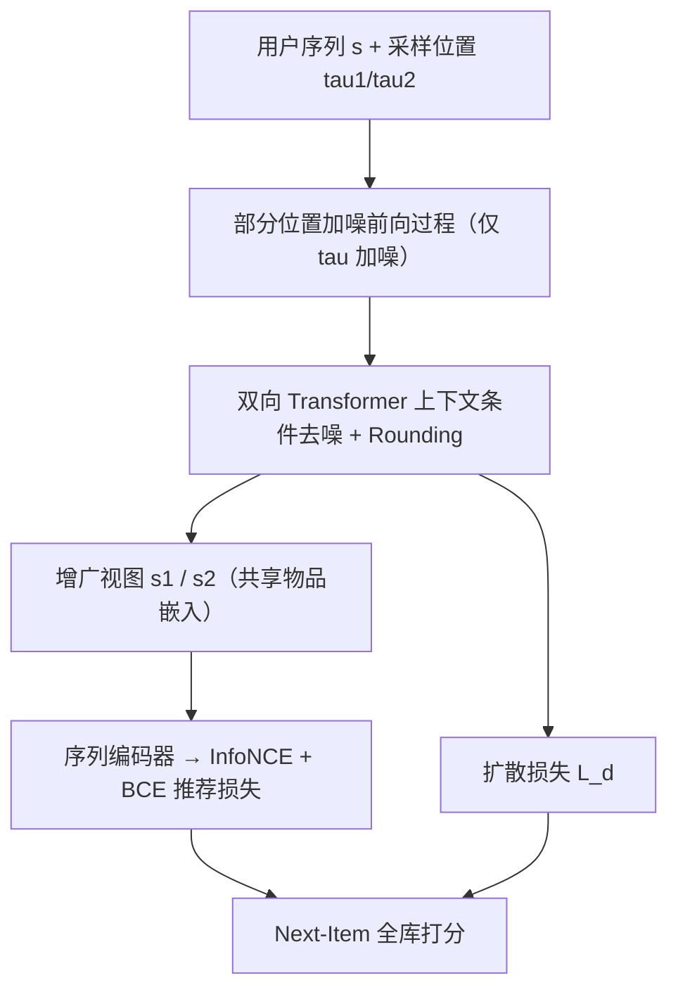
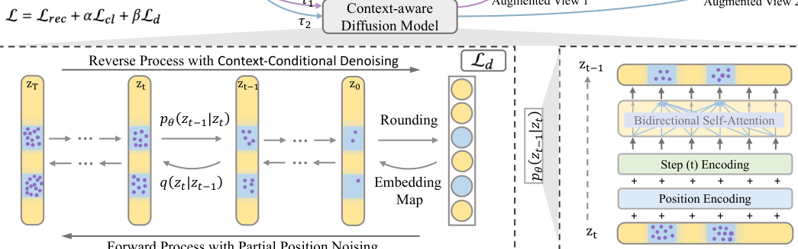

# Context Matters: Enhancing Sequential Recommendation with Context-aware Diffusion-based Contrastive Learning (上下文感知扩散式对比学习用于序列推荐)

- **会议/期刊**: CIKM 2024 (Full Paper)
- **作者与机构**: Ziqiang Cui, Haolun Wu, Bowei He, Ji Cheng, Chen Ma（香港城市大学、McGill 大学）
- **推荐链路定位**: 召回（Next-Item 序列召回）+ 训练期自监督增广
- **研究方向**: 序列与会话推荐 / 自监督对比学习与交互去噪
- **论文原文**: [https://arxiv.org/abs/2405.09369v5](https://arxiv.org/abs/2405.09369v5)
- **开源代码**: [https://github.com/ziqiangcui/CaDiRec](https://github.com/ziqiangcui/CaDiRec)

## TL;DR (1分钟核心速览)

现有序列对比学习（CL4SRec/CoSeRec/DuoRec/MCLRec）都用**随机** mask / substitute / crop / dropout 造正视图，稀疏序列被随机扰动后语义漂移严重——两个"正样本"可能一个偏运动、一个偏电子产品，强行拉近会让序列表征对用户偏好变化失敏甚至表征坍缩。本文提出 CaDiRec：用**双向 Transformer 扩散模型，仅对被选中位置加噪**，以左右两侧未扰动物品为上下文条件去噪生成"合乎上下文"的替代物品，两次采样得到一对合理解正视图，并与序列推荐模型**共享物品嵌入、端到端联合训练**。在 5 个基准上采用 Leave-One-Out + Full-Ranking 协议，HR@10 相对最强基线提升 4.2%–11.8%，NDCG@10 提升 4.2%–16.2%（$p<0.01$ 配对 t 检验）。

## Background & Motivation (背景与核心矛盾)

- **主流范式**: 以 SASRec 类自注意力编码器为骨架，叠加数据级（crop/mask/reorder/substitute）或模型级（不同 dropout mask）随机增广，最大化同用户两视图的一致性。
- **前人局限**: ① 序列极稀疏（Amazon 三集密度仅 0.05%–0.07%），任何随机替换都会破坏兴趣演化轨迹；② 随机性导致 "正对" 之间语义不一致，等价于把不同兴趣的用户序列强行拉近，压缩了表征区分度。
- **核心洞察 (Key Insight)**: 序列推荐与 CV 增广的本质差异在于**强时序依赖**——一个物品是否可替换，应由其前后文决定；因此增广应转为"在给定上下文的条件下采样一个替代物品"，即建模条件分布 $p(v_i \mid s_{<i}, s_{>i})$ 而非均匀随机。
- **本文切入点**: 扩散模型擅长条件生成，把"部分位置加噪 + 上下文条件去噪"引入对比增广，使正样本既多样（不同初始噪声）又语义一致。

## Method (核心方法设计)

### 1. 整体框架 (Overall Architecture)

输入用户序列 $\mathbf{s}$，按比例$\rho$采样位置集合$\tau_1$（视图 1）与$\tau_2$（视图 2）；前向过程只对选中位置的嵌入加高斯噪声，其余位置（上下文 + 相对位置编码 + 扩散步编码）完整保留，作为去噪条件；反向过程用**双向 Transformer（BERT）**逐级去噪，并每步执行 rounding 把选中位置映回物品嵌入空间、其余位置强行替换回原嵌入；最终得到两条增广序列，分别送入共享嵌入的 SASRec 式序列编码器，一路算推荐 BCE 损失、一路算对比 InfoNCE，扩散损失回传至同一嵌入矩阵，三损失端到端联合优化。

<figure class="paper-figure" markdown="span">
  <figcaption>图2：我们提出的CaDiRec概览。CaDiRec采用上下文感知扩散模型为对比学习生成合理的增强视图。该上下文感知扩散模型包括带部分位置加噪的前向过程和带上下文条件去噪的反向过程。这些设计使模型能够为选定位置生成符合上下文的合适替换，从而产生合理的增强序列。为有效捕获上下文依赖，CaDiRec在扩散中采用双向Transformer架构。</figcaption>
</figure>

### 2. 关键设计拆解 (Key Designs)

1. **部分位置加噪 + 上下文条件去噪（Context Guidance）**：痛点是不加约束的生成会滑成随机替换。做法是把扩散限定在选中位置：$\tilde{\mathbf{z}}_0,\tilde{f}_\theta,\tilde{\mathbf{e}}$只保留$\tau$分量，损失仅在$\tau$ 上计算，但双向注意力让生成物品能"看到"左右未被扰动的物品：
$\mathcal{L}_d=\sum_{t=2}^{T}\|\tilde{\mathbf{z}}_0-\tilde{f}_\theta(\mathbf{z}_t,t)\|^2+\|\tilde{\mathbf{e}}-\tilde{f}_\theta(\mathbf{z}_1,1)\|^2-\log p_\theta(\mathbf{s}|\mathbf{z}_0)$
直觉：上下文被硬性保留 = 条件约束被写进网络输入，替代物品被"夹"在相邻兴趣之间，语义漂移空间被压缩。
2. **双向编码器替代单向引导**：DiffuASR/DreamRec 只用历史单向信息，本文用 BERT 层堆叠同时编码前驱与后继，并通过位置编码 + 扩散步编码区分时序与噪声级；消融显示换成 MLP 编码器后 ML-1m NDCG@10 从 0.1251 掉到 0.1212。
3. **共享嵌入 + 端到端三损失**：若扩散与推荐各用一套嵌入，生成空间与打分空间错位，增广样本对推荐无益。共享矩阵 $\mathbf{M}$并联合优化$\mathcal{L}=\mathcal{L}_{rec}+\alpha\mathcal{L}_{cl}+\beta\mathcal{L}_d$；对比损失仍用内积 InfoNCE，batch 内$2(N-1)$ 个视图作负样本（免额外负采样）；推荐侧沿用 1 正 1 均匀负的 BCE。**推理期不跑扩散**，仅一次序列编码，延迟与 CL4SRec 同级（训练期较长，与 DreamRec 相当）。

## Experimental Setup & Evaluation Protocol (实验设置与评估协议)

- **数据集与预处理**: 全部按 `5-core` 过滤物品与用户。

| 数据集 | #Users | #Items | #Interactions | 密度 | 场景/特点 |
| :--- | :---: | :---: | :---: | :---: | :--- |
| ML-1m | 6,040 | 3,953 | 1,000,209 | 4.19% | 电影，稠密（序列长 200） |
| Beauty | 22,363 | 12,101 | 198,502 | 0.07% | Amazon 电商，稀疏 |
| Sports | 35,598 | 18,357 | 296,337 | 0.05% | Amazon 户外，最稀疏 |
| Toys | 19,412 | 11,924 | 167,597 | 0.07% | Amazon 玩具 |
| Yelp | 30,431 | 20,033 | 316,354 | 0.05% | 本地商户 |

- **数据划分与防穿越**: `Leave-One-Out`——最后一条测试、倒数第二条验证、其余训练（严格时序，无未来穿越）。
- **排名评测协议**: 无偏 `Full-Ranking`，对全物品集打分排序，指标 HR@5/10、NDCG@5/10。
- **对比基线与超参设置**: 11 个基线分三类——经典（BPR-MF、Caser、SASRec、BERT4Rec）、对比学习（S3-Rec、CL4SRec、CoSeRec、DuoRec、MCLRec）、扩散（DiffuASR、DreamRec）。嵌入维度 $d=64$，推荐侧 2 层 2 头、扩散侧 1 层 2 头双向 Transformer，$T=1000$，batch 256，Adam$lr=10^{-3}$，Amazon/Yelp 最大长度 50、ML-1m 为 200；为公平比较，**所有基线统一使用负采样 BCE**（而非全库 softmax）。每实验跑 5 次取均值，配对 t 检验$p<0.01$。

## Key Experimental Results (实验关键数据)

### 1. 主实验对比 (Main Results)

| 数据集 | 指标 | SASRec | BERT4Rec | CL4SRec | CoSeRec | DuoRec | MCLRec | DreamRec | **CaDiRec** | Improv. |
| :--- | :--- | :---: | :---: | :---: | :---: | :---: | :---: | :---: | :---: | :---: |
| ML-1m | HR@10 | 0.1902 | 0.1804 | 0.1978 | 0.1952 | 0.1996 | 0.2047 | 0.2006 | **0.2282** | +11.5% |
| ML-1m | NDCG@10 | 0.0906 | 0.0831 | 0.0932 | 0.0974 | 0.1003 | 0.1055 | 0.1077 | **0.1251** | +16.2% |
| Beauty | HR@10 | 0.0628 | 0.0601 | 0.0651 | 0.0648 | 0.0669 | 0.0689 | 0.0687 | **0.0718** | +4.2% |
| Beauty | NDCG@10 | 0.0321 | 0.0308 | 0.0322 | 0.0334 | 0.0336 | 0.0357 | 0.0352 | **0.0386** | +8.1% |
| Sports | HR@10 | 0.0339 | 0.0359 | 0.0383 | 0.0372 | 0.0362 | 0.0382 | 0.0374 | **0.0426** | +11.2% |
| Sports | NDCG@10 | 0.0174 | 0.0181 | 0.0173 | 0.0205 | 0.0189 | 0.0197 | 0.0191 | **0.0233** | +13.7% |
| Toys | HR@10 | 0.0675 | 0.0665 | 0.0684 | 0.0695 | 0.0681 | 0.0702 | 0.0643 | **0.0785** | +11.8% |
| Toys | NDCG@10 | 0.0374 | 0.0368 | 0.0388 | 0.0401 | 0.0385 | 0.0412 | 0.0402 | **0.0441** | +7.0% |
| Yelp | HR@10 | 0.0274 | 0.0338 | 0.0349 | 0.0323 | 0.0342 | 0.0354 | 0.0245 | **0.0387** | +9.3% |
| Yelp | NDCG@10 | 0.0136 | 0.0171 | 0.0181 | 0.0179 | 0.0189 | 0.0177 | 0.0152 | **0.0197** | +4.2% |

### 2. 消融实验 (Ablation Study)

| 变体 | ML-1m HR@10 / ND@10 | Beauty | Sports | Toys | Yelp |
| :--- | :---: | :---: | :---: | :---: | :---: |
| w/o CG（去上下文引导） | 0.1762 / 0.0861 | 0.0647 / 0.0355 | 0.0361 / 0.0202 | 0.0698 / 0.0398 | 0.0304 / 0.0149 |
| w/o B-Enc（换 MLP 编码器） | 0.2203 / 0.1212 | 0.0695 / 0.0365 | 0.0399 / 0.0211 | 0.0738 / 0.0419 | 0.0351 / 0.0172 |
| w/o $\mathcal{L}_d$（扩散损失） | 0.1757 / 0.0855 | 0.0644 / 0.0353 | 0.0363 / 0.0199 | 0.0695 / 0.0396 | 0.0300 / 0.0148 |
| w/o $\mathcal{L}_{cl}$（对比损失） | 0.1932 / 0.0982 | 0.0673 / 0.0359 | 0.0391 / 0.0208 | 0.0721 / 0.0412 | 0.0312 / 0.0153 |
| **CaDiRec (full)** | **0.2282 / 0.1251** | **0.0718 / 0.0386** | **0.0426 / 0.0233** | **0.0785 / 0.0441** | **0.0387 / 0.0197** |

### 3. 关键实验发现 (Key Findings)

1. **上下文引导是最大贡献项**：去掉上下文（等价 $\rho=1$ 全序列加噪）后 ML-1m HR@10 从 0.2282 跌至 0.1762（−22.8%），比去掉扩散损失（0.1757）幅度相当，说明"扩散"本身不是收益来源，**上下文条件**才是——正是它把生成退化为随机替换的风险掐断。
2. **扩散损失必须参与端到端更新**：w/o $\mathcal{L}_d$（扩散不训练，近似随机增广）在五个数据集上均接近最差，验证"合理增广"来自被优化的条件生成分布，而非结构本身；同时 w/o B-Enc 仍保留大部分收益（0.2203），说明双向编码的增益是次级但稳定的（+3.6% HR@10）。
3. **稀疏场景与短序列收益更大**：Sports/Toys/Yelp（密度 ≤0.07%）的 HR@10 提升 9.3%–11.8%，高于稠密的 ML-1m 在 HR@10 上的表现；按序列长度分桶后，最短桶（长度=5）上 CaDiRec 仍显著领先 MCLRec；超参上 $\alpha\approx0.2$、$\beta\le0.4$、$\rho\in[0.1,0.2]$最优，$\rho\to1$ 时因上下文耗尽而性能回落，与消融结论闭合。t-SNE 亦显示无上下文版本表征过度聚集（坍缩倾向），带上下文版本分布更疏散。

## Highlights & Limitations (亮点、对比与审稿批判)

- **与代表作对比 (vs. Prior Work)**: CL4SRec/CoSeRec 的增广是 rule-based 随机或共现相似度替换，完全不看序列上下文；DuoRec/MCLRec 转向模型级 dropout，随机性仍在；DiffuASR/DreamRec 把扩散当作**生成器直接做推荐**（前者拼接伪物品导致误差累积、后者直接生成下一物品），本文则把扩散**降格为高质量的增广采样器**，只在训练期使用，定位差异带来更好的精度/延迟折中。
- **可迁移亮点**: ① "只对被扰动位置加噪、其余位置作为条件回填" 的部分加噪范式，可移植到序列去噪自监督、物品属性补全、会话补全等任务；② 生成模型与主模型的物品嵌入共享 + 三损失联合训练，避免增广空间与打分空间错位，这一条对任何"生成式增广 + 判别式主模型"的架构都通用。
- **审稿级局限批判**: ① 训练开销显著：$T=1000$步扩散 + 双向编码器，虽推理不加负担，但训练成本与调参（$\alpha,\beta,\rho$ 三超参在稠密/稀疏数据上最优点不一致）对工业迭代不友好；② 评测仍限于离线 Full-Ranking，无线上 A/B 或大规模时延/吞吐报告；③ 生成粒度停留在"单物品替换"，未涉及插入/删除（序列长度与外推行为），且对极长序列（>200）与冷启动物品的条件生成质量未做专门分析。

## Rating (四维评分)

- **方法创新性 (Novelty)**: ⭐⭐⭐⭐ （首次把"上下文条件扩散"用于序列对比增广，部分位置加噪 + 双向条件去噪的算子设计有明确物理直觉，但整体是成熟模块的组合式创新）
- **评估协议与实验扎实度 (Protocol & Experiments)**: ⭐⭐⭐⭐ （5 数据集、11 基线、Leave-One-Out + 全库排序、5 次重复 + $p<0.01$ 检验，消融/超参/长度分桶/t-SNE 齐备，唯缺线上验证与统计显著性方差报告）
- **写作与数学规范度 (Clarity & Rigor)**: ⭐⭐⭐⭐ （扩散前向/反向与变分下界推导完整、符号统一，$\mathcal{L}_d$ 的简化引用 DiffuSeq 而未展开推导，稍显依赖读者前置知识）
- **工业落地与复现价值 (Industrial & Practical Value)**: ⭐⭐⭐ （代码开源、推理零额外开销可直接上线，但 1000 步扩散的训练成本与三超参敏感性会抬高工程迭代代价）

