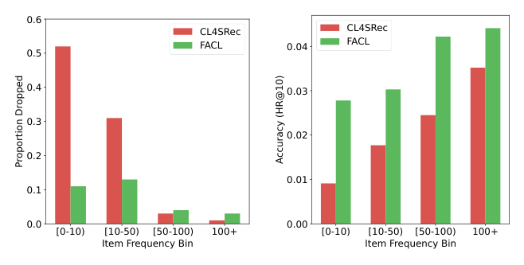
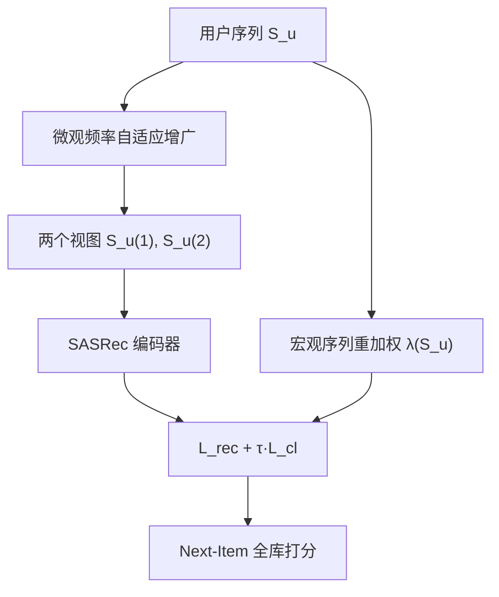
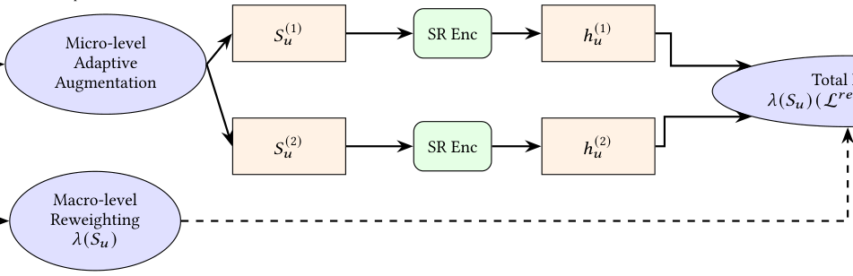

# Frequency-aware Adaptive Contrastive Learning for Sequential Recommendation（频率感知自适应对比学习序列推荐）

- **会议/期刊**: ICDE 2022（目录归档；arXiv 2026 预印本）
- **作者与机构**: Zhikai Wang, Weihua Zhang，复旦大学
- **推荐链路定位**: 召回 / 端到端序列推荐
- **研究方向**: 序列与会话推荐 / 自监督对比学习与交互去噪
- **论文原文**: [https://arxiv.org/abs/2601.17057v1](https://arxiv.org/abs/2601.17057v1)
- **开源代码**: 暂未开源

## TL;DR (1分钟核心速览)

本文针对序列推荐中随机数据增广对低频物品和短序列过度扰动的问题，提出频率感知自适应对比学习 FACL：微观按物品频率缩放扰动概率，宏观按序列稀有度与长度重加权损失。在 5 个公开数据集的 5-core、Leave-One-Out、Full-Ranking 协议下，HR@10/NDCG@10 较 RCL 普遍提升 3%–4.5%，最高约 3.8%。

## Background & Motivation (背景与核心矛盾)

- **主流范式**: CL4SRec/CoSeRec 通过 crop/drop/reorder 或 substitute/insert 生成正视图，并用 InfoNCE 拉近同序列表示；DuoRec/RCL 等模型增广方法更稳，但同样未显式保护稀有交互。
- **前人局限**: 随机增广无视频率，低频物品在序列中冗余少，更易被完全丢弃；短序列与低频用户本身信号稀疏，正视图生成时更易破坏用户意图。
- **核心洞察 (Key Insight)**: 图 1 在 Yelp 显示，drop-item 扰动下低频物品被完全丢弃比例最高，且低频目标 HR@10 显著下降；频率与扰动伤害呈强负相关。
- **本文切入点**: 用全局频率统计同时控制“每个物品扰动多少”与“每条序列在损失中占多大权重”。

<figure class="paper-figure" markdown="span">
  <figcaption>图1：左：在丢弃项目扰动下，按项目频率分箱统计被完全丢弃的项目比例（基线 vs. 本文方法）。右：不同频率水平下目标项目的预测准确率（基线 vs. 本文方法）。</figcaption>
</figure>

## Method (核心方法设计)

### 1. 整体框架 (Overall Architecture)

FACL 以 SASRec 等序列编码器为骨干：输入用户序列 $S_u$后，微观模块按物品频率生成两个低频保护的自适应增广视图，编码得到$h_u^{(1)},h_u^{(2)}$；宏观模块计算序列权重$\lambda(S_u)$，同时放大推荐损失与对比损失。训练仍以 next-item softmax 为主、InfoNCE 为辅，推理时只保留原序列编码与全库打分，不增加在线增广开销。

<figure class="paper-figure" markdown="span">
  <figcaption>图2：所提出的 FACL 框架概览。</figcaption>
</figure>

### 2. 关键设计拆解 (Key Designs)

1. **微观频率自适应增广**：低频物品 $f(v)\ll\bar f_{S_u}$时降低扰动概率，核心为$\rho(v)=\gamma f(v)/\bar f_{S_u}$，并截断至$2\gamma$；子序列采样接受率$\alpha(S')=\min(f_{\min}(S')/\bar f,1)$。直觉是保护稀有物品的局部上下文，避免 drop/substitute/reorder 直接抹去意图信号。
2. **宏观频率与长度重加权**：对含稀有物品或较短序列赋更高权重，$\lambda(S_u)=(\bar f/\bar f(S_u)\cdot\bar l/|S_u|)^\beta$。它把“物品稀有”和“用户行为稀疏”同时注入损失，使低频样本不被高频序列淹没。
3. **训练目标与复杂度**：总损失为 $\mathcal{L}=\sum_{u}\lambda(S_u)(\mathcal{L}_{rec}+\tau\mathcal{L}_{cl})$，$\mathcal{L}_{cl}$用批内负样本 InfoNCE。每批复杂度$O(Bn+B^2d)$，仅比标准对比学习多线性频率统计开销；推理无额外负采样。

## Experimental Setup & Evaluation Protocol (实验设置与评估协议)

- **数据集与预处理**: 采用 Amazon Beauty/Sports、ML-1M/20M、Yelp，过滤少于 5 次交互的用户/物品；ML 最大序列长度 200，其余 50。

| 数据集 | #Users | #Items | #Interactions | 平均长度 | 稀疏度 |
| :--- | ---: | ---: | ---: | ---: | ---: |
| Beauty | 22,363 | 12,101 | 198,502 | 8.9 | 99.93% |
| Sports | 35,598 | 18,357 | 296,337 | 8.3 | 99.95% |
| ML-1M | 6,041 | 3,417 | 999,611 | 165.5 | 95.16% |
| ML-20M | 138,493 | 27,278 | 20,000,263 | 144.4 | 99.47% |
| Yelp | 30,499 | 20,068 | 317,182 | 10.4 | 99.95% |

- **数据划分与防穿越**: 按序列推荐惯例采用 `Leave-One-Out`：每用户最后 1 条测试、倒数第 2 条验证。
- **排名评测协议**: 无偏 `Full-Ranking`，对全物品集排序，报告 HR@{5,10}、NDCG@{5,10}；训练用全库 softmax 交叉熵，无额外负采样。
- **对比基线与超参**: 基线含 SASRec、CL4SRec、CoSeRec、CT4Rec、DuoRec、BSARec、RCL；骨干统一 SASRec，$d=64$、2 层 2 头、Adam$10^{-3}$、batch 256；报告 3 次随机种子均值与标准差，未显式给出显著性检验。

## Key Experimental Results (实验关键数据)

### 1. 主实验对比 (Main Results)

下表保留 HR@10/NDCG@10（HR@5 趋势一致，原文表 2 更全）；**加粗为最优**。

| 数据集 | 指标 | SASRec | CL4SRec | CoSeRec | CT4Rec | DuoRec | BSARec | RCL | **FACL** | Improv. |
| :--- | :--- | ---: | ---: | ---: | ---: | ---: | ---: | ---: | ---: | ---: |
| Beauty | HR@10 | .0627 | .0683 | .0772 | .0856 | .0845 | .0850 | .0898 | **.0929** | 3.34% |
| Beauty | NDCG@10 | .0281 | .0317 | .0431 | .0428 | .0443 | .0448 | .0476 | **.0493** | 3.57% |
| Sports | HR@10 | .0336 | .0374 | .0458 | .0479 | .0498 | .0505 | .0528 | **.0548** | 3.79% |
| Sports | NDCG@10 | .0169 | .0194 | .0244 | .0260 | .0262 | .0270 | .0287 | **.0296** | 3.14% |
| ML-1M | HR@10 | .1904 | .2239 | .2533 | .2904 | .2946 | .2970 | .3045 | **.3151** | 3.55% |
| ML-1M | NDCG@10 | .0910 | .1284 | .1583 | .1634 | .1680 | .1702 | .1763 | **.1828** | 3.65% |
| ML-20M | HR@10 | .2152 | .2323 | .2495 | .2802 | .3001 | .3040 | .3113 | **.3226** | 3.57% |
| ML-20M | NDCG@10 | .1013 | .1302 | .1426 | .1652 | .1735 | .1760 | .1805 | **.1869** | 3.56% |
| Yelp | HR@10 | .0268 | .0342 | .0455 | .0617 | .0614 | .0632 | .0675 | **.0701** | 3.85% |
| Yelp | NDCG@10 | .0133 | .0151 | .0269 | .0356 | .0383 | .0390 | .0418 | **.0434** | 3.82% |

### 2. 消融实验 (Ablation Study)

在 ML-20M 与 Yelp 上移除/替换核心组件，**加粗为完整 FACL**。

| 变体 | ML-20M HR@10 | ML-20M NDCG@10 | Yelp HR@10 | Yelp NDCG@10 |
| :--- | ---: | ---: | ---: | ---: |
| CoSeRec | .2495 | .1426 | .0455 | .0269 |
| w/o adaptive aug. | .3142 | .1829 | .0666 | .0411 |
| w/ len-aware aug. | .3039 | .1712 | .0621 | .0391 |
| LLM-based reweight | .3131 | .1816 | .0681 | .0408 |
| w/o reweight | .3150 | .1832 | .0674 | .0404 |
| w/o item reweight | .3165 | .1841 | .0678 | .0416 |
| w/o len-aware reweight | .3169 | .1843 | .0679 | .0417 |
| **FACL (full)** | **.3226** | **.1869** | **.0701** | **.0434** |

### 3. 关键实验发现 (Key Findings)

1. FACL 在 5 个数据集 HR@10/NDCG@10 全部第一，较 RCL 提升约 3.1%–4.5%；Yelp HR@5 为 .0501 vs .0481（+4.15%），说明“频率自适应数据增广”可反超模型增广类方法。
2. ML-20M 上去掉自适应增广后 HR@10 从 .3226 降至 .3142（-2.60%），去掉重加权降至 .3150（-2.36%），两者互补；而给增广再加长度缩放反而降至 .3039，说明短序列的扰动概率已按比例缩小，额外缩放冗余。
3. 图 5/6 的分桶结果显示，FACL 在低频物品与低频用户组均最高且跨频率差距最小；Yelp 上 HR@10 .0701 远高于 CL4SRec 的 .0342，表明稀有意图信号被更完整保留。

## Highlights & Limitations (亮点、对比与审稿批判)

- **与代表作对比 (vs. Prior Work)**: CL4SRec/CoSeRec 对所有物品等概率增广，易破坏低频上下文；RCL 虽做相对对比学习，仍未显式建模频率。FACL 的增量在于用频率同时调节扰动强度与样本权重，且可挂接 FMLP 等非 Transformer 骨干并保持 3%–4% 增益。
- **可迁移亮点**: 频率缩放函数可迁移到图对比、去噪自编码与多模态增广；序列级 $\lambda$ 重加权可直接用于稀疏用户/长尾场景的损失重平衡。
- **审稿级局限批判**: 需存储/近似物品相关性，最坏 $O(|V|^2)$空间；零频新物品无法获得可靠频率先验；$\gamma,\eta,\beta$ 依赖验证集调参，且原文仅离线 Full-Ranking 评测，缺少线上延迟与 A/B 证据。

## Rating (四维评分)

- **方法创新性 (Novelty)**: ⭐⭐⭐⭐ （双层级频率自适应机制简单但切中增广偏差，实证动机清晰）
- **评估协议与实验扎实度 (Protocol & Experiments)**: ⭐⭐⭐⭐ （5 数据集、全库排序、3 种子标准差与充分消融；但未报告显著性检验与线上验证）
- **写作与数学规范度 (Clarity & Rigor)**: ⭐⭐⭐⭐ （公式与复杂度清楚；符号 $\gamma$ 同时指增广比与温度，易混淆）
- **工业落地与复现价值 (Industrial & Practical Value)**: ⭐⭐⭐ （线性开销、骨干无关、易部署；但无开源代码，物品相关性存储与冷启动频率缺失仍需工程处理）

