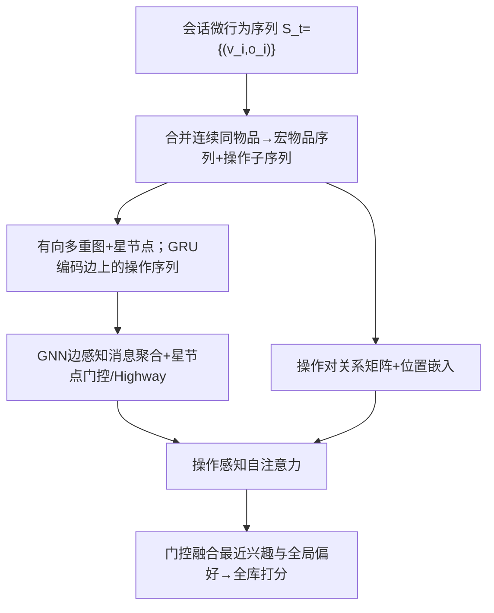
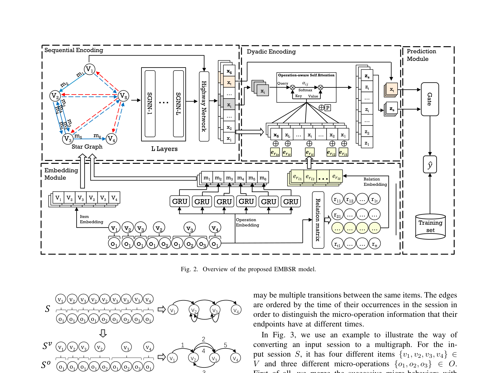

# Micro-Behavior Encoding for Session-based Recommendation（面向会话推荐的微行为编码）

- **会议/期刊**: ICDE 2022
- **作者与机构**: Jiahao Yuan, Wendi Ji, Dell Zhang, Jinwei Pan, Xiaoling Wang；华东师范大学、伦敦大学伯贝克学院、字节跳动 AI Lab
- **推荐链路定位**: 召回/精排（会话级 Next-Item）
- **研究方向**: 序列与会话推荐 / 图神经网络推荐
- **论文原文**: [论文原文链接](https://arxiv.org/abs/2204.02002v1)
- **开源代码**: [开源代码仓库链接](https://github.com/SamHaoYuan/EMBSR)

## TL;DR (1分钟核心速览)

针对会话推荐只建模物品级“宏行为”、忽略点击/加购/读评论等微操作的问题，EMBSR 将微行为序列与操作对关系联合编码：多重图+GNN 聚合序列模式，操作感知自注意力捕捉二元关系。在 JD-Appliances/Computers/Trivago 全库排序下，H@10 相对最强基线提升 5.31%/8.56%/14.01%，M@10 提升 11.35%/16.25%/4.93%。

## Background & Motivation (背景与核心矛盾)

- **主流范式**: GRU4Rec、NARM、STAMP、BERT4Rec、SR-GNN、GC-SAN、SGNN-HN 等主要建模会话内物品转移（宏行为）。
- **前人局限一**: 物品序列过于粗粒度；同一物品序列在不同操作下可能对应完全不同意图，如图 1 中“读评论后购买”与“直接购买”的差异无法由宏序列区分。
- **前人局限二**: RIB/HUP/MKM-SR 等微行为模型多用 RNN 建模操作序列，只能捕捉相邻依赖；GNN 构图也难把同一物品的多次操作融入消息传播。
- **核心洞察 (Key Insight)**: 微行为存在两类互补模式——同一物品上的“序列模式”和跨操作对的“二元关系模式”（如 $\langle read,purchase\rangle$vs$\langle click,purchase\rangle$）。
- **本文切入点**: 用有向多重图聚合序列模式，再用操作感知自注意力显式编码操作对关系。

## Method (核心方法设计)

### 1. 整体框架 (Overall Architecture)

输入会话先合并同一物品的连续微行为，得到宏物品序列及每物品的操作子序列；将宏物品序列转为带星节点的有向多重图，每条边的特征由该次转移终点物品的操作子序列经 GRU 编码，GNN 按边聚合微操作信息并更新卫星/星节点；随后把微行为元组嵌入、操作对关系嵌入与位置嵌入送入操作感知自注意力，得到全局偏好，与最后微行为表示门控融合后全库 softmax 打分。

### 2. 关键设计拆解 (Key Designs)

1. **多重图构建与微操作边特征**：普通会话图丢失同一物品多次操作。本文将每条有向边 $(v_i,v_{i+1})$绑定终点物品的操作序列，经 GRU 得$\tilde h_{i+1}=GRU(e_{o_{i+1}},\tilde h_{i+1,j-1})$；消息函数为$m_{i+}^{l+1}=W_m^+[e_{u_j}^l;\tilde h_j]+b_m^+$，入/出边分别聚合。直觉是同一物品转移因操作历史不同而产生不同消息。
<figure class="paper-figure" markdown="span">
  <figcaption>图 3. 不同的图构建方式。我们采用第二种方式，即将会话转换为多重图。</figcaption>
</figure>

2. **操作感知自注意力**：标准自注意力只能编码绝对操作，无法表达操作对语义。本文建立关系矩阵 $M_R\in\mathbb{R}^{|O|^2\times d}$，令$z_i=\sum_j\alpha_{ij}(x_j+e_{r_{ij}}+e_{p_j})$，$e_{ij}=x_iW_Q(x_j+e_{r_{ij}}+e_{p_j})^\top/\sqrt d$。这样把“读评论→购买”与“点击→购买”的差异注入注意力键值。

3. **门控融合与训练目标**：全局偏好 $z_s$与最近兴趣$x_t$通过$\beta=\sigma(W_m[z_s;x_t]+b_m)$、$m=\beta\odot z_s+(1-\beta)\odot x_t$融合；预测$\hat y_i=softmax(w_k\hat m^\top\hat v_i)$，损失$\mathcal{L}=-\sum_i y_i\log\hat y_i$。训练使用全库 softmax 交叉熵，无负采样；推理需构图、GNN 与$O(t^2)$ 自注意力。

## Experimental Setup & Evaluation Protocol (实验设置与评估协议)

- **数据集与预处理**: JD 两集过滤出现少于 50 次的物品，Trivago 过滤少于 5 次；删除单物品会话。原文未给 #Users。

| 数据集 | 会话数(训/验/测) | #Items | #Micro-behavior | 过滤/场景 |
| :--- | :---: | :---: | :---: | :--- |
| JD-Appliances | 583,255/83,279/166,670 | 75,159 | 32,736,184 | 物品<50；家电 |
| JD-Computers | 577,301/82,391/164,782 | 93,140 | 24,245,132 | 物品<50；电脑 |
| Trivago | 260,877/37,027/74,770 | 183,561 | 5,726,369 | 物品<5；酒店搜索 |

- **数据划分与防穿越 (Splitting Strategy)**: 按会话 70%/10%/20% 划分训练/验证/测试，取每会话最后一项为 ground truth；非全局时间戳切分，且预测下一宏物品而非下一微行为，避免 $v_t=v_{t+1}$ 泄漏。
- **排名评测协议 (Ranking Protocol)**: 对全部候选物品打分后取 top-K，属于 `Full-Ranking` 全库排序；训练目标为全库 softmax，无负采样。
- **对比基线与超参设置**: 宏行为基线 S-POP、SKNN、NARM、STAMP、SR-GNN、GC-SAN、BERT4Rec、SGNN-HN；微行为基线 RIB、HUP、MKM-SR。嵌入维度 $d=100$，batch 512，最多 50 epoch，Adam，学习率$\{0.001,0.003,0.005,0.008,0.01\}$，dropout$\{0,0.1,\ldots,0.5\}$；Wilcoxon 检验$p\ll0.01$。

## Key Experimental Results (实验关键数据)

### 1. 主实验对比 (Main Results)

| 方法 | Appl. H@10 | Appl. M@10 | Comp. H@10 | Comp. M@10 | Triv. H@10 | Triv. M@10 |
| :--- | :---: | :---: | :---: | :---: | :---: | :---: |
| NARM | 42.69 | 19.46 | 28.14 | 10.70 | 18.02 | 8.25 |
| STAMP | 42.10 | 19.72 | 26.97 | 11.26 | 17.13 | 8.62 |
| SR-GNN | 43.80 | 21.11 | 29.11 | 12.57 | 15.91 | 7.94 |
| GC-SAN | 42.02 | 19.38 | 28.75 | 10.58 | 20.10 | 8.55 |
| BERT4Rec | 42.67 | 18.52 | 26.79 | 10.59 | 15.00 | 7.13 |
| SGNN-HN | 47.07 | 22.64 | 32.01 | 13.00 | 20.13 | 9.53 |
| MKM-SR | 45.02 | 22.22 | 30.21 | 13.23 | 16.63 | 8.14 |
| **EMBSR** | **49.57** | **25.21** | **34.75** | **15.38** | **22.95** | **10.00** |
| Improv. | +5.31% | +11.35% | +8.56% | +16.25% | +14.01% | +4.93% |

### 2. 消融实验 (Ablation Study)

| 变体 | Appl. H@10/M@10 | Comp. H@10/M@10 | Triv. H@10/M@10 |
| :--- | :---: | :---: | :---: |
| w/o 二元关系 (EMBSR-NS) | 46.73/21.12 | 32.19/12.51 | 23.04/9.76 |
| w/o 序列模式 (EMBSR-NG) | 46.78/19.04 | 32.04/11.91 | 22.19/9.96 |
| **EMBSR** | **49.57/25.21** | **34.75/15.38** | **22.95/10.00** |

去掉融合门控（EMBSR-NF）在 Appliances 上 H@10=48.99、M@10=25.60；M@10 略高于完整模型的 25.21，说明门控主要提升 H@10 与跨数据集稳定性，而非所有指标单调最优。

### 3. 关键实验发现 (Key Findings)

- 主实验上 EMBSR 在三个数据集全面最优；Trivago H@20 达 31.18，较 SGNN-HN 的 26.39 提升 18.15%，说明当目标物品常不在会话内时，细粒度操作对扩展召回更关键。
- 消融中去掉二元关系使 Computers M@10 从 15.38 降至 12.51（-18.7%），去掉序列模式使 Appliances M@10 从 25.21 降至 19.04（-24.5%），两种微行为模式互补，序列模式对 MRR 贡献更大。
- Computers 案例中仅宏序列的 SGNN-Self 前 5 全是键盘且未命中目标，EMBSR 前 5 全是鼠标垫并命中 MP2；但 Trivago H@1 为 5.49，低于 SGNN-HN 的 5.64（-2.66%），说明 top-1 仍受目标缺失和粗排召回限制。

## Highlights & Limitations (亮点、对比与审稿批判)

- **与代表作对比 (vs. Prior Work)**: SGNN-HN 只用宏物品星图；EMBSR 在同一星图框架中加入边级 GRU 微操作消息。MKM-SR 将物品 GNN 与操作 RNN 分开再拼接；EMBSR 把操作序列直接注入 GNN 消息，并用操作感知自注意力建模二元关系。RIB/HUP 只建模微行为顺序，无法表达跨操作依赖。
- **可迁移亮点**: 将“边绑定的操作子序列经 GRU 编码”作为图消息特征，可直接迁移到多行为电商图；把操作对关系作为自注意力 bias，也适用于多模态行为序列。
- **审稿级局限批判**: 关系矩阵规模为 $|O|^2$，自注意力为$O(t^2)$，操作类型多或会话长时开销明显；实验仅覆盖三个公开数据集，无线上 A/B，且未对不同操作加权/过滤，Trivago top-1 仍落后于 SGNN-HN。

## Rating (四维评分)

- **方法创新性 (Novelty)**: ⭐⭐⭐⭐ （首次系统区分微行为序列模式与二元关系模式，多重图+操作感知注意力组合新颖）
- **评估协议与实验扎实度 (Protocol & Experiments)**: ⭐⭐⭐⭐ （三数据集、全库排序、11 个基线、Wilcoxon 显著性检验齐全，但消融表原文排版有错位）
- **写作与数学规范度 (Clarity & Rigor)**: ⭐⭐⭐⭐ （公式与符号基本清晰，星节点/多重图记号较密，复杂度分析略简）
- **工业落地与复现价值 (Industrial & Practical Value)**: ⭐⭐⭐⭐ （代码已开源，微行为信号易落地；但 $|O|^2$ 关系矩阵与图+注意力推理开销需工程优化）

