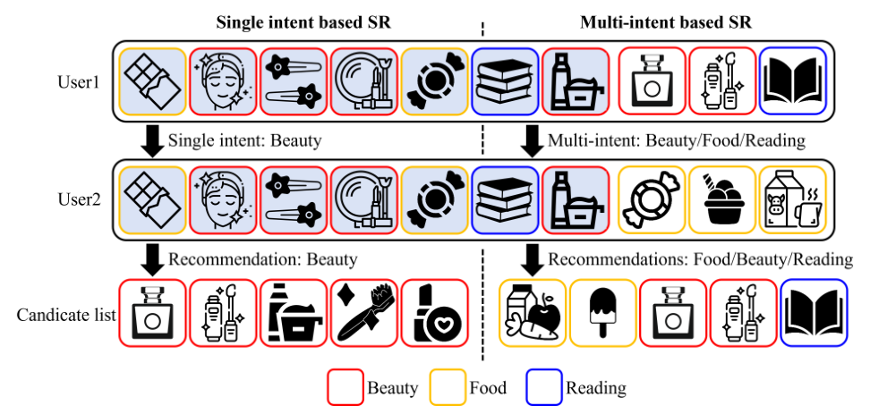
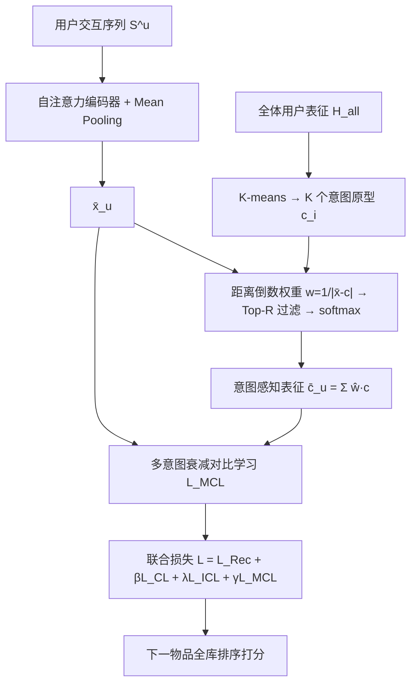

# Multi-intent Aware Contrastive Learning for Sequential Recommendation (多意图感知对比学习的序列推荐)

- **会议/期刊**: ICDE 2022
- **作者与机构**: Junshu Huang（深圳大学）、Zi Long、Xianghua Fu、Yin Chen（深圳技术大学）
- **推荐链路定位**: 召回（序列编码器 + 下一物品全库排序）
- **研究方向**: 序列与会话推荐 / 自监督对比学习与去噪
- **论文原文**: [https://arxiv.org/abs/2409.08733v1](https://arxiv.org/abs/2409.08733v1)
- **开源代码**: 暂未开源

## TL;DR (1分钟核心速览)

现有序列对比学习（ICLRec/IOCRec）把用户序列压缩成**单一意图**表征做 InfoNCE 对齐，违背了真实购物序列天然多意图的事实。MCLRec 用 K-means 得到 K 个潜在意图原型，按欧氏距离倒数取 Top-$R$ 意图加权聚合成"意图感知用户表征"，并在对比相似度中引入**意图距离衰减项**抑制高相似对的贡献。在 Beauty/Sports/Toys/Yelp 四个 5-core 数据集、`Full-Ranking` + `Leave-One-Out` 协议下，HR@5 相对最优基线最高提升 10.76%，NDCG@5 最高提升 15.64%。

## Background & Motivation (背景与核心矛盾)

- **主流范式**: CL4SRec 类方法靠 crop/mask/reorder 序列增广做实例级 InfoNCE；ICLRec 用 EM + K-means 学单一意图分布来监督用户表征；IOCRec 用全局/局部解耦取"主意图"。
- **前人局限**: 其一，单意图表征把序列中并存的"美妆/食品/阅读"等兴趣坍缩成一个主向量（图 1 中 User1 含 perfume，单意图模型会把 User2 全推美妆）；其二，ICLRec 的意图仅作为监督信号，**意图维度之间无信息交叉**，IOCRec 虽解耦但仍只用单意图级表征参与 CL。
- **核心洞察 (Key Insight)**: 相近用户的行为序列共享部分意图子集，若能把"另一序列可解释的多意图组合"作为锚点的对照目标，正样本的多样性收益将大于简单实例对齐。
- **本文切入点**: 把"用户—意图"空间距离显式编码进表征聚合与对比权重，使 CL 目标从单点到多点、并从等权到距离自适应加权。

<figure class="paper-figure" markdown="span">
  <figcaption>图 1：该图展示了SR模型训练由单意图或多意图信息引导时候选物品倾向的变化。User2序列中与User1序列相同的物品以蓝色背景高亮。</figcaption>
</figure>

## Method (核心方法设计)

### 1. 整体框架 (Overall Architecture)

每条序列先过自注意力编码器并做 mean-pooling 得到 $\bar{x}_u$；每轮训练在全体用户表征集合$\mathcal{H}_{all}$上跑一次 Faiss 加速的 K-means 得到$K$个意图原型$C=\{c_i\}_{i=1}^{K}$（原型随训练轮次在线刷新）。对 batch 内每个用户，计算与$K$个原型的距离倒数权重，仅保留 Top-$R$后 softmax 归一化并加权求和得到意图感知表征$\bar{c}_u$。随后$\{\bar{x}_u,\bar{c}_u\}$共$2N$ 个表征进入改造后的 InfoNCE，与原序列对比损失、ICL 意图对比损失、下一物品 BPR 损失多任务联合训练；推理时仅用编码器打分，无额外开销。

### 2. 关键设计拆解 (Key Designs)

1. **意图感知用户表征（Top-R 硬过滤 + 软加权）**：痛点是单意图平均池化丢失多兴趣，且全部 $K$个原型加权会引入与当前决策无关的噪声意图。权重定义为欧氏距离倒数$w_{u,i}=1/|\bar{x}_u - c_i|$，再只保留最大的$R$个（$R \ll K$）并置零其余：

$$\hat{w}_{u,i}=\frac{\exp(\omega_{u,i})}{\sum_{j=1}^{K}\exp(\omega_{u,j})},\quad \omega_{u,i}=\begin{cases} w_{u,i}, & c_i \in \hat{C}_u \\ 0, & c_i \notin \hat{C}_u\end{cases}$$

$\bar{c}_u=\sum_{i=1}^{K}\hat{w}_{u,i}\cdot c_{u,i}$。直觉：零化后再 softmax 起到"平滑"作用，避免无关意图被极小权重稀释主意图，同时保留多意图组合的可解释结构。

2. **多意图感知的距离衰减对比（Distance-Decayed InfoNCE）**：痛点在于传统 InfoNCE 把所有非正样本等权推开，但两个"意图组合高度相似"的用户本不该被强推开，否则破坏意图簇结构。作者在相似度中减去一个衰减项：

$$\text{sim}(b_p,b_q)=b_p\cdot b_q - D(b_p,b_q),\quad D=\log_2\frac{2}{1-\text{sim}_{\cos}(\cdot,\cdot)}$$

其中同一表征 $b_p=b_q$时$D=+\infty$（屏蔽自对比），比较两用户时用$\bar{w}$、涉及意图感知表征时用$\bar{c}$ 计算余弦相似。相似度越高惩罚越大，等价于对"高相似对"做连续软降权——这正是本文宣称"缓解高相似 pair 影响"的算子实现。

3. **训练目标、负采样与推理效率**：总损失

$$\mathcal{L}=\mathcal{L}_{Rec}+\beta\mathcal{L}_{CL}+\lambda\mathcal{L}_{ICL}+\gamma\mathcal{L}_{MCL}$$

$\mathcal{L}_{Rec}$沿用 S3-Rec 的逐步随机单负采样 BCE；$\mathcal{L}_{CL}$为序列增广视图 InfoNCE；$\mathcal{L}_{ICL}$复现 ICLRec 的意图聚类对比；$\mathcal{L}_{MCL}$为$\bar{x}_u \leftrightarrow \bar{c}_u$双向 InfoNCE，负样本取 batch 内其余$2N-1$ 个表征（in-batch，免额外负采样）。在线推理只保留编码器与物品打分，K-means 仅训练期执行。

## Experimental Setup & Evaluation Protocol (实验设置与评估协议)

- **数据集与预处理**: 全部按 SASRec 规范做 `5-core` 过滤，按用户分组并按时间升序排列。

| 数据集 | #Users | #Items | #Interactions | 稀疏度 | 特征/场景说明 |
| :--- | :---: | :---: | :---: | :---: | :--- |
| Beauty | 22,363 | 12,101 | 198,502 | 99.93% | Amazon 美妆评论，平均长度 8.9 |
| Sports | 35,598 | 18,357 | 296,337 | 99.95% | Amazon 户外运动，项目最多 |
| Toys | 19,412 | 11,924 | 167,597 | 99.93% | Amazon 玩具，序列最短 8.6 |
| Yelp | 30,431 | 20,033 | 316,354 | 99.95% | 本地商户评论，平均长度 10.4 |

- **数据划分与防穿越**: `Leave-One-Out`——每用户最后 1 个交互作测试、倒数第 2 个作验证、其余训练；序列截断/补齐至 $T=50$。
- **排名评测协议**: 无偏 `Full-Ranking`（对全部 12K–20K 物品排序，不做负采样），指标 HR@{5,10} 与 NDCG@{5,10}。
- **对比基线与超参设置**: 四组基线——非序列 BPR-MF；传统序列 GRU4Rec/Caser/SASRec；SSL 类 BERT4Rec/S3-Rec/CL4SRec；意图类 DSSRec/ICLRec/IOCRec。编码器 2 层自注意力、2 头、$d=64$、Adam（lr=0.001）、单卡 A100；$\beta,\lambda,\gamma\in\{0.1,\dots,0.8\}$，$K\in\{32,\dots,2048\}$，$R/K\in\{0.125,\dots,0.875\}$，验证集早停。原文未报显著性检验。

## Key Experimental Results (实验关键数据)

### 1. 主实验对比 (Main Results)

| Model | Beauty HR@10 | Beauty NDCG@10 | Sports HR@10 | Sports NDCG@10 | Toys HR@10 | Toys NDCG@10 | Yelp HR@10 | Yelp NDCG@10 |
| :--- | :---: | :---: | :---: | :---: | :---: | :---: | :---: | :---: |
| SASRec | 0.0624 | 0.0342 | 0.0333 | 0.0177 | 0.0652 | 0.0320 | 0.0265 | 0.0134 |
| BERT4Rec | 0.0601 | 0.0300 | 0.0359 | 0.0190 | 0.0524 | 0.0309 | 0.0291 | 0.0171 |
| S3-Rec | 0.0307 | 0.0153 | 0.0205 | 0.0111 | 0.0689 | 0.0388 | 0.0283 | 0.0162 |
| CL4SRec | 0.0642 | 0.0345 | 0.0369 | 0.0191 | 0.0736 | 0.0339 | 0.0354 | 0.0188 |
| DSSRec | 0.0616 | 0.0329 | 0.0328 | 0.0178 | 0.0671 | 0.0369 | 0.0297 | 0.0152 |
| ICLRec | 0.0744 | 0.0403 | 0.0437 | 0.0238 | 0.0834 | 0.0480 | 0.0409 | 0.0207 |
| IOCRec | 0.0774 | 0.0396 | 0.0452 | 0.0220 | 0.0804 | 0.0381 | 0.0394 | 0.0192 |
| **MCLRec** | **0.0811** | **0.0455** | **0.0465** | **0.0252** | **0.0896** | **0.0519** | **0.0421** | **0.0220** |
| Improv. | +4.78% | +12.90% | +2.92% | +5.71% | +7.41% | +8.06% | +3.01% | +6.04% |

@5 提升更显著：Beauty HR@5 +10.76%（0.0511→0.0566）、NDCG@5 +15.64%（0.0326→0.0377）；Sports +5.19%/+5.34%，Toys +6.31%/+7.55%，Yelp +6.38%/+8.63%。

### 2. 消融实验 (Ablation Study)

原文**未提供标准的组件移除消融表**（无 `w/o MCL`、`w/o Top-R` 行），仅有超参敏感性分析（图 3，Beauty/NDCG@10）：

| 配置 | K=64 | K=128 | K=256 | K=512 | K=1024 |
| :--- | :---: | :---: | :---: | :---: | :---: |
| 最优 $R/K$ | 0.75 | 0.75 | 0.625 | 0.75 | — |
| 趋势 | 次优 | 上升 | **峰值** | 回落 | 明显回落 |
| ICLRec 参照 | 0.0403（各 $K$、$R/K$ 均被 MCLRec 超越） | | | | |

间接消融证据来自基线族对比：意图类（ICLRec 0.0403 / IOCRec 0.0396）> CL 类（CL4SRec 0.0345）> MIP 类（BERT4Rec 0.0300），Toys 上 S3-Rec NDCG@10 0.0388 反超 CL4SRec 0.0339，说明掩码式 SSL 在长序列不足时更脆弱。

### 3. 关键实验发现 (Key Findings)

1. **多意图信息量确实存在且可被利用**：在 Beauty 上 MCLRec 相对最强基线 IOCRec 的 NDCG@5 提升 15.64%（0.0377 vs 0.0311），而 IOCRec 相对 ICLRec 反而下降（0.0311 vs 0.0326），说明单纯"解耦主意图"无收益，必须让多意图组合参与对比正样本才兑现。
2. **@5 增益系统性大于 @10**（Beauty 10.76% vs 4.78%，Toys 6.31% vs 7.41% 略有例外），表明改进主要发生在头部排序质量，而非尾部召回广度——与"意图加权聚焦少数主意图"的机制一致。
3. **Sports 提升最小（HR@10 +2.92%）**：候选物品数最多（18,357）而平均序列仅 8.3，意图簇样本不足使 K-means 原型估计变噪；$K$ 超过 256 后性能回落亦印证"每簇平均样本数不足"是核心瓶颈。

## Highlights & Limitations (亮点、对比与审稿批判)

- **与代表作对比 (vs. Prior Work)**: 相比 ICLRec 只用单意图分布做监督信号，MCLRec 把意图原型拉进表征聚合环节；相比 IOCRec 的"全局+局部相加选中意图"，本文保留 Top-$R$ 多意图的软组合并新增距离衰减项；相比 CL4SRec 等实例级增广 CL，本文用"跨序列意图共享"替代人工增广，避免增广破坏语义。
- **可迁移亮点**: (1) 用"原型距离倒数 + Top-R 零化 softmax"做软簇指派，可直接迁移到跨域/多场景兴趣路由；(2) 在相似度上减去 $-\log_2(2/(1-\text{sim}_{\cos}))$ 的连续降权写法，是修正 InfoNCE "假阴性对"的轻量替代方案，无需重训负样本队列。
- **审稿级局限批判**: 其一，$K$-means 每轮在全体表征上重跑，Faiss 加速但千级簇 + 万级用户仍带来额外训练开销，且簇心随 batch 波动可能引入非平稳监督；其二，**缺少组件消融与显著性检验**，无法判定增益到底来自 Top-$R$过滤、衰减项还是$\mathcal{L}_{MCL}$本身；此外衰减项$\log_2$形式缺乏理论推导（未证明仍是互信息下界），$R/K\approx0.625$ 在不同数据集间不稳健（0.625 vs 0.75 并存），超参敏感度较高。

## Rating (四维评分)

- **方法创新性 (Novelty)**: ⭐⭐⭐⭐ （把多意图原型组合引入 CL 正样本，并给出距离衰减连续降权的具体算子，"意图空间距离即相似度修正"的思路有新意但理论支撑偏弱）
- **评估协议与实验扎实度 (Protocol & Experiments)**: ⭐⭐⭐ （四数据集 + 无偏 Full-Ranking + 十组基线较规范，但缺组件消融、缺显著性检验、缺长尾/稀疏分桶分析）
- **写作与数学规范度 (Clarity & Rigor)**: ⭐⭐⭐ （公式链完整、图 2 拆解清晰；但 Eq.14–15 的分段定义与 $\bar{w}$/$\bar{c}$ 切换表述含混，衰减项未给动机推导）
- **工业落地与复现价值 (Industrial & Practical Value)**: ⭐⭐⭐ （推理零额外开销、即插即用于现有序列召回；但训练期每轮 K-means 成本与未开源限制复现与线上迭代）

