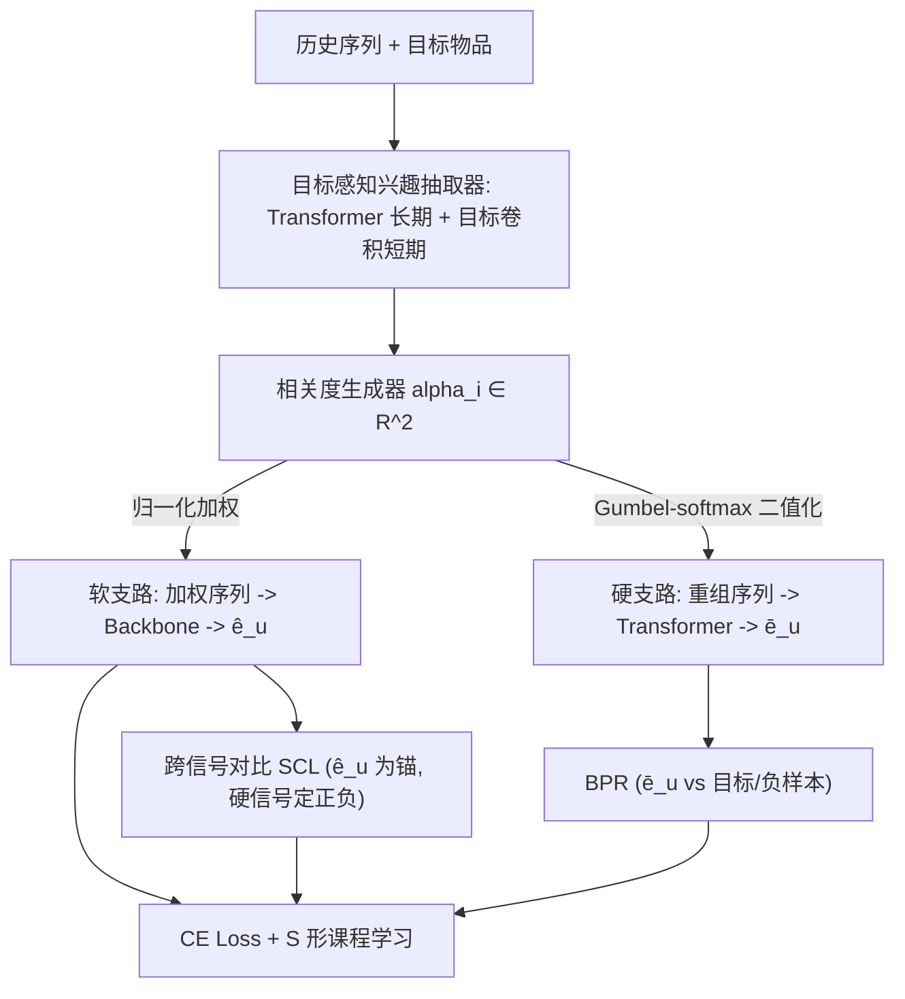
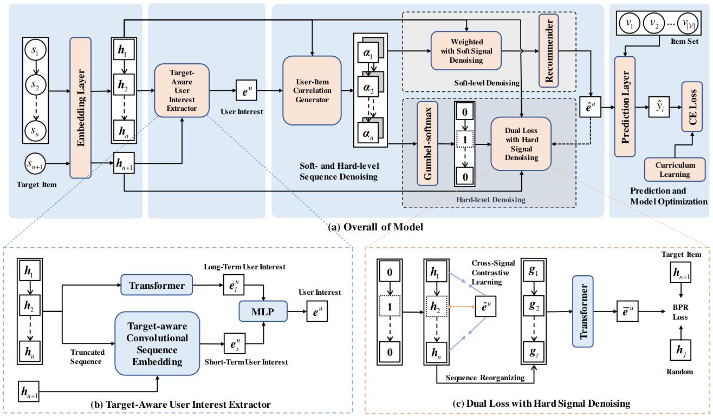

# Multi-Level Sequence Denoising with Cross-Signal Contrastive Learning for Sequential Recommendation (基于跨信号对比学习的多级序列去噪序列推荐)

- **会议/期刊**: ICDE
- **作者与机构**: Xiaofei Zhu, Liang Li（重庆理工大学），Weidong Liu（中国移动研究院），Xin Luo（西南大学）
- **推荐链路定位**: 召回（下一物品预测 / 序列编码）
- **研究方向**: 序列与会话推荐 / 自监督对比学习与交互去噪
- **论文原文**: [https://arxiv.org/abs/2404.13878v2](https://arxiv.org/abs/2404.13878v2)
- **开源代码**: [https://github.com/lalunex/MSDCCL](https://github.com/lalunex/MSDCCL)

## TL;DR (1分钟核心速览)

序列推荐中的误点击噪声长期被"软降权"或"硬删除"两类方法单独处理：前者仍会给噪声分配权重从而过拟合，后者在无监督信号下会误删有效物品。MSDCCL 让二者互为监督——用注意力判别器产出二维相关度，一路做归一化加权（软），一路经 Gumbel-softmax 二值化后重组序列（硬），再以跨信号对比损失（软表征为锚、硬信号定正负）与 BPR 校准硬伪标签，并配 S 形课程学习。在 5 个公开数据集、`Leave-One-Out` + `Full-Ranking` 协议下，与 BERT4Rec 骨干融合后 ML-1M 的 HR@20 相对最强去噪基线 HSD 提升 **118.9%**。

## Background & Motivation (背景与核心矛盾)

- **主流范式**: 噪声处理分两派——软去噪（DSAN 虚拟目标注意力、AC-TSR 空间/对抗校准器、FMLP-Rec 频域低通滤波）与硬去噪（BERD 建模损失不确定性、HSD 用用户级+序列级信号剔除不一致物品）。
- **前人局限**: ① 软去噪仍为噪声项保留非零权重，模型在长序列、噪声密度高时持续过拟合误点击；② 硬去噪依赖无监督伪标签，短序列上极易把有效物品当噪声丢弃，反而损失信息。
- **核心洞察 (Key Insight)**: 同一判别器同时输出"连续相关度"与"离散噪声标记"，可让软路径的稳定梯度抑制硬路径伪标签的抖动，硬路径的离散选择又能反过来阻止软路径对噪声的持续拟合。
- **本文切入点**: 用跨信号对比学习把两条路径耦合为互监督闭环，并以 S 形课程学习控制难样本投放节奏。

## Method (核心方法设计)

### 1. 整体框架 (Overall Architecture)

输入用户序列经物品嵌入+位置嵌入后进入两条支路：目标感知兴趣抽取器用 Transformer 编码全序列得长期兴趣 $\mathbf{e}_u^l$，用"末$m$项 + 目标物品"拼接后做横/竖卷积（Caser 式）得短期兴趣$\mathbf{e}_u^s$，FFN 融合为$\mathbf{e}_u$；用户-物品相关度生成器以$\mathbf{e}_u$为 query 为每项打分$\boldsymbol{\alpha}_i\in\mathbb{R}^2$（相关/不相关）。软支路按归一化相关度加权后送入可插拔骨干（BERT4Rec/SASRec）得$\hat{\mathbf{e}}_u$并算交叉熵；硬支路对$\boldsymbol{\alpha}_i$做 Gumbel-softmax 二值化，置零噪声项并重组序列，再经 Transformer 得$\bar{\mathbf{e}}_u$ 并算 BPR。两路以跨信号对比损失互通，训练全程叠加 S 形课程学习。

<figure class="paper-figure" markdown="span">
  <figcaption>图 1：我们提出的模型 MSDCCL 的架构。</figcaption>
</figure>

### 2. 关键设计拆解 (Key Designs)

1. **二维相关度判别器 + 软硬双去噪**：痛点在于单一注意力分数无法表达"负向证据"。作者令判别器同时输出相关与不相关两维概率
   $\boldsymbol{\alpha}_i=\sigma\big([\mathbf{h}'_i\|\mathbf{e}_u\|\mathbf{h}'_i-\mathbf{e}_u\|\mathbf{h}'_i\odot\mathbf{e}_u]\mathbf{W}_4\big)\in\mathbb{R}^2$差分项与逐元素积显式编码"偏离度"，使其天然适配噪声判别。第 0 维归一化后加权$\hat{\mathbf{h}}_i=\alpha^0_i\mathbf{h}_i\mathbf{W}_5$（软），第 1 维经
   $\tilde{\alpha}^1_i=\frac{\exp((\log\alpha^1_i+g^1)/\tau)}{\sum_{j=0}^{1}\exp((\log\alpha^j_i+g^j)/\tau)}$二值化后重组$\boldsymbol{G}=\mathrm{Reorganize}((\mathbf{1}-\tilde{\boldsymbol{\alpha}}^1)\cdot\boldsymbol{H})$（硬）。软路径保证梯度处处可导，硬路径提供不可回退的离散裁剪，二者互补避免"降权仍过拟合"与"误删信息"。

2. **跨信号对比学习 + BPR 伪标签校准**：硬信号无真值监督，容易塌缩。作者以软支路表征 $\hat{\mathbf{e}}_u$为锚点，令$\tilde{\alpha}^1_i=0$（判为有效）的物品为正样本、$\tilde{\alpha}^1_i=1$（判为噪声）的物品为负样本:
   $\mathcal{L}_{SCL}=-\frac{1}{|S^+|}\sum_{s_i\in S^+}\log\frac{\exp(\mathrm{sim}(\hat{\mathbf{e}}_u,\mathbf{h}_i)/\tau)}{\sum_{s_j\in S}\exp(\mathrm{sim}(\hat{\mathbf{e}}_u,\mathbf{h}_j)/\tau)}$由于对比的负样本正是"被判为噪声"的项，最小化该损失等价于强迫软表征远离噪声方向；同时用 BPR 保持硬重组表征$\bar{\mathbf{e}}_u$ 与目标物品的相对序，作为伪标签可靠性的兜底约束——这也是消融中 `w/o BPR` 掉幅小于 `w/o DL` 的原因：BPR 是校准器而非主监督源。

3. **训练目标与 S 形课程学习**：总损失
   $\mathcal{L}=\frac{1}{|\mathcal{U}|}\sum_u\big[\mathcal{L}_{Rec}+\lambda(\mathcal{L}_{SCL}+\mathcal{L}_{BPR})\big]+\beta\|\Theta\|_2^2$批内按损失升序切分为 80% 易样本 / 20% 难样本，难样本投放比例按 sigmoid 而非线性从 0 升到上限，模拟人类"低速区缓、高速区快"的学习曲线。负采样为随机负样本（BPR）+ 序列内跨信号负样本（SCL），**无需额外负采样器**；推理时仅用软支路$\hat{\mathbf{e}}_u$ 与全库物品内积，硬支路只在训练期存在，线上开销与 BERT4Rec 持平。

## Experimental Setup & Evaluation Protocol (实验设置与评估协议)

- **数据集与预处理**（按时间戳保留序列，过滤交互数 <5 的物品与 <5 的用户，即 `5-core`；ML-1M 截断长度 200，其余 50）：

| 数据集 | #Users | #Items | #Interactions(序列数) | 平均长度 | 稀疏度 |
| :--- | :---: | :---: | :---: | :---: | :---: |
| ML-100k | 944 | 1,350 | 99,287 | 105.29 | 92.21% |
| Beauty | 22,364 | 12,102 | 198,502 | 8.88 | 99.93% |
| Sports | 35,599 | 18,358 | 296,337 | 8.32 | 99.95% |
| Yelp (2019 年后) | 30,432 | 20,034 | 316,354 | 10.40 | 99.95% |
| ML-1M | 6,041 | 3,417 | 999,611 | 165.50 | 95.16% |

- **数据划分与防穿越**: `Leave-One-Out`（最后一项测试、倒数第二项验证、其余训练），严格按时间序，无未来交互泄漏。
- **排名评测协议**: 无偏 `Full-Ranking`（在整个物品集上排序，避免采样偏差），报告 HR@{5,10,20}、NDCG@{5,10,20}、MRR@20；显著性用双侧 t 检验 $p<0.05$。
- **对比基线与超参**: 7 个通用序列模型（GRU4Rec、NARM、STAMP、Caser、SASRec、CL4SRec、BERT4Rec，均报告 w/o 与 +MSDCCL 两版）+ 4 个 SOTA 去噪模型（DSAN、FMLP-Rec、HSD+BERT4Rec、AC-BERT4Rec）；嵌入维度 $d=100$，batch 256，Adam$10^{-3}$，对比温度$\tau$初值 0.5、每 40 batch 退火，$\beta\in\{0,10^{-3},10^{-4}\}$ 验证集选取。

## Key Experimental Results (实验关键数据)

### 1. 主实验对比 (Main Results)

| 模型 | ML-100k HR@20 | NDCG@20 | MRR@20 | Beauty HR@20 | NDCG@20 | MRR@20 |
| :--- | :---: | :---: | :---: | :---: | :---: | :---: |
| BERT4Rec (骨干) | 0.0912 | 0.0315 | 0.0157 | 0.0204 | 0.0078 | 0.0044 |
| DSAN (AAAI'21) | 0.0700 | 0.0254 | 0.0133 | 0.0264 | 0.0105 | 0.0062 |
| FMLP-Rec (WWW'22) | 0.0764 | 0.0288 | 0.0160 | 0.0284 | 0.0107 | 0.0060 |
| HSD+BERT4Rec (CIKM'22) | 0.1294 | 0.0447 | 0.0218 | 0.0683 | 0.0266 | 0.0151 |
| AC-BERT4Rec (CIKM'23) | 0.0877 | 0.0320 | 0.0147 | 0.0609 | 0.0235 | 0.0133 |
| **MSDCCL+BERT4Rec** | **0.2126** | **0.0845** | **0.0498** | **0.0955** | **0.0500** | **0.0372** |
| Improv.% (vs. 最强基线) | +64.3% | +89.0% | +128.4% | +39.8% | +87.9% | +146.4% |

补充：ML-1M 上 MSDCCL 达 HR@20 **0.3062** / NDCG@20 **0.1356**（较 HSD 提升 118.9% / 143.0%，AC-BERT4Rec 因显存 OOM 未跑通）；Sports 上 HR@20 **0.0553**（+82.5%）；**Yelp 是唯一失手场景**（HR@20 0.0695 vs AC-BERT4Rec 0.0700）。此外该模块对 6 个骨干普遍有效，如 ML-100k 上 BERT4Rec 的 HR@20 从 0.0912 提升到 0.2126（+133.1%）。

### 2. 消融实验 (Ablation Study)

| 变体 | ML-100k HR@20 | NDCG@20 | MRR@20 | ML-1M HR@20 | NDCG@20 | MRR@20 |
| :--- | :---: | :---: | :---: | :---: | :---: | :---: |
| Full | **0.2126** | **0.0845** | **0.0498** | **0.3062** | **0.1356** | **0.0881** |
| w/o DL (硬去噪双损失) | 0.1783 | 0.0678 | 0.0380 | 0.2826 | 0.1249 | 0.0811 |
| w/o TS (目标信号) | 0.2054 | 0.0823 | 0.0489 | 0.3033 | 0.1337 | 0.0866 |
| w/o BPR | 0.1991 | 0.0793 | 0.0468 | 0.3034 | 0.1346 | 0.0877 |
| w/o CL (课程学习) | 0.2079 | 0.0826 | 0.0486 | 0.3031 | 0.1336 | 0.0864 |

### 3. 关键实验发现 (Key Findings)

1. **硬去噪支路是主增益源，但必须由软信号锚定**：`w/o DL` 在 ML-100k 上 HR@20 降 16.1%、MRR@20 降 23.7%，Beauty 上 MRR@20 从 0.0372 腰斩至 0.0180；而单独去掉 BPR 仅降 6.4%，说明跨信号对比提供主要监督、BPR 只负责稳定伪标签，二者缺一不可。
2. **软硬互补在序列长度维度上得到验证**：分桶实验中 AC-BERT4Rec（纯软）在短序列占优、HSD（纯硬）在长序列占优，MSDCCL 在 ML-100k 与 Beauty 的短/中/长三桶上全部领先——正好对应"短序列硬删易误伤、长序列软降权易过拟合"的机制假设。
3. **难样本投放节奏比数量更关键**：S 形增量在 5 个数据集上稳定优于线性增量（ML-100k HR@20 0.2126 vs 约 0.2095，ML-1M 0.3062 vs 约 0.3047）；且 $\lambda$增大性能单调下降、$\lambda=0$ 显著劣化，说明双损失只应作为正则而非主目标；Gumbel-softmax 也一致优于阈值裁剪（裁剪最优阈值 0.2，仍低于 Gumbel）。

## Highlights & Limitations (亮点、对比与审稿批判)

- **与代表作对比 (vs. Prior Work)**: 相较 AC-BERT4Rec（仅重分配注意力权重，噪声仍获非零权重）与 HSD（用户级+序列级信号硬删，短序列误删严重），本文首次把两类信号放进同一判别器并互为监督；与 SGL/CL4SRec 的序列增广对比学习不同，其正负样本来自"硬去噪判定"而非随机扰动，语义更贴近真实噪声。
- **可迁移亮点**: ① 二维（相关/不相关）判别头 + 差分特征 $\mathbf{h}'_i-\mathbf{e}_u$ 可直接移植到 CTR 中的噪声特征筛选；② S 形难样本调度是即插即用的训练技巧，对任何带课程学习的去噪/长尾任务都成立。
- **审稿级局限批判**: ① 硬支路需额外一次 Transformer 前向，训练成本约为骨干的 2 倍，论文未给出收敛 epoch 与显存对比；② Yelp 上性能反而低于 AC-BERT4Rec，作者仅归因"信号难融合"，缺乏噪声率与短序列占比的定量分析；③ 噪声标签完全由模型自生成、无人工/合成噪声注入实验，去噪有效性缺少可控验证。

## Rating (四维评分)

- **方法创新性 (Novelty)**: ⭐⭐⭐⭐ （软硬双去噪+跨信号对比的组合首次出现，二维判别器设计巧妙，但各组件本身均为已有技术的重组）
- **评估协议与实验扎实度 (Protocol & Experiments)**: ⭐⭐⭐⭐ （5 数据集 + Full-Ranking 无偏评测 + 双侧 t 检验 + 6 骨干通用性验证充分，缺噪声注入与效率对比）
- **写作与数学规范度 (Clarity & Rigor)**: ⭐⭐⭐ （公式完整但符号在 SCL/BPR 处对 $\hat{\mathbf{e}}_u$、$\bar{\mathbf{e}}_u$ 的指代偶有不一致，复杂度分析缺失）
- **工业落地与复现价值 (Industrial & Practical Value)**: ⭐⭐⭐⭐ （代码开源、模块与主流骨干解耦、推理零额外开销，训练成本翻倍是主要落地代价）

