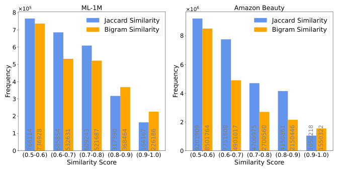
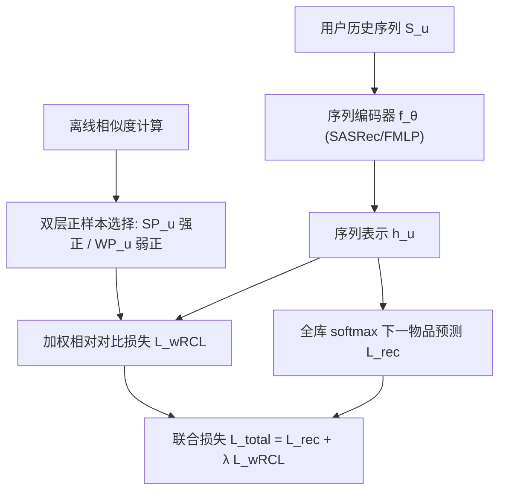
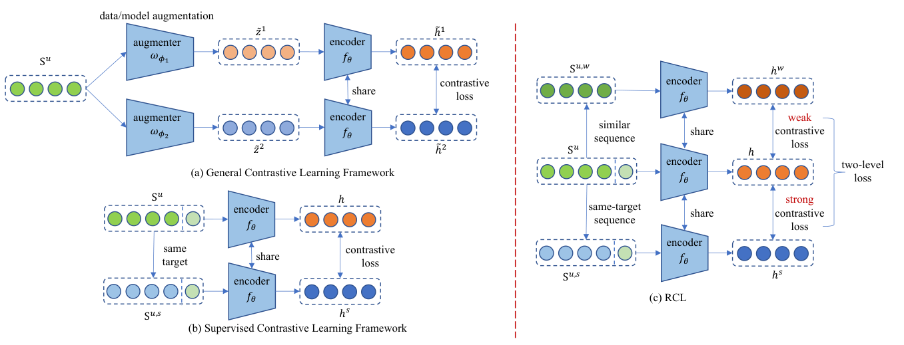

# Relative Contrastive Learning for Sequential Recommendation with Similarity-based Positive Pair Selection (基于相似正样本选择的相对对比学习序列推荐)

- **会议/期刊**: CIKM 2024（arXiv v3 更新于 2025-04-27）
- **作者与机构**: Zhikai Wang 等；达摩院、上海交通大学、美团
- **推荐链路定位**: 召回/精排（Next-Item Ranking）
- **研究方向**: 序列与会话推荐 / 自监督对比学习与去噪
- **论文原文**: [arXiv:2504.19178v3](https://arxiv.org/abs/2504.19178v3)
- **开源代码**: [Cloudcatcher888/RCL](https://github.com/Cloudcatcher888/RCL)

## TL;DR (1分钟核心速览)

现有监督对比学习（SCL）序列推荐只把“同目标物品”的序列当正样本，但 ML-1M/Beauty 中分别有 47.5%/52.7% 的序列没有同目标序列，监督信号严重不足。本文提出 RCL：把同目标序列作为强正样本、把高相似但不同目标的序列作为弱正样本，并用带边界约束的加权相对对比损失保证“中心序列到强正样本的距离 < 到弱正样本的距离”。在 5 个公开集 + 1 个美团私有集上，以 SASRec 为主干、全库 Full-Ranking 评测，HR/NDCG 相对 SOTA 平均提升 4.88%。

## Background & Motivation (背景与核心矛盾)

- **主流范式**: 序列推荐以 SASRec/FMLP 等编码器做下一物品预测；对比学习通过数据/模型增强或同目标序列构造自监督信号，缓解稀疏与噪声。
- **前人局限**: 增强式 CL（CL4SRec、MCLRec）的裁剪/掩码/重排可能改变用户意图；SCL（DuoRec、ContraRec、HPM）依赖同目标序列，但同目标序列稀缺，大量序列拿不到对比信号。
- **核心洞察 (Key Insight)**: 不同目标物品的序列仍可能高度相似。图 1 显示，ML-1M/Beauty 中排名前 5.31%/4.28% 的序列对 Jaccard 相似度 > 0.7；且 100% 序列至少拥有 319/744 个高相似序列，可补齐正样本覆盖。
- **本文切入点**: 将“相似序列”降级为弱正样本，用相对约束而非硬拉近，既扩充正样本又不让弱正样本污染强正样本的中心结构。

<figure class="paper-figure" markdown="span">
  <figcaption>图1：ML-1M 和 Amazon Beauty 数据集上具有不同目标项的序列对的相似度频率直方图。</figcaption>
</figure>
图1：ML-1M 与 Amazon Beauty 上不同目标项序列对的相似度频率直方图，说明大量不同目标序列仍高度相似。

## Method (核心方法设计)

### 1. 整体框架 (Overall Architecture)

RCL 不改变主推荐模型结构：用户历史序列经嵌入层与 Transformer/MLP 编码器得到 $\mathbf{h}_u$，主任务仍用全库 softmax 做下一物品预测。训练前先离线计算序列间相似度，为每个序列构造强正样本集$\mathrm{SP}_u$（同目标）与弱正样本集$\mathrm{WP}_u$（Top-$\alpha$ 相似、目标不同）；每个 batch 内分别采样强/弱正样本，联合优化推荐交叉熵与相对对比损失。推理阶段不增加额外参数，仅用编码器输出对全物品排序。

<figure class="paper-figure" markdown="span">
  <figcaption>图2：在通用对比学习框架（a）中，典型组件包括基于数据或模型的增强模块、用户表示编码器和对比损失函数。在监督对比学习框架（b）中，增强模块被替换为随机采样的同目标正样本。所提出的 RCL（c）不同之处在于采用双层正样本对选择模块，将同目标序列视为强正样本，将相似序列视为弱正样本。采用相对对比学习模块以...</figcaption>
</figure>
图2：三种对比框架对比：(a) 通用增强式 CL；(b) SCL 只用同目标正样本；(c) RCL 采用双层正样本与相对对比损失。

### 2. 关键设计拆解 (Key Designs)

1. **双层正样本选择（强正 + 弱正）**：同目标序列直接反映未来意图，作为强正样本 $\mathrm{SP}_u$；相似但不同目标的序列只间接反映历史偏好，作为弱正样本。对每个序列取相似度 Top-$\alpha$形成$\mathrm{WP}_u$，并按相似度比例采样：
   $p_b=\frac{s_{u,b}}{\sum_{c\in\mathrm{WP}_u}s_{u,c}}$。
   直觉是：高相似序列更可能共享意图，应被更高频、更高权地利用；Top-$\alpha$ 而非固定单条，避免正样本僵化。

2. **带 max 边界的相对对比损失**：若直接把弱正样本塞进 InfoNCE 分母，会把它推得比普通负样本还远。RCL 先定义成对损失 $\mathcal{L}_{\mathrm{pair}}(S_u,S_{u,a})$，再取强正样本中的最大损失作为边界：
   $\mathcal{L}_{\max}^u=\max_{S_{u,a}\in\mathrm{SP}_u}\mathcal{L}_{\mathrm{pair}}(S_u,S_{u,a})$。
   弱正样本项变为 $\max(\mathcal{L}_{\mathrm{weighted}}(S_u,S_{u,b}),\mathcal{L}_{\max}^u)$，从而只要求弱正样本“不要比最差强正样本更远”，不强行拉到强正样本同一邻域。

3. **相似度加权与联合训练**：加权成对损失为
   $\mathcal{L}_{\mathrm{weighted}}=-\log\frac{s_{u,a}\exp(\mathbf{h}_u\cdot\mathbf{h}_a/\tau)}{\sum_{S_c\in A\setminus\{S_u\}}s_{u,c}\exp(\mathbf{h}_u\cdot\mathbf{h}_c/\tau)}$，
   总损失 $\mathcal{L}_{\mathrm{total}}=\mathcal{L}_{\mathrm{rec}}+\lambda\mathcal{L}_{w\mathrm{RCL}}$。
   训练负采样方面：主推荐损失用全库 softmax（无负采样）；对比损失以 batch 内其他序列为负样本，属于 In-batch Negative。推理无额外开销；相似度预计算为 $O(N^2)$，GPU 并行可显著加速。

## Experimental Setup & Evaluation Protocol (实验设置与评估协议)

- **数据集与预处理**: 统一按 `5-core` 过滤用户/物品；ML-1M/20M 最大序列长度 200，其余为 50。

| 数据集 | #Users | #Items | #Interactions | 平均长度 | 稀疏度 |
| :--- | :---: | :---: | :---: | :---: | :---: |
| Beauty | 22,363 | 12,101 | 198,502 | 8.9 | 99.93% |
| Sports | 35,598 | 18,357 | 296,337 | 8.3 | 99.95% |
| ML-1M | 6,041 | 3,417 | 999,611 | 165.5 | 95.16% |
| ML-20M | 138,493 | 27,278 | 20,000,263 | 144.4 | 99.47% |
| Yelp | 30,499 | 20,068 | 317,182 | 10.4 | 99.95% |
| Life Service | 2,508,449 | 276,331 | 102,399,201 | 40.8 | 99.99% |

- **数据划分与防穿越 (Splitting Strategy)**: 沿用 [14,20,23] 的序列划分协议，即每用户最后一项测试、倒数第二项验证、其余训练；Life Service 为美团本地生活私有数据，取单城市单日交互。
- **排名评测协议 (Ranking Protocol)**: 无偏 `Full-Ranking`，对整个物品库未交互项排序，报告 HR@5/10、NDCG@5/10；未见 Sampled Ranking。
- **对比基线与超参设置**: 基线含 SASRec、CL4SRec、CT4Rec、MCLRec、DuoRec、ContraRec、HPM；主干 SASRec，$d=64$，2 层 2 头，batch=256，Adam，学习率 0.001；$\lambda\in\{0.1,\dots,0.5\}$，$\alpha\in\{0.025,\dots,0.25\}$，$\tau\in\{0.01,\dots,5\}$。结果报告均值±标准差，未明确$p$ 值检验。

## Key Experimental Results (实验关键数据)

### 1. 主实验对比 (Main Results)

下表每格为 `HR@10 / NDCG@10`，加粗为最优；`Improv.` 为 RCL 相对最强基线 HPM 的提升。

| 数据集 | SASRec | CL4SRec | MCLRec | DuoRec | ContraRec | HPM | RCL | Improv. |
| :--- | :---: | :---: | :---: | :---: | :---: | :---: | :---: | :---: |
| Beauty | .0627/.0281 | .0683/.0317 | .0861/.0446 | .0845/.0443 | .0855/.0442 | .0860/.0454 | **.0898/.0476** | 3.10%/4.84% |
| Sports | .0336/.0169 | .0374/.0194 | .0501/.0260 | .0498/.0262 | .0502/.0264 | .0506/.0271 | **.0528/.0287** | 4.35%/5.90% |
| ML-1M | .1904/.0910 | .1975/.0928 | .2933/.1683 | .2946/.1680 | .2944/.1682 | .2951/.1696 | **.3045/.1763** | 3.19%/3.95% |
| ML-20M | .2152/.1013 | .2271/.1131 | .2995/.1726 | .3001/.1735 | .3007/.1739 | .3011/.1741 | **.3113/.1805** | 3.39%/3.68% |
| Yelp | .0268/.0133 | .0342/.0151 | .0647/.0394 | .0614/.0383 | .0618/.0388 | .0651/.0399 | **.0675/.0418** | 3.69%/4.76% |
| Life Service | .0142/.0096 | .0161/.0112 | .0249/.0187 | .0246/.0189 | .0248/.0185 | .0252/.0192 | **.0268/.0205** | 6.35%/6.77% |

在 FMLP 主干上，FMLP+RCL 相比 FMLP+HPM 在 ML-20M/Yelp 上分别提升 3.97%/5.57%（按原文报告），说明收益不依赖单一 Transformer 编码器。

### 2. 消融实验 (Ablation Study)

| 变体 | 关键设置 | 观察（图3） |
| :--- | :--- | :--- |
| Weak | 仅弱正样本 | 弱于联合使用，相似噪声影响明显 |
| Strong | 仅强正样本，缺失时退化为增强表示 | 弱于联合使用，覆盖不足 |
| Unweight | 强+弱，无相似度加权 | 低于完整 RCL |
| 3-Pairs Loss | 弱正样本被显式当负样本推开 | 显著差于其他四组 |
| RCL | 强+弱+加权相对损失 | 最优 |
| 相似度度量 | Jaccard/TF-IDF/N-gram/Levenshtein/Semantic | 2-gram 略优；顺序敏感度量偏差 |

### 3. 关键实验发现 (Key Findings)

1. **弱正样本补齐覆盖比单纯增强更有效**：RCL 在 Beauty 上 HR@10 从 HPM 的 .0860 提到 .0898、NDCG@10 从 .0454 提到 .0476；Life Service 上分别提升 6.35%/6.77%，说明弱正样本确实为“无同目标”序列提供了监督信号。
2. **相对边界是性能关键，而非正样本越多越好**：消融中 3-Pairs Loss 因把弱正样本当负样本惩罚，显著落后；完整 RCL 又优于无权重版本，证明 max 边界与相似度加权共同抑制了弱正样本噪声。
3. **顺序敏感相似度并非越严格越好**：2-gram 仅略优于 Jaccard/TF-IDF，而 Levenshtein/Semantic 明显落后；$\alpha$ 从 0.05 增大到 0.25 时性能约降 10%，说明低相似序列进入弱正样本集会引入噪声。在线 A/B 的 AVTU 在 7 天内提升 0.20%–1.27%，验证了真实流量收益。

## Highlights & Limitations (亮点、对比与审稿批判)

- **与代表作对比 (vs. Prior Work)**: 相比 CL4SRec/MCLRec 的增强式 CL，RCL 不扰动序列；相比 DuoRec/ContraRec/HPM 只用同目标正样本，RCL 用相似序列补齐覆盖；相比简单多正样本 InfoNCE，RCL 用 max 边界控制弱正样本的相对距离。
- **可迁移亮点**: “强/弱正样本 + 相对边界”可直接迁移到跨域序列推荐与多行为序列建模；离线 Top-$\alpha$ 相似序列索引也可用于冷启动物品的软对齐。
- **审稿级局限批判**: 相似度预计算为 $O(N^2)$，虽 GPU 并行降低 99.0% 时间/95.1% 内存（ML-20M/Yelp），工业全量仍需分城市/品类裁剪；弱正样本质量强依赖相似度度量与$\alpha$，且 Life Service 私有集不可复现，缺少与生成式/LLM 序列推荐的对比。

## Rating (四维评分)

- **方法创新性 (Novelty)**: ⭐⭐⭐⭐ （强/弱双层正样本与 max 相对边界组合有新意，但本质仍是对比学习的样本工程）
- **评估协议与实验扎实度 (Protocol & Experiments)**: ⭐⭐⭐⭐ （6 数据集 + Full-Ranking + 双主干 + 在线 A/B 较完整，但缺少显著性检验与采样排序对照）
- **写作与数学规范度 (Clarity & Rigor)**: ⭐⭐⭐⭐ （损失设计与边界含义清楚，复杂度分析到位；相似度离线计算细节可更充分）
- **工业落地与复现价值 (Industrial & Practical Value)**: ⭐⭐⭐⭐ （代码开源、无额外推理参数、已有美团在线验证；$O(N^2)$ 预计算是主要工程门槛）

