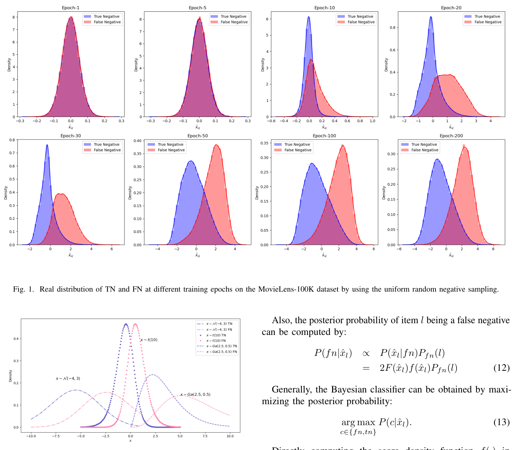
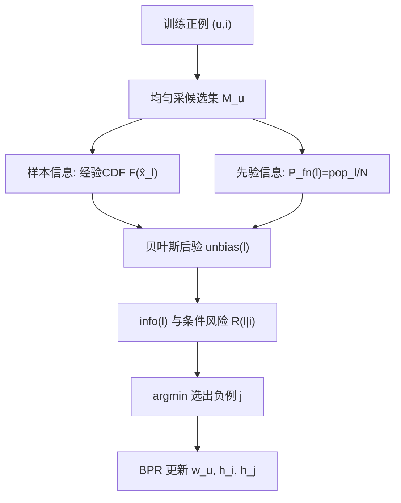
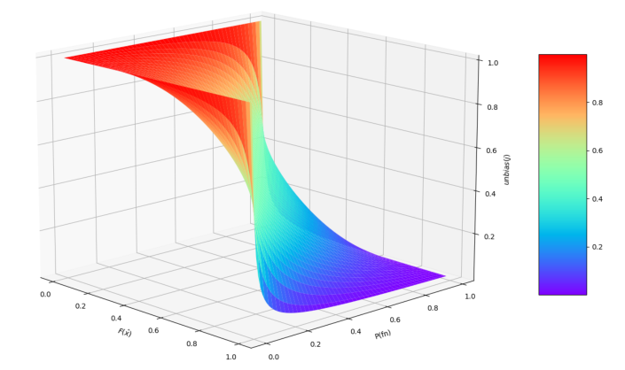

# Bayesian Negative Sampling for Recommendation (贝叶斯负采样推荐)

- **会议/期刊**: ICDE 2023 (arXiv 2204.06520v3, 21 pages)
- **作者与机构**: Bin Liu, Bang Wang (华中科技大学电子信息与通信学院)
- **推荐链路定位**: 召回（训练期负采样，模型无关插件）
- **研究方向**: 协同过滤与双塔召回 / 自监督对比学习与交互去噪
- **论文原文**: [https://arxiv.org/abs/2204.06520v3](https://arxiv.org/abs/2204.06520v3)
- **开源代码**: [https://github.com/liubin06/BNS](https://github.com/liubin06/BNS)

## TL;DR (1分钟核心速览)

隐式协同过滤用 $(u,i,j)$三元组训练时，未交互的$j$可能是用户将来会点击的**假阴性 (FN)**，而 BPR 一律令$sgn(j)=-1$会把潜在兴趣往下压。本文由排序关系$\hat{x}_{tn}\le\hat{x}_{fn}$导出 TN/FN 的**次序统计类条件密度**，构造消去密度的模型无关后验$\text{unbias}(j)$（真阴性概率的无偏估计），再以最小化**经验采样风险**给出理论最优采样准则。在 ML-100K/1M/Yahoo!-R3 上、MF 与 LightGCN 双主干、Top-20 NDCG 相对最强基线提升 0.7%–5.1%（Mean 提升约 2%）。

## Background & Motivation (背景与核心矛盾)

- **主流范式**: pairwise BPR 损失 + 负采样。静态类（RNS 均匀、PNS 按 $p(j)\propto r_j^{0.75}$）用固定分布采样；硬负采样类（AOBPR 全局高分、DNS 相对高排位）贪心取样本上"像正例"的物品；SRNS 用预测分数的高方差作先验。
- **前人局限**: ① 静态分布与模型状态解耦，训练后期采样分布已与当前打分脱节；② 硬负采样按分数/排位取 top，而**排在前面恰恰大概率就是 FN**，形成负迁移（论文实测其 TNR 反而最低）。SRNS 用线性加权融合方差与信息量，缺乏概率意义上的最优性保证。
- **核心洞察 (Key Insight)**: CF 模型的优化目标本身就要求 FN（潜正例）分数高于 TN，故 $\hat{x}_{tn}\le\hat{x}_{fn}$在训练中后期近似成立（实测分布逐 epoch 分离）。于是无需任何标签，仅凭"打分在$u$ 的未交互分数向量中的分位数"即可把 TN/FN 概率化区分开。
- **本文切入点**: 把负采样重述为**负例二分类 + 采样风险最小化**：先验（曝光/流行度）× 样本信息（分位数）→ 后验 → 最优采样器。

<figure class="paper-figure" markdown="span">
  <figcaption>图2. 不同f(x)类型下TN和FN的理论分布。</figcaption>
</figure>

## Method (核心方法设计)

### 1. 整体框架 (Overall Architecture)

对每个 batch 内的正例 $(u,i)$，先从其未交互集$\mathcal{I}^-_u$中**均匀**抽一个小候选集$\mathcal{M}_u$（$|\mathcal{M}_u|=5$）；对每个候选$l$并行计算三件事：梯度幅度$\text{info}(l)$、先验$P_{fn}(l)$、经验 CDF 似然$F(\hat{x}_l)$，合成后验$\text{unbias}(l)$；再由条件采样风险$R(l|i)$选出负例$j$ 并做 BPR 更新。全程无需额外标注、无需额外前向，候选内计算为线性复杂度。

### 2. 关键设计拆解 (Key Designs)

1. **次序统计类条件密度（把"TN/FN"变成可算分布）**：设 TN 与 FN 分数同分布 $f(x)$且有序$X_{tn}\le X_{fn}$，则由两变量次序统计量推得$g(x)=2f(x)[1-F(x)]$、$h(x)=2f(x)F(x)$。直觉：分数越高，落进 FN 尾部的概率质量越大、落进 TN 的概率质量越小，二者天然可分——这正是"硬负采样 = 高 FN 风险"的理论解释。

2. **模型无关后验负信号 $\text{unbias}(l)$**：直接算$f(\cdot)$不可行，用$P(tn|x)/[P(tn|x)+P(fn|x)]$把密度$f(\cdot)$ **约掉**：

$$\text{unbias}(l)=\frac{[1-F(\hat{x}_l)]\,[1-P_{fn}(l)]}{1-F(\hat{x}_l)-P_{fn}(l)+2F(\hat{x}_l)P_{fn}(l)}$$

其中 $F(\hat{x}_l)=\#\{\hat{x}\le\hat{x}_l\}/|\mathcal{I}^-_u|$由 Glivenko 定理用经验分布一致逼近，$P_{fn}(l)=pop_l/N$。可证$E[F(X)]=1/2$使该量成为"$l$为 TN"的**无偏估计**；且$\text{unbias}$对$F$与$P_{fn}$均单调递减，值域$[0,1]$ 符合概率解释。关键价值：它同时覆盖了以往工作"只用先验（PNS/曝光/KG）"与"只用样本信息（AOBPR/DNS/SRNS）"两大范式。

<figure class="paper-figure" markdown="span">
  <figcaption>图3. 由式(15)得到的归一化后验概率unbias(j)的数值图。</figcaption>
</figure>

3. **贝叶斯最优采样准则与训练目标**：采样 $l$的风险是"误采 FN 的损失"与"采到 TN 的收益"的期望加权，一阶 Taylor 展开得$R(l|i)=[1-\text{unbias}(l)]\cdot\text{info}(l)-\lambda\cdot\text{unbias}(l)\cdot\text{info}(l)$，其中$\text{info}(l)=1-\sigma(\hat{x}_{ui}-\hat{x}_{ul})$。最终

$$j=\arg\min_{l\in\mathcal{M}_u}\ \text{info}(l)\cdot\big[1-(1+\lambda)\,\text{unbias}(l)\big]$$

定理 0.1 证明：逐正例最小化条件风险即最小化经验采样风险，故 $\mathcal{M}_u=\mathcal{I}^-_u$时$h=h^*$；$\lambda\to\infty$退化为$\arg\max \text{info}\cdot\text{unbias}$（既难又"真负"）。**复杂度**：每候选$O(|\mathcal{I}|)$（CDF）+$O(1)$，整体线性；负采样策略本身不引入额外参数或网络。仍是标准 BPR 总损失$\sum_{(u,i,j)}\ln\sigma(\hat{x}_{ui}-\hat{x}_{uj})$，无需 in-batch / hard negative 池。

## Experimental Setup & Evaluation Protocol (实验设置与评估协议)

| 数据集 | #Users | #Items | #Interactions (train+test) | 稀疏度/密度 | 特征/场景说明 |
| :--- | :---: | :---: | :---: | :---: | :--- |
| MovieLens-100K | 943 | 1,682 | 100k (80k+20k) | 6.31% | 五点显式评分全部转隐式 |
| MovieLens-1M | 6,040 | 3,952 | 1,000k (800k+200k) | 4.19% | 同上，规模中等 |
| Yahoo!-R3 | 5,400 | 1,000 | 182k (146k+36k) | 3.37% | 物品极少、密度最低、最稀疏 |

- **数据划分与防穿越**: **比例划分**（每数据集随机 20% 作测试、80% 作训练），非 Leave-One-Out、非全局时间戳切分；训练集只保留交互二值信息，丢弃评分细节。
- **排名评测协议**: **Full-Ranking**（对用户全部未交互物品打分后全库排序取 Top-K，正例取测试集交互），无负采样候选集裁剪，无偏。
- **对比基线与超参**: 5 个基线 — RNS（均匀）、PNS（$p\propto r^{0.75}$）、AOBPR（全局高分）、DNS（相对排位线性）、SRNS（高方差先验）。主干为 MF 与 LightGCN，Embedding$d=32$，lr$=0.01$，$T=100$epoch；候选集$|\mathcal{M}_u|=5$，$\lambda=5$。重复 10 次，各指标标准差$<0.002$（未报告显著性检验）。
- **采样质量专项指标**: TNR $=\#TN/(\#TN+\#FN)$（采样真负率）与 INF$=\sum_j \text{info}(j)\cdot sgn(j)/(\#TN+\#FN)$（带符号平均梯度幅度）。

## Key Experimental Results (实验关键数据)

### 1. 主实验对比 (Main Results)

| 数据集 / 主干 | 指标 | RNS | PNS | AOBPR | DNS | SRNS | **BNS** | Improv. |
| :--- | :--- | :---: | :---: | :---: | :---: | :---: | :---: | :---: |
| ML-100K / MF | P@5 | 0.3900 | 0.2647 | 0.3970 | 0.4053 | 0.3951 | **0.4205** | +3.75% |
| ML-100K / MF | NDCG@20 | 0.3962 | 0.2709 | 0.3980 | 0.4069 | 0.4013 | **0.4176** | +2.63% |
| ML-100K / LightGCN | NDCG@20 | 0.4248 | 0.3742 | 0.4064 | 0.4335 | 0.4244 | **0.4383** | +1.11% |
| ML-1M / MF | P@5 | 0.3843 | 0.3461 | 0.3946 | 0.4066 | 0.3955 | **0.4207** | +3.47% |
| ML-1M / LightGCN | NDCG@20 | 0.3781 | 0.3440 | 0.3849 | 0.3840 | 0.3815 | **0.3917** | +1.77% |
| Yahoo!-R3 / MF | NDCG@20 | 0.1665 | 0.1644 | 0.1443 | 0.1697 | 0.1655 | **0.1783** | +5.07% |
| Yahoo!-R3 / LightGCN | NDCG@20 | 0.2047 | 0.1464 | 0.1886 | 0.2089 | 0.2017 | **0.2117** | +1.34% |

（Improv. 均相对该行最强的非本文基线，以 DNS 为主。BNS 在 2 主干 × 3 数据集 × 3 指标共 18 组中拿下 16 组最优、2 组次优。）

### 2. 消融与敏感性实验 (Ablation Study)

| ML-100K / MF 变体 | 说明 | P@5 | NDCG@20 |
| :--- | :--- | :---: | :---: |
| RNS | 随机负采样（下界） | 0.3900 | 0.3962 |
| BNS (标准) | 固定 $\lambda=5$ | 0.4205 | 0.4176 |
| BNS-1 | $\lambda$ warm-start（先大后小） | **0.4237** | 0.4197 |
| BNS-2 | 样本信息 $\hat{x}_l$ warm-start（先 RNS 后 BNS） | 0.4148 | 0.4125 |
| BNS-3 | 非信息先验 $P_{fn}=1/1682$（退化为 DNS） | 0.4048 | 0.4030 |
| BNS-4 | 职业增强先验（$P_{fn}\cdot(1+\Delta o_{ul})$） | 0.4262 | **0.4216** |

| 候选集规模 $|\mathcal{M}_u|$（理想先验） | 1 | 5 | 20 | 100 | 682 ($=|\mathcal{I}^-_u|$) |
| :--- | :---: | :---: | :---: | :---: | :---: |
| NDCG@20 (ML-100K / MF) | 0.3962 | 0.4992 | 0.5498 | 0.5971 | **0.6073** |

### 3. 关键实验发现 (Key Findings)

1. **"高分负例"是陷阱而非捷径**：采样质量曲线上 AOBPR/DNS 的 TNR 长期低于随机水平（RNS），而 BNS 的 TNR 最接近 1、INF 惩罚最小；对应到排序指标，硬负采样在 ML-100K/MF 只拿到 0.4069，反被 BNS 的 0.4176 超过 2.63%——假阴性率才是硬负采样的真实瓶颈。
2. **先验质量决定了 BNS 的天花板，而非采样准则**：剥离先验（BNS-3 退化为 DNS）使 P@5 从 0.4205 掉到 0.4048（-3.7%），注入职业群体先验（BNS-4）则升到 0.4262；在理想先验下把 $|\mathcal{M}_u|$从 5 放大到全库，NDCG@20 从 0.4992 一路涨到 0.6073（+21.7%），说明当前$pop_l/N$ 的粗先验是主要误差源。
3. **候选集规模是双刃剑，warm-start 只对 $\lambda$有效**：$|\mathcal{M}_u|>10$时 NDCG@20 反而回落（先验噪声被更大候选集放大）；而$\lambda$ warm-start 稳定带来 +0.5%（P@5 0.4205→0.4237），因为早期强调硬度、后期强调规避 FN，符合"先探索后利用"的训练动力学。样本信息 warm-start（BNS-2）反而更差，侧面印证 BNS 对打分尺度不敏感、鲁棒于弱模型。

## Highlights & Limitations (亮点、对比与审稿批判)

- **与代表作对比 (vs. Prior Work)**: RNS/PNS 是静态分布，与模型演化脱钩；AOBPR/DNS 只用样本信息且贪心地取高排位，却把 FN 当 TN 压低；SRNS 引入先验但仅线性加权方差。本文首次把负采样形式化为**贝叶斯二分类 + 经验风险最小化**，给出可证的最优采样器，并把"先验 / 样本信息"两条既有路线统一为公式中的两个因子。
- **可迁移亮点**: ① 用**经验 CDF 的分位数** $F(\hat{x}_l)$作为"模型无关联置信度"，可直接迁移到对比学习的难负例过滤、跨域负迁移抑制、样本去噪；② 风险最小化框架天然支持把任意先验（KG 关系、曝光日志、社交通道）以$P_{fn}(l)$ 形式 plug-in，无需改动采样器结构。
- **审稿级局限批判**: ① 先验建模极简（$pop_l/N$，二项假设），而敏感性实验本身证明先验是性能主瓶颈，$N$定义与负例独立性假设在真实曝光系统下不成立；② 采样损失用一阶 Taylor + 独立性假设近似，CF 场景下$\Delta\mathcal{L}(l|i)$无解析解，$\lambda$的物理含义与最优取值理论不清；③ 每个候选需$O(|\mathcal{I}|)$ 计算全库/全未交互集合的 CDF，物品规模仅 1k–4k 的实验未验证工业千万级库下的延迟与近似误差（需分桶或排序预计算）。

## Rating (四维评分)

- **方法创新性 (Novelty)**: ⭐⭐⭐⭐ （用次序统计量导出 TN/FN 类条件密度、并消去密度得到无偏后验负信号，是把负采样纳入贝叶斯决策论的少见且自洽的建模）
- **评估协议与实验扎实度 (Protocol & Experiments)**: ⭐⭐⭐ （Full-Ranking 协议无偏、双主干三数据集较完整，但仅小规模数据集、单一随机 80/20 划分、无显著性检验与线上验证）
- **写作与数学规范度 (Clarity & Rigor)**: ⭐⭐⭐⭐ （定理-引理链条完整，含无偏性证明与归因推导；扣分在于采样损失的一阶近似与先验二项假设的正当性讨论略薄）
- **工业落地与复现价值 (Industrial & Practical Value)**: ⭐⭐⭐⭐ （代码开源、线性复杂度、模型无关可插拔；但全库 CDF 计算的在线开销在超大规模候选池下仍需工程近似改造）

