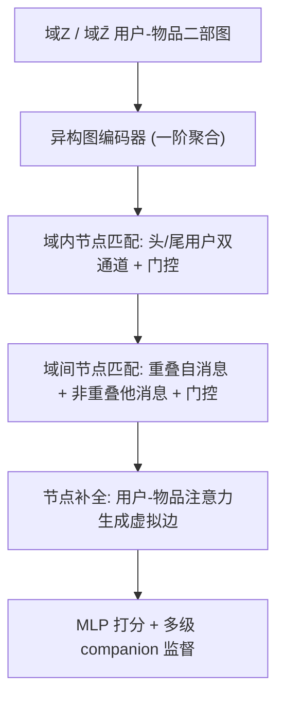
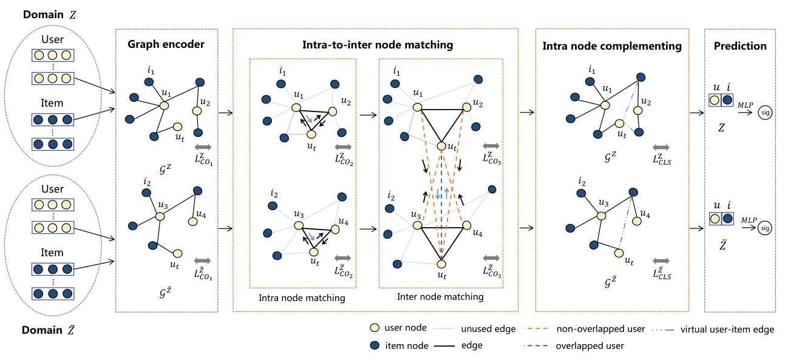
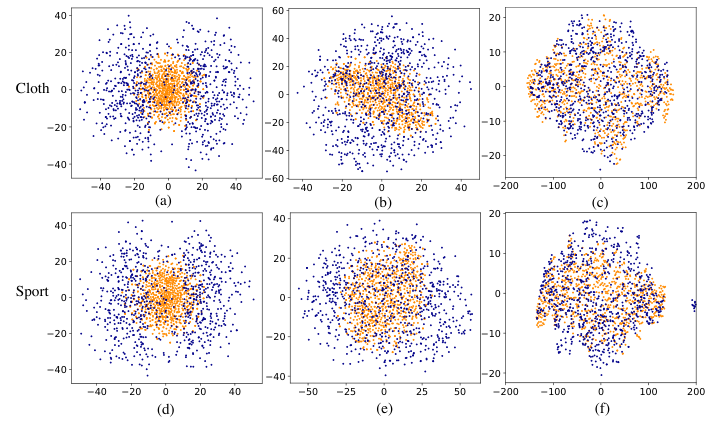

# Neural Node Matching for Multi-Target Cross Domain Recommendation (多目标跨域推荐中的神经节点匹配)

- **会议/期刊**: IEEE ICDE 2023
- **作者与机构**: Wujiang Xu, Shaoshuai Li, Mingming Ha, Xiaobo Guo, Qiongxu Ma, Xiaolei Liu, Linxun Chen, Zhenfeng Zhu（蚂蚁集团网商银行 / 北京交通大学 / 北京科技大学）
- **推荐链路定位**: 精排（跨域多目标排序打分）
- **研究方向**: 跨域与多场景推荐 / 图神经网络推荐
- **论文原文**: [https://arxiv.org/abs/2302.05919v1](https://arxiv.org/abs/2302.05919v1)
- **开源代码**: [https://github.com/WujiangXu/NMCDRR](https://github.com/WujiangXu/NMCDRR)

## TL;DR (1分钟核心速览)

真实跨域场景往往只有极少数用户重叠（<1%），且重叠与非重叠用户都以长尾稀疏交互为主；现有 Herograph、PTUPCDR 等仍依赖重叠用户搭桥、且对所有用户一视同仁。NMCDR 用"域内→域间"两级全连接用户-用户图匹配把非重叠用户直接卷入知识流，并用用户-物品匹配生成的虚拟交互边补全尾部用户表征。在 Ku=0.1% 的 Amazon 三组任务上，NDCG@10 相对最强基线提升 9.08%–37.93%（平均 24.84%），MYbank 金融任务平均 +3.31%，线上 CVR 提升 4.70%–6.81%。

## Background & Motivation (背景与核心矛盾)

- **主流范式**: 多目标跨域推荐（multi-target CDR）通过特征组合（CoNet/MiNet）或双向映射（GA-DTCDR）实现域间迁移，近期用 GNN 聚合重叠用户作为跨域桥（Herograph）、用 meta-network 为每用户生成个性化桥函数（PTUPCDR）。
- **前人局限**: ① 上述方法隐含"多数用户跨域全重叠"假设，当重叠率降到 0.1% 时 GA-DTCDR、MMoE 等性能迅速退化到与 LR 同级；② 用户-物品交互长尾分布下，桥接信息本身由少数头部用户主导，尾部用户表征欠拟合，且这些有偏表征被直接送去跨域迁移，造成负迁移。
- **核心洞察 (Key Insight)**: 非重叠用户无需"被重叠用户代表"——若把用户-用户对齐视作图匹配的节点级匹配问题，则任意两个用户之间都可直接建立带权信息通道；同时尾部用户缺失的交互可由"相似头部用户偏好"以虚拟边形式回填。
- **本文切入点**: 用两级全连接同质用户图匹配替代"依赖重叠用户的桥" + 用户-物品匹配补全虚拟交互，并在每个模块插入 companion 监督信号。

## Method (核心方法设计)

### 1. 整体框架 (Overall Architecture)

输入为两域的用户-物品二部图 $\mathcal{G}^{Z},\mathcal{G}^{\bar Z}$。先用异构 GNN 编码器做一阶邻域聚合得到$\boldsymbol{u}^{g1}$；随后 **intra node matching** 在域内构造全连接用户-用户同质图，并把消息按"头部用户/尾部用户"两类分别传播、门控融合得$\boldsymbol{u}^{g2}$；**inter node matching** 再跨域构造全连接用户图，用"重叠用户自消息 + 非重叠用户他消息"两路融合得$\boldsymbol{u}^{g3}$；**intra node complementing** 以用户-物品注意力生成虚拟链接强度回填$\boldsymbol{u}^{g4}$；最后 MLP + sigmoid 分别对两域打分。训练时对$\hat y^{g0..g3}$ 施加多层 BCE 监督。

<figure class="paper-figure" markdown="span">
  <figcaption>图 2：NMCDR 概览。在节点内匹配组件中，黑色（即 ut →u1）和蓝色（即 u1 →ut）实线箭头分别表示尾部用户和头部用户传播的两类不同消息。在节点间匹配组件中，橙色（即 u1 →ut）和蓝色（即 ut ↔ut）虚线分别表示非重叠用户和重叠用户的知识融合桥。节点内补全组件中的黑色虚线表示预测的虚拟用户-物品交互。LZ</figcaption>
</figure>

### 2. 关键设计拆解 (Key Designs)

1. **头/尾分流 + 门控的域内用户图匹配**：痛点是一阶 GNN 在稀疏尾部用户上信息量不足、且头部用户会淹没尾部信号。做法是以 $|\mathcal{N}_{u_i}|$与阈值$K_{head}$划分头/尾用户，对两类邻居用**不同**变换矩阵传播$\boldsymbol{m}^{head}_{u_i\leftarrow u_k}=\frac{1}{|\mathcal{N}^{head}_{u_i}|}(\boldsymbol{u}^{g1}_k\boldsymbol{W}_{head}+\boldsymbol{b}_{head})$，再门控融合$\boldsymbol{u}^{g2\prime}_i=\tanh((1-\boldsymbol{H}^{igm})\odot\boldsymbol{u}_{head}+\boldsymbol{H}^{igm}\odot\boldsymbol{u}_{tail})$。直觉：不同角色需要不同 Lipschitz 上界（见原文 Eq.31 稳定性界与$\|\boldsymbol{W}\|_2$ 正相关），分组权重在"可辨识性"和"参数爆炸"之间折中。

2. **双路跨域匹配的对称混合**：痛点是非重叠用户过去完全拿不到跨域信号。做法是全连接跨域用户图，重叠用户对走 $\boldsymbol{m}^{self}=\bar{\boldsymbol{u}}^{g2}_i\boldsymbol{W}_{self}+\boldsymbol{b}_{self}$，非重叠用户走带 Laplacian 归一化的$\boldsymbol{m}^{other}$，并做**双向对称**混合$\boldsymbol{u}^{g3*}_i=\boldsymbol{u}^{g2}_i\boldsymbol{W}^{Z}_{cross}+\boldsymbol{u}^{Z}_{self,i}(1-\boldsymbol{W}^{\bar Z}_{cross})$（另一域角色互换）。这让$u_i$ 能被另一域所有用户"看过一眼"，而无需先有重叠用户做中介。

3. **虚拟边补全 + 训练目标**：尾部用户观测交互过少导致表征欠定，故以 $\alpha_{u_iv_j}=\frac{\exp(\boldsymbol{u}^{g3\top}_i\boldsymbol{v}_j)}{\sum_{v_j\in\mathcal{N}_{u_i}}\exp(\boldsymbol{u}^{g3\top}_i\boldsymbol{v}_j)}$度量用户-物品匹配强度并回填$\boldsymbol{u}^{g4}_i=\boldsymbol{u}^{g3}_i+\sum_{v_j}\alpha_{u_iv_j}\boldsymbol{v}_j\boldsymbol{W}_{ref}$；总损失$\mathcal{L}_{total}=w_5\mathcal{L}^{Z}_{CO}+w_6\mathcal{L}^{\bar Z}_{CO}+w_7\mathcal{L}^{Z}_{cls}+w_8\mathcal{L}^{\bar Z}_{cls}$，其中$\mathcal{L}_{CO}$ 对 4 个中间层表征各自接共享预测头做 BCE（深监督）。负采样训练 1:1，评测 1:199。

## Experimental Setup & Evaluation Protocol (实验设置与评估协议)

| 数据集 | #Users | #Items | #Interactions | 重叠用户数 | 场景说明 |
| :--- | :---: | :---: | :---: | :---: | :--- |
| Amazon Music | 50,841 | 43,858 | 713,740 | 15,081 | 公开图书/影音域，物品均交互 16.27 |
| Amazon Movie | 87,875 | 38,643 | 1,184,889 | — | 物品均交互 30.66 |
| Amazon Cloth | 27,519 | 9,481 | 161,010 | 16,337 | 物品均交互 16.98 |
| Amazon Sport | 107,984 | 40,460 | 851,553 | — | 物品均交互 21.04 |
| Amazon Phone | 41,829 | 17,943 | 194,121 | 7,857 | 物品均交互 10.82 |
| Amazon Elec | 27,328 | 12,655 | 170,426 | — | 物品均交互 13.46 |
| MYbank Loan | 147,837 | 1,488 | 304,409 | 6,530 | 金融票据/信贷，物品均交互 204.57 |
| MYbank Fund | 65,257 | 1,319 | 86,281 | — | 物品均交互 65.41 |

- **数据划分与防穿越**: `Leave-One-Out`（每个用户最后一条交互作测试集），并人工控制重叠率 $K_u\in\{0.1\%,1\%,10\%,50\%,90\%\}$与数据密度$D_s\in\{10\%,50\%,70\%\}$ 做受控实验。
- **排名评测协议**: `Sampled Ranking`，1 正 + 199 随机负样本，指标 NDCG@10 / HR@10，五次取最优。
- **对比基线与超参**: 单域 LR/BPR/NeuMF、多任务 MMoE/PLE、跨域 CoNet/MiNet/GA-DTCDR/DML/HeroGraph/PTUPCDR；$d=128$、batch 512、Adam、lr=$10^{-4}$，$K_{head}=7$，各匹配组件取 512 个邻居。

## Key Experimental Results (实验关键数据)

### 1. 主实验对比 (Main Results)

$K_u=0.1\%$（极端小重叠）下 NDCG@10，斜线左右为两域：

| Model | Music/Movie | Cloth/Sport | Phone/Elec | Loan/Fund |
| :--- | :---: | :---: | :---: | :---: |
| LR | 5.25 / 31.36 | 5.02 / 9.24 | 4.12 / 19.67 | 47.34 / 21.97 |
| MMoE | 6.60 / 30.20 | 6.03 / 9.89 | 3.95 / 20.16 | 45.23 / 20.49 |
| GA-DTCDR | 7.03 / 31.56 | 5.61 / 10.71 | 3.70 / 20.39 | 45.94 / 21.72 |
| HeroGraph | 6.59 / 32.05 | 6.21 / 10.45 | 4.21 / 19.09 | 48.89 / 19.07 |
| PTUPCDR | 7.60 / 31.80 | 6.22 / 10.66 | 4.29 / 20.51 | 48.01 / 22.13 |
| **NMCDR** | **8.29** / **33.39** | **8.40** / **13.52** | **6.29** / **23.49** | **49.47** / **25.32** |
| Improv.% | +9.08 / +4.18 | +35.05 / +26.24 | +37.93 / +14.53 | +1.10 / +14.41 |

$K_u=90\%$ 时增益收窄（Cloth 9.54 vs PTUPCDR 7.58，+25.8%；Phone 19.18 vs 16.84，+13.9%），说明增益并非来自重叠用户利用。

### 2. 消融实验 (Ablation Study)

$K_u=50\%$、NDCG@10：

| Variant | Music | Cloth | Phone | Fund |
| :--- | :---: | :---: | :---: | :---: |
| w/o-Igm（去域内匹配） | 10.28 | 9.14 | 16.50 | 49.69 |
| w/o-Cgm（去域间匹配） | 9.30 | 7.35 | 14.42 | 49.76 |
| w/o-Inc（去节点补全） | 10.90 | 8.95 | 17.05 | 49.67 |
| w/o-Sup（去 companion 监督） | 9.78 | 8.38 | 17.09 | 49.80 |
| **NMCDR** | **11.26** | **9.26** | **17.44** | **49.89** |

### 3. 关键实验发现 (Key Findings)

1. **域间匹配是主贡献，域内匹配与补全次之**：Cloth 上 w/o-Cgm 掉 20.6%（9.26→7.35），w/o-Igm 掉 1.3%，w/o-Sup 掉 9.5%，说明"非重叠用户直接对齐"才是打破桥依赖的关键，而非单纯更强的域内编码。
2. **增益与物品交互密度强负相关**：物品平均交互数低的 Phone/Elec（10.82/13.46）拿到 +37.93%/+14.53%，而高密度的 Loan/Fund（204.57/65.41）只有 +1.10%/+14.41%，Amazon 平均 +24.84% 对 MYbank 平均 +3.31%——补全虚拟边的边际收益随数据稠密而衰减。
3. **稀疏度存在"能力边界"**：$D_s$ 从 70% 降到 10%，Cloth 增益从 +14.64% 收窄到 +4.95%，说明当交互本身过稀时表征学习与虚拟边同时失效；可视化（图 5）显示补全模块后尾部用户嵌入分布才与头部用户对齐。
4. **线上 A/B（12.1–12.15）CVR**：Loan 13.81% vs 最强基线 DML 12.93%（+6.81%），Fund 7.13% vs 6.81%（+4.70%），Account 2.59% vs 2.43%（+6.58%）。

<figure class="paper-figure" markdown="span">
  <figcaption>图 5：学习到的用户表示可视化，用于评估 NMCDR 各关键组件的有效性。</figcaption>
</figure>

## Highlights & Limitations (亮点、对比与审稿批判)

- **与代表作对比**: 相比 HeroGraph 的"全局共享图 + 依赖 >80% 重叠用户"、PTUPCDR 的"per-user meta 桥但对稀疏用户一视同仁"、DML 的"潜在正交映射"，NMCDR 用全连接用户图把非重叠用户直接纳入迁移，并用虚拟边纠正尾部偏差；参数量 0.56M，低于 MiNet 0.78M 与 HeroGraph 0.64M，单 batch 训练/推理 5.34e-4/3.92e-4 秒反而更快。
- **可迁移亮点**: ① "图匹配节点级对齐"替代跨域桥接的思路可迁移到多场景/多业务联合建模；② 每个关键模块插入 companion 预测头做深监督，是低成本、几乎无推理开销的正则手段。
- **审稿级局限批判**: ① 域内与域间均为全连接用户图，理论上 $O(N^2)$，虽采样 512 邻居但未给出随用户规模增长的时延曲线，MYbank 4500 万用户量级下的工程裁剪细节缺失；② 重叠率通过随机下采样重叠用户构造，用户集合随之变化，未说明不同$K_u$ 下负样本集是否固定，跨设置比较存在口径风险；③ 表 IX 的 Phone "Ours"（16.50/29.47）与表 IV 同设置（17.44/30.87）数值不一致，且部分消融变体高于完整模型，缺少方差/显著性检验；④ 公式 (5) 中头/尾判定符号与正文"交互少者为尾部"相矛盾（疑似笔误）。

## Rating (四维评分)

- **方法创新性 (Novelty)**: ⭐⭐⭐⭐ （把图匹配的节点级匹配引入跨域知识融合，并用稳定性上界解释头/尾分组权重，机制清晰且有理论抓手）
- **评估协议与实验扎实度 (Protocol & Experiments)**: ⭐⭐⭐⭐ （四任务 + 5 档重叠率 + 3 档密度 + 线上 A/B 覆盖完整，但采样排序、单次最优汇报与消融数值不一致扣分）
- **写作与数学规范度 (Clarity & Rigor)**: ⭐⭐⭐ （模块与公式齐全，但符号存在笔误、缺少复杂度与超参敏感性定量表格）
- **工业落地与复现价值 (Industrial & Practical Value)**: ⭐⭐⭐⭐⭐ （代码开源、参数量小、推理更快，且已在蚂蚁网商银行线上验证 CVR 增益）

