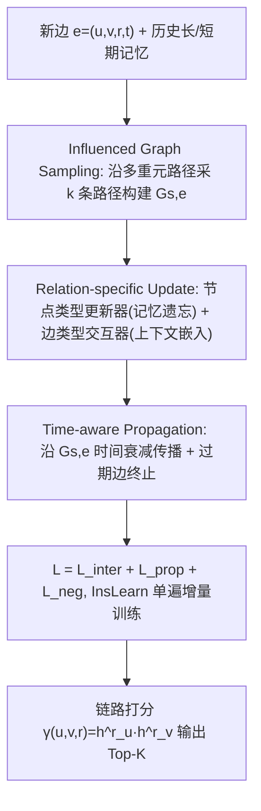
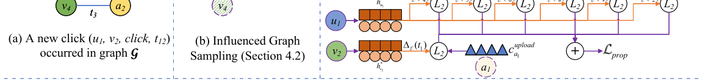

# Instant Representation Learning for Recommendation over Large Dynamic Graphs (面向大规模动态图推荐的即时表征学习)

- **会议/期刊**: ICDE 2023
- **作者与机构**: Cheng Wu, Chaokun Wang 等（清华大学软件学院）；Changping Wang, Guorui Zhou 等（快手）
- **推荐链路定位**: 召回（动态图表征学习 + 链路预测）
- **研究方向**: 图神经网络与知识图谱推荐
- **论文原文**: [arXiv:2305.18622](https://arxiv.org/abs/2305.18622v1)
- **开源代码**: [github.com/shatter15/SUPA](https://github.com/shatter15/SUPA)

## TL;DR (1分钟核心速览)

真实推荐场景的用户行为图是**多重异质且流式演化**的，受机器资源限制只能保留最近子图，同一节点在两时刻采样的邻居可能几乎不重叠，作者将其命名为**邻域扰动 (Neighborhood Disturbance)**，它会让基于邻居聚合的 GNN 学到剧烈波动的嵌入并需要反复重训。SUPA 提出 **采样-更新-传播 (Sample-Update-Propagate)** 架构，为每条新边采影响子图、更新两个交互节点的长/短期记忆、沿子图做时间感知传播，再配合单遍增量训练工作流 **InsLearn**。在 6 个真实数据集、全库排序 (H@K/NDCG/MRR) 下相对最强基线 H@50 提升 1.2%~54.0%，单卡 GTX 1080Ti 达 11,657 边/秒。

## Background & Motivation (背景与核心矛盾)

- **主流范式**: 推荐图建模把用户、物品视为节点、交互视为边，用图嵌入或 GNN 聚合邻居信息做链路预测；为利用多种行为，近期工作转向多重异质图 (multi-behavior、metapath 聚合)。
- **前人局限**: ① 现有方法大多假定图静态或需多 epoch 迭代，图大幅演化后必须重训 (如 EvolveGCN、DyHATR)，不适合在线流式；② 资源受限下真实系统只保留最近子图，采样邻居随时刻剧烈变化，邻居聚合类模型会为同一节点产出两个差异巨大的嵌入，丢失长期偏好。
- **核心洞察 (Key Insight)**: 单条新边的影响是**局部**的，且交互信息已编码进两端的短期记忆，无需全图聚合——只需在一条采样子图上"广播"该信息即可。
- **本文切入点**: 用"采样影响子图→更新交互节点记忆→时间感知传播"三步替代"聚合所有邻居"，从结构上规避邻域扰动，并配单遍训练工作流支撑在线增量。

## Method (核心方法设计)

### 1. 整体框架 (Overall Architecture)

给定新边 $e=(u_1,v_2,r,t)$，SUPA 先依据预定义**多重元路径 schema** 从两个交互节点各自采样$k$条路径构成影响子图$G_{s,e}$；接着 Relation-specific Update 模块用节点类型专属更新器刷新两端的长/短期记忆，用边类型专属交互器计算交互损失；再在$G_{s,e}$ 上做时间感知传播，把两端的目标嵌入按时间间隔衰减地向影响节点广播并计算传播损失；最后结合负采样损失联合优化。训练时 InsLearn 按时间戳排序、切批、单遍增量训练并批内验证早停，输出关系特定的即时节点嵌入用于链路打分。

<figure class="paper-figure" markdown="span">
  <figcaption>图2. SUPA 的架构（建议彩色查看）。对于新边 e = (u1, v2, click, t12)，Influenced Graph Sampling Module 采样路径以构建影响图 Gs,e。随后，Relation-specific Update Module 结合边的语义与时间信息更新交互节点表示。之后，Time-aware Propagation Module 在 Gs,e 上传播交互信息以更新受影响节点表示。</figcaption>
</figure>

### 2. 关键设计拆解 (Key Designs)

1. **节点类型专属更新器 + 记忆遗忘（破解兴趣漂移）**: 前人把长期偏好与瞬时兴趣混在一起、或靠 RNN 建模，效率低。SUPA 为每节点维护长期记忆 $h^L$、短期记忆$h^S$、关系上下文$c^r$，用**随空闲时间间隔单调递减**的遗忘函数衰减短期记忆、保留长期记忆:
$h^*_u = h^L_u + h^S_u \cdot g\!\left(\sigma(\alpha_{\phi(u)})\cdot \Delta_V(u)\right)$，其中$g(x)=\frac{1}{\log(e+x)}$，$\Delta_V(u)=t-t'_u$为节点$u$自上次交互以来的活跃间隔。$\alpha_{\phi(u)}$ 按节点类型区分（用户与物品漂移速度不同），直觉是"越久未活跃，短期记忆越应淡出"，从而同时兼顾即时漂移与长期偏好。

2. **边类型专属交互器 + 时间感知传播（破解多重异质 + 过期噪声）**: 同一节点在不同行为下语义不同，SUPA 用关系上下文嵌入区分: $h^r_u = \frac{1}{2}(h^*_u + c^r_u)$，交互损失$\mathcal{L}_{inter}=-\log\sigma({h^r_u}^\top h^r_v)$。传播时对经过的旧边逐跳衰减并过旧即止:$d_{p,v'} = D(\Delta_E(t'))\cdot g(\Delta_E(t'))\cdot d_{p,u'}$，其中$D(x)=\mathbb{I}[x\le\tau]$为过期过滤器，$\tau$由$g(\tau)=0.3$ 标定。物理直觉：一条十年前买纸巾的行为不该再影响今天的推荐，衰减+终止让信息"越老越弱、过老即断"，避免噪声与邻域扰动。

3. **训练目标、负采样与推理效率**: 总损失 $\mathcal{L}=\mathcal{L}_{inter}+\mathcal{L}_{prop}+\mathcal{L}_{neg}$，$\mathcal{L}_{prop}$借 skip-gram 思想最大化边与其影响子图共现节点的相似度，$\mathcal{L}_{neg}$用同边类型下的负采样节点缓解过平滑。免去全图聚合后，单边训练复杂度$O((kl+N_{neg})\cdot|E|)$、单遍单迭代，推理$h^r_v=\frac{1}{2}(h^L_v+h^S_v+c^r_v)$，链路打分$\gamma(u,v,r)={h^r_u}^\top h^r_v$ 取 Top-K。

## Experimental Setup & Evaluation Protocol (实验设置与评估协议)

- **数据集与预处理**: 6 个真实数据集，涵盖同质/静态/异质/多重动态四类以检验泛化:

| 数据集 | #Nodes | #Edges | #Node/Types | #Edge/Types | 密度/说明 |
| :--- | :---: | :---: | :---: | :---: | :--- |
| UCI | 1,677 | 56,617 | 1 | 1 | 2.01% / 同质流式消息网 |
| Amazon | 10,099 | 148,659 | 1 | 2 | 0.146% / 静态多重图 |
| Last.fm | 127,786 | 720,537 | 2 | 1 | 0.0044% / 异质非多重 |
| MovieLens | 16,578 | 1,231,508 | 2 | 2 | 0.448% / 评分+标签 |
| Taobao | 12,611 | 20,890 | 2 | 4 | 0.0131% / 4 类行为 |
| Kuaishou | 138,812 | 1,779,639 | 3 | 5 | 0.0092% / 用户-视频-作者 |

- **数据划分与防穿越**: 按时间戳排序后 `80% 训练 / 1% 验证 / 19% 测试`，属**全局时间戳切分**（Amazon 为静态集，全部边赋同一时间戳）。
- **排名评测协议**: **Full-Ranking 全库未交互排序**，报告 H@20/H@50、NDCG@10、MRR；显著性用 $t$-test，$p<0.01$。
- **对比基线与超参**: 16 个基线分三类——静态嵌入 (DeepWalk/LINE/node2vec/GATNE)、推荐模型 (NGCF/LightGCN/MATN/MB-GMN/HybridGNN/MeLU)、动态嵌入 (NetWalk/DyGNN/EvolveGCN/TGAT/DyHNE/DyHATR)。嵌入维度 $d=128$，采样路径$k\in[1,20]$、路径长$l\in[1,10]$、$N_{neg}\in\{1,3,5,7\}$、$S_{batch}=1024$、$I_{valid}=8$、patience$\mu=3$，Adam 学习率$3\times10^{-3}$。

## Key Experimental Results (实验关键数据)

### 1. 主实验对比 (Main Results)

以下摘取 H@50 与 MRR（节选自原文 Table V/VI，仅列代表性基线）:

| 方法 | UCI H@50 | MovieLens H@50 | Kuaishou H@50 | Taobao H@50 | MovieLens MRR |
| :--- | :---: | :---: | :---: | :---: | :---: |
| DeepWalk | 0.2550 | 0.0674 | 0.0486 | 0.3522 | 0.0069 |
| GATNE | 0.1574 | 0.0258 | 0.0124 | 0.3426 | 0.0052 |
| LightGCN | 0.1093 | 0.0317 | 0.0745 | 0.2931 | 0.0044 |
| MB-GMN | 0.1763 | 0.0724 | 0.0116 | 0.2120 | 0.0147 |
| MeLU | 0.2107 | 0.0666 | 0.0536 | 0.3249 | 0.0124 |
| EvolveGCN | 0.2271 | 0.0745 | 0.0287 | 0.1228 | 0.0102 |
| DyHATR | 0.1006 | 0.0063 | 0.0027 | 0.0189 | 0.0010 |
| **SUPA** | **0.3926** | **0.0850** | **0.0929** | **0.3575** | **0.0273** |
| **Improv.** | **+54.0%** | **+14.1%** | **+24.7%** | **+1.5%** | **+85.7%** |

（Improv. 相对于该数据集最强基线。全库排序，所有 SUPA 结果 $p<0.01$ 显著。）另在 Amazon H@50 达 0.5107 (+1.2%)、Last.fm 0.1698 (+24.1%)，NDCG@10 与 MRR 同步领先。

### 2. 消融实验 (Ablation Study)

考察三类损失、时间/异质组件与 InsLearn（节选自 Table VII/VIII，展示 H@50 / MRR）:

| 变体 | UCI H@50 | MovieLens MRR | Taobao H@50 | Kuaishou H@50 |
| :--- | :---: | :---: | :---: | :---: |
| w/o $\mathcal{L}_{prop}$ | 0.2528 | 0.0249 | 0.0211 | 0.0196 |
| w/o $\mathcal{L}_{neg}$ | 0.2237 | 0.0294 | 0.3029 | 0.0303 |
| w/o InsLearn | 0.3621 | 0.0236 | 0.3570 | 0.0778 |
| SUPA$^{s}$ (去异质) | — | — | 0.3209 | 0.0635 |
| SUPA$^{nt}$ (去时间) | — | — | 0.3472 | 0.0667 |
| **SUPA** | **0.3926** | **0.0273** | **0.3575** | **0.0929** |

### 3. 关键实验发现 (Key Findings)

- **传播损失 $\mathcal{L}_{prop}$ 是性能命脉**：去掉它 Kuaishou H@50 从 0.0929 暴跌至 0.0196、UCI MRR 从 0.1174 跌至 0.0239，证明"沿影响子图传播高阶关系"是 SUPA 应对邻域扰动的核心而非附属。
- **异质/时间组件协同不可或缺**：同时去除异质组件 (SUPA$^s$) 与同时去时间组件 (SUPA$^{nt}$) 在 Kuaishou 分别降至 0.0635、0.0667，二者叠加才回到 0.0929，说明多重语义与时序记忆对短视频场景贡献互补。
- **对邻域扰动与规模天然鲁棒**：在保留邻居数 $\eta$从 5 到$\infty$变化时 SUPA 的 MRR 几乎不敏感（对比 EvolveGCN 外的静态/推荐基线明显波动）；$S_{batch}\ge32$后性能稳定，$2^{15}$ 批下平均 2.811s 处理 11,657 条边/秒，验证单遍增量可用性。

## Highlights & Limitations (亮点、对比与审稿批判)

- **与代表作对比 (vs. Prior Work)**: 与邻居聚合类代表 (LightGCN/NGCF/MB-GMN) 的本质区别在于**不做全邻居聚合**，改采局部影响子图（MB-GMN 利用多重行为但忽略时序，HybridGNN 在多 batch 稀疏时聚合流质量崩塌）；与动态图嵌入 (EvolveGCN/DyHATR) 相比，SUPA 免去多 epoch 重训与 RNN 单元，且显式建模过期边衰减，摆脱 Last.fm/Kuaishou 上 DyHNE 无法出结果的时效窘境。
- **可迁移亮点**: ①"短期记忆随空闲间隔 $g(\sigma(\alpha)\Delta)$单调衰减"的轻量漂移建模可直接嵌入召回塔；②$D(x)=1/\log(e+x)$衰减+过期阈值$\tau$ 的"越老越弱、过老即断"算子可复用到任意流式图或序列衰减场景。
- **审稿级局限批判**: ① **多重元路径 schema 需人工预定义**（作者明言留作 future work），schema 设计与 $k,l$敏感度在不同数据集表现不一，迁移成本高；② **长期记忆仍保留历史偏好**，导致 Step2→Step3 大间隔处动态链路预测出现小幅回退，且"邻居保留$\eta$"实验仅取最新子图、未覆盖边删除的完整场景，对真实删边流式的鲁棒性验证不足。

## Rating (四维评分)

- **方法创新性 (Novelty)**: ⭐⭐⭐⭐ （以采样-更新-传播替代邻居聚合，首次形式化"邻域扰动"并给出记忆遗忘+时间衰减一体的架构，新意扎实但元路径仍沿用已有范式）
- **评估协议与实验扎实度 (Protocol & Experiments)**: ⭐⭐⭐⭐ （6 数据集 × 16 基线、全库排序、$t$-test$p<0.01$、含动态链路/扰动/可扩展性多维实验，消融完整；个别基线在部分数据集缺失结果）
- **写作与数学规范度 (Clarity & Rigor)**: ⭐⭐⭐⭐ （更新/交互/传播公式清晰、符号定义完备、复杂度分析详尽，但元路径 schema 手动设定削弱了理论闭环）
- **工业落地与复现价值 (Industrial & Practical Value)**: ⭐⭐⭐⭐⭐ （已开源、单卡 11,657 边/秒、单遍增量可直接部署于快手级流式场景，召回落地价值极高）

