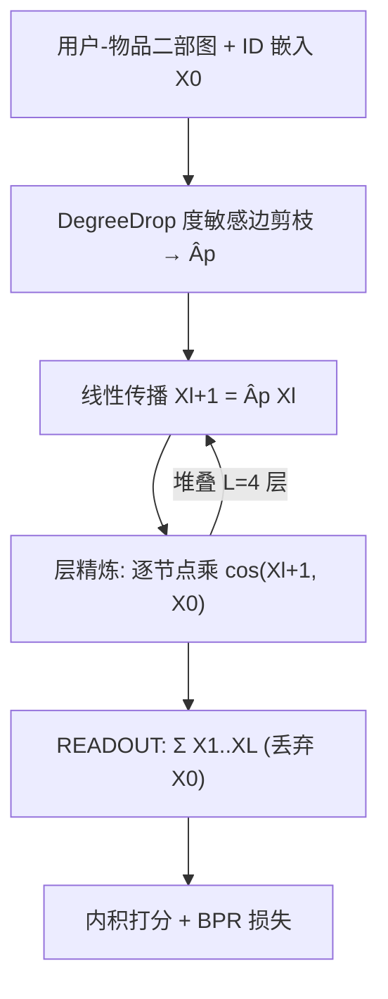
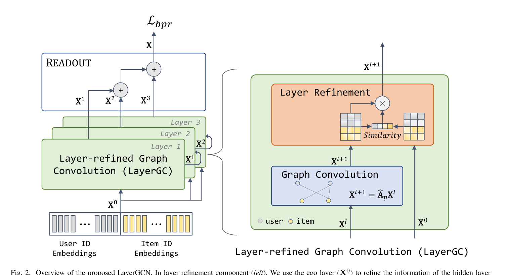

# Layer-refined Graph Convolutional Networks for Recommendation (面向推荐的层精炼图卷积网络)

- **会议/期刊**: ICDE 2023 (Research Track)
- **作者与机构**: Xin Zhou, Donghui Lin, Yong Liu, Chunyan Miao（阿里巴巴-南洋理工联合研究院 / 冈山大学 / 南洋理工大学）
- **推荐链路定位**: 召回（图协同过滤表征学习与全库排序）
- **研究方向**: 图神经网络与知识图谱推荐 / 自监督对比学习与交互去噪
- **论文原文**: [https://arxiv.org/abs/2207.11088v2](https://arxiv.org/abs/2207.11088v2)
- **开源代码**: [https://github.com/enoche/ImRec](https://github.com/enoche/ImRec)

## TL;DR (1分钟核心速览)

LightGCN 类模型在稠密交互图上存在"过平滑 vs. 解塌缩"两难：固定均值聚合层数一深就过平滑，而给各层加可学习权重后权重空间又塌缩到 ego 层（图 1 实证）。本文提出 LayerGCN：每层传播后用该层隐表征与 ego 层的余弦相似度**逐节点**重加权，只保留"信息仍与自身一致"的部分再向深层传播；并用度敏感概率 $p_{e}\propto 1/\sqrt{d_ud_i}$ 剪除枢纽节点冗余边。在 4 个公开数据集、全库排序协议下，Recall@20 相对最强基线最高提升 10.42%，且收敛速度比 DropEdge 快 39%。

## Background & Motivation (背景与核心矛盾)

- **主流范式**: 以 NGCF/LightGCN 为代表的二部图协同过滤，用线性传播 $\hat{A}X_l$堆叠$L$ 层，再用 READOUT（多为 mean）聚合所有层得到节点表征。
- **前人局限**: ① 层数一深，节点表征被邻居信息同化，$l\to\infty$时任意相邻对$||x_i^l-x_j^l||_p\to 0$，稠密图（如 MOOC）上连 4 层都退化；② LightGCN 尝试给层加可学习权重但"实验无提升"，作者复现发现权重必然塌缩到 ego 层独占，高阶信息实际进不来。
- **核心洞察 (Key Insight)**: 用户-物品图是**异配二部图**，邻居与目标节点类型不同、表征本不该相似；因此不能像节点分类那样用固定残差比 $\alpha$ 融合 ego 与高阶层，而应"按相似度筛选后再融合"——相似度高说明该层仍携带本节点个性化信息，相似度低说明已被邻居稀释。
- **本文切入点**: 把"层聚合"改写为"层精炼"——在传播过程中逐层用 ego 层做无参数门控，并在 READOUT 中直接丢弃 ego 层（其信息已蒸馏进各隐层）。

<figure class="paper-figure" markdown="span">
  ![图 1. 推荐困境：固定节点更新会导致过平滑；相反，若层权重可学习，则 ego 层的权重总是主导其他层。在 MOOC 数据集 \[7\] 上使用 4 层 LightGCN \[3\] 进行实验。](../../../../assets/papers/2207.11088v2/figure_1.png)<figcaption>图 1. 推荐困境：固定节点更新会导致过平滑；相反，若层权重可学习，则 ego 层的权重总是主导其他层。在 MOOC 数据集 [7] 上使用 4 层 LightGCN [3] 进行实验。</figcaption>
</figure>

## Method (核心方法设计)

### 1. 整体框架 (Overall Architecture)

输入为用户/物品 ID 嵌入 $X_0$，构成对称归一化二部邻接$\hat{A}=D^{-1/2}AD^{-1/2}$。训练前先按度敏感概率采样保留边集，得到稀疏化邻接$\hat{A}_p$（推理阶段回退到原始$\hat{A}$）。随后做$L$层"精炼图卷积"：每层先线性传播$\hat{A}_pX_l$，再逐节点乘上该层与 ego 层的余弦相似度（加$\epsilon$防零），得到$X_{l+1}$。最终 READOUT 只对$X_1..X_L$求和（丢弃$X_0$），用内积打分$\hat{r}_{ui}=x_u^\top x_i$，BPR 损失端到端训练。

<figure class="paper-figure" markdown="span">
  <figcaption>图 2. 所提出的 LayerGCN 概览。在层细化组件（左侧）中，我们使用 ego 层（X0）在隐藏层（Xl）传播到下一层（Xl+1）之前细化其信息。</figcaption>
</figure>

### 2. 关键设计拆解 (Key Designs)

1. **Layer-refined Graph Convolution (LayerGC)**：针对"固定残差比不灵活、可学习权重塌缩"问题，把融合系数从标量变成逐节点向量：
$$X_{l+1}=(\alpha_{l+1}+\epsilon)\,\hat{A}_pX_l,\qquad \alpha_{l+1}=\cos\!\left(\hat{A}_pX_l,\;X_0\right)$$
其中 $\alpha_{l+1}\in\mathbb{R}^{N}$由行向量余弦相似度给出，$\mathrm{SIM}(x_i,x_j)=\frac{x_i\cdot x_j}{\max(\lVert x_i\rVert_2\lVert x_j\rVert_2,\epsilon)}$。直觉：余弦为 Lipschitz 常数为 1 的无参门控，与 ego 正交的层分量被压到$\epsilon$量级，从而"信息性层被放大、发散层被抑制"；若某层与 ego 相似度越高，高阶邻居信号才被允许注入。可证其表征能力与 WL 测试同强（sum 聚合为单射，而 LightGCN 的 mean 非单射），并给出$d^{\text{lgn}}_l=\lVert x_l-x_0\rVert_2 \ge d^{\text{lr}}_l=\lVert x_l\cos\theta - x_0\rVert_2$，即精炼后节点与 ego 的偏离更小，过平滑被抑制。

2. **Degree-sensitive Edge Dropout (DegreeDrop)**：针对 DropEdge 均匀剪枝"无差别丢边、低度节点信息被误伤、收敛慢"的问题，按边两端度数设定保留概率：
$$p_{e_k}=\frac{1}{\sqrt{d_i}\sqrt{d_j}}$$
即两端都是枢纽的边最易被剪。理由：高度节点最易过平滑（其表征被大量邻居平均化），剪掉枢纽间冗余连接既降噪又避免图被割裂。实现上按该分布做多项式采样保留 $M-m$条边，再对$\hat{A}_p$ 做重归一化。

3. **训练目标与推理开销**：总损失为 BPR 加 $X_0$ 的 L2 正则：
$$\mathcal{L}=\sum_{(u,i,j)\in\mathcal{D}}-\log\sigma(\hat{r}_{ui}-\hat{r}_{uj})+\lambda\lVert X_0\rVert_2^2$$
负样本为**均匀随机采样**（每正样本 1 负样本），无难负采样设计。复杂度为 $\mathcal{O}(2LMT/B)$（传播）加上$\mathcal{O}(LNT/B)$（精炼），因$N\ll M$ 与 LightGCN 同量级；且精炼不引入任何可学习参数（区别于 GAT 的注意力权重），更抗过拟合。

## Experimental Setup & Evaluation Protocol (实验设置与评估协议)

- **数据集与预处理**: MOOC 未过滤；Games/Food 采用 `5-core`；Yelp 采用 `10-core`（用户与物品双向）。

| 数据集 | #Users | #Items | #Interactions | 稀疏度 | 特征/场景说明 |
| :--- | :---: | :---: | :---: | :---: | :--- |
| MOOC | 82,535 | 1,302 | 458,453 | 99.5734% | 教育选课，稠密、物品极少（典型初创平台形态） |
| Games | 50,677 | 16,897 | 454,529 | 99.9469% | Amazon 评论，隐式正反馈 |
| Food | 115,144 | 39,688 | 1,025,169 | 99.9776% | Amazon 食品类，图规模最大 |
| Yelp | 99,010 | 56,441 | 2,762,088 | 99.9506% | 商户签到，度分布高度长尾 |

- **数据划分与防穿越 (Splitting Strategy)**: 按时间戳排序后做**全局时间切分** 70%/10%/20%（train/valid/test），并剔除验证/测试中未在训练集出现过的冷启动用户与物品，杜绝未来信息泄漏。
- **排名评测协议 (Ranking Protocol)**: 无偏 `Full-Ranking`（除训练正样本外全库物品均为候选），指标 Recall@K 与 NDCG@K，$K\in\{10,20,50\}$。
- **对比基线与超参设置**: BPR、MultiVAE、EHCF、BUIR、NGCF、LR-GCCF、LightGCN、UltraGCN、IMP-GCN 共 9 个基线；统一 $d=64$、Xavier 初始化、Adam，各基线按原论文调参。LayerGCN 固定$L=4$，$\lambda\in\{10^{-2}..10^{-5}\}$，剪枝比$\{0,0.1,0.2\}$；最优$\lambda=10^{-3}$，稠密数据集剪枝比 0.1。显著性用 5 个随机种子的 paired t-test（$p<0.05$，表中 `*` 标注）。

## Key Experimental Results (实验关键数据)

### 1. 主实验对比 (Main Results)

| 数据集 / 指标 | BPR | MultiVAE | NGCF | LR-GCCF | LightGCN | UltraGCN | IMP-GCN | LayerGCN (w/o Drop) | **LayerGCN (Full)** | Improv. |
| :--- | :---: | :---: | :---: | :---: | :---: | :---: | :---: | :---: | :---: | :---: |
| MOOC R@20 | 0.3479 | 0.3639 | 0.3426 | 0.3336 | 0.3321 | 0.3183 | 0.3345 | 0.3889 | **0.3979*** | +9.34% |
| MOOC N@50 | 0.2265 | 0.2476 | 0.2443 | 0.2294 | 0.2208 | 0.2324 | 0.2296 | 0.2526 | **0.2665*** | +7.63% |
| Games R@20 | 0.0369 | 0.0376 | 0.0425 | 0.0446 | 0.0461 | 0.0480 | 0.0477 | 0.0490 | **0.0502*** | +4.58% |
| Games N@50 | 0.0265 | 0.0280 | 0.0314 | 0.0320 | 0.0326 | 0.0348 | 0.0337 | 0.0340 | **0.0355** | +2.01% |
| Food R@20 | 0.0222 | 0.0208 | 0.0254 | 0.0277 | 0.0286 | 0.0287 | 0.0288 | 0.0303 | **0.0318*** | +10.42% |
| Food N@50 | 0.0167 | 0.0159 | 0.0185 | 0.0206 | 0.0211 | 0.0216 | 0.0216 | 0.0223 | **0.0234*** | +8.33% |
| Yelp R@20 | 0.0393 | 0.0423 | 0.0413 | 0.0439 | 0.0501 | 0.0508 | 0.0501 | 0.0531 | **0.0542*** | +6.69% |
| Yelp N@50 | 0.0380 | 0.0398 | 0.0398 | 0.0414 | 0.0473 | 0.0477 | 0.0473 | 0.0491 | **0.0501*** | +5.03% |

### 2. 消融实验 (Ablation Study)

| 变体 | MOOC R@20 | MOOC N@50 | Yelp R@20 | Yelp N@50 |
| :--- | :---: | :---: | :---: | :---: |
| LayerGCN w/o DegreeDrop（仅 LayerGC） | 0.3889 | 0.2526 | 0.0531 | 0.0491 |
| LayerGCN + DropEdge（均匀剪枝） | 0.3571 | 0.2421 | 0.0532 | 0.0493 |
| **LayerGCN (DegreeDrop, Full)** | **0.3979** | **0.2665** | **0.0542** | **0.0501** |
| LightGCN (最佳 2–3 层) | 0.3286 | 0.2330 | — | — |

层数敏感性（MOOC，LayerGCN 固定 4 层 vs. LightGCN 层数搜索）：LightGCN 1/2/3/4 层的 R@20 为 0.3227/0.3286/0.3271/0.3321，第 4 层已开始退化；LayerGCN 8 层时 R@50 仍单调升至约 0.60 附近。

### 3. 关键实验发现 (Key Findings)

1. **设计有效性主要来自 LayerGC 而非剪枝**：去掉 DegreeDrop 的变体已在全部 4 个数据集、全部指标上超越所有 9 个基线，说明层精炼是主要增益源；DegreeDrop 在其之上再贡献 MOOC R@20 0.3889→0.3979（+2.3%）的增益，且稠密图上增益远大于稀疏图。
2. **度分布决定 DegreeDrop 的收益边界**：MOOC 中 20% 物品度数超过 400，枢纽边大量被剪，DegreeDrop 相对 DropEdge 带来 MOOC R@20 0.3571→0.3979 的大幅提升，并将收敛 epoch 减少 39%（剪枝比 >0.5 时仅需 DropEdge 一半）；而 Yelp 约 90% 物品度数 <10，度概率难以区分节点，收益几乎为零，二者差异印证"高度节点更易过平滑"的假设。
3. **精炼打破固定层数限制且权重不塌缩**：LightGCN 在 MOOC 上 3 层即见顶，LayerGCN 4 层仍优于其最佳浅层配置（R@20 0.3979 vs. 0.3286）；可视化显示各层权重不再由 ego 层独占，且**偶数跳邻居（同类型节点）贡献显著高于奇数跳**，与二部图同配性直觉一致。

## Highlights & Limitations (亮点、对比与审稿批判)

- **与代表作对比 (vs. Prior Work)**: 相比 LightGCN 的固定 mean READOUT，本文用无参相似度做逐节点门控，避免了可学习层权重的塌缩；相比 LR-GCCF / GCNII 的固定残差比或超参 $\alpha$，本文系数随层、随节点自适应；相比 DropEdge 的均匀剪枝，DegreeDrop 有明确的过平滑机理指向（枢纽节点优先去边），并顺带加速收敛。
- **可迁移亮点**: ① "隐层与初始表征的 cosine 门控"是可插拔模块，可无痛替换 SGL/SimGCL、UltraGCN、多模态图推荐中的 mean READOUT；② 度敏感边采样可作为图对比学习中边扰动的替代分布，兼顾降噪与收敛速度。
- **审稿级局限批判**: ① 负样本仅均匀采样、无难负样本或采样矫正，全库排序下可能存在负样本分布偏差；② 推理阶段回退到未剪枝 $\hat{A}$，训练-推理图结构不一致，且 DegreeDrop 的最优剪枝比在稠密/稀疏图上差异大（0.1 vs 接近 0），超参与数据度分布强耦合；③ 仅在 4 个 Amazon/Yelp/MOOC 类隐式反馈数据集验证，缺少工业级千万级图与线上 A/B 的时延/吞吐证据。

## Rating (四维评分)

- **方法创新性 (Novelty)**: ⭐⭐⭐⭐ （把"层聚合"重构为 ego 引导的逐节点门控，无参且给出 WL 表达力与过平滑距离界两定理，理论支撑扎实）
- **评估协议与实验扎实度 (Protocol & Experiments)**: ⭐⭐⭐⭐ （时间切分 + 全库排序 + 5 种子 paired t-test，9 个基线覆盖全面；但缺采样排序与线上实验）
- **写作与数学规范度 (Clarity & Rigor)**: ⭐⭐⭐⭐ （动机图 1 的"两难"刻画极具说服力，复杂度与残差连接对比清晰；式 20 的不等式推导略跳跃，符号沿用略密）
- **工业落地与复现价值 (Industrial & Practical Value)**: ⭐⭐⭐⭐⭐ （代码已开源 ImRec，精炼模块零额外参数、与 LightGCN 同量级复杂度、收敛快 39%，工程迁移成本极低）

