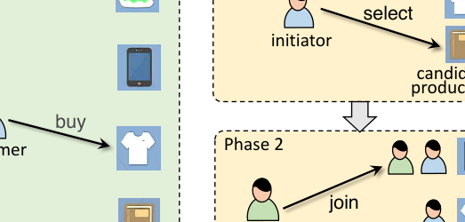
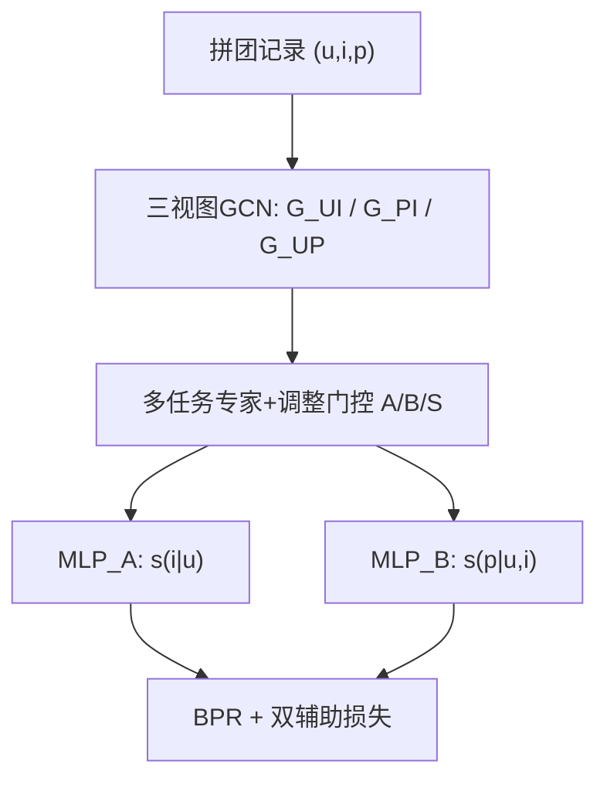
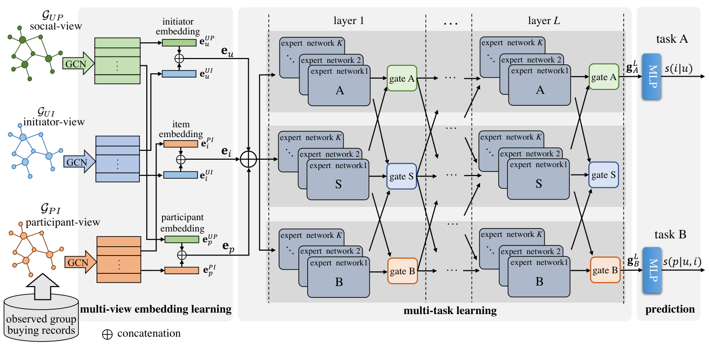

# Group Buying Recommendation Model Based on Multi-task Learning (基于多任务学习的拼团推荐模型)

- **会议/期刊**: ICDE 2023
- **作者与机构**: Shuoyao Zhai, Baichuan Liu, Deqing Yang, Yanghua Xiao；复旦大学、上海市数据科学重点实验室
- **推荐链路定位**: 精排/排序（双任务候选打分）
- **研究方向**: 多任务学习与列表级重排 / 社交与群组推荐
- **论文原文**: [https://arxiv.org/abs/2211.14247v1](https://arxiv.org/abs/2211.14247v1)
- **开源代码**: [https://github.com/DeqingYang/MGBR](https://github.com/DeqingYang/MGBR)

## TL;DR (1分钟核心速览)

针对拼团推荐中“发起人选品”与“参与者选团”两个耦合子任务，MGBR 以三视图 GCN 学角色化表征，再用共享/专属专家网络与调整门控交互信息，并用两项辅助损失精炼嵌入。在 Beibei 拼团数据、1:9/1:99 采样排序协议下，Task B MRR@10 较最强基线提升 71.65%。

## Background & Motivation (背景与核心矛盾)

- **主流范式**: 群组推荐把成员偏好聚合为群表征，再给群推荐商品；拼团场景已有 GBGCN/GBMF 区分发起者与参与者，但仍只完成“给发起者推荐商品”。
- **前人局限**: 拼团天然是两阶段——发起者选品开团、参与者选团加入；群组推荐既无角色区分，也不建模“给 $(u,i)$推荐参与者$p$”。此外，把同团共现用户当社交边会引入伪社交噪声。
- **核心洞察 (Key Insight)**: 两个子任务相互增强：发起者选品会预估潜在参与者的跟团意愿，参与者决策又依赖 $(u,i)$；三元组中的$(u,i)$、$(i,p)$、$(u,p)$ 分别承载不同偏好信息。
- **本文切入点**: 首次形式化拼团双任务，用多视图 GCN + 多任务专家/门控 + 双辅助损失同时优化 $s(i|u)$与$s(p|u,i)$。

<figure class="paper-figure" markdown="span">
  <figcaption>图1. 个人购买与拼团购买的对比。在（a）个人购买中，顾客从候选商品列表中选择其最喜欢的商品购买，而不考虑其他用户的购买。在（b）拼团购买中，发起者先从其最喜欢的商品中选择一个发起拼团，并等待其他用户参与该团。随后，另一用户从候选团列表中选择一个团，以参与者角色加入。</figcaption>
</figure>
图1：个人购买与拼团购买的两阶段结构差异。

## Method (核心方法设计)

### 1. 整体框架 (Overall Architecture)

MGBR 先由三张视图上的 GCN 得到发起者、商品、参与者的双视图拼接嵌入；随后多任务模块用 A/B/S 三组专家与门控在层间交换信息，S 吸收 A/B 门控输出，A/B 门控再注入 $(u,i)$、$(i,p)$、$(u,p)$的成对先验；最后两个 MLP 分别输出$s(i|u)$与$s(p|u,i)$。训练以 BPR 为主损失，并叠加 ListNet/BPR 辅助损失。

<figure class="paper-figure" markdown="span">
  <figcaption>图2. 我们提出的用于拼团推荐的MGBR模型概览。它包含三个主要模块：多视图嵌入学习模块、多任务学习模块和预测模块。在第一个模块中，发起者、商品和参与者的嵌入通过在三个视图（图）上的GCNs学习得到。第二个模块由若干专家网络和门控构成，以基于两个子任务之间的信息交互进一步学习对象嵌入。在预测模块中，对候选商品和参与者的预测分数分别</figcaption>
</figure>
图2：MGBR 三模块总体架构。

### 2. 关键设计拆解 (Key Designs)

1. **三视图角色化嵌入**：拼团中同一用户可能以发起者或参与者出现，单一用户-商品图会混淆角色。MGBR 在 $G_{UI}$、$G_{PI}$、$G_{UP}$上分别做 GCN，并拼接双视图嵌入：$\mathbf{e}_u=\mathbf{e}^{UI}_u\|\mathbf{e}^{UP}_u$、$\mathbf{e}_i=\mathbf{e}^{UI}_i\|\mathbf{e}^{PI}_i$、$\mathbf{e}_p=\mathbf{e}^{PI}_p\|\mathbf{e}^{UP}_p$。$G_{UP}$ 故意省略参与者-参与者边，降低同团弱关系噪声。

2. **调整门控的多任务交互**：通用 MMoE 门控只做专家聚合，无法显式注入任务先验。MGBR 令 $\mathbf{g}^{l}_{A}=\mathbf{g}^{l}_{A1}+\alpha_A\mathbf{g}^{l}_{A2}$，其中$\mathbf{g}^{l}_{A2}=(\mathbf{e}_u\|\mathbf{e}_i)\mathbf{W}_{A,ui}\mathbf{E}^{l}_A+(\mathbf{e}_i\|\mathbf{e}_p)\mathbf{W}_{A,ip}\mathbf{E}^{l}_S+(\mathbf{e}_u\|\mathbf{e}_p)\mathbf{W}_{A,up}\mathbf{E}^{l}_S$；B 门控对称。这样 Task A 侧重$(u,i)$，Task B 侧重$(i,p)$与$(u,p)$，共享专家 S 负责跨任务传递。

3. **训练目标、负采样与推理开销**：总损失 $\mathcal{L}=\mathcal{L}_A+\beta\mathcal{L}_B+\beta_A\mathcal{L}'_A+\beta_B\mathcal{L}'_B$，$\mathcal{L}_A/\mathcal{L}_B$为 BPR；$\mathcal{L}'_A$用 ListNet 约束“替换商品比替换参与者更伤分数”，$\mathcal{L}'_B$用 BPR 约束$s(p|u,i)>s(p|u,i')$。训练负采样 1:9，$\beta=1,\beta_A=\beta_B=0.3$。推理复杂度约$O(LKd^2)$，近似$O(d^2)$，但实测 8.35 min/epoch。

## Experimental Setup & Evaluation Protocol (实验设置与评估协议)

- **数据集与预处理**: 使用 Beibei 母婴拼团数据，过滤购买记录少于 5 条的用户（类 5-core），并移除涉及被过滤用户的团。

| 数据集 | #Users | #Items | #Interactions | 稀疏度/密度 | 特征/场景说明 |
| :--- | :---: | :---: | :---: | :---: | :--- |
| Beibei | 125,012 | 30,516 | 430,360 成交团 | — | 母婴拼团；同团用户视为社交边 |

- **数据划分与防穿越 (Splitting Strategy)**: 按训练/验证/测试 = 7:3:1 划分（原文如此）；正样本来自成交团，Task A 为 $(u,i)$，Task B 为$(u,i,p)$。
- **排名评测协议 (Ranking Protocol)**: 采样排序而非 Full-Ranking。1:9 协议候选列表长 10，算 MRR/NDCG@10；1:99 协议候选列表长 100，算 MRR/NDCG@100；训练负采样比例 1:9。
- **对比基线与超参设置**: 对比 DeepMF、NGCF、DiffNet、EATNN、GBGCN、GBMF；$d=128$，GCN 层数$H=2$，专家数$K=6$，多任务层数$L=2$，$|T|=99$，$\alpha_A=\alpha_B=0.1$，学习率$0.0002$，batch 64。三次运行取均值，未报告显著性检验。

## Key Experimental Results (实验关键数据)

### 1. 主实验对比 (Main Results)

表1：主实验（1:9 对应 @10，1:99 对应 @100；Improv. 相对最强基线）。

| Model | A MRR@10 | A NDCG@10 | A MRR@100 | A NDCG@100 | B MRR@10 | B NDCG@10 | B MRR@100 | B NDCG@100 |
| :--- | :---: | :---: | :---: | :---: | :---: | :---: | :---: | :---: |
| DeepMF | 0.3763 | 0.5183 | 0.1672 | 0.3046 | 0.3070 | 0.4656 | 0.0654 | 0.2209 |
| NGCF | 0.5607 | 0.6617 | 0.2841 | 0.4150 | 0.3778 | 0.5211 | 0.1254 | 0.2748 |
| DiffNet | 0.3780 | 0.5206 | 0.1290 | 0.2771 | 0.3314 | 0.4844 | 0.0976 | 0.2483 |
| EATNN | 0.5827 | 0.6807 | 0.2240 | 0.3736 | 0.3404 | 0.4929 | 0.0727 | 0.2310 |
| GBGCN | 0.5095 | 0.6231 | 0.2775 | 0.4006 | 0.3668 | 0.5127 | 0.1168 | 0.2665 |
| GBMF | 0.3718 | 0.5135 | 0.1433 | 0.2867 | 0.3254 | 0.4794 | 0.0884 | 0.2406 |
| **MGBR** | **0.6401** | **0.7292** | **0.2876** | **0.4501** | **0.6484** | **0.7327** | **0.2877** | **0.4471** |
| **Improv.** | **9.85%** | **7.13%** | **1.23%** | **8.46%** | **71.65%** | **40.61%** | **129.43%** | **62.70%** |

### 2. 消融实验 (Ablation Study)

表2：核心组件消融（1:9 协议）。

| Variant | A MRR@10 | A NDCG@10 | B MRR@10 | B NDCG@10 | 说明 |
| :--- | :---: | :---: | :---: | :---: | :--- |
| MGBR-M-R | 0.2531 | 0.4327 | 0.2344 | 0.4141 | 去共享专家/门控+辅助损失 |
| MGBR-M | 0.2607 | 0.4401 | 0.2471 | 0.4272 | 去共享 S |
| MGBR-G | 0.6126 | 0.7041 | 0.4707 | 0.6001 | 去调整门控（$\alpha=0$） |
| MGBR-R | 0.4228 | 0.5663 | 0.4769 | 0.6074 | 去双辅助损失 |
| MGBR-D | 0.5189 | 0.6390 | 0.4494 | 0.5858 | 三视图合并为单 HIN |
| **MGBR** | **0.6401** | **0.7292** | **0.6484** | **0.7327** | 完整模型 |

### 3. 关键实验发现 (Key Findings)

1. **Task B 是主要突破点**：MGBR 的 B MRR@10 达 0.6484，较 NGCF 的 0.3778 提升 71.65%，NDCG@10 提升 40.61%；Task A 相对 EATNN 仅提升 9.85%/7.13%，说明“给 $(u,i)$ 推荐参与者”是现有基线普遍缺失的能力。
2. **共享 S 与调整门控贡献最大**：去掉 S 后 A/B MRR@10 降至 0.2607/0.2471；去掉调整门控后 B MRR@10 降至 0.4707（较完整模型降约 27.4%），但 A 仅降至 0.6126（降约 4.3%），证明跨任务先验主要缓解更难的 Task B。
3. **多视图优于单异构图，辅助损失有效**：MGBR-D 的 A/B MRR@10 为 0.5189/0.4494，明显低于完整模型；MGBR-R 为 0.4228/0.4769，说明拆分视图可减少关系干扰，ListNet/BPR 辅助损失进一步精炼角色嵌入。

## Highlights & Limitations (亮点、对比与审稿批判)

- **与代表作对比 (vs. Prior Work)**: GBGCN/GBMF 虽面向拼团，但只做 Task A；NGCF 有 GCN 却无角色视图与双任务交互；MMoE/PLE 类多任务门控不显式注入 $(u,i)$、$(i,p)$、$(u,p)$ 先验。MGBR 的本质增量是“角色化多视图 + 先验注入门控 + 双任务辅助损失”。
- **可迁移亮点**: 调整门控可迁移到多场景 CTR/CVR 多任务；三视图拆分可替代单异构图以降低关系噪声；用 ListNet/BPR 构造任务特定辅助损失，适合双角色推荐。
- **审稿级局限批判**: 仅一个 Beibei 母婴数据集，且为 1:9/1:99 采样排序，缺少全库排序与线上 A/B；模型 31.3M 参数、8.35 min/epoch，显著重于 NGCF 的 3.17 min/epoch，超大规模部署成本高；划分比例写作 7:3:1 且未报告显著性检验，复现时需谨慎。

## Rating (四维评分)

- **方法创新性 (Novelty)**: ⭐⭐⭐⭐ （首次形式化拼团双任务，调整门控把成对先验注入多任务专家，机制清晰）
- **评估协议与实验扎实度 (Protocol & Experiments)**: ⭐⭐⭐ （单数据集、采样排序、三次均值但无显著性检验，外部效度有限）
- **写作与数学规范度 (Clarity & Rigor)**: ⭐⭐⭐⭐ （公式与模块定义完整，但符号密集，消融表 R.Drop 分母易误读）
- **工业落地与复现价值 (Industrial & Practical Value)**: ⭐⭐⭐⭐ （代码与数据开源、真实拼团场景可复现；但训练开销与参数规模限制大规模部署）

