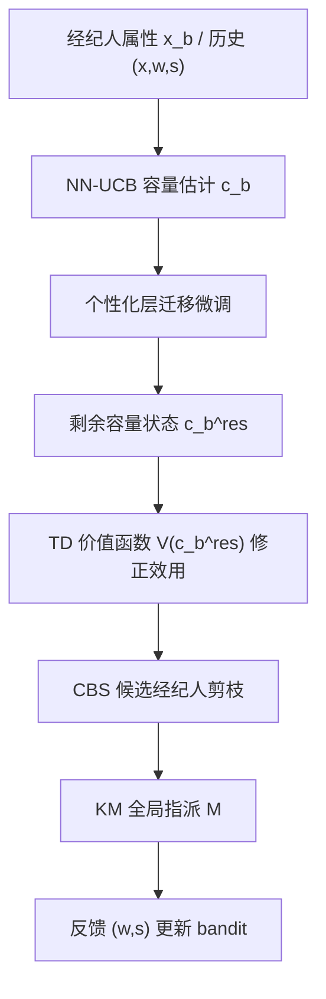
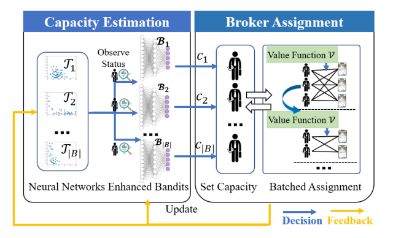

# Towards Capacity-Aware Broker Matching: From Recommendation to Assignment (面向容量感知的经纪人匹配：从推荐到指派)

- **会议/期刊**: ICDE 2023
- **作者与机构**: Shuyue Wei, Yongxin Tong, Zimu Zhou, Qiaoyang Liu, Lulu Zhang, Yuxiang Zeng, Jieping Ye；北航、香港城市大学、贝壳
- **推荐链路定位**: 匹配/派单（替代 top-k 推荐）
- **研究方向**: 强化学习与动态探索推荐 / 去偏公平与工业系统
- **论文原文**: [https://arxiv.org/abs/2303.03024v1](https://arxiv.org/abs/2303.03024v1)
- **开源代码**: 暂未开源

## TL;DR (1分钟核心速览)

针对 top-k 经纪人推荐导致头部过载、服务质量骤降，本文把匹配从推荐转为容量感知指派：用 NN-UCB 在线估计个性化工作量容量，再用 MDP 价值函数与 KM 做跨批次全局指派，并用 CBS 无损剪枝。在贝壳三城数据上，LACB 提升 72.0–82.2% 经纪人效用，LACB-Opt 比 KM 类快 233.4–284.9×。

## Background & Motivation (背景与核心矛盾)

- **主流范式**: 贝壳等平台在客户点击房源后默认推荐 top-3 经纪人，本质是 top-k 推荐，不感知经纪人当前工作量。
- **前人局限**: ① top-k 让少数头部经纪人承接大量请求，城市 A top-1 日均 38.26 请求，是均值 3.18 的 12.03×；超过 40 请求/日后注册率从 14.3–27.5% 跌至 2.5–17.8%。② 既有指派工作多假设容量已知且逐批独立，忽略跨批次剩余容量依赖。
- **核心洞察 (Key Insight)**: 经纪人容量有限、与工作量的关系非线性且个体差异大；过载是“推荐”范式忽略容量约束所致，应改为全局“指派”。
- **本文切入点**: 先在线估计经纪人级容量，再把剩余容量作为状态做跨批次价值规划与二分图匹配。

图 1：贝壳 App 默认推荐三名经纪人，top 经纪人被持续过载。
<figure class="paper-figure" markdown="span">
  <figcaption>图 1：在 Beike（主要在线房地产平台）上进行 top-k 经纪人推荐的示意图。当购房者点击其心仪房源的更多信息时，平台 App 默认推荐三名经纪人。</figcaption>
</figure>

## Method (核心方法设计)

### 1. 整体框架 (Overall Architecture)

LACB 分两阶段：容量估计阶段输入经纪人属性 $x_b$与历史三元组$(x,w,s)$，用 NN-UCB 选择日容量$c_b$，并通过层迁移微调得到经纪人专属估计；指派阶段以剩余容量$c_b^{\mathrm{res}}$为状态，用 TD 学习价值函数$V(c_b^{\mathrm{res}})$，对接近容量的头部经纪人修正匹配效用，在可用经纪人集合$B^+$上跑 KM；LACB-Opt 先用 CBS 为每个请求选$Top_r^{|R|}$候选，把 KM 复杂度从$O(|B|^3)$降到$O(|R|^3+|R||B|)$。

图 5：LACB 的容量估计—指派两阶段工作流。
<figure class="paper-figure" markdown="span">
  <figcaption>图 5：LACB 的工作流程。</figcaption>
</figure>

### 2. 关键设计拆解 (Key Designs)

1. **NN-enhanced UCB 容量估计**：标准 UCB 假设奖励与上下文线性相关，无法刻画注册率—工作量的非线性。本文将线性项换成 MLP $S_\theta(x,c)$，导数换成梯度$g_\theta=\nabla_\theta S_\theta$，按$UCB_{x,c}=S_\theta(x,c)+\alpha\sqrt{g_\theta(x,c)^T D^{-1}g_\theta(x,c)}$选容量；个性化时复制全局 MLP 前$L-1$层、冻结后仅微调末层，缓解单经纪人样本稀疏。理论给出$n$批 regret 上界$n|C|\xi^L/\pi^{L-1}$。
2. **容量感知 MDP 指派**：逐批独立指派会浪费跨批次剩余容量。本文把 $c_b^{\mathrm{res}}$作状态、批次效用作奖励，用 TD 更新$V(c_b^{\mathrm{res}})\leftarrow V(c_b^{\mathrm{res}})+\beta[u+\gamma V(c_b^{\mathrm{res}\prime})-V(c_b^{\mathrm{res}})]$；仅对频繁触顶的头部经纪人（$f_b>\delta$）把效用修正为$u'_{r,b}=u_{r,b}+\gamma V(c_b^{\mathrm{res}\prime})-V(c_b^{\mathrm{res}})$，再跑 KM。直觉是让“现在占用头部容量”承担未来机会成本。
3. **CBS 无损加速与训练推理**：真实平台 $|B|\gg|R|$，KM 的$O(|B|^3)$不可接受。定理表明每个请求只需保留效用最高的$|R|$个候选经纪人即可找到最优指派；CBS 用快速选择选候选，使总复杂度降为$O(|R|^3+|R||B|)$。训练损失为$\mathcal{L}(\theta)=\sum_{o\in ob}\|S_\theta(x_o,w_o)-s_o\|_2^2+\lambda\|\theta\|_2^2$，无负采样，靠 bandit 探索-利用采样；推理每批先估容量，再 CBS+KM。

## Experimental Setup & Evaluation Protocol (实验设置与评估协议)

- **数据集与预处理**: 贝壳 2021 年三城 21 天真实日志，合成数据 2,000 经纪人、50,000 请求；无 5-core 过滤。

| 数据集 | #Brokers | #Requests | 覆盖天数 | 请求/经纪人 | 说明 |
| :--- | :---: | :---: | :---: | :---: | :--- |
| City A | 5,515 | 103,106 | 21 | 18.7 | 青岛 |
| City B | 8,155 | 387,339 | 21 | 47.5 | 成都 |
| City C | 3,689 | 74,831 | 21 | 20.3 | 杭州 |
| Synthetic | 2,000 | 50,000 | 7–21 | 可变 | 调 $|B|,|R|,\sigma$ |

- **数据划分与防穿越 (Splitting Strategy)**: 按天/固定时间窗分批，在线逐日反馈；容量估计只用历史观测，未来批次不泄露，非 Leave-One-Out。
- **排名评测协议 (Ranking Protocol)**: 非 ranking 任务；每批在可用经纪人 $B^+$ 上做全量二分图指派，效用由平台同款模拟器给出，无负采样。
- **对比基线与超参设置**: Top-1/Top-3、RR、KM、CTop-K、AN；3 层 MLP 128-64-16，$\alpha=0.001$，batchSize=16，$\lambda=0.001$，$\beta=0.25$，$\gamma=0.9$，$\delta=0.8$；原文未报告显著性检验。

## Key Experimental Results (实验关键数据)

### 1. 主实验对比 (Main Results)

原文主结果以图 8/11 报告，未给逐点表；下表按趋势与明确报告数值整理，避免虚构。

| 方法 | 容量机制 | 总效用（图 8/11 趋势） | 关键数值/开销 | 结论 |
| :--- | :--- | :---: | :--- | :--- |
| Top-1 | 无 | 低 | 快；过载最重 | 头部注册率骤降 |
| Top-3 | 无 | 略高于 Top-1 | 快；仍过载 | 多推几个不解决容量 |
| RR | 随机分摊 | 中 | 快；公平但限头部 | 避免过载却浪费余量 |
| KM | 无 | 中 | $O(|B|^3)$ | 仅全局指派，无容量 |
| CTop-K | 城市级经验容量 | 高于 Top-K | 快 | 证明容量约束必要 |
| AN | NeuralUCB+KM | 较高 | 慢；冷启动弱 | 有容量但每批独立 |
| LACB | 个性化 NN-UCB+MDP | **最高** | 慢；City A 80.8% 经纪人提升 | 效果最优 |
| LACB-Opt | +CBS | **最高（≈LACB）** | **比 KM 类快 233.4–284.9×** | 无损加速 |

### 2. 消融实验 (Ablation Study)

原文未给标准 `w/o` 消融表，以下按模块替换归纳：

| 配置 | 容量估计 | 跨批次 $V$ | CBS | 总效用 | 运行时间 |
| :--- | :---: | :---: | :---: | :---: | :---: |
| Top-K | ✗ | ✗ | ✗ | 低 | 快 |
| KM | ✗ | ✗ | ✗ | 中 | $O(|B|^3)$ |
| AN | ✓ NeuralUCB | ✗ | ✗ | 较高 | 慢 |
| LACB | ✓ NN-UCB+个性化 | ✓ | ✗ | **最高** | 慢 |
| LACB-Opt | ✓ | ✓ | ✓ | **最高** | **最快 KM 类** |

### 3. 关键实验发现 (Key Findings)

1. **容量约束是主因**：CTop-K 全面优于 Top-K，Top-3 仅略优于 Top-1；城市 A top-1 日均 38.26 请求、为均值 12.03×，>40 请求/日时注册率从 14.3–27.5% 跌至 2.5–17.8%，说明单纯增加推荐位无法解决过载。
2. **LACB 同时改善头部与长尾**：City A 中 80.8% 经纪人效用高于 Top-K，三城整体 72.0–82.2%；LACB 头部工作量低于除 RR 外所有基线，既避免过载又保留头部余量，而 RR 虽公平却限制头部产能。
3. **CBS 实现无损加速**：LACB-Opt 与 LACB 效用一致，真实数据比 KM 类快 233.4–284.9×，合成数据最高 1091.9×；$|R|/|B|=0.005$时加速 641.7×，$0.05$ 时仍有 16.4×，验证候选剪枝定理在极度不平衡二分图上的价值。

## Highlights & Limitations (亮点、对比与审稿批判)

- **与代表作对比 (vs. Prior Work)**: 相比 Top-K/CTop-K，本文不是给所有客户推同一批头部经纪人，而是把剩余容量作为状态做跨批次全局指派；相比 AN，容量不是城市级常数或每批独立 NeuralUCB，而是经纪人级在线估计+MDP 长期价值。
- **可迁移亮点**: 层迁移微调可缓解单经纪人/单骑手数据稀疏；CBS 的 $Top_r^{|R|}$剪枝定理可直接迁移到骑手派单、客服分配、律师咨询等$|B|\gg|R|$ 场景。
- **审稿级局限批判**: ① 以注册率为服务质量代理，效用来自离线模拟器，缺在线 A/B 与真实收益验证；② 容量估计依赖 bandit 探索，冷启动/策略切换有风险，$\alpha,\delta,\gamma$较敏感；③ 未显式优化公平性，Matthew 效应仅间接缓解；KM 仍为$O(|R|^3)$，超大请求批需近似。

## Rating (四维评分)

- **方法创新性 (Novelty)**: ⭐⭐⭐⭐ （首次把经纪人匹配从 top-k 推荐转为容量感知指派，NN-UCB+MDP 价值函数组合有新意，并有 regret/复杂度分析）
- **评估协议与实验扎实度 (Protocol & Experiments)**: ⭐⭐⭐ （三城真实数据+合成数据较扎实，但主结果以图呈现、无标准消融与显著性检验，且为离线模拟器评估）
- **写作与数学规范度 (Clarity & Rigor)**: ⭐⭐⭐⭐ （问题定义、算法流程、复杂度与 regret 证明完整；部分符号/算法行有小笔误，不影响主线）
- **工业落地与复现价值 (Industrial & Practical Value)**: ⭐⭐⭐⭐ （贝壳真实场景与 CBS 无损加速落地性强；但未开源，在线 A/B 与长期公平收益未报告）

