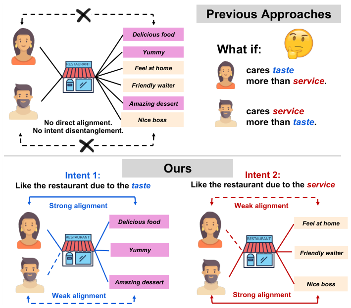
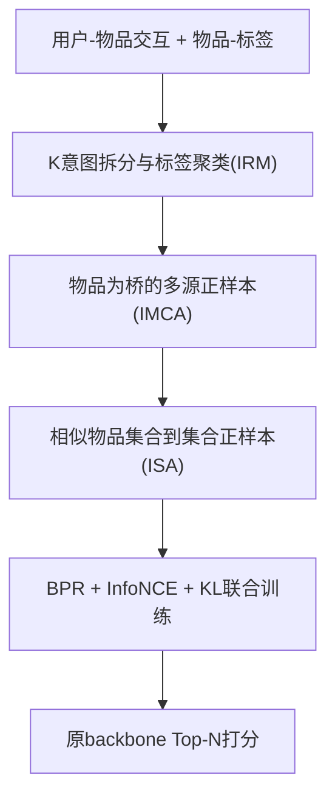
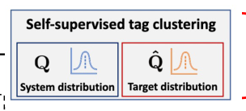

# Intent-aware Multi-source Contrastive Alignment for Tag-enhanced Recommendation (面向标签增强推荐的意图感知多源对比对齐)

- **会议/期刊**: ICDE 2023
- **作者与机构**: Haolun Wu 等；McGill University / Mila、Huawei Noah’s Ark Lab、City University of Hong Kong
- **推荐链路定位**: 召回/精排表示增强（模型无关，可插拔）
- **研究方向**: 自监督对比学习与交互去噪 / 冷启动与长尾推荐
- **论文原文**: [论文原文链接](https://arxiv.org/abs/2211.06370v1)
- **开源代码**: 暂未开源（论文引用 CiteULike-t 数据集仓库，非作者方法实现）

## TL;DR (1分钟核心速览)

针对标签增强推荐中“用户意图纠缠、GNN 过平滑、高度节点主导”的痛点，IMCAT 把用户/物品嵌入拆成 $K$ 个意图子向量，用端到端标签聚类把每个子向量对齐到语义标签簇，再以物品为桥构造用户-物品-标签多源 InfoNCE，并用相似物品集合扩展正样本。7 个数据集、3 个 backbone 的 Top-20 排序下，R@20 最高约 +6.7%、NDCG@20 最高约 +10.8%，训练时间较 GNN 基线减少 50% 以上。

## Background & Motivation (背景与核心矛盾)

- **主流范式**: 现有标签/知识图谱增强推荐多把用户、物品、标签、KG 融成异构图，用 GNN 消息传递注入辅助信息。
- **前人局限**: ① 用户-物品只建模单一“interact-with”关系，无法区分“因口味”还是“因服务”点击，意图纠缠且噪声交互会误导；② 对齐时把用户匹配到物品的全部标签，造成过平滑；③ 幂律分布下高度节点在消息传递中影响过大，长尾物品与冷启动用户信号更弱。
- **核心洞察 (Key Insight)**: 标签可按语义聚成簇，每个簇对应一种用户意图；物品同时连接用户与标签，天然可作为多源对齐的“桥”。
- **本文切入点**: 不加深图传播，而以意图感知的多源对比学习把标签信息直接注入 CF 表征。

<figure class="paper-figure" markdown="span">
  <figcaption>图 1：展示先前方法与我们的方法之间差异的示意图。我们不仅通过对比对齐直接对齐用户与标签，还在该过程中解耦用户意图。</figcaption>
</figure>

## Method (核心方法设计)

### 1. 整体框架 (Overall Architecture)

IMCAT 以任意 CF backbone 的用户/物品嵌入为输入：先将 $u,v$各拆成$K$个意图子向量；用 Student’s t 软分配把标签聚成$K$ 簇并回传 KL 目标；再以物品为桥，对“交互过该物品的用户意图聚合”与“该物品同一意图簇的标签聚合 + 物品向量”做双向 InfoNCE；最后用共享标签集的相似物品扩展正样本集。训练由 BPR、标签 BPR、对比对齐与聚类 KL 联合优化，推理仍走原 backbone 打分，不引入多层消息传递。

<figure class="paper-figure" markdown="span">
  <figcaption>图 4：以第j个物品为例的IMCAT整体架构。四个目标以红色高亮显示。</figcaption>
</figure>

### 2. 关键设计拆解 (Key Designs)

1. **意图感知表征与端到端标签聚类 (IRM)**：单向量把多种动机混在一起 $\to$将$u_i,v_j$拆为$K$个$d/K$子向量，并用带温度$\eta$的 Student’s t 分布计算标签$t_l$属于第$k$簇的概率$Q_{lk}$，再用锐化目标$\hat Q$做 KL，硬分配取$\arg\max_k Q_{lk}$。这样每个意图子空间对应一个语义标签簇，既解耦又避免表征塌缩。

$$
Q_{lk}=\frac{(1+\|t_l-\mu_k\|^2/\eta)^{-\frac{\eta+1}{2}}}{\sum_{i=1}^{K}(1+\|t_l-\mu_i\|^2/\eta)^{-\frac{\eta+1}{2}}},\quad \mathcal{L}_{KL}=KL(\hat Q\|Q)
$$

2. **物品为桥的多源对比对齐 (IMCA)**：用户-标签没有直接边 $\to$对物品$v_j$，按意图$k$聚合交互用户得$u_j^k$，聚合其属于第$k$簇的标签并经线性层得$\hat t_j^k$，令$z_j^k=\hat t_j^k\oplus v_j^k$，只在同一$j$时作为正对，做双向 InfoNCE，并用$M_{j,k}$ 按物品-意图相关度重加权。物品同时出现在 CF 与标签侧，因此成为跨源监督的天然锚点。

$$
\mathcal{L}_{u2it}^{k}=-\sum_{j=1}^{|V|}\log\frac{\exp((u_j^k\circ z_j^k)/\tau)}{\sum_{j^-}\exp((u_j^k\circ z_j^{k,-})/\tau)}M_{j,k}
$$

3. **意图感知集合到集合对齐 (ISA)**：单物品正样本不足，长尾/冷启动更弱 $\to$在意图$k$下用 Jaccard 比较两物品的标签集，$s_{j,j'}^{k}>\delta$即视为同集，将$P_j^k$中多个相似物品都作为正样本，把$\mathcal{L}_{CA}$扩展为$\mathcal{L}_{CA^*}$。这相当于对交互图做意图级增广，降低高度节点主导，提升低度节点监督密度。

$$
s_{j,j'}^{k}=\frac{|T^k(v_j)\cap T^k(v_{j'})|}{|T^k(v_j)\cup T^k(v_{j'})|}
$$

**训练目标、负采样与推理效率**：总损失为 $\mathcal{L}=\mathcal{L}_{UV}+\alpha\mathcal{L}_{VT}+\beta\mathcal{L}_{CA^*}+\gamma\mathcal{L}_{KL}$；BPR 每正样本采 1 个负样本，对比部分把同批其他物品作为候选负样本。推理无多层 GNN 传播，模型无关、可插拔，较 GNN 基线训练更轻。

## Experimental Setup & Evaluation Protocol (实验设置与评估协议)

- **数据集与预处理**: 显式评分 $\ge 4$视为正反馈；过滤交互数$<10$ 的用户/物品；每个标签至少分配给 5 个物品。

| 数据集 | #Users | #Items | #Tags | #Interactions | 密度/场景 |
| :--- | ---: | ---: | ---: | ---: | :--- |
| HetRec-MV | 2,107 | 3,872 | 2,071 | 471,482 | 5.78%/电影 |
| HetRec-FM | 1,026 | 5,817 | 2,283 | 57,976 | 0.97%/音乐 |
| HetRec-Del | 1,274 | 5,169 | 4,595 | 19,951 | 0.30%/书签 |
| CiteULike | 4,011 | 12,408 | 1,579 | 94,512 | 0.19%/论文 |
| Last.fm-Tag | 18,149 | 14,548 | 6,822 | 582,791 | 0.22%/音乐 |
| AMZBook-Tag | 50,022 | 22,370 | 2,345 | 731,777 | 0.07%/图书 |
| Yelp-Tag | 39,856 | 26,669 | 1,073 | 1,009,922 | 0.10%/商户 |

- **数据划分与防穿越**: 用户-物品交互按 $7:1:2$ 划分为训练/验证/测试；冷启动与长尾为事后分桶分析，不是严格零样本冷启动划分。
- **排名评测协议**: 测试阶段做 Top-20 排序，报告 Recall@20 与 NDCG@20；原文未报告采样候选集协议，按测试正样本对物品排序评估。
- **对比基线与超参**: 基线覆盖无辅助信息（BPRMF、NeuMF、LightGCN）、标签增强（CFA、DSPR、TGCN）、KG 增强（CKE、RippleNet、KGAT、KGIN）、SSL（SGL、KGCL）。嵌入维度 $d=64$，batch=1024，lr/weight decay=$10^{-3}$，GNN 均 2 层，5 次运行取均值，paired t-test$p\le 0.01$。

## Key Experimental Results (实验关键数据)

### 1. 主实验对比 (Main Results)

下表选取 3 个代表性数据集，保留 8 个主流基线；L-IMCAT 为本文最佳组合（LightGCN backbone）。

| 模型 | CiteULike R@20 / N@20 | AMZBook-Tag R@20 / N@20 | Yelp-Tag R@20 / N@20 |
| :--- | :---: | :---: | :---: |
| BPRMF | 16.09 / 8.97 | 14.14 / 8.12 | 8.36 / 5.41 |
| LightGCN | 19.14 / 11.91 | 15.89 / 9.27 | 9.37 / 6.19 |
| TGCN | 21.06 / 12.71 | 17.09 / 9.96 | 9.76 / 6.47 |
| KGAT | 20.09 / 12.48 | 16.79 / 9.61 | 9.39 / 6.23 |
| KGIN | 22.03 / 13.08 | 16.81 / 9.63 | 9.97 / 6.67 |
| SGL | 20.74 / 12.59 | 16.92 / 9.88 | 9.85 / 6.53 |
| KGCL | 21.41 / 12.90 | 17.12 / 10.01 | 10.00 / 6.69 |
| **L-IMCAT** | **22.87 / 13.59** | **17.72 / 10.51** | **10.41 / 6.94** |
| **Improv.% vs 最强基线** | **+3.8 / +3.9** | **+3.5 / +5.0** | **+4.1 / +3.7** |

### 2. 消融实验 (Ablation Study)

以 L-IMCAT 在 CiteULike 与 Yelp-Tag 上移除核心组件：

| 变体 | CiteULike R@20 | CiteULike N@20 | Yelp-Tag R@20 | Yelp-Tag N@20 |
| :--- | :---: | :---: | :---: | :---: |
| L-IMCAT 完整 | **22.87** | **13.59** | **10.41** | **6.94** |
| w/o UIT（去多源对齐） | 19.84 | 12.40 | 9.45 | 6.27 |
| w/o UT（仅 U-I 对齐） | 20.04 | 12.45 | 9.76 | 6.41 |
| w/o UI（仅 U-T 对齐） | 21.79 | 13.04 | 9.89 | 6.57 |
| w/o NLT（去非线性变换） | 22.14 | 13.12 | 10.02 | 6.70 |

### 3. 关键实验发现 (Key Findings)

1. **多源对齐是主要增益源**：去掉 UIT 后 CiteULike R@20 从 22.87 降到 19.84（-13.2%），Yelp-Tag 从 10.41 降到 9.45（-9.2%）；保留 U-T 比保留 U-I 更好，说明 U-I 已由 BPR 建模，U-T 对比监督更稀缺、更关键。
2. **模型无关性明显**：NeuMF+IMCAT 在 AMZBook-Tag 上 R@20=17.21、Yelp-Tag=10.04，已接近或超过部分 GNN 基线；L-IMCAT 在 7 个数据集上均优于 KGCL/KGIN 等 SOTA，说明收益不只来自更深图传播。
3. **长尾/冷启动与效率兼得**：ISA 阈值 $\delta=0.1/0.3$会引入伪相似物品而伤害性能，$\delta=0.7/0.9$最优；论文报告训练时间较 KGCL 等减少 50%+，且长尾物品与$<10$ 交互冷启动用户分组表现更优。

## Highlights & Limitations (亮点、对比与审稿批判)

- **与代表作对比**: TGCN/KGAT/KGIN 依赖异构图消息传递，参数与邻居采样开销大；SGL/KGCL 主要做拓扑增广，未显式建模“物品标签对应哪种用户意图”。IMCAT 把标签簇作为意图语义锚，用对比目标替代深层图传播。
- **可迁移亮点**: ① “物品为桥”构造用户-标签正对，可迁移到多模态/知识图谱对齐；② 意图级 Jaccard 集合到集合正样本，可用于冷启动与长尾增广。
- **审稿级局限**: ① 需要可用的物品标签，且 $K$、$\delta$、聚类预训练与更新频率带来超参成本；② 评估采用随机$7:1:2$ 划分，冷启动为事后分桶而非严格零样本，线上时效性与全库排序延迟仍需验证。

## Rating (四维评分)

- **方法创新性 (Novelty)**: ⭐⭐⭐⭐ （意图解耦 + 标签簇端到端聚类 + 多源集合对齐组合新颖，理论支撑以对比学习与聚类锐化为主）
- **评估协议与实验扎实度 (Protocol & Experiments)**: ⭐⭐⭐⭐ （7 数据集、3 backbone、5 次运行与显著性检验较完整；但划分偏随机、冷启动非严格零样本）
- **写作与数学规范度 (Clarity & Rigor)**: ⭐⭐⭐⭐ （InfoNCE、KL、Jaccard 与重加权定义清楚，复杂度分析偏少，K/δ 敏感性有实验补充）
- **工业落地与复现价值 (Industrial & Practical Value)**: ⭐⭐⭐⭐ （模型无关、无多层 GNN 传播、训练更省时；但标签质量与聚类预训练增加工程成本）

