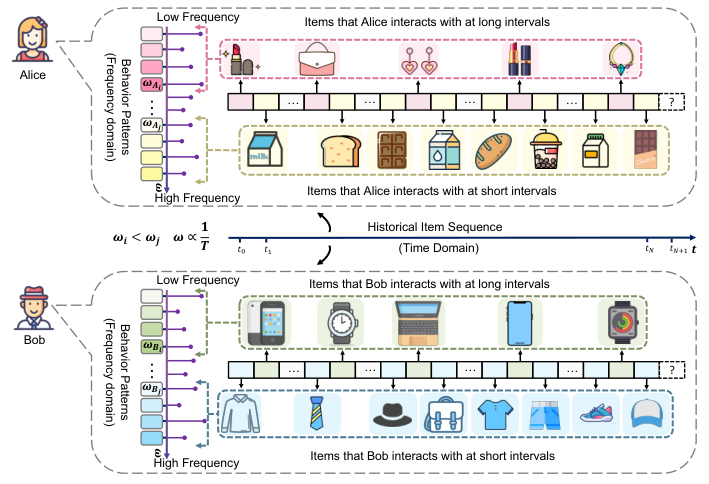
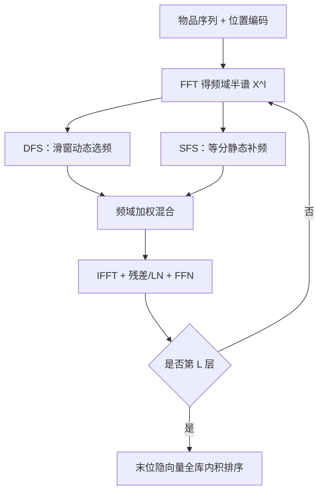
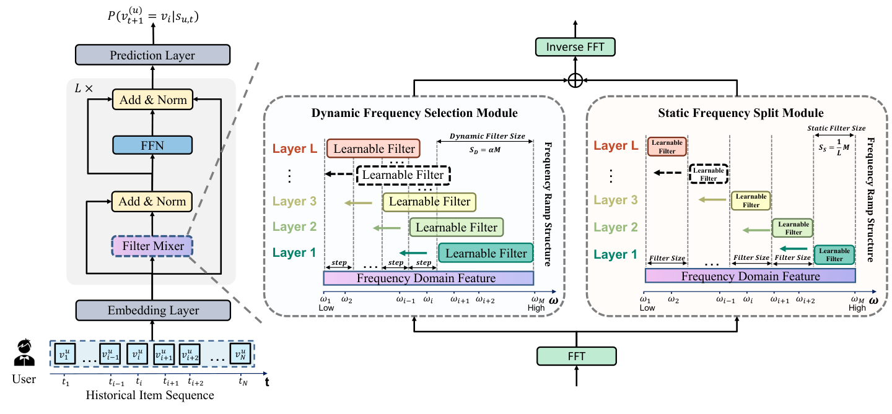

# Contrastive Enhanced Slide Filter Mixer for Sequential Recommendation（对比增强滑动滤波混合器的序列推荐）

- **会议/期刊**: ICDE 2023
- **作者与机构**: Xinyu Du, Huanhuan Yuan, Pengpeng Zhao 等；苏州大学、麦考瑞大学、罗格斯大学等
- **推荐链路定位**: 召回/排序（Next-Item 全库排序）
- **研究方向**: 序列与会话推荐 / 自监督对比学习与交互去噪
- **论文原文**: [arXiv:2305.04322v1](https://arxiv.org/abs/2305.04322v1)
- **开源代码**: [SLIME4Rec](https://github.com/sudaada/SLIME4Rec)

## TL;DR (1分钟核心速览)

针对时域序列中多周期行为纠缠、自注意力低通与 FMLP-Rec 全局滤波偏低频的问题，SLIME4Rec 用 FFT 后的 DFS/SFS 滑动滤波替代自注意力，并以频域混合视图做对比学习增强用户表征；在 5 个基准的 Leave-One-Out 全库排序上，HR@10/NDCG@10 相对最强基线 DuoRec 最高提升 21.39%/16.41%。

## Background & Motivation (背景与核心矛盾)

- **主流范式**: 序列推荐多在时域用 GRU/CNN/Transformer/MLP 建模物品转移，FMLP-Rec 率先用频域全局滤波去噪。
- **前人局限**: 时域交互中噪声与多周期行为相互纠缠，自注意力更擅长聚合低频而抑制高频；FMLP-Rec 的全局滤波器又偏向低频、难以逐层分离不同频段。
- **核心洞察 (Key Insight)**: 用户行为在频域可分解为低频长期偏好与高频短期/周期性兴趣，应让不同网络层关注不同频段，而非用一个全局滤波覆盖全谱。
- **本文切入点**: 以动态选频 DFS + 静态分频 SFS 的滑动滤波结构替代自注意力，并用频域视图对比学习增强表征。

<figure class="paper-figure" markdown="span">
  <figcaption>图 1. 从两个不同视角观察用户历史条目序列的示意图。从时域视角观察时，Alice 和 Bob 交互过的条目沿 t 轴按时间顺序排列。将视角切换到频域时，每个用户的历史条目序列沿 ω 轴分解为具有不同频率和周期的多种行为模式。Alice 和 Bob 均具有低频行为（即 ωAi、ωBi）和高频行为（即 ωAj、ωBj）。</figcaption>
</figure>
*图 1：时域纠缠序列在频域分解为低/高频行为模式。*

## Method (核心方法设计)

### 1. 整体框架 (Overall Architecture)

输入物品序列经嵌入与位置编码得到 $\mathbf{H}^0$，沿序列维做 FFT 得半谱$\mathbf{X}^l\in\mathbb{C}^{M\times d}$。每层 Filter Mixer 并行用 DFS 与 SFS 对复数谱乘以可学习滤波并相加，IFFT 回时域后接残差、LN 与 FFN；堆叠$L$ 层后取末位隐向量与物品嵌入内积，softmax 全库打分。训练端以交叉熵为主损失，并以同一序列的频域混合视图做对比正则。

<figure class="paper-figure" markdown="span">
  <figcaption>图 2. SLIME4Rec 的模型架构与 Transformer 编码器类似。它首先通过嵌入层生成带有位置嵌入的条目嵌入，然后由滤波器混合层代替自注意力层从频域提取用户偏好。滤波器混合器的细节如右侧所示，其由两个模块组成，即动态频率选择（DFS）和静态频率拆分（SFS）模块。为简洁起见，我们将不同层的所有可学习滤波器绘制在一个块中，以展示频率斜坡结构如何在两个模块上工作。</figcaption>
</figure>
*图 2：SLIME4Rec 以 Filter Mixer 替代自注意力，DFS/SFS 在频域形成滑动滤波。*

### 2. 关键设计拆解 (Key Designs)

1. **动态频率选择 DFS + 频率斜坡 (Frequency Ramp)**：痛点在于全局滤波无法区分频段。对第 $l$层，用宽度$\alpha M$的高频→低频滑窗$\overleftarrow{\sigma}^{l}_{D}(\omega)$乘可学习复滤波：$\hat{\mathbf{X}}^{l}_{D}=\mathbf{X}^{l}\odot\overleftarrow{\sigma}^{l}_{D}(\omega)\odot\mathbf{W}^{l}_{D}$，步长$\mathrm{step}=(1-\alpha)M/(L-1)$。不同层因此看到不同频段，低层抓高频局部、高层抓低频全局。
2. **静态频率拆分 SFS 与双滤波混合**：当 $\alpha<1/L$时动态窗会漏掉相邻频段，SFS 以$\beta=1/L$等分全谱并滑动补频：$\hat{\mathbf{X}}^{l}_{S}=\mathbf{X}^{l}\odot\overleftarrow{\sigma}^{l}_{S}(\omega)\odot\mathbf{W}^{l}_{S}$；最终$\hat{\mathbf{X}}^{l}=(1-\gamma)\hat{\mathbf{X}}^{l}_{D}+\gamma\hat{\mathbf{X}}^{l}_{S}$，再 IFFT。静态分支提供更细粒度分频，避免频段空洞。
3. **训练目标、负采样与推理效率**：总损失 $\mathcal{L}=\mathcal{L}_{Rec}+\lambda\mathcal{L}_{CLReg}$；推荐采用全库 softmax 交叉熵，不做训练负采样；对比学习以 DFS/SFS 混合的频域视图和同目标序列为正样本、in-batch 为负样本。复杂度约由自注意力$O(n^2d+nd^2)$降至$O(L(n\log n+nd+nd^2))$ 量级，推理为末位向量全库内积排序。

## Experimental Setup & Evaluation Protocol (实验设置与评估协议)

- **数据集与预处理**: Amazon 三域、ML-1M、Yelp，均采用 `5-core` 过滤。

| 数据集 | #Users | #Items | #Interactions | 平均长度/稀疏度 | 特征/场景说明 |
| :--- | :---: | :---: | :---: | :---: | :--- |
| Beauty | 22,363 | 12,101 | 198,502 | 8.9 / 99.93% | Amazon 美妆，稀疏 |
| Clothing | 39,387 | 23,033 | 278,677 | 7.1 / 99.97% | Amazon 服饰，极稀疏 |
| Sports | 35,598 | 18,357 | 296,337 | 8.3 / 99.95% | Amazon 运动户外 |
| ML-1M | 6,041 | 3,417 | 999,611 | 165.5 / 95.16% | 电影，稠密长序列 |
| Yelp | 30,499 | 20,068 | 317,182 | 10.4 / 99.95% | 本地商户，2019 年后交易 |

- **数据划分与防穿越**: `Leave-One-Out`：最后一项测试、倒数第二项验证、其余训练。
- **排名评测协议**: `Full-Ranking` 全库未交互物品排序，不使用负采样；指标 HR@5/10、NDCG@5/10。
- **对比基线与超参设置**: 覆盖 BPR-MF、GRU4Rec、Caser、SASRec、BERT4Rec、FMLP-Rec、CL4SRec、ContrastVAE、CoSeRec、DuoRec；嵌入维度 $d=64$，层数$L\in\{2,4,8\}$，序列长度$N\in\{25,50,75,100\}$，$\alpha\in[0,1]$步长 0.1，Adam lr=0.001。原文未报告显著性检验$p$ 值。

## Key Experimental Results (实验关键数据)

### 1. 主实验对比 (Main Results)

下表报告 HR@10 / NDCG@10；`Δ` 为相对最强基线 DuoRec 的提升，最优值加粗。

| 数据集 | SASRec | BERT4Rec | FMLP-Rec | CL4SRec | ContrastVAE | CoSeRec | DuoRec | SLIME4Rec | Δ (HR@10/NDCG@10) |
| :--- | :---: | :---: | :---: | :---: | :---: | :---: | :---: | :---: | :---: |
| Beauty | .0627/.0281 | .0401/.0254 | .0632/.0333 | .0683/.0317 | .0681/.0350 | .0752/.0430 | .0845/.0443 | **.0910/.0489** | +7.69%/+10.38% |
| Clothing | .0272/.0124 | .0208/.0102 | .0206/.0107 | .0266/.0121 | .0247/.0133 | .0279/.0131 | .0302/.0148 | **.0343/.0164** | +13.58%/+10.81% |
| Sports | .0336/.0169 | .0326/.0153 | .0344/.0185 | .0374/.0197 | .0366/.0184 | .0437/.0242 | .0498/.0262 | **.0565/.0305** | +13.45%/+16.41% |
| ML-1M | .1904/.0910 | .1323/.0619 | .2118/.1113 | .1975/.0928 | .2220/.1157 | .2212/.1021 | .2946/.1680 | **.3156/.1864** | +7.13%/+10.95% |
| Yelp | .0265/.0134 | .0291/.0171 | .0304/.0153 | .0352/.0185 | .0294/.0147 | .0395/.0205 | .0631/.0386 | **.0766/.0439** | +21.39%/+13.73% |

### 2. 消融实验 (Ablation Study)

SFS 补频消融（$L=8$、$\alpha=0.1$；报告 HR@5/NDCG@5）：

| 变体 | Beauty | Clothing | Sports | ML-1M | Yelp |
| :--- | :---: | :---: | :---: | :---: | :---: |
| DFS only（w/o SFS） | .0570/.0371 | .0203/.0120 | .0365/.0232 | .1945/.1357 | .0452/.0312 |
| DFS+SFS（$\beta=0.125$） | **.0591/.0379** | **.0211/.0128** | **.0369/.0239** | **.2020/.1384** | **.0460/.0327** |

### 3. 关键实验发现 (Key Findings)

- **SFS 确实补上动态窗漏检频段**：$L=8,\alpha=0.1$下，ML-1M HR@5 从 .1945 升至 .2020、NDCG@5 从 .1357 升至 .1384；Yelp 从 .0452/.0312 升至 .0460/.0327，说明静态等分频段在$\alpha<1/L$ 时提供细粒度补偿。
- **滑窗方向比单纯加深网络更重要**：Mode 4（$\overleftarrow{\sigma}$ 高频→低频）在 ML-1M 得 HR@5/NDCG@5=.2237/.1567，优于 Mode 1 的 .2086/.1432，验证低层抓高频局部、高层抓低频全局的层级先验。
- **稀疏噪声序列收益更大**：Yelp HR@10 相对 DuoRec 提升 21.39%，Sports NDCG@5 提升 16.83%；稠密 ML-1M 为 +7.13%/+10.95%，说明频域分频去噪对稀疏、多周期交互更有效。

## Highlights & Limitations (亮点、对比与审稿批判)

- **与代表作对比 (vs. Prior Work)**: 相比 FMLP-Rec 的单一全局滤波，本文用 DFS+SFS 的层级滑动滤波显式分离高低频；相比 SASRec/BERT4Rec 的自注意力低通与 $O(n^2)$ 开销，频域滤波更轻且保留高频；相比 DuoRec 的时域数据/模型增广，本文将 DFS/SFS 频域混合作为对比视图，直接强化频域表征。
- **可迁移亮点**: 频率斜坡 + 滑窗带通滤波可迁移到长序列/多周期兴趣建模；频域混合视图可作为轻量对比增广，替代裁剪/掩码类时域增广。
- **审稿级局限批判**: 其一，$\alpha$、$\beta$、$L$ 需逐数据集搜索，稀疏集与稠密集最优差异大，调参成本偏高；其二，仅离线 `Leave-One-Out` 全库排序，未报告显著性检验、线上 A/B 或推理延迟实测，复数滤波的工程实现与稳定性仍需验证。

## Rating (四维评分)

- **方法创新性 (Novelty)**: ⭐⭐⭐⭐ （频域滑动滤波替代自注意力，DFS/SFS 与频率斜坡形成清晰的层级分频机制）
- **评估协议与实验扎实度 (Protocol & Experiments)**: ⭐⭐⭐⭐ （5 个基准、Leave-One-Out 全库排序、7 个强基线，消融覆盖滤波与滑窗方向；但缺显著性检验）
- **写作与数学规范度 (Clarity & Rigor)**: ⭐⭐⭐⭐ （FFT/卷积定理到滤波公式链条完整，符号较清晰；$\alpha/\beta$ 重叠条件需细读）
- **工业落地与复现价值 (Industrial & Practical Value)**: ⭐⭐⭐⭐ （代码开源，$O(n\log n)$ 滤波比自注意力更易扩展；但需逐数据集调参，复数滤波部署需额外工程）

