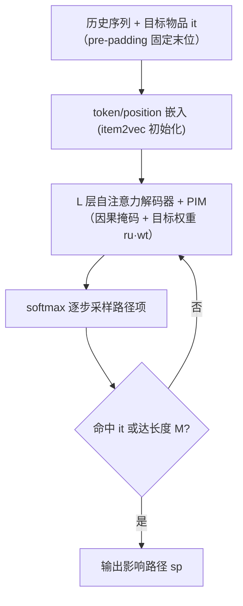
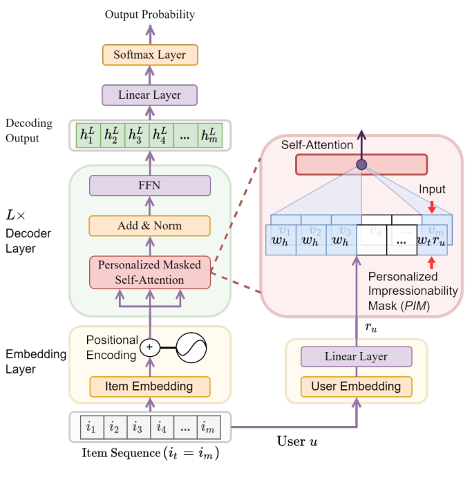

# Influential Recommender System (影响力推荐系统)

- **会议/期刊**: ICDE 2023 (39th IEEE International Conference on Data Engineering)
- **作者与机构**: Haoren Zhu, Hao Ge, Xiaodong Gu, Pengfei Zhao, Dik Lun Lee（HKUST / SJTU / BNU-HKBU UIC）
- **推荐链路定位**: 端到端序列生成（多步推荐列表生成，服务于营销/广告触达）
- **研究方向**: 序列与会话推荐 / 对话推荐与智能体仿真
- **论文原文**: [https://arxiv.org/abs/2211.10002v2](https://arxiv.org/abs/2211.10002v2)
- **开源代码**: 暂未开源（`code_url` 指向文中基线 Caser 的官方实现，非本文模型）

## TL;DR (1分钟核心速览)

传统推荐是"被动拟合历史兴趣"(URS)，而电商/广告/新闻更需要**主动把用户引导到一个给定目标物品 $i_t$** 上。本文提出新范式 IRS 与模型 IRN：把目标物品当作序列末尾 token，用带"个性化易受影响性掩码 (PIM)"的 Transformer 解码器，逐步生成一条既平滑又可接受的影响路径。在 Lastfm / Movielens-1M 上，以随机采样目标物品 + Bert4Rec 模拟评估器的离线协议，IRN 的 SR@20 达 14.2%/25.9%（最强基线 6.25%/7.3%），IoI 提升 2.8 倍/64%。

## Background & Motivation (背景与核心矛盾)

- **主流范式**: 序列推荐（GRU4Rec/Caser/SASRec/Bert4Rec）以"下一物品预测"为目标，完全由用户历史兴趣驱动，可称为用户导向推荐 URS。
- **前人局限**: (i) URS 只会在兴趣邻域内打转，无法把新品类/新品"卖"给用户，硬广直推又会伤体验；(ii) 图上的最短路类方法（Dijkstra/MST）能找到通往目标的路径，却与用户兴趣脱节，路径突兀、用户中途流失。
- **核心洞察 (Key Insight)**: 目标物品本身可以被当作"已知的未来 token"参与建模——训练时把真实历史子序列的**末项设为目标**，模型即学会"给定终点，反推一条自然过渡路径"；同时不同用户对外部影响的接受度不同（易受影响者可更激进）。
- **本文切入点**: 用 Transformer 解码器 + 目标感知的掩码注意力，把"路径规划"化为条件序列生成问题。

## Method (核心方法设计)

### 1. 整体框架 (Overall Architecture)

输入用户历史 $s_h=\{i_1,\dots,i_{m-1}\}$与目标物品$i_t$，拼接为长度$m$的序列（目标固定在末位，采用 **pre-padding** 而非 post-padding，保证目标位置恒定、便于位置编码与并行）。物品经 item2vec 预训练 token 嵌入 + 位置嵌入后送入$L$层带 PIM 的自注意力解码器；输出层投影到物品空间，按$p(i_j|i_{<j},i_t,u)$逐步采样生成路径项，直至命中$i_t$或超过最大长度$M$。训练阶段则将每个历史子序列的最后一项当作$i_t$，让模型重建整条路径。复杂度约$O(m^2d+|\mathcal{I}|d)$。

<figure class="paper-figure" markdown="span">
  <figcaption>图 4. IRN 的整体框架。给定序列 s = {i1, ..., im}，其中最后一项为目标物品（it = im），IRN 首先将 s 嵌入为向量。然后通过 L 个解码器层组成的堆栈学习输入序列的隐藏表示。解码器中的自注意力层结合专门设计的个性化易受影响性掩码，以适应对外部影响接受度不同的用户。</figcaption>
</figure>

### 2. 关键设计拆解 (Key Designs)

1. **个性化易受影响性掩码 PIM（目标感知 + 用户自适应）**：痛点源于标准因果掩码使解码器只能看过去、对目标"视而不见"。PIM 在注意力 logits 上叠加掩码权重 $M_{jk}$：$k>j$时置$-\infty$，$k=m$（目标位）时取$r_u w_t$，其余取$w_h$，即

$$\alpha_{jk}=\frac{\exp\!\left(\boldsymbol{q}_j^{\top}\boldsymbol{k}_k/\sqrt{d_k}+M_{jk}\right)}{\sum_{k'}\exp\!\left(\boldsymbol{q}_j^{\top}\boldsymbol{k}_{k'}/\sqrt{d_k}+M_{jk'}\right)},\qquad r_u=\mathbf{W}_U\mathbf{U}[u]$$

其中 $w_t>w_h$迫使模型关注目标，$r_u$ 由用户嵌入线性映射得到，作为"激进度"缩放目标权重。直觉：同一目标下，探索型用户可被更短路径直接带到位，保守型用户需要更贴合历史的缓坡路径。

2. **以目标为条件的路径重建损失**：不再做 next-item 的 teacher forcing，而是让整条真实路径在给定 $i_t$与$u$ 时概率最大，等价于最小化条件困惑度：

$$\mathcal{L}=\frac{1}{|\mathcal{S}|}\sum_{u\in\mathcal{U}}\sum_{s\in S_u}\left(-\frac{1}{m}\sum_{j=1}^{m}\log p(i_j\mid i_{<j},i_t,u)\right)$$

关键在于 $i_t$ 出现在**每一步**的条件里，因此模型具备跨全序列的"长程规划"能力，而非贪心局部最优（对比 Rec2Inf 每步独立重排）。

3. **训练/推理与负采样策略**：全库 softmax（无负采样，$|\mathcal{I}|$仅 2.7k/3.4k，可承受）；推理时逐项自回归采样，最多$M=20$步，可用束搜索加速。超参：$d=40/30$，$d'=10$，$L=5/6$，$h=4/6$，$w_t=1$。

## Experimental Setup & Evaluation Protocol (实验设置与评估协议)

- **数据集与预处理**：均做 `5-core` 过滤；Lastfm 对同一 user-item 连续行为做合并去重。

| 数据集 | #Users | #Items | #Interactions | 密度 | 场景说明 |
| :--- | :---: | :---: | :---: | :---: | :--- |
| Lastfm | 896 | 2,682 | 28,220 | 1.17% | 音乐收听（低决策成本） |
| Movielens-1M | 6,040 | 3,415 | 996,183 | 4.83% | 电影观看（含类型/导演特征） |

- **数据划分与防穿越**: 保留每用户完整历史最后一项做 next-item 测试；其余按时间顺序切成连续不重叠子序列，长度 $l_{min}=20$、$l_{max}=50/60$（Lastfm/ML-1M），子序列末项作为训练时的目标$i_t$；测试集规模$=|\mathcal{U}|$，每条测试样本随机抽取满足$i_t\notin s_h$且交互数$\ge 5$ 的目标物品。
- **排名评测协议**: 非传统 Top-N 排序，而是 **路径级生成式评估 + 模拟器打分**：因路径项多为数据集未出现交互，用独立评估器 $\mathcal{E}$（4 个 SOTA 序列模型择优，最终 Bert4Rec，HR@20 0.0489/0.264，MRR 相对次优 +58.4%）估计$P(i|s)=\mathcal{E}(i,s)$。
- **四项指标**: `SR@M`（$M$ 步内命中目标的比率）、`IoI@M`（目标物品对数似然增量）、`IoR@M`（目标排名提升位数）、`log(PPL)`（路径平滑度，越小越自然）。
- **对比基线**: Pf2Inf 框架下 Dijkstra / MST；Rec2Inf 框架下 POP / BPR / TransRec / GRU4Rec / Caser / SASRec（候选集 $k=50$，按到目标距离贪心重排）；距离度量 ML-1M 用类型特征向量、Lastfm 用 item2vec。

## Key Experimental Results (实验关键数据)

### 1. 主实验对比 (Main Results)

$M=20$，加粗为 IRS 方法内最优，下划线为次优。

| 方法 | Lastfm SR20 | IoI20 | IoR20 | logPPL | ML-1M SR20 | IoI20 | IoR20 | logPPL |
| :--- | :---: | :---: | :---: | :---: | :---: | :---: | :---: | :---: |
| Dijkstra (Pf2Inf) | 0.031 | 0.0192 | 3.73 | 9.88 | 0.069 | 0.009 | 362.8 | 6.97 |
| MST (Pf2Inf) | 0.0016 | -0.0531 | -11.5 | 8.13 | 0.031 | -0.026 | 52.0 | 8.47 |
| POP (Rec2Inf) | 0.0234 | 0.203 | 47.7 | 7.46 | 0.019 | 1.35 | 238.9 | 5.89 |
| BPR (Rec2Inf) | 0.0279 | -0.0218 | 41.9 | 6.80 | 0.021 | 0.930 | 242.8 | 6.01 |
| TransRec (Rec2Inf) | _0.0625_ | 0.0218 | 48.9 | 6.77 | 0.042 | 1.59 | 508.0 | 5.50 |
| GRU4Rec (Rec2Inf) | 0.0140 | 0.0392 | 20.8 | **6.37** | 0.012 | 0.91 | 130.1 | 5.22 |
| Caser (Rec2Inf) | 0.0246 | 0.0236 | 15.8 | 6.81 | _0.073_ | 1.38 | _614.0_ | **4.74** |
| SASRec (Rec2Inf) | 0.0137 | 0.0205 | 42.7 | 7.78 | 0.014 | 1.10 | 139.8 | 6.03 |
| **IRN (本文)** | **0.142** | **0.572** | **160.7** | _6.65_ | **0.259** | **2.61** | **804.7** | _4.94_ |
| Improv. vs 最强基线 | +127% | +182% | +229% | — | +255% | +64% | +31% | — |

### 2. 消融实验 (Ablation Study)

| 掩码类型 | Lastfm logPPL | SR20 | IoI20 | ML-1M logPPL | SR20 | IoI20 |
| :--- | :---: | :---: | :---: | :---: | :---: | :---: |
| Type 1: $w_h=w_t=0$（无目标感知） | **5.93** | 0.002 | 0.011 | **4.27** | 0.009 | 0.054 |
| Type 2: $w_t=1$（均匀目标权重） | 6.55 | 0.118 | 0.477 | 4.92 | 0.232 | 2.01 |
| Type 3: $r_u w_t$（PIM，完整） | 6.65 | **0.142** | **0.572** | 4.94 | **0.259** | **2.61** |

### 3. 关键实验发现 (Key Findings)

1. **目标感知是性能主开关，个性化是免费增益**：去掉目标注意力（Type 1）后 SR 从 0.142 崩到 0.002；加入 $r_u$在仅增加 0.10 logPPL 的代价下把 SR 再提约 20%、IoI 提约 20%，且$r_u$ 在两数据集上均近似正态分布，佐证用户"受影响力"确实异质。
2. **长程规划能力体现在长度曲线上**：$M$从 5 增至 20 时 IRN 的 SR 持续上升，而 Rec2Inf 基线（TransRec/Caser）在$M\approx10$ 后迅速饱和——因后者每步贪心局部重排、训练中从未见过目标；同时 IRN 在同等激进度下 SR 显著更高且 PPL 更低，打破了基线固有的"SR↑ 则 PPL↑"权衡。
3. **影响力并非以牺牲主任务为代价**：在纯 next-item 任务上 IRN 的 HR@20/MRR 为 0.0458/0.0190（Lastfm）与 0.242/0.073（ML-1M），相对 Bert4Rec 仅损失约 9.0%/9.2%，远好于同框架下 GRU4Rec（0.198）与 SASRec（0.207）在 ML-1M 上的明显退化。案例研究还展示了 Action → Adventure/Thriller → Children/Comedy 的平滑类型迁移。

## Highlights & Limitations (亮点、对比与审稿批判)

- **与代表作对比 (vs. Prior Work)**: 与 SASRec/Bert4Rec 类序列模型的关键差别是把目标物品写进**训练损失的条件项**而非仅用于推理期重排；与 Dijkstra/MST 图路径方法的差别是用数据驱动的序列先验替代拓扑最短路，因而在稀疏、非连通图上仍可生成平滑路径（Dijkstra 的 logPPL 高达 9.88 说明路径虽"到达"却不可接受）。
- **可迁移亮点**: (i) 把"未来目标 token 前置入条件"的掩码改造，可直接迁移到多样性/去偏重排、目标品类扶持等"给定终点规划路径"的场景；(ii) 用 $r_u$ 缩放掩码权重实现"按用户调节激进度"，是一种极轻量的用户级可控生成机制。
- **审稿级局限批判**: (i) **评估可信度**：核心指标依赖 Bert4Rec 代理评估器且目标物品随机采样，存在模拟器偏差，缺少真实线上 A/B 与人工评测；(ii) **成功率仍偏低且推理逐项自回归**：SR@20 仅 14.2%/25.9%，$M$步生成带来线性延迟，且$w_t$ 需按业务手调，缺少自适应策略；此外假设用户被动接受全部推荐，未建模中途拒绝的在线纠偏。

## Rating (四维评分)

- **方法创新性 (Novelty)**: ⭐⭐⭐⭐⭐ （首个"影响力/主动引导推荐"范式，PIM 把目标与用户性格耦合进注意力掩码，思路简洁且此前无人涉及）
- **评估协议与实验扎实度 (Protocol & Experiments)**: ⭐⭐⭐ （自建 SR/IoI/IoR/PPL 四指标合理，但重度依赖代理评估器与随机目标采样，无真实用户反馈，缺显著性检验）
- **写作与数学规范度 (Clarity & Rigor)**: ⭐⭐⭐⭐ （问题形式化、PIM 图示与困惑度推导清晰，复杂度分析完整；部分符号（$w_h$ 取值、激进度归一化）交代略简）
- **工业落地与复现价值 (Industrial & Practical Value)**: ⭐⭐⭐ （营销/新品推广场景价值明确、可插拔；但逐项自回归开销、$w_t$ 手调及无官方开源限制其直接复现与上线）

