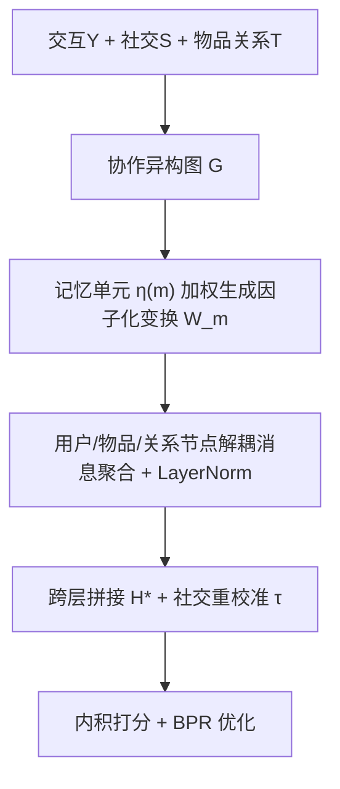
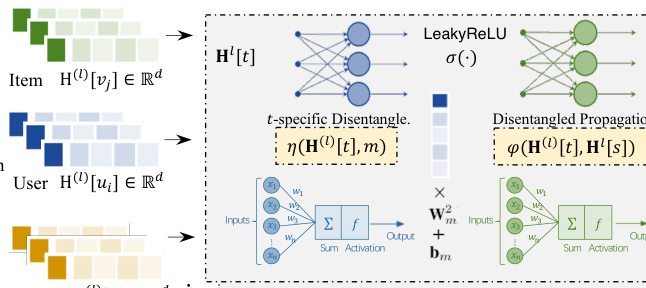

# Disentangled Graph Social Recommendation (解耦图社交推荐)

- **会议/期刊**: IEEE ICDE 2023
- **作者与机构**: Lianghao Xia, Yizhen Shao, Chao Huang, Yong Xu, Huance Xu, Jian Pei（香港大学 / 华南理工大学 / 杜克大学）
- **推荐链路定位**: 召回（用户-物品匹配打分）
- **研究方向**: 社交与群组推荐 / 图神经网络与知识图谱推荐
- **论文原文**: [https://arxiv.org/abs/2303.07810v1](https://arxiv.org/abs/2303.07810v1)
- **开源代码**: [https://github.com/HKUDS/DGNN](https://github.com/HKUDS/DGNN)

## TL;DR (1分钟核心速览)

社交推荐的主流做法是把社交图与交互图融合做 GNN 传播，但（i）几乎不建模**物品侧语义关系**（品类/功能依赖），（ii）把社交边、交互边、语义边压进同一潜空间，忽略"关系异构背后的潜在因子纠缠"。本文提出 DGNN：用一组可微记忆单元为每种节点/边类型动态生成因子化变换矩阵，在统一的协作异构图上做解耦消息传递与跨层聚合。在 Ciao/Epinions/Yelp 三数据集、1 正 + 100 负的采样排序协议下，HR@10 相对最优基线分别提升 4.10%/4.77%/1.84%。

## Background & Motivation (背景与核心矛盾)

- **主流范式**: DiffNet/GraphRec/MHCN 等在用户-物品交互图上叠加用户社交图做多层图卷积或注意力传播，把社交影响注入用户表征；KGAT/DGCF 分别从知识图谱侧或单关系意图侧引入语义。
- **前人局限 1**: 现有社交推荐只利用物品的协同相似度，物品间的**细粒度语义依赖**（品类、功能、场馆空间邻近）未被纳入传播；而异构关系语义差异大，硬塞进同一图反而引入噪声。
- **前人局限 2**: 用户为何连边、为何点击，本质由多因子驱动（品牌 vs. 颜色、同事 vs. 家人）；用单一向量表示"社交影响"无法反映社交多义性（social polysemy），DGCF/DisenHAN 仅在单一关系类型上解耦。
- **核心洞察 (Key Insight)**: 异构关系的语义可以由**少量可共享的潜在因子原型**线性组合而成——因此不必为每种节点/边类型独立参数化（HGT 的做法），而应学习"类型→因子"的软分配权重。
- **本文切入点**: 将关系异构编码写成记忆单元加权的动态变换算子，使解耦在 GNN 消息传递中自动发生，彻底摆脱 meta-path 领域知识。

## Method (核心方法设计)

### 1. 整体框架 (Overall Architecture)

先把用户-物品交互 $\mathbf{Y}$、用户社交$\mathbf{S}$、物品-关系节点关联$\mathbf{T}$拼成统一协作异构图$\mathcal{G}=(\mathcal{U}\cup\mathcal{V}\cup\mathcal{R},\ \mathcal{S}\cup\mathcal{T}\cup\mathcal{Y})$，为三类节点学习初始嵌入；每层传播由"记忆增强异构编码器"生成类型相关的因子化变换，再对用户（聚合社交邻居+交互邻居）、物品（聚合交互邻居+关系节点）、关系节点（聚合关联物品）分别做归一化聚合，配合残差自环与 LayerNorm 稳定训练，最后跨层拼接得到$\mathbf{H}^{*}$，经社交重校准后与物品向量内积打分，用 BPR 端到端优化。

<figure class="paper-figure" markdown="span">
  <figcaption>图1. 所提出的DGNN架构的模型流程。协作异构图与初始用户/物品/关系节点嵌入一起输入到我们的DGNN中，该DGNN由解耦异构性编码器和异构图消息聚合器组成。η(m)表示第m个记忆单元对应编码后的因子化嵌入的学习重要性权重。</figcaption>
</figure>

### 2. 关键设计拆解 (Key Designs)

1. **记忆增强关系异构编码器（把"类型专属参数"换成"因子原型加权"）**：痛点是为每类边独立设参数既爆炸又学不到跨类型共性。DGNN 维护 $|\mathcal{M}|$个因子原型，用目标节点嵌入预测各原型的注意力，再对源节点做加权变换：$\phi(\mathbf{H}^{(l)}[t],\mathbf{H}^{(l)}[s])=\big(\sum_{m=1}^{|\mathcal{M}|}\eta(\mathbf{H}^{(l)}[t],m)\mathbf{W}^{1}_{m}\big)\mathbf{H}^{(l)}[s]$，其中$\eta(\mathbf{H}^{(l)}[t],m)=\sigma(\mathbf{H}^{(l)}[t]\cdot\mathbf{W}^{2}_{m}+b_m)$。直觉：边类型不同 → 激活的原型子集不同，等价于在共享因子字典上做软路由，参数从$O(|\mathcal{B}|d^2)$降到$O(|\mathcal{M}|d^2)$ 且天然可迁移。

2. **异构解耦消息聚合（让用户被"社交"和"交互"分别解释）**：用户侧同时汇聚社交邻居（社交语义原型）与交互物品（偏好语义原型），并按 $1/(|\mathcal{N}^{S}_{u_i}|+|\mathcal{N}^{Y}_{u_i}|)$归一；物品侧额外吸收关系节点$r$的品类语义，$r$又反向聚合其关联物品。相比 HAN/HERec 依赖 meta-path，这里的关系路径由$\mathbf{T}$ 直接给出，无需领域知识。

3. **社交重校准打分与训练目标**：预测阶段用 $\tau(\mathbf{H}^{*}[u_i])=\frac{1}{|\mathcal{N}^{S}_{u_i}|+1}\big(\sum_{u'_i\in\mathcal{N}^{S}_{u_i}}\mathbf{H}^{*}[u'_i]+\mathbf{H}^{*}[u_i]\big)$再平均一次社交邻居，最终$\hat{y}_{i,j}=\big(\mathbf{H}^{*}[u_i]+\tau(\mathbf{H}^{*}[u_i])\big)^{\top}\mathbf{H}^{*}[v_j]$，把社交影响显式写进打分而非仅隐在嵌入里。损失为 BPR + L2：$\mathcal{L}=\sum_{(i,j^+,j^-)}-\log\sigma(\hat{y}_{i,j^+}-\hat{y}_{i,j^-})+\lambda\|\Theta\|_2^2$；负采样为标准均匀负采样（每正样本配 1 负），推理为向量内积 + ANN，复杂度$O(|\mathcal{M}||\mathcal{E}|d^2)$。

## Experimental Setup & Evaluation Protocol (实验设置与评估协议)

| 数据集 | #Users | #Items | #Interactions | 稀疏度 | 特征/场景说明 |
| :--- | :---: | :---: | :---: | :---: | :--- |
| Ciao | 1,925 | 15,053 | 30,370 | 0.1048% | 评论网站，65,084 条信任边（密度 1.7564%） |
| Epinions | 18,081 | 251,722 | 715,821 | 0.0157% | 信任网络，572,784 条社交边 |
| Yelp | 99,262 | 105,142 | 769,929 | 0.0074% | 本地商户，1,298,522 条社交边，物品关系用商户品类 |

- **数据划分与防穿越**: 论文沿用 KGAT/RCFF 的社交推荐设定，测试阶段为每位用户构造 **1 个正样本 + 100 个随机未交互负样本**；原文未明确给出训练/验证的时间戳或留一划分细节，属潜在复现歧义点。
- **排名评测协议**: **Sampled Ranking（1:100 负采样排序）**，指标 HR@N 与 NDCG@N，$N\in\{5,10,20\}$；未报告 Full-Ranking 结果。
- **对比基线与超参**: 覆盖 14 个基线——注意力社交推荐（SAMN、EATNN）、GNN 社交推荐（DiffNet、GraphRec、MHCN、DGRec）、图 CF（NGCF、GCCF）、解耦推荐（DGCF、DisenHAN）、知识感知（KGAT）、异构图（HAN、HGT、HERec）。嵌入维度 $d$在$\{4,8,16,32\}$中搜索（最优 16），学习率 0.01，batch 512–4096，$\lambda\in\{10^{-3},10^{-4},10^{-5}\}$，记忆单元$|\mathcal{M}|=8$，图层$L=2$。

## Key Experimental Results (实验关键数据)

### 1. 主实验对比 (Main Results)

| 数据集 | 指标 | DGCF | DisenHAN | HGT | HERec | MHCN | DiffNet | **DGNN** | Improv. |
| :--- | :--- | :---: | :---: | :---: | :---: | :---: | :---: | :---: | :---: |
| Ciao | HR@10 | 0.5189 | 0.4856 | 0.4933 | 0.5298 | 0.5080 | 0.5202 | **0.5515** | +4.10% |
| Ciao | NDCG@10 | 0.3166 | 0.2894 | 0.3062 | 0.3104 | 0.3118 | 0.3201 | **0.3338** | +4.28% |
| Epinions | HR@10 | 0.6635 | 0.6825 | 0.7001 | 0.6767 | 0.6411 | 0.6323 | **0.7335** | +4.77% |
| Epinions | NDCG@10 | 0.4594 | 0.4627 | 0.4812 | 0.4572 | 0.4261 | 0.4160 | **0.5215** | +8.37% |
| Yelp | HR@10 | 0.7956 | 0.8159 | 0.8185 | 0.7047 | 0.8019 | 0.8222 | **0.8373** | +1.84% |
| Yelp | NDCG@10 | 0.5410 | 0.5403 | 0.5547 | 0.4990 | 0.5348 | 0.5524 | **0.5873** | +3.93% |

（Improv. 为相对最强基线的提升：Ciao 对 HERec/DiffNet，Epinions 对 HGT，Yelp 对 DiffNet/NGCF；表中未报告显著性检验。）

### 2. 消融实验 (Ablation Study)

| 变体 | Ciao HR@10 | Epinions HR@10 | Yelp HR@10 | 结论趋势 |
| :--- | :---: | :---: | :---: | :--- |
| **DGNN 全模型** | **0.5515** | **0.7335** | **0.8373** | — |
| w/o 记忆增强异构编码 $-M$ | 明显下降（降幅最大） | 明显下降 | 明显下降 | 因子化解耦为核心贡献 |
| w/o 社交重校准 $-\tau$ | 下降 | 下降 | 下降 | 打分期显式社交融合有效 |
| w/o LayerNorm $-LN$ | 小幅下降 | 小幅下降 | 小幅下降 | 稳定梯度、缓解异构尺度差异 |
| w/o 物品语义边 $-T$ | 下降 | 下降 | 下降 | 品类语义补充协同信号 |
| w/o 社交边 $-S$ | 下降 | 下降 | 下降 | 社交上下文仍不可替代 |
| w/o 两者 $-ST$ | 最差 | 最差 | 最差 | 双侧异构信息互补 |

（原文以图 4、图 5 柱状图呈现，未给出具体数值，此处按相对高低整理。）

### 3. 关键实验发现 (Key Findings)

1. **解耦记忆模块是性能主轴**：移除 $-M$ 后三个数据集 HR@10/NDCG@10 降幅均最大，且完整模型在 Yelp 上把 NDCG@10 从 NGCF 的 0.5651 推到 0.5873（+3.93%），说明"因子原型软路由"比 HGT 的类型专属参数更能提炼跨关系共性。
2. **异构物品语义与社交信号互补而非替代**：$-ST$ 变体在全部 top-N 位置均最差；Ciao 上 DGNN NDCG@10 = 0.3338 高于最强协同基线 DiffNet 0.3201，Epinions 上较 HGT 提升 8.37%，验证品类关系把稀疏交互下的偏好推断"补厚"。
3. **效率与稀疏鲁棒性双优**：单 epoch 训练 Epinions 仅 31.60s，而 HGT 需 525.94s、DGCF 63.52s（约 16.7×/2× 加速），测试 Ciao 0.71s vs HGT 0.77s；在按交互密度与社连密度四等分的稀疏桶中，DGNN 在每档均优于 TrustMF/LRGCCF/DiffNet/NGCF/HAN。

## Highlights & Limitations (亮点、对比与审稿批判)

- **与代表作对比**: vs **DiffNet/GraphRec**：仅融合社交+交互两类同质关系，无因子解耦也无物品语义；vs **DGCF/DisenHAN**：只在单一关系类型（用户-物品意图）上解耦，无法处理社交/交互/语义三类关系异构；vs **HAN/HGT/HERec**：依赖 meta-path 或类型专属参数，前者需领域知识、后者参数随类型数线性膨胀，DGNN 用共享记忆字典同时解决两个问题。
- **可迁移亮点**: ①"记忆单元注意力 = 关系类型的软路由"可直接搬到多行为/多场景推荐（点击/加购/购买）替代多塔参数；② 打分前对邻居嵌入再做一次平均的 $\tau(\cdot)$ 重校准，是零成本提升社交/图侧信号的通用技巧。
- **审稿级局限批判**: ① 评测仅用 1:100 采样排序且未做全库 Full-Ranking 与显著性检验，Yelp 上 HR 增益仅 1.84%，采样偏差可能放大差距；② 物品语义关系依赖数据集自带的品类标注（Ciao/Epinions/Yelp），在新场景缺失该类元数据时收益不明，且 $O(|\mathcal{M}||\mathcal{E}|d^2)$的边级动态变换在亿级交互图上开销需重新评估；③ 层数$L>2$即过平滑、$|\mathcal{M}|$ 固定为 8，超参敏感度较高。

## Rating (四维评分)

- **方法创新性 (Novelty)**: ⭐⭐⭐⭐ （用记忆原型替代类型专属参数实现异构关系解耦，视角统一且无需 meta-path，但仍是"注意力+因子分解"的组合式创新）
- **评估协议与实验扎实度 (Protocol & Experiments)**: ⭐⭐⭐ （14 个基线覆盖全面、含稀疏分桶与效率对比，但仅 1:100 采样排序、无 Full-Ranking 与显著性检验，消融只给柱状图）
- **写作与数学规范度 (Clarity & Rigor)**: ⭐⭐⭐⭐ （公式与三类节点聚合路径定义清晰，含时间/空间复杂度推导与算法伪码；部分符号在图文中重复度较高）
- **工业落地与复现价值 (Industrial & Practical Value)**: ⭐⭐⭐⭐ （代码开源、训练速度优于 HGT/DGCF，社交重校准与记忆路由易工程化；但边级动态变换在超大规模图上的显存/延迟仍需裁剪）

