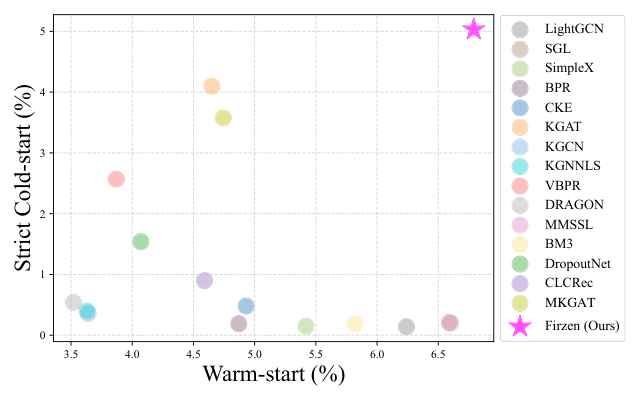
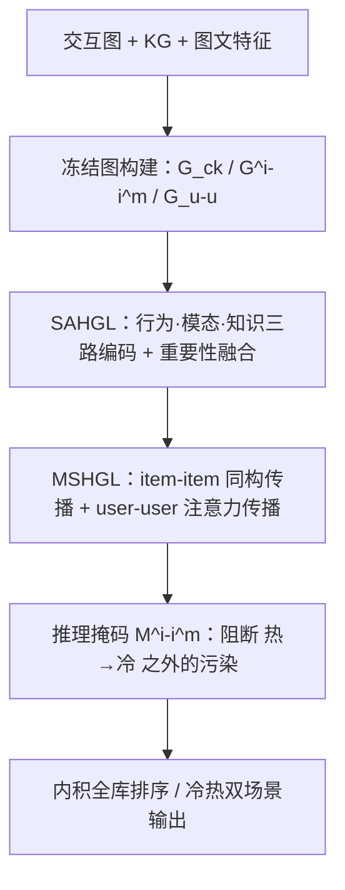
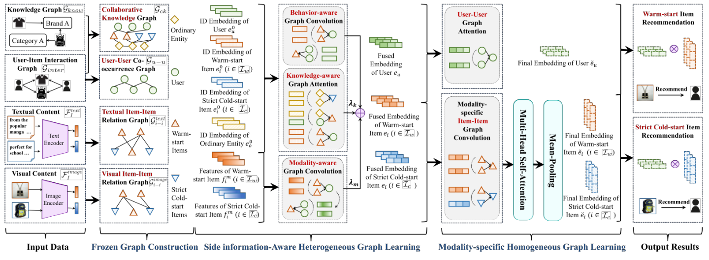

# Firzen: Firing Strict Cold-Start Items with Frozen Heterogeneous and Homogeneous Graphs for Recommendation (以冻结异质/同构图点燃严格冷启动物品推荐)

- **会议/期刊**: ICDE 2024
- **作者与机构**: Hulingxiao He, Xiangteng He, Yuxin Peng (北京大学王选计算机研究所) ; Zifei Shan, Xin Su (腾讯微信事业群)
- **推荐链路定位**: 召回（物品表征与全库排序）
- **研究方向**: 冷启动与长尾推荐 / 多模态推荐
- **论文原文**: [https://arxiv.org/abs/2410.07654v1](https://arxiv.org/abs/2410.07654v1)
- **开源代码**: [https://github.com/PKU-ICST-MIPL/Firzen_ICDE2024](https://github.com/PKU-ICST-MIPL/Firzen_ICDE2024)

## TL;DR (1分钟核心速览)

严格冷启动（Strict Cold-Start）物品在训练阶段完全缺席、测试阶段也没有任何交互边，因此只能靠内容表征排序。Firzen 指出：纯 ID 类模型（SGL/MMSSL）因缺少交互监督而学不出该类物品向量，而纯内容类模型（KGAT/VBPR）又会让无关模态与 KG 实体污染热启动表征。作者将协作知识图、模态 item-item 图、用户共现图**全部冻结**，用 SAHGL + MSHGL 把行为感知/模态感知/知识感知信号经同构图**单向**由热启动物品扩散到冷启动物品，推理时再用掩码隔断反向污染。在 Amazon Beauty/Cell Phones/Clothing 与工业数据集 Weixin-Sports 的**全库排序（Full-Ranking, K=20）**协议下，Beauty 冷启动 M@20 相对最强基线 KGAT 提升 21.9%，热启动与 SOTA 持平（HM@20 提升 32.6%）。

## Background & Motivation (背景与核心矛盾)

- **主流范式**: 一类是以 ID Embedding + 交互图卷积为主的 CF 模型（LightGCN/SGL/SimpleX）；另一类引入物品多模态内容（VBPR/MMSSL）或知识图谱（KGAT/KGNNLS）作为辅助信息提升稀疏场景。
- **前人局限 1（监督依赖）**: 侧信息仅被用于"增强热启动 ID 表征"，严格冷启动物品因无交互监督而学不到可行向量，测试时也无用户边可借用，故 MMSSL、SGL 在该场景几乎失效。
- **前人局限 2（内容噪声）**: 另一类直接以内容表征物品，虽缓解了交互依赖，但用户偏好可能只体现在海报、剧情或导演中的某一个侧面（图 2），把全部模态与 KG 实体灌入会模糊热启动物品的最终表征，KGAT/VBPR 因此在热启动场景掉点。
- **核心洞察 (Key Insight)**: 严格冷启动的瓶颈不是"内容不够多"，而是"内容与协同信号之间缺少一条可传播的路径"；item-item 语义结构恰好可以充当这条从热启动到冷启动的桥，但必须**冻结**以免噪声被反复放大。
- **本文切入点**: 把图当作固定的消息通道而非可学习参数，热启动路径保持纯协同（不掺内容），冷启动路径只从同构近邻单向取信号，从而同时兼顾两端。

<figure class="paper-figure" markdown="span">
  <figcaption>图 1. Firzen 与现有方法在 Amazon Beauty 数据集上严格冷启动和热启动场景下的性能比较（MRR@20）。</figcaption>
</figure>

## Method (核心方法设计)

### 1. 整体框架 (Overall Architecture)

Firzen 由三部分组成。**冻结图构建**：把用户-物品交互图与物品 KG 通过 item-entity 对齐合并为协作知识图 $\mathcal{G}_{ck}$；对每个模态$m\in\{\text{text},\text{image}\}$用原始模态特征的余弦相似度 + top-$K$稀疏化构图，得到$\check{\mathbf{G}}^m_{i-i}$；用共同交互物品数 top-$K$构建用户共现图$\mathbf{G}_{u-u}$。**SAHGL** 在异质图上并行跑三路编码：行为感知 LightGCN、模态感知投影卷积、知识感知图注意力，再按重要性加权融合。**MSHGL** 在冻结同质图上做轻量 GCN（物品侧）与图注意力（用户侧）传播，并用多头自注意力融合模态间依赖。训练用 BPR + 对抗 + 对比 + KG 四路损失；推理阶段把 item-item 图按"热→冷"方向掩码后重新传播，得到冷启动物品向量并全库打分。

<figure class="paper-figure" markdown="span">
  <figcaption>图 4. 所提出的 Firzen 架构的模型流程。利用 KGs、用户-物品交互图和多模态内容构建冻结图。随后，这些图与初始用户/物品/实体 ID 嵌入及多模态特征一起依次输入 SAHGL 和 MSHGL，以获得最终表示。λk、λm 分别表示知识感知表示和模态感知表示的重要性。</figcaption>
</figure>

### 2. 关键设计拆解 (Key Designs)

1. **交互感知模态投影 + 重要性门控融合**：原始图文特征包含大量与偏好无关的成分。作者不做重建式去噪，而是先用可学习投影把模态特征压到交互向量空间再做邻居聚合 $x^m_u=\sum_{i\in\mathcal{N}_u}\mathrm{Linear}(f^m_i)/\sqrt{|\mathcal{N}_u|}$，然后融合$e_i=\tilde{e}_i+\lambda_k x^{know}_i+\lambda_m(\beta_t x^{text}_i+\beta_i x^{image}_i)$。关键在于$\beta_t,\beta_i$不是自由参数，而是由对抗判别器在两张虚拟交互图上的输出经 softmax 后以动量方式更新：$\beta_t=\eta\beta_t+(1-\eta)\frac{\exp(D(\bar{\mathbf{G}}^{text}_{inter}))}{\sum_{m}\exp(D(\bar{\mathbf{G}}^{m}_{inter}))}$。物理直觉是：哪一模态的虚拟交互图更难被判别器与真实图区分，就说明它更能解释真实行为，权重更高。
2. **冻结同构图上的单向冷启动传播（MSHGL）**：痛点在于冷启动物品在交互图上是孤立点。作者用 $\hat{\mathbf{h}}^m_l(a)=\sum_{b\in\mathcal{N}_a}\check{\mathbf{G}}^m_{i-i}(a,b)\hat{\mathbf{h}}^m_{l-1}(b)$在模态图上传播，使冷启动物品从其热启动近邻继承协同分量；用户侧则用共现次数做注意力$\frac{\exp(\tilde{\mathbf{G}}_{u-u}(a,b))}{\sum_c\exp(\tilde{\mathbf{G}}_{u-u}(a,c))}$，让共享物品越多的用户影响力越大。核心是**推理期的方向性掩码**：$\hat{\mathbf{G}}^m_{i-i}=\tilde{\mathbf{G}}^m_{i-i}\odot\mathbf{M}^m_{i-i}$，其中$a\in\mathcal{I}_{warm},b\in\mathcal{I}_{cold}$ 时掩码为 0，保证信息只从热流向量冷，热启动物品表征不被冷启动噪声反向侵蚀。这也是"同一模型兼顾两场景"的根本原因。
3. **训练目标、负采样与推理效率**：负采样为均匀随机采样（BPR 三元组）。总损失 $\mathcal{L}_{Rec}=\mathcal{L}_{BPR}+\lambda_{adv}\mathcal{L}_{adv}+\lambda_{contr}\mathcal{L}_{contr}+\lambda_{reg}\|\boldsymbol{\theta}\|_2^2$，其中对抗项采用 WGAN-GP 形式，目标图由 Gumbel-Softmax 增强并混入最终嵌入相似度作为辅助信号$\phi=\frac{\breve{e}_u\breve{e}_i}{\|\breve{e}_u\|_2\|\breve{e}_i\|_2}$；对比项用 InfoNCE 拉近模态感知视角与最终视角；KG 侧用 TransR 成对排序损失$\mathcal{L}_{KG}$ 与主损失**交替**优化。推理时冷启动每用户 16.3 ms、热启动 57.9 ms（Beauty，单 TITAN Xp）。

## Experimental Setup & Evaluation Protocol (实验设置与评估协议)

- **数据集与预处理**: 采用 Amazon 三子集与腾讯微信视频号的工业数据集，均做 `5-core` 过滤后重排为严格冷启动基准（其中 20% 物品随机划为冷启动物品，再按 1:1 切成 cold-val / cold-test；其余物品按 8:1:1 切为 train / warm-val / warm-test）。KG 由 4 类实体、6 类关系（Weixin-Sports 为 WikiSports 一跳子图）构成。

| 数据集 | #Users | #Items | #Interactions | 稀疏度 | 特征/场景说明 |
| :--- | :---: | :---: | :---: | :---: | :--- |
| Beauty | 22,363 | 12,101 | 198,502 | 99.927% | 图 4096-d / 文 384-d，KG 1,102 万三元组 |
| Cell Phones | 27,879 | 10,429 | 194,439 | 99.933% | 同上，电子品类 |
| Clothing | 39,387 | 23,033 | 278,677 | 99.969% | KG 达 4,695 万三元组 |
| Weixin-Sports | 336,466 | 91,086 | 4,222,715 | 99.986% | 工业短视频，64-d 多模态，18,322 个冷启动物品 |

- **数据划分与防穿越 (Splitting Strategy)**: `冷启动划分` — 冷启动物品在训练阶段被整体移除，测试时也无交互边（区别于普通冷启动），属于防信息泄漏的严格设定。
- **排名评测协议 (Ranking Protocol)**: 无偏 `Full-Ranking`。热启动场景候选为全部未交互热启动物品，冷启动场景候选为全部冷启动物品，均非采样排序。指标为 R/M/N/H/P@20，并额外报告冷热调和平均 $\mathrm{HM}=2\cdot\text{cold}\cdot\text{warm}/(\text{cold}+\text{warm})$ 以惩罚"单边强"。
- **对比基线与超参设置**: 覆盖 5 类共 15 个基线（CF: BPR/LightGCN/SGL/SimpleX；KG: CKE/KGAT/KGCN/KGNNLS；MM: VBPR/DRAGON/BM3/MMSSL；CS: DropoutNet/CLCRec；MM+KG: MKGAT）。嵌入维度 $d=64$，batch 2048，Adam，300 epoch 早停；所有 CS 模型以 LightGCN 为骨干、同样输入多模态内容以保证公平。

## Key Experimental Results (实验关键数据)

### 1. 主实验对比 (Main Results)

Beauty 上冷/热/HM 三场景主结果（%，`Improv.` 为相对最强非本方法基线的 M@20 提升）：

| Setting | Method | R@20 | M@20 | N@20 | H@20 | Improv. |
| :--- | :--- | :---: | :---: | :---: | :---: | :---: |
| Cold | LightGCN | 0.77 | 0.14 | 0.27 | 0.97 | – |
| Cold | SGL | 0.93 | 0.21 | 0.35 | 1.12 | – |
| Cold | MMSSL | 0.67 | 0.20 | 0.28 | 0.89 | – |
| Cold | KGAT | 12.74 | 4.10 | 5.71 | 14.68 | – |
| Cold | DropoutNet | 4.85 | 1.54 | 2.15 | 5.92 | – |
| Cold | CLCRec | 2.62 | 0.59 | 0.99 | 3.16 | – |
| Cold | MKGAT | 11.58 | 3.59 | 5.08 | 13.46 | – |
| Cold | **Firzen** | **13.65** | **5.00** | **6.54** | **15.83** | **+21.9%** |
| Warm | SGL | 14.56 | 6.59 | 7.53 | 19.56 | – |
| Warm | MMSSL | 14.30 | 6.60 | 7.51 | 19.28 | – |
| Warm | KGAT | 11.29 | 4.65 | 5.53 | 15.47 | – |
| Warm | **Firzen** | 14.31 | **6.84** | **7.67** | 19.32 | **+3.6%** |
| HM | KGAT | 11.97 | 4.36 | 5.62 | 15.06 | – |
| HM | MKGAT | 9.40 | 4.20 | 4.76 | 13.48 | – |
| HM | **Firzen** | **13.97** | **5.78** | **7.06** | **17.40** | **+32.6%** |

跨数据集冷启动与 HM 的 M@20 概览：

| Dataset | 最强基线 (Cold) | Firzen (Cold) | Improv. | 最强基线 (HM) | Firzen (HM) |
| :--- | :---: | :---: | :---: | :---: | :---: |
| Cell Phones | 3.06 (KGAT) | **3.38** | +10.5% | 3.54 (KGAT) | **4.54** |
| Clothing | 1.31 (KGAT) | **2.63** | +100.8% | 1.31 (KGAT) | **2.74** |
| Weixin-Sports | 0.11 (VBPR) | **0.17** | +54.5% | 0.08 (VBPR) | **0.34** |

### 2. 消融实验 (Ablation Study)

Beauty 数据集，BA=行为感知卷积、KA=知识感知注意力、MA=模态感知卷积、MS=同构图传播：

| 配置 | Cold R@20 | Cold M@20 | Warm R@20 | Warm M@20 | HM M@20 |
| :--- | :---: | :---: | :---: | :---: | :---: |
| BA+KA+MA（w/o MS） | 3.31 | 0.86 | 14.27 | 6.72 | 1.52 |
| BA+MA+MS（w/o KA） | 11.63 | 4.36 | 14.38 | 6.75 | 5.30 |
| BA+KA+MS（w/o MA） | 12.93 | 4.77 | 14.29 | 6.93 | 5.65 |
| KA+MA+MS（w/o BA） | 12.35 | 4.37 | 13.13 | 5.49 | 4.87 |
| **Full Firzen** | **13.65** | **5.00** | **14.31** | **6.84** | **5.78** |

### 3. 关键实验发现 (Key Findings)

1. **同构图传播是冷启动的"命门"，且必须冻结**：去掉 MS 后冷启动 M@20 从 5.00 崩到 0.86（-82.8%），但热启动几乎无损（6.84→6.72），证明 MSHGL 是把协同信号注入冷启动物品的唯一通道；同时超参分析显示近邻数 $K$ 从 5 增到 20 时冷启动指标**单调下降**，说明过连接会引入不当传播，验证了冻结 + 稀疏化的必要性。
2. **模态与 KG 是互补而非叠加，但 fusion 权重必须"收着用"**：单独去掉 KA 或 MA 都会让冷启动 M@20 掉 12.8%/4.6%，而热启动几乎不变（6.84→6.75/6.93）；$\lambda_k$超过 0.36、$\lambda_m$ 超过 1.10 后冷启动指标转而下降、热启动持续下降，定量印证了"无关内容模糊热启动表征"这一动机假设。而去掉 BA 会让**热启动**也掉 19.7%（6.84→5.49），说明协同信号仍是热启动精度的天花板。
3. **对 KG 噪声的相对鲁棒性显著优于同类**：注入 20% 离群/重复/矛盾三元组后，Firzen 冷启动 M@20 为 2.81/2.86/2.69，绝对降幅约 44%，而 KGAT、MKGAT 在噪声下冷启动 M@20 直接跌至 0.14–0.24（降幅 90%+）；同时 Firzen 的 HM 平均降幅仅 31.7–35.0%，是所有对比方法中最低，说明对抗 + 对比双路蒸馏确实筛掉了 KG 中的任务无关事实。此外在普通冷启动设定下（测试时新增交互边）Firzen 仍达 R@20 13.40 / M@20 4.70，优于 MKGAT 的 11.19/3.39。

## Highlights & Limitations (亮点、对比与审稿批判)

- **与代表作对比 (vs. Prior Work)**: 与 KGAT 相比，Firzen 不把多模态内容作为 KG 节点混入，而是分开编码后用判别器驱动的重要性加权融合，避免了 MKGAT 中"内容节点远少于实体节点导致传播不足"的问题；与 MMSSL 相比，Firzen 不依赖完整交互图构造冷启动物品向量，而借 item-item 语义桥做跨物品迁移；与 DropoutNet 相比，本文不靠"删除行为特征"模拟冷启动，而是在推理期用掩码真正隔断信息流，冷启动与热启动共享同一套参数。
- **可迁移亮点**: (1) **推理期方向掩码** $\mathbf{M}^m_{i-i}$是一个极轻量的"单向信息阀"，可套用到任何"新物品只能读取、不能反向写入"的增量索引场景；(2) 用判别器输出经 momentum softmax 生成侧信息权重$\beta_m$，比人工调权或固定 concat 更省调参成本，可直接搬到多源特征融合的召回塔。
- **审稿级局限批判**: (1) **开销偏重**：Beauty 上训练需 48,272 s（约 13.4 h），推理每用户冷启动 16.3 ms、热启动 57.9 ms，且随模态数线性增长，相比 LightGCN 的毫秒级打分，在千万级候选的在线召回中难以直接落地，论文也未给出 ANN 加速或离线预计算方案。(2) **冷启动划分偏理想化**：采用"随机抽 20% 物品"而非全局时间戳切分，冷启动物品在内容分布上与热启动物品同源，无法反映真实新品上线的分布漂移；且新物品接入时必须重建 top-$K$item-item 图并重跑传播，增量更新成本与$K$敏感性（$K$ 越大反而越差）都未充分讨论。

## Rating (四维评分)

- **方法创新性 (Novelty)**: ⭐⭐⭐⭐ （"冻结图 + 单向掩码传播"把冷启动问题重构为信息流向控制问题，配合判别器驱动的模态重要性，思路干净且与 LATTICE/FREEDOM 的冻结图路线形成有意义的推进）
- **评估协议与实验扎实度 (Protocol & Experiments)**: ⭐⭐⭐⭐ （全库排序 + 冷热调和平均 HM 的设计很克制，4 个基准含真实工业数据、15 个基线、8 个 RQ 覆盖消融/噪声/超参/可解释性，唯一遗憾是未做时间切分与显著性检验）
- **写作与数学规范度 (Clarity & Rigor)**: ⭐⭐⭐ （三路编码 + 四路损失的符号体系较密，$\beta$与$\lambda$ 的层级关系、掩码在图构建与推理两阶段的差异需反复对照原文；复杂度分析只给了对抗与对比项，缺整体端到端开销推导）
- **工业落地与复现价值 (Industrial & Practical Value)**: ⭐⭐⭐⭐ （代码已开源，且在微信视频号真实数据集上验证；但 13 小时训练与每用户数十毫秒推理意味着更适合离线表征生产 + 向量召回，而非在线实时打分）

