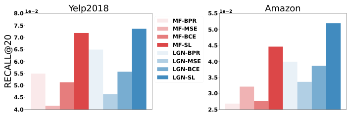
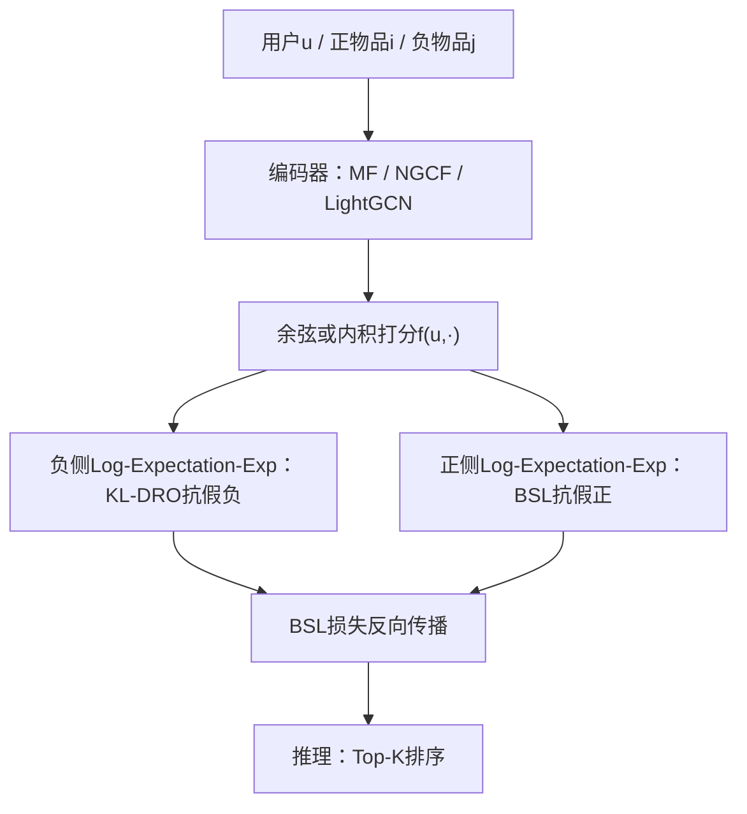
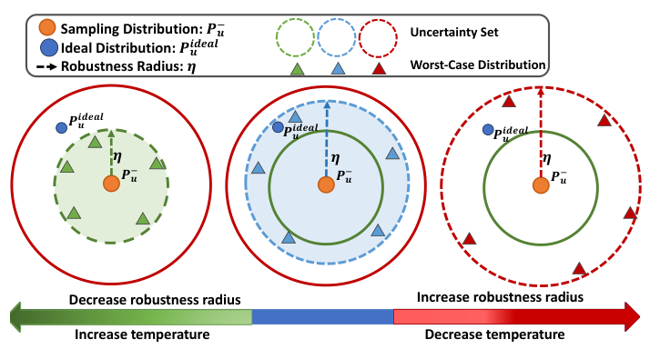

# BSL: Understanding and Improving Softmax Loss for Recommendation（理解并改进推荐中的Softmax损失）

- **会议/期刊**: ICDE 2024
- **作者与机构**: Junkang Wu, Jiawei Chen, Jiancan Wu, Wentao Shi, Jizhi Zhang, Xiang Wang；中国科学技术大学、浙江大学
- **推荐链路定位**: 召回/排序（CF 训练目标）
- **研究方向**: 协同过滤与双塔召回 / 交互去噪与鲁棒损失
- **论文原文**: [论文原文链接](https://arxiv.org/abs/2312.12882v1)
- **开源代码**: [开源代码仓库链接](https://github.com/junkangwu/BSL)

## TL;DR (1分钟核心速览)

本文针对推荐损失函数“SL 为何有效”缺乏理论解释、且只抗负样本噪声的问题，证明优化 Softmax Loss 等价于对负样本分布做 KL-DRO，并用方差正则解释其公平性；进一步把 Log-Expectation-Exp 对称用于正样本，提出一行代码可实现的 BSL。四个数据集、MF/NGCF/LightGCN 等骨干、Full-Ranking 协议下，Recall@20/NDCG@20 全面超越 BCE/MSE/BPR 及 SGL/SimSGL 等，LGN+BSL 在 Yelp2018 较 SimSGL 提升约 3.2%/2.7%。

## Background & Motivation (背景与核心矛盾)

- **主流范式**: 隐式反馈 CF 常用 pointwise BCE/MSE、pairwise BPR 与 Softmax Loss（SL）；SL 将物品打分归一化为多项分布，实践中精度更高。
- **前人局限**: 现有工作未揭示 SL 与其他损失的连接及其鲁棒性来源； fairness 被归因于 popularity-aware 负采样，但本文发现均匀采样下 SL 仍更公平。正样本噪声（点击诱饵、从众）也被忽视。
- **核心洞察 (Key Insight)**: SL 负侧的 $\log\mathbb{E}[\exp(\cdot)]$ 正是 KL 不确定性集下的 DRO；其方差惩罚会压缩热门/冷门物品打分离散度。
- **本文切入点**: 用 DRO 统一解释 SL 的鲁棒性与公平性，并把同一结构复制到正侧，得到 BSL。

<figure class="paper-figure" markdown="span">
  <figcaption>图1：基于MF（红色柱）和LightGCN（蓝色柱）在Yelp2018与Amazon数据集上不同损失函数的性能对比。SL在各模型和数据集上均显著优于其他损失函数（增益&gt;15%）。表I中其他数据集与架构的额外结果呈现相似模式，凸显了SL在协同过滤中的有效性。</figcaption>
</figure>

## Method (核心方法设计)

### 1. 整体框架 (Overall Architecture)

输入用户 $u$、正物品$i$、负物品$j$，由 MF/NGCF/LightGCN 编码并计算余弦或内积分数$f(u,\cdot)$。训练时分别在正、负样本分布上构造 Log-Expectation-Exp 损失：负侧提供 KL-DRO 抗假负能力，正侧在 BSL 中对称加入抗假正能力；两温度$\tau_1,\tau_2$ 分别控制正负鲁棒半径。反向传播只改损失，推理仍做 Top-K 打分排序，无额外网络。

### 2. 关键设计拆解 (Key Designs)

1. **SL 的负侧 DRO 等价性**：痛点在于假负样本造成采样分布与真实负分布偏移。SL 可写为  
$\mathcal{L}_{SL}(u)=-\mathbb{E}_{i\sim P_u^+}[f(u,i)]+\tau\log\mathbb{E}_{j\sim P_u^-}[\exp(f(u,j)/\tau)]$，  
其负侧等价于 $\max_{P:D_{KL}(P,P_u^-)\le\eta}\mathbb{E}_{j\sim P}[f(u,j)]$。证明用 KL 约束与凸共轭$g^*(x)=e^{x-1}$，得到$\tau$ 即拉格朗日乘子/鲁棒半径；直觉是对难负样本加权，抵抗负分布扰动。

<figure class="paper-figure" markdown="span">
  <figcaption>图2：τ、η与不确定性集之间的关系</figcaption>
</figure>

2. **方差正则与公平性**：对负侧做二阶 Taylor 展开得  
$\mathcal{L}_{SL}\approx-\mathbb{E}_{P_u^+}[f]+\mathbb{E}_{P_u^-}[f]+\frac{\mathrm{Var}[f]}{2\tau}+\tau\eta$。  
因此 SL 隐式惩罚负样本预测方差，缩小热门与长尾物品打分差；温度满足 $\tau^*\approx\sqrt{\mathrm{Var}[f]/(2\eta)}$，调$\tau$ 等价于调鲁棒半径。

3. **BSL 与训练/推理**：将正侧也改为 Log-Expectation-Exp：  
$\mathcal{L}_{BSL}(u)=-\tau_1\log\mathbb{E}_{i\sim P_u^+}[\exp(f(u,i)/\tau_1)]+\tau_2\log\mathbb{E}_{j\sim P_u^-}[\exp(f(u,j)/\tau_2)]$。  
正负温度分离以适配不同噪声水平；训练可用 Uniform 负采样或 In-batch negatives，推理仅余弦/内积 Top-K，每对 $O(d)$，无额外模块。

## Experimental Setup & Evaluation Protocol (实验设置与评估协议)

- **数据集与预处理**: 采用公开 CF 数据，未额外 5-core 过滤，统计如下：

| 数据集 | #Users | #Items | #Interactions | 稀疏度/密度 | 特征/场景说明 |
| :--- | :---: | :---: | :---: | :---: | :--- |
| Amazon | 192,403 | 63,001 | 1,689,188 | 0.014% | 电商隐式反馈 |
| Yelp2018 | 31,668 | 38,048 | 1,561,406 | 0.130% | 本地生活商户 |
| Gowalla | 29,858 | 40,981 | 1,027,370 | 0.084% | LBS 签到 |
| Movielens-1M | 6,022 | 3,043 | 995,154 | 5.431% | 电影评分二值化 |

- **数据划分与防穿越 (Splitting Strategy)**: 沿用 LightGCN 的随机 80%/10%/10% 训练/验证/测试划分，非全局时间戳切分，存在未来交互穿越风险。
- **排名评测协议 (Ranking Protocol)**: 无偏 `Full-Ranking`，对测试用户全库未交互物品排序，报告 Recall@20、NDCG@20；训练负采样为 Uniform 或 In-batch。
- **对比基线与超参设置**: 对比 CML/ENMF、NGCF/LightGCN/SGL/SimSGL/NCL 等；嵌入维 64、Xavier 初始化，学习率 $\{1e-3,5e-3,1e-4\}$，L2$\{1e-9,\dots,1e-1\}$，层数$\{1,2,3\}$，$\tau\in[0.05,1.0]$步长 0.10，负样本数$\{200,400,800,1500\}$；未报告显著性检验。

## Key Experimental Results (实验关键数据)

### 1. 主实验对比 (Main Results)

| 方法 | Amazon R@20 | Amazon N@20 | Yelp R@20 | Yelp N@20 |
| :--- | :---: | :---: | :---: | :---: |
| ENMF (SIGIR'19) | 0.0405 | 0.0182 | 0.0624 | 0.0515 |
| SGL (SIGIR'21) | 0.0454 | 0.0209 | 0.0690 | 0.0570 |
| SimpleX (CIKM'21) | - | - | 0.0701 | 0.0575 |
| UltraGCN (CIKM'21) | 0.0421 | 0.0195 | 0.0683 | 0.0561 |
| SimSGL (SIGIR'22) | 0.0486 | 0.0225 | 0.0721 | 0.0601 |
| NCL (WWW'22) | 0.0426 | 0.0195 | 0.0664 | 0.0552 |
| MF+SL | 0.0446 | 0.0195 | 0.0718 | 0.0585 |
| MF+BSL | 0.0476 | 0.0217 | 0.0725 | 0.0599 |
| LGN+SL | 0.0519 | 0.0248 | 0.0736 | 0.0612 |
| LGN+BSL | **0.0521** | **0.0249** | **0.0744** | **0.0617** |

相对最强基线 SimSGL，LGN+BSL 在 Amazon/Yelp 的 R@20 提升 **7.2%/3.2%**，N@20 提升 **10.7%/2.7%**。

### 2. 消融实验 (Ablation Study)

| 变体/设置 | 关键结果 |
| :--- | :--- |
| w/o 方差正则（SL−Var） | 图5：热门组 8–10 NDCG 上升、长尾组 1–5 下降，公平性恶化 |
| w/o 负侧 Log-Exp（BCE/MSE） | Yelp MF：MSE R@20=0.0415、BCE=0.0513，均低于 SL=0.0718 |
| w/o 正侧 Log-Exp（SL） | Gowalla 40% 正噪声：SL NDCG=0.1228，BSL=0.1495（+21.7%） |

### 3. 关键实验发现 (Key Findings)

1. SL/BSL 在四个数据集、三类骨干上均优于 BCE/MSE/BPR；LGN+BSL 在 Yelp2018 达 0.0744/0.0617，超过 SimSGL 的 0.0721/0.0601，说明损失设计可弥补架构差距。
2. 正噪声下 BSL 优势放大：Gowalla 40% 噪声时 BSL 较 SL 的 NDCG 提升 21.7%，且仍高于 SL 无噪声结果，验证正侧 DRO 的必要性。
3. 负噪声下 SL/BSL 更稳定；最优 $\tau$随噪声率从约 0.10 增至 0.12，与$\tau^*\approx\sqrt{\mathrm{Var}[f]/(2\eta)}$ 的方差—鲁棒半径权衡一致。

## Highlights & Limitations (亮点、对比与审稿批判)

- **与代表作对比 (vs. Prior Work)**: SimpleX 经验性引入 cosine contrastive loss，SGL/SimSGL 依赖图增广/对比学习，本文从 KL-DRO 解释 SL 并给出正负对称的 BSL；相较 AutoDenoise 等额外去噪模块，BSL 仅改一行损失、无额外网络。
- **可迁移亮点**: 双侧 Log-Expectation-Exp 可作为通用鲁棒损失；正负分离温度可迁移到多噪声场景的召回/排序训练。
- **审稿级局限批判**: $\tau_1,\tau_2$ 需网格搜索，且正噪声实验为人工注入，真实点击诱饵分布未必匹配；未报告显著性检验与线上 A/B，Full-Ranking 评测开销也较高。

## Rating (四维评分)

- **方法创新性 (Novelty)**: ⭐⭐⭐⭐ （用 KL-DRO 严格解释 SL，并把负侧结构对称到正侧，理论视角新颖）
- **评估协议与实验扎实度 (Protocol & Experiments)**: ⭐⭐⭐⭐ （四数据集、三骨干、Full-Ranking 与多噪声/公平性分析较完整，但缺显著性检验）
- **写作与数学规范度 (Clarity & Rigor)**: ⭐⭐⭐⭐ （DRO 推导清晰，温度与鲁棒半径解释直观，公式符号统一）
- **工业落地与复现价值 (Industrial & Practical Value)**: ⭐⭐⭐⭐⭐ （模型无关、一行代码替换损失、推理零额外开销，开源代码可直接复现）

