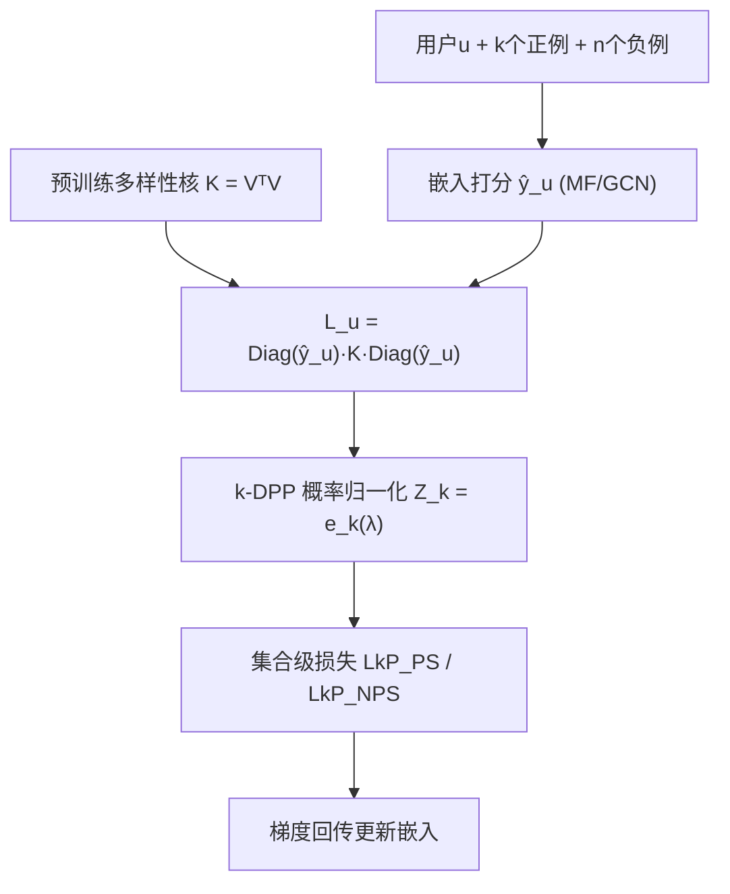

# Learning k-Determinantal Point Processes for Personalized Ranking (学习 k-行列式点过程用于个性化排序)

- **会议/期刊**: IEEE ICDE 2024
- **作者与机构**: Yuli Liu (青海大学 / ANU)、Christian Walder (Google Brain)、Lexing Xie (ANU / Data61 CSIRO)
- **推荐链路定位**: 精排（排序优化准则 / 损失函数层，模型无关）
- **研究方向**: 协同过滤与双塔召回 / 多任务学习与列表级重排
- **论文原文**: [https://arxiv.org/abs/2406.15983v1](https://arxiv.org/abs/2406.15983v1)
- **开源代码**: 暂未开源

## TL;DR (1分钟核心速览)

BPR/SetRank 等隐式反馈排序准则只在"单物品 vs 单物品"或"物品对集合求和的 BPR"层面比较，既无法把一组物品当作整体利用其相关性，也几乎不建模多样性。本文提出集合级准则 $\mathrm{L}k\mathrm{P}$：为用户构造$k+n$个物品的 ground set，用**条件化于基数$k$的 k-DPP 概率**去比较"全正例子集"与其余$k$元子集，并额外压低全负例子集概率（$\mathrm{L}k\mathrm{P}_{NPS}$）。在 Beauty/ML-1M/Anime 三个数据集、GCN 与 MF 两种骨干、全库排序协议下，Recall@5 相对最强基线提升 8.09%–10.86%，F-score 提升 4.5%–5.5%。

## Background & Motivation (背景与核心矛盾)

- **主流范式**: 隐式反馈推荐以 BPR（成对）与 SetRank / Set2SetRank（集合式但仍是 BPR 形式）为排序准则，模型侧多用 MF 或 NGCF/LightGCN 类图卷积。
- **前人局限 (1)**: pointwise/pairwise 完全忽略物品间相关性；listwise 依赖"序"信息，而隐式反馈只有 0/1，序关系本就模糊；setwise 方法把集合排序**化简为集合内单品分数汇总**，并未把集合当整体比较。
- **前人局限 (2)**: 多样性只在 DPP-MAP 重排阶段（GAN/KG 框架内）事后处理，没有进入优化目标，导致推荐集中在热门同质物品上。
- **核心洞察**: DPP 核天然可分解为 quality×diversity，若把该核放入**概率归一化**的排序比较中，集合概率本身就带有"排序可解释性"；而标准 DPP 允许任意基数子集竞争，会产生不可解释的跨基数比较，因此必须用固定基数的 k-DPP。
- **本文切入点**: 直接在 $k+n$ground set 上比较 k-DPP 子集概率，使"相关性比较$>_u$"与"多样性比较$>_d$"在同一目标内同时被优化。

## Method (核心方法设计)

### 1. 整体框架 (Overall Architecture)

对每个用户采样一个 $k+n$的 ground set（$k$个正例 +$n$个随机负例，默认$k=n=5$）。用户/物品嵌入（MF 内积或 GCN 表示）先给出$k+n$个物品的相关性分数$\hat{y}_u$，与**预训练并冻结**的多样性核$K$组合成个性化 DPP 核$L_u$；随后枚举该 ground set 上全部$\binom{k+n}{k}$个$k$ 元子集，用 k-DPP 归一化概率构造集合级排序损失，梯度经行列式求导回传至嵌入。推理阶段无需任何子集枚举，只需按常规打分排序。

### 2. 关键设计拆解 (Key Designs)

1. **k-DPP 集合级概率排序（把比较单位从"物品对"换成"$k$元子集"）**：标准 DPP 允许不同基数子集互相竞争，目标信号含混；k-DPP 将分布条件化于基数$k$，使目标子集只与同规模子集竞争，从而获得可解释的排序语义：
$$P^k_{L_u}(S^{+k}_u)=\frac{\det(L_{u,S^{+k}_u})}{\sum_{|S'|=k}\det(L_{u,S'})}$$
   直觉上，最大化该概率即等价于"目标 $k$ 集在全体同规模子集中排第一"，且子集内部相关性通过行列式被整体建模。

2. **质量-多样性核分解（让同一个核同时编码用户偏好与品类覆盖）**：若只用纯多样性核，会选出最不相似但与用户无关的物品，因此把个性化写进对角阵：
$$L_u=\mathrm{Diag}(\hat{\boldsymbol{y}}_u)\cdot K\cdot \mathrm{Diag}(\hat{\boldsymbol{y}}_u),\qquad \log\det(L_{u,S})=\sum_{i\in S}\log\hat{y}_{u,i}^2+\log\det(K_S)$$
   上式表明集合概率可严格拆成"相关性累加 + 多样性行列式"两项。$K=V^{\top}V$由 log-det 目标$\mathcal{J}=\sum\log\det(K_{T^+})-\log\det(K_{T^-})$预训练，用历史交互中跨品类广的子集作正例，故$K$ 越偏好品类覆盖广的集合。

3. **归一化高效计算、负例处理与训练目标**：分母 $Z_k=\sum_{|S'|=k}\det(L_{S'})=e_k(\lambda_1,\dots,\lambda_{k+n})$（第$k$个初等对称多项式），用递推$e^m_l\leftarrow e^{m-1}_l+\lambda_m e^{m-1}_{l-1}$在$O((k+n)k)$内完成；正例侧目标$\mathcal{L}=\sum_u\sum_{S^{+k}_u}\log P^k_{L_u}(S^{+k}_u)$，NPS 变体再加入负例排除项$\log(1-P^k_{L_u}(S^{-k}_u))$（取$n=k$ 避免负例互比）。梯度为
$$\frac{\partial \mathcal{L}}{\partial \Theta}=\sum_{S^+}\mathrm{tr}\!\left(L_{S^+}^{-1}\frac{\partial L_{S^+}}{\partial \Theta}\right)-\sum_{S'}\sum_{|S'|=k}w_{S'}\,\mathrm{tr}\!\left(L_{S'}^{-1}\frac{\partial L_{S'}}{\partial \Theta}\right)$$
   其中 $w_{S'}$ 为归一化后子集重要度。负例策略为"随机负采样 + ground set 内隐式全子集竞争"，无需 hard negative 挖掘。

## Experimental Setup & Evaluation Protocol (实验设置与评估协议)

- **数据集与预处理**（过滤交互数 $<10$ 的长尾用户与物品）：

| 数据集 | #Users | #Items | #Interactions | #Categories | 说明 |
| :--- | :---: | :---: | :---: | :---: | :--- |
| Beauty | 52.0k | 57.2k | 0.4M | 213 | 最稀疏、品类最丰富 |
| ML-1M | 6.0k | 3.4k | 1.0M | 18 | 稠密电影评分 |
| Anime | 73.5k | 12.2k | 1.0M | 43 | 动画评分 |

- **数据划分与防穿越**: 每个用户随机 70% / 10% / 20% 划分为训练 / 验证 / 测试（随机划分，非全局时间戳切分）。
- **排名评测协议**: 未交互物品全库打分排序（Full-Ranking），未采用采样排序；指标为 Recall@N、NDCG@N（N∈{5,10,20}）、品类覆盖 Category Coverage (CC) 及二者调和 F-score。
- **对比基线与超参**: BCE（pointwise）、BPR（pairwise）、SetRank、S2SRank（setwise）在 GCN(NGCF) 与 MF 两种骨干上实现；嵌入维度统一 64，Adam + 网格搜索，$k=n=5$；另将$\mathrm{L}k\mathrm{P}$ 移植到 GCMC、NeuMF 验证通用性。

## Key Experimental Results (实验关键数据)

### 1. 主实验对比 (Main Results)

GCN 骨干，$k=n=5$（$\mathrm{L}k\mathrm{P}$变体组合$S$ 训练实例构造）：

| 数据集 | 方法 | Re@5 | Re@20 | Nd@5 | CC@20 | F@20 |
| :--- | :--- | :---: | :---: | :---: | :---: | :---: |
| Beauty | BCE | 0.0672 | 0.1700 | 0.0656 | 0.1336 | 0.1360 |
| Beauty | BPR | 0.0694 | 0.1544 | 0.0704 | 0.1301 | 0.1299 |
| Beauty | SetRank | 0.0775 | 0.1746 | 0.0772 | 0.1278 | 0.1361 |
| Beauty | S2SRank | 0.0783 | 0.1752 | 0.0776 | 0.1303 | 0.1378 |
| Beauty | **$\mathrm{L}k\mathrm{P}_{PS}$** | 0.0806 | 0.1841 | 0.0794 | **0.1360** | 0.1439 |
| Beauty | **$\mathrm{L}k\mathrm{P}_{NPS}$** | **0.0868** | **0.1874** | **0.0878** | 0.1334 | **0.1446** |
| ML-1M | BPR | 0.0785 | 0.1800 | 0.0854 | 0.6571 | 0.2478 |
| ML-1M | S2SRank | 0.0791 | 0.1857 | 0.0878 | 0.6519 | 0.2548 |
| ML-1M | **$\mathrm{L}k\mathrm{P}_{NPS}$** | **0.0862** | **0.1972** | **0.0950** | **0.6594** | **0.2687** |
| Anime | BPR | 0.0879 | 0.2184 | 0.1443 | 0.5890 | 0.2991 |
| Anime | S2SRank | 0.0902 | 0.2295 | 0.1477 | 0.5793 | 0.3076 |
| Anime | **$\mathrm{L}k\mathrm{P}_{NPS}$** | **0.0974** | **0.2447** | **0.1579** | 0.5758 | **0.3239** |
| — | max vs. max 提升 | +10.86% | +6.96% | +13.14% | +8.23% | +4.94% |

（末行为 Beauty 上相对最强基线的提升；ML-1M、Anime 上 Re@5 分别提升 7.95%、8.09%。）

### 2. 消融实验 (Ablation Study)

Beauty 数据集上对三个设计维度的分解（$S$=顺序滑窗构集，$R$=随机构集；$P$=仅正例包含项，$NP$=加入负例排除项；默认$K$vs.$E$=用可训练嵌入相似度替代预训练核）：

| 变体 | Re@5 | Nd@5 | CC@20 | F@20 |
| :--- | :---: | :---: | :---: | :---: |
| PR | 0.0788 | 0.0808 | 0.1312 | 0.1391 |
| PS | 0.0806 | 0.0794 | 0.1360 | 0.1439 |
| NPR | 0.0820 | 0.0801 | 0.1354 | 0.1410 |
| **NPS** | **0.0868** | **0.0878** | 0.1334 | **0.1446** |
| PSE | 0.0726 | 0.0716 | 0.1377 | 0.1398 |
| NPSE | 0.0684 | 0.0695 | **0.1446** | 0.1387 |

另：去掉 k-DPP 的基数归一化改用标准 DPP，ML-1M 上 NDCG@20 跌至 0.1106（低于 BPR 的 0.1254）；$k$从 2 增至 6 时 NDCG@5 在$k=5$处达到峰值、$k>5$后回落，且收敛 epoch 随$k$单调上升；$n>5$ 时三项指标均下降。

### 3. 关键实验发现 (Key Findings)

1. **"排除负例子集"是主要增益来源**：NPS 相对 PS 在 Beauty 上 Re@5 提升 7.7%（0.0806→0.0868）、Nd@5 提升 10.6%，说明仅拉高正例子集概率不足，显式压低全负例 $k$ 集才能拉开排序间隙（对应图 4 概率分布随 epoch 分化）。
2. **顺序构集 $S$优于随机构集$R$，但多样性略降**：PS/NPS 相对 PR/NPR 在 Recall 上更优（0.0806 vs 0.0788），而 PR/NPR 在 CC@20 上更好，证实滑窗构集捕捉到的序列相关性被 k-DPP 有效利用，且随机构集需要更多 epoch 收敛。
3. **多样性核的"学习方式"决定权衡质量**：预训练 $K$变体质量更高（NPS F@20 = 0.1446 优于 NPSE 的 0.1387），而$E$ 型（可训练嵌入核）多样性最好（CC@20 = 0.1446）却质量崩至 0.0684，说明把多样性作为可学习目标与相关性目标同时压在同一嵌入上会造成优化冲突。

## Highlights & Limitations (亮点、对比与审稿批判)

- **与代表作对比**: 相较 BPR（成对、无相关性、无多样性）与 SetRank/S2SetRank（伪集合级、仍用 BPR 形式、多样性缺位），本文是首个把定义域限定为基数 $k$ 的概率归一化排序准则，使集合概率具备可验证的排序语义；相较 DPP-MAP 类多样化重排（Warlop 等），本文把多样性前置到优化目标而非后处理，且固定基数避免了后处理阶段的相关性损耗。
- **可迁移亮点**: (1) 用初等对称多项式递推在 $O((k+n)k)$ 内算 k-DPP 归一化常数，可直接用于任何需要在 ground set 上做概率归一化的集合损失；(2) "预训练核 + 冻结 + 只学 quality 对角项"的解耦思路，可迁移到多目标（相关性/新颖性/公平性）权衡训练，避免目标冲突。
- **审稿级局限批判**: (1) 训练时每个 ground set 需对 $\binom{k+n}{k}$个子集做行列式与求逆，虽然分母可递推，但梯度中$\sum_{|S'|=k}L_{S'}^{-1}$的枚举开销随$k$组合爆炸，论文只报告到$k=6$，大规模场景可扩展性存疑；(2) 评估采用随机 70/10/20 划分而非时间戳切分，隐式反馈存在未来交互泄漏风险，且仅用品类覆盖（CC）衡量多样性、未采用 ILD，多样性结论对数据集品类粒度（ML-1M 仅 18 类）高度敏感。

## Rating (四维评分)

- **方法创新性 (Novelty)**: ⭐⭐⭐⭐ （首次将 k-DPP 的基数条件化概率归一化用作排序准则，把集合级相关性与多样性统一进单一损失，视角新颖但本质仍是 DPP 核分解的应用）
- **评估协议与实验扎实度 (Protocol & Experiments)**: ⭐⭐⭐⭐ （三种数据集 × MF/GCN 两种骨干 × 移植 GCMC/NeuMF，主实验与 6 变体消融完整，但缺少时间戳切分与显著性检验）
- **写作与数学规范度 (Clarity & Rigor)**: ⭐⭐⭐⭐ （核分解、归一化常数与梯度推导完整，$O((k+n)k)$ 复杂度有交代；标准 DPP 失效的分析略散落于实验章节）
- **工业落地与复现价值 (Industrial & Practical Value)**: ⭐⭐⭐ （推理零额外开销、可即插即用于现有模型，但训练期子集枚举与预训练多样性核增加工程成本，且未开源代码）

