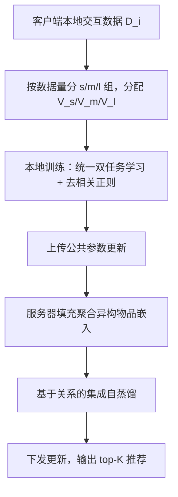
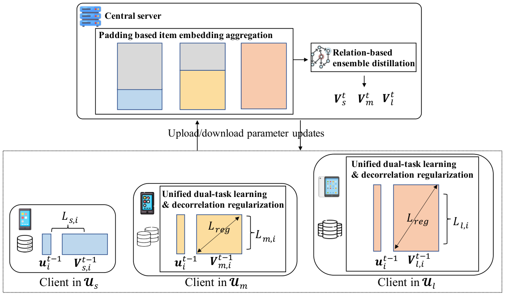

# HeteFedRec: Federated Recommender Systems with Model Heterogeneity（面向模型异构的联邦推荐系统）

- **会议/期刊**: ICDE 2024
- **作者与机构**: Wei Yuan, Liang Qu, Lizhen Cui, Yongxin Tong, Xiaofang Zhou, Hongzhi Yin；University of Queensland、Shandong University、Beihang University、HKUST
- **推荐链路定位**: 端到端联邦训练 / 召回排序
- **研究方向**: 去偏公平、可信隐私与工业架构（联邦推荐）
- **论文原文**: [论文原文链接](https://arxiv.org/abs/2307.12810v3)
- **开源代码**: 暂未开源

## TL;DR (1分钟核心速览)

针对联邦推荐所有客户端共享同尺寸公共参数、忽视数据量异构的痛点，HeteFedRec 首次允许按客户端资源分配不同维度的物品嵌入，并用填充聚合、统一双任务学习、维度去相关正则与基于关系的集成自蒸馏实现异构知识融合。在 ML/Anime/Douban 的 1:4 采样排序协议下，NDCG@20 较最强同构基线提升 1.9%–20.6%。

## Background & Motivation (背景与核心矛盾)

- **主流范式**: FedRecs 通常将用户嵌入作为私有参数留在本地，仅聚合物品嵌入与预测层等公共参数，从而在不共享用户数据的前提下协同训练推荐模型。
- **前人局限**: 现有 FedRecs 假设所有客户端训练同尺寸模型，但真实用户交互量差异巨大；小数据客户端难以支撑大模型，其更新甚至拖累全局模型，而大数据客户端又需要更大容量。异构联邦学习中的通道/层宽聚合依赖网络深度或宽度，且知识蒸馏方法通常需要公共参考数据集，二者均与 FedRecs 的“物品嵌入表主导模型尺寸、数据敏感不可共享”不兼容。
- **核心洞察 (Key Insight)**: 在 FedRecs 中，模型异构主要体现为物品嵌入维度差异；若让大嵌入表的低维子块与小嵌入表共享同一推荐目标，则不同尺寸模型的子矩阵更新可在语义上对齐。
- **本文切入点**: 以物品嵌入维度为异构载体，设计“填充聚合 + 子块同任务训练 + 防坍缩正则 + 关系蒸馏”的联邦聚合框架。

## Method (核心方法设计)

### 1. 整体框架 (Overall Architecture)

HeteFedRec 按客户端交互量将其分为小/中/大三级，分别分配物品嵌入 $\mathbf{V}_s,\mathbf{V}_m,\mathbf{V}_l$，满足$N_s<N_m<N_l$。客户端本地训练私有用户嵌入与对应公共参数；服务器先将小尺寸物品嵌入更新补零至$N_l$，求和后按各尺寸切片回写，实现异构模型间的加性聚合。为避免不同尺寸子块梯度语义错位，中/大客户端同时优化多个低维子任务；再用维度去相关正则防止大嵌入坍缩。聚合后服务器在随机物品子集上做关系集成自蒸馏，最后下发更新用于 top-K 推荐。

<figure class="paper-figure" markdown="span">
  <figcaption>图 4：HeteFedRec 的框架。为便于展示，本图中省略 Θ。推荐系统。相反，数据丰富的客户端更倾向于训练更大的模型，以获得更准确的推荐，并得益于更大模型更强的表示能力。</figcaption>
</figure>

### 2. 关键设计拆解 (Key Designs)

1. **填充聚合 + 统一双任务学习**：直接平均异构更新会因不同维度子块代表不同隐因子而错配。服务器将小更新补零到 $N_l$后求和再切片：$\nabla\mathbf{V}_{agg}=\sum_{U_s}\nabla\mathbf{V}_{s,i}^{p}+\sum_{U_m}\nabla\mathbf{V}_{m,i}^{p}+\sum_{U_l}\nabla\mathbf{V}_{l,i}$，$\nabla\mathbf{V}_{a}=\nabla\mathbf{V}_{agg}[:N_a]$。为让子块梯度同任务，中客户端优化$\mathcal{L}_{m,i}=\mathcal{L}(\boldsymbol{u}_i^{[:N_s]},\mathbf{V}_{m,i}^{[:N_s]},\Theta_s)+\mathcal{L}(\boldsymbol{u}_i,\mathbf{V}_{m,i},\Theta_m)$，大客户端再加一项目标；这样填充后的低维子块可直接聚合而不破坏语义。

2. **维度去相关正则 (DDR)**：仅优化低维子块会让大嵌入坍缩到小模型，高维参数冗余。用相关矩阵 Frobenius 范数替代昂贵的奇异值方差惩罚：$\mathcal{L}_{reg}(\mathbf{V})=\frac{1}{N}\|\operatorname{corr}((\mathbf{V}-\bar{\mathbf{V}})/\sqrt{\operatorname{var}(\mathbf{V})})\|_F$，并加入中/大客户端损失$\mathcal{L}'_{m,i}=\mathcal{L}_{m,i}+\alpha\mathcal{L}_{reg}(\mathbf{V}_{m,i})$（大模型同理）。它迫使各维编码独立知识，防止异构大模型退化为同构小模型。

3. **关系集成自蒸馏与训练目标**：FedRecs 无法构造公共参考数据，故只蒸馏物品间相对关系。随机选物品子集 $V_{kd}$，集成距离$d_{ens}=\frac{1}{3}\sum_{a\in\{s,m,l\}}d(\mathbf{V}_a,V_{kd})$，蒸馏损失$\mathcal{L}_{kd}(\mathbf{V})=\|d(\mathbf{V},V_{kd})-d_{ens}\|_2^2$。总损失为$\mathcal{L}'_{m,i}$或$\mathcal{L}'_{l,i}$，负采样按 1:4；服务器聚合后再做蒸馏。推理仅需物品嵌入与 MLP 打分，额外通信为少量$\Theta_s,\Theta_m$，开销可忽略。

## Experimental Setup & Evaluation Protocol (实验设置与评估协议)

- **数据集与预处理**:

| 数据集 | #Users | #Items | #Interactions | 密度 | 平均交互/用户 | 场景 |
| :--- | :---: | :---: | :---: | :---: | :---: | :--- |
| ML | 6,040 | 3,706 | 1,000,209 | 4.47% | 165 | 电影 |
| Anime | 10,482 | 6,888 | 1,265,530 | 1.75% | 120 | 动漫 |
| Douban | 1,833 | 7,397 | 330,268 | 2.44% | 180 | 图书 |

- **数据划分与防穿越 (Splitting Strategy)**: 按 80%/20% 比例划分训练/测试；被选客户端再从本地训练集划 10% 作验证；用户即客户端，本地数据不共享，未采用全局时间戳切分。
- **排名评测协议 (Ranking Protocol)**: 原文采用 1:4 负采样构造评测，属于 `Sampled Ranking`，非 `Full-Ranking` 全库排序；指标为 Recall@20 与 NDCG@20。
- **对比基线与超参设置**: 同构基线 `All Small`、`All Large`、`All Large/Exclusive`；异构基线 `Standalone`、`Clustered FedRec`、`Directly Aggregate`。ML/Anime 设 $N_s,N_m,N_l=8,16,32$，Douban 设$32,64,128$；分组比例 5:3:2；Adam lr=0.001；每轮选 256 用户；LightGCN 传播 1 层，FFN 为 3 层；未报告显著性检验。

## Key Experimental Results (实验关键数据)

### 1. 主实验对比 (Main Results)

下表为 NDCG@20，最优值加粗；“Improv.%”相对最强同构基线：

| 方法 | NCF-ML | NCF-Anime | NCF-Douban | LGCN-ML | LGCN-Anime | LGCN-Douban |
| :--- | :---: | :---: | :---: | :---: | :---: | :---: |
| All Small | .04328 | .04962 | .01087 | .04232 | .04824 | .00530 |
| All Large | .04028 | .04442 | .00878 | .04197 | .04788 | .00378 |
| All Large/Exclusive | .01753 | .02458 | .00856 | .01891 | .01467 | .00363 |
| Standalone | .01108 | .00411 | .00295 | .01085 | .00411 | .00263 |
| Clustered FedRec | .02235 | .01581 | .00501 | .02633 | .01379 | .00480 |
| Directly Aggregate | .02207 | .03151 | .00502 | .02657 | .01437 | .00479 |
| **HeteFedRec** | **.04781** | **.05655** | **.01290** | **.04313** | **.05177** | **.00639** |
| Improv.% | +10.47% | +13.97% | +18.68% | +1.91% | +7.32% | +20.57% |

Recall@20 趋势一致；例如 Fed-NCF/ML 上 HeteFedRec 为 .02662，高于 All Large 的 .02558。

### 2. 消融实验 (Ablation Study)

| 设置 | NCF-ML | NCF-Anime | NCF-Douban | LGCN-ML | LGCN-Anime | LGCN-Douban |
| :--- | :---: | :---: | :---: | :---: | :---: | :---: |
| HeteFedRec | .04781 | .05655 | .01290 | .04313 | .05177 | .00639 |
| -RESKD | .04636 | .05504 | .01232 | .04307 | .05072 | .00618 |
| -RESKD,DDR | .04332 | .05355 | .01167 | .04225 | .04812 | .00563 |
| -RESKD,DDR,UDL | .02207 | .03151 | .00502 | .02657 | .01437 | .00479 |

### 3. 关键实验发现 (Key Findings)

1. **UDL 是异构聚合成立的主因**：移除全部三组件后退化为 `Directly Aggregate`，NCF/ML 的 NDCG 从 .04781 跌至 .02207（-53.8%），Anime 从 .05655 跌至 .03151（-44.3%），说明填充后的子块梯度若不同任务，聚合会发生严重更新错配。
2. **DDR 直接抑制维度坍缩**：去掉 DDR 后 NCF/ML 为 .04332，几乎等于 All Small 的 .04328；最大物品嵌入协方差奇异值方差在 ML/Anime/Douban 上分别从 0.4573/0.9190/0.0523 降至 0.0974/0.0838/0.0167，证明高维不再冗余。
3. **按数据量分配尺寸优于“一刀切”**：图6 中小客户端在 ML/Anime 上 All Small 优于 All Large，大客户端则相反；HeteFedRec 在 Us/Um/Ul 全组最优，且 5:3:2 分组优于 1:1:1 与 2:3:5，说明多数用户数据不足时保守分配小模型更稳。

## Highlights & Limitations (亮点、对比与审稿批判)

- **与代表作对比 (vs. Prior Work)**: HeteroFL 依赖通道/层宽裁剪，DepthFL 依赖层深聚合，均不适配 FedRecs 以物品嵌入维度主导模型尺寸的结构；FedMD 类方法需公共参考数据，HeteFedRec 以子块同任务与关系蒸馏替代，无需共享样本。
- **可迁移亮点**: 填充聚合前先让不同尺寸子块共享同一目标，可迁移到异构嵌入表/多场景模型融合；用相关矩阵 Frobenius 范数替代奇异值方差惩罚，是低成本防表征坍缩的通用技巧。
- **审稿级局限批判**: 仍要求所有客户端保持相同模型架构，仅支持嵌入维度异构；分组比例与模型尺寸对性能敏感，最优分配未求解。评测为 1:4 采样排序而非全库排序，且未报告显著性检验，结论的统计稳健性有限。

## Rating (四维评分)

- **方法创新性 (Novelty)**: ⭐⭐⭐⭐ （首个 FedRec 模型异构框架，子块同任务+关系蒸馏思路清晰，但组件多为已知技术组合）
- **评估协议与实验扎实度 (Protocol & Experiments)**: ⭐⭐⭐⭐ （三数据集、两基模型、消融与多组 RQ 较完整；但采样排序且无显著性检验）
- **写作与数学规范度 (Clarity & Rigor)**: ⭐⭐⭐⭐ （聚合、损失与算法流程定义清楚；部分维度切片符号需对照原文）
- **工业落地与复现价值 (Industrial & Practical Value)**: ⭐⭐⭐⭐ （隐私约束下可行，额外通信仅少量 $\Theta$；但组划分/尺寸敏感且暂未开源）

