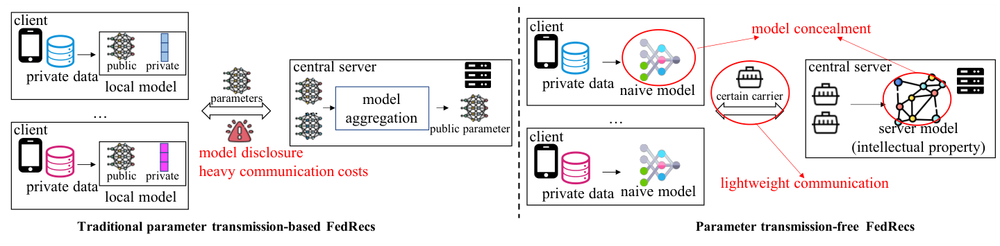
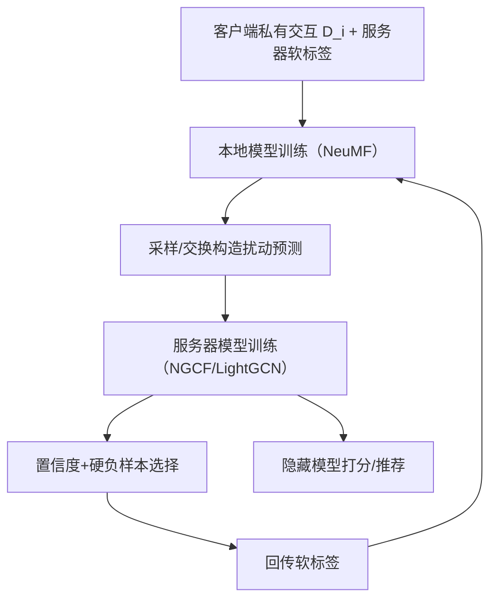
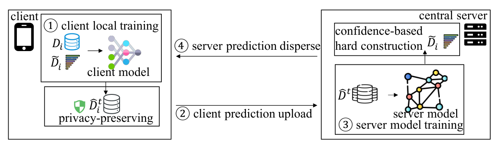

# Hide Your Model: A Parameter Transmission-free Federated Recommender System（藏起你的模型：免参数传输的联邦推荐系统）

- **会议/期刊**: ICDE 2024
- **作者与机构**: Wei Yuan, Chaoqun Yang, Liang Qu, Quoc Viet Hung Nguyen, Jianxin Li, Hongzhi Yin；University of Queensland / Griffith University / Deakin University
- **推荐链路定位**: 端到端训练（联邦推荐模型训练框架）
- **研究方向**: 去偏公平、可信隐私与工业架构 / 联邦推荐隐私保护
- **论文原文**: [论文原文链接](https://arxiv.org/abs/2311.14968v3)
- **开源代码**: [开源代码仓库链接](https://github.com/hi-weiyuan/PTF-FedRec)

## TL;DR (1分钟核心速览)

针对现有 FedRec 必须公开并反复传输全局模型参数、导致平台模型知识产权泄露与高通信开销的痛点，本文提出 PTF-FedRec：客户端与服务器异构模型仅交换预测分数，客户端用采样+交换扰动上传，服务器用置信度+硬负样本回传软标签。在三个数据集、Full-Ranking 协议下，最佳联邦结果较 FedMF 等提升 36.2%–139.3%，通信降至 KB 级。

## Background & Motivation (背景与核心矛盾)

- **主流范式**: 现有 FedRec 按 FedAvg 共享公开参数/梯度，用户私有嵌入留在本地，服务器需向所有客户端开源推荐模型。
- **前人局限**: ①服务器必须暴露模型架构与参数，模型 IP 无法保护；②每轮传输高维物品嵌入，成本随物品数与模型规模增长。LDP/水印只保护用户参数或追踪复制，不能阻止模型泄露。
- **核心洞察 (Key Insight)**: 知识蒸馏表明预测分数可承载知识；若服务器与客户端模型异构，仅传预测即可协同，且服务器模型可保持黑盒。
- **本文切入点**: 用预测分数替代模型参数作为通信载体，采样+交换保护用户交互顺序，置信度+硬负样本提升服务器回传质量。

<figure class="paper-figure" markdown="span">
  <figcaption>图 1：传统基于参数传输的 FedRec 与无参数传输的 FedRec 对比。</figcaption>
</figure>
*图1：传统参数传输式 FedRec 与免参数传输式 FedRec 的对比。*

## Method (核心方法设计)

### 1. 整体框架 (Overall Architecture)

PTF-FedRec 采用客户端-服务器异构模型：客户端默认 NeuMF，服务器可部署 NGCF/LightGCN。每轮客户端在私有 $D_i$与服务器软标签$\tilde D_i$上训练，采样并交换部分预测得到$\hat D_i$上传；服务器以软标签 BCE 训练，再按物品更新频率与预测分数选置信/硬样本生成$\tilde D_i$ 回传。全程不交换模型参数，服务器模型对客户端黑盒。

<figure class="paper-figure" markdown="span">
  <figcaption>图 2：PTF-FedRec 的细节。</figcaption>
</figure>
*图2：PTF-FedRec 的预测上传、服务器训练与软标签回传流程。*

### 2. 关键设计拆解 (Key Designs)

1. **预测承载的交替蒸馏协议**：针对“传参数=泄模型”的根因，服务器不再下发参数，而以客户端上传的软预测 $\hat r_{ij}$为监督训练自身模型：$\mathcal{L}_s=-\sum_{(u_i,v_j,\hat r_{ij})\in\hat D_i}[\hat r_{ij}\log\tilde r_{ij}+(1-\hat r_{ij})\log(1-\tilde r_{ij})]$。客户端则在$D_i\cup\tilde D_i$ 上做 BCE，实现双向知识传递；直觉是预测分数只暴露“用户-物品偏好接口”，不暴露服务器网络结构与权重。

2. **隐私保护 $\hat D_i$构造**：直接上传全部训练物品预测会遭 Top Guess Attack——服务器按分数排序即可猜出正样本。本文先随机采样：$\hat V_i^t\leftarrow sample(V_i^t|\beta_i^t,\gamma_i^t)$，隐藏正负比例；再以概率$\lambda$交换高分正样本与负样本分数：$\hat D_i^t\leftarrow swap(\hat D_i^t|\lambda)$。采样满足$(\epsilon,\delta)$-DP，交换作为后处理可进一步扰动顺序信息，且比 LDP 加噪更保效用。

3. **置信度+硬负样本回传**：为让服务器知识“可靠且必要”，回传物品由两部分组成：$\tilde V_i^{conf}=\operatorname{TopK}_{\mu\alpha}\{freq(v)\mid v\notin\hat V_i\}$，$\tilde V_i^{hard}=\operatorname{TopK}_{(1-\mu)\alpha}\{F_s(M_s^{t+1}|v)\mid v\notin\hat V_i\}$；前者选服务器嵌入更新频繁的高置信物品，后者选高分硬负样本。默认$\alpha=30,\mu=0.5$。

**训练目标、负采样与推理效率**：客户端训练负采样比 1:4，服务器以软标签 BCE 优化；交替执行 $\mathcal{L}_c$与$\mathcal{L}_s$。每轮通信仅为预测三元组，成本与用户平均交互长度相关，而非物品嵌入维度。

## Experimental Setup & Evaluation Protocol (实验设置与评估协议)

- **数据集与预处理**:

| 数据集 | #Users | #Items | #Interactions | 密度 | 说明 |
| :--- | :---: | :---: | :---: | :---: | :--- |
| MovieLens-100K | 943 | 1,682 | 100,000 | 6.30% | 电影 |
| Steam-200K | 3,753 | 5,134 | 114,713 | 0.59% | 游戏 |
| Gowalla | 8,392 | 10,086 | 391,238 | 0.46% | 签到，20-core |

- **数据划分与防穿越 (Splitting Strategy)**: 随机 8:2 划分训练/测试，验证集从本地训练集抽样；非全局时间戳切分，未显式防未来交互穿越。
- **排名评测协议 (Ranking Protocol)**: 对用户全部未交互物品打分排序，即无偏 Full-Ranking；训练阶段按 1:4 负采样，评估阶段不采样负样本。指标为 Recall@20、NDCG@20。
- **对比基线与超参设置**: 集中式 NeuMF/NGCF/LightGCN；联邦 FCF、FedMF、MetaMF。嵌入维度 $d=32$，NGCF/LightGCN 3 层，NeuMF MLP 为 64-32-16；Adam$lr=0.001$，全局 20 轮，客户端/服务器本地 epoch 为 5/2，batch 为 64/1024；$\alpha=30,\beta\in[0.1,1],\gamma\in[1,4],\lambda=0.1,\mu=0.5$。未报告显著性检验$p$ 值。

## Key Experimental Results (实验关键数据)

### 1. 主实验对比 (Main Results)

表1：主实验 Recall@20 / NDCG@20 对比（粗体为最佳联邦结果）。

| 方法 | ML R@20 | ML N@20 | Steam R@20 | Steam N@20 | Gowalla R@20 | Gowalla N@20 |
| :--- | ---: | ---: | ---: | ---: | ---: | ---: |
| Centralized NeuMF | 0.1357 | 0.1544 | 0.3033 | 0.2074 | 0.0214 | 0.0177 |
| Centralized NGCF | 0.1883 | 0.2045 | 0.3777 | 0.2674 | 0.0420 | 0.0334 |
| Centralized LightGCN | 0.1794 | 0.1954 | 0.3708 | 0.2640 | 0.0442 | 0.0333 |
| FCF | 0.1108 | 0.1241 | 0.2341 | 0.1524 | 0.0150 | 0.0093 |
| FedMF | 0.1192 | 0.1351 | 0.2444 | 0.1543 | 0.0160 | 0.0108 |
| MetaMF | 0.1138 | 0.1301 | 0.2356 | 0.1397 | 0.0153 | 0.0112 |
| PTF-NeuMF | 0.1319 | 0.1482 | 0.2554 | 0.1571 | 0.0202 | 0.0159 |
| **PTF-NGCF** | **0.1623** | **0.1775** | **0.3484** | **0.2306** | **0.0345** | **0.0268** |
| PTF-LightGCN | 0.1606 | 0.1739 | 0.3246 | 0.2186 | 0.0330 | 0.0261 |
| **Improv. vs 最佳联邦** | **+36.2%** | **+31.4%** | **+42.5%** | **+49.4%** | **+115.6%** | **+139.3%** |

### 2. 消融实验 (Ablation Study)

表2：$\tilde D_i$ 构造消融（R@20 / N@20）。

| 方法 | ML R@20 | ML N@20 | Steam R@20 | Steam N@20 | Gowalla R@20 | Gowalla N@20 |
| :--- | ---: | ---: | ---: | ---: | ---: | ---: |
| PTF-FedRec | 0.1623 | 0.1775 | 0.3484 | 0.2306 | 0.0345 | 0.0268 |
| w/o hard | 0.1611 | 0.1724 | 0.3294 | 0.2126 | 0.0334 | 0.0262 |
| w/o confidence | 0.1602 | 0.1706 | 0.3256 | 0.2059 | 0.0323 | 0.0243 |
| w/o confidence & hard | 0.1566 | 0.1674 | 0.3107 | 0.1895 | 0.0316 | 0.0247 |

### 3. 关键实验发现 (Key Findings)

1. **联邦场景显著领先，但仍逊于集中式图模型**：PTF-NGCF 较最佳联邦基线在 ML/Steam/Gowalla 上 Recall 提升 36.2%/42.5%/115.6%，NDCG 提升 31.4%/49.4%/139.3%；但在稀疏 Gowalla 上仍落后集中式 NGCF 约 17.9%/19.8%，说明预测载体损失了部分高阶协同信息。

2. **通信从 MB 级降至 KB 级**：每客户端每轮仅 3.02KB/1.21KB/1.59KB，较 FCF 的 0.46/1.31/2.59MB 低约 150 倍以上，较 FedMF 的 7.32/20.98/41.43MB 低 2000 倍以上；成本随用户平均交互长度增长，而非物品数增长。

3. **隐私-效用权衡优于 LDP**：Top Guess Attack 的 F1 从无防御 0.9836/0.9838/0.9710 降至采样+交换的 0.4539/0.4016/0.4236，同时 NDCG 保持 0.1775/0.2306/0.0268；$\Delta F1/\Delta NDCG$ 为 39.5/30.9/421.1，优于 LDP 的 9.7/4.45/97.6。消融中置信+硬样本全随机化使 ML/Steam/Gowalla Recall 降至 0.1566/0.3107/0.0316（-3.5%/-10.8%/-8.4%），验证回传样本选择有效。

## Highlights & Limitations (亮点、对比与审稿批判)

- **与代表作对比 (vs. Prior Work)**: FCF/FedMF/MetaMF 仍传输/加密模型参数或元网络参数，服务器模型对客户端可见；PTF-FedRec 服务器与客户端模型异构，仅交换预测，模型架构与参数均黑盒。与联邦蒸馏的模型异构方案相比，它不依赖公共代理数据集，且服务器端真实持有并训练模型，而非仅聚合客户端共识。
- **可迁移亮点**: ①采样+交换的“无噪声 DP”可用于任何需上传排序分数的联邦场景；②置信度频率+硬负样本的回传选择可迁移到跨端蒸馏、云端大模型向端侧小模型传知。
- **审稿级局限批判**: ①隐私假设为诚实但好奇服务器，未量化恶意客户端投毒或模型提取攻击；②随机 8:2 划分缺少时间切分与显著性检验，离线 Full-Ranking 结论仍需线上 A/B 验证；③$\beta,\gamma,\lambda$ 的隐私-效用敏感度较高，且服务器回传需额外前向计算。

## Rating (四维评分)

- **方法创新性 (Novelty)**: ⭐⭐⭐⭐ （首次在 FedRec 中同时保护用户数据与平台模型 IP，免参数传输协议新颖且模型无关）
- **评估协议与实验扎实度 (Protocol & Experiments)**: ⭐⭐⭐ （三数据集、三模型、通信与隐私攻击较完整，但随机划分、无显著性检验、无线上验证）
- **写作与数学规范度 (Clarity & Rigor)**: ⭐⭐⭐⭐ （协议与公式简洁清晰，DP 讨论略浅但足以支撑设计）
- **工业落地与复现价值 (Industrial & Practical Value)**: ⭐⭐⭐⭐ （通信 KB 级、代码开源、可兼容 NeuMF/NGCF/LightGCN，但依赖诚实服务器假设与超参调优）

