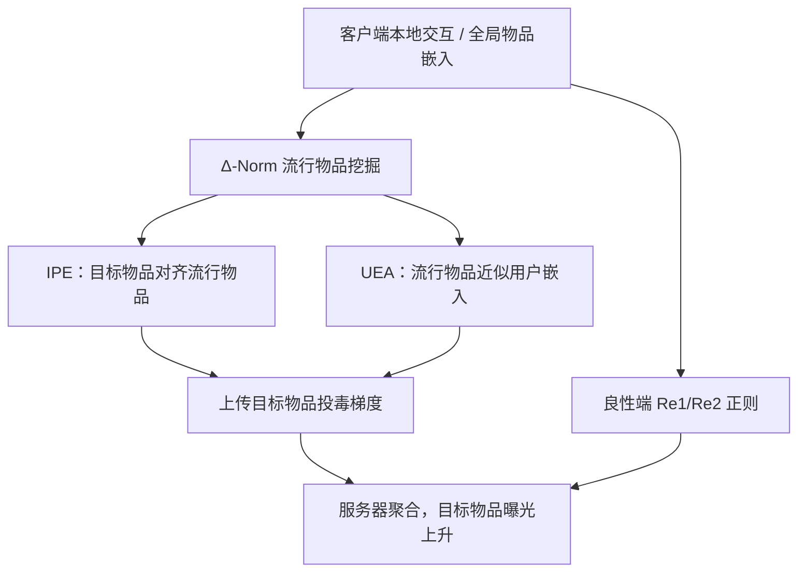
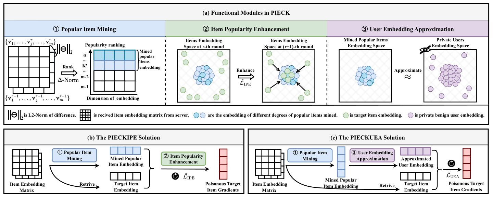

# Preventing the Popular Item Embedding Based Attack in Federated Recommendations (联邦推荐中基于流行物品嵌入的投毒攻击防御)

- **会议/期刊**: ICDE 2024（arXiv 2025 扩展版）
- **作者与机构**: Jun Zhang, Huan Li, Dazhong Rong, Yan Zhao, Ke Chen, Lidan Shou；浙江大学、奥尔堡大学
- **推荐链路定位**: 训练阶段 / 联邦推荐安全（非召回、精排打分链路）
- **研究方向**: 去偏公平、可信隐私与工业架构
- **论文原文**: [论文原文链接](https://arxiv.org/abs/2502.12958v1)
- **开源代码**: [开源代码仓库链接](https://github.com/junzhang-zj/PIECK)

## TL;DR (1分钟核心速览)

针对联邦推荐投毒攻击依赖特定模型或先验知识、现有防御因冷门目标梯度占比过高而失效，本文提出模型无关且无需先验的 PIECK：用 $\Delta\text{-Norm}$ 挖掘流行物品，再以流行物品嵌入对齐（IPE）或近似用户嵌入（UEA）生成投毒梯度，并设计 Re1/Re2 双正则防御。在 ML-100K/1M、AZ 的 Leave-One-Out 全库排序下，UEA 将 ER@10 从 0.23% 提至 93.39%，防御压至 0–1.25%，HR@10 仅轻微波动。

## Background & Motivation (背景与核心矛盾)

- **主流范式**: 联邦推荐系统（FRS）将用户嵌入留在客户端、物品嵌入与交互函数在服务器聚合；攻击者通过恶意客户端上传投毒梯度，提升目标物品曝光。
- **前人局限**: FedRECA 需要部分真实交互，PIPA 需要物品流行度先验；A-RA/A-HUM 只适用于交互函数可学习的 DL-FRS。两个核心矛盾是：① 攻击依赖模型结构或外部先验，真实场景不可得；② 常规联邦防御假设毒梯度是少数，但 FRS 中冷门目标物品的正向梯度极少，毒梯度反而占主导。
- **核心洞察 (Key Insight)**: 长尾分布下流行物品被更多用户交互、收敛更慢，其嵌入在相邻轮次变化更大且更持久；同时用户/物品对称结构使流行物品嵌入分布接近用户嵌入分布。
- **本文切入点**: 在训练过程中自动挖掘流行物品，用其嵌入构造模型无关、无需先验的目标投毒；防御端则用两个正则项同时破坏“流行物品对齐”和“用户嵌入近似”。

## Method (核心方法设计)

### 1. 整体框架 (Overall Architecture)

服务器下发全局物品嵌入；恶意客户端累计连续轮次物品嵌入差 $\Delta\text{-Norm}$，取 top-$N$作为流行物品。随后分两支：IPE 将目标物品拉向流行物品嵌入；UEA 用流行物品嵌入替代不可见用户嵌入，直接最大化目标物品得分。两支只回传目标物品梯度。防御端良性客户端同样挖掘流行物品，在本地 BCE 损失上加入 Re1/Re2，分别打散流行—非流行物品特征、拉开流行物品与用户分布。推理解码仍是未交互物品 top-$K$ 打分。

<figure class="paper-figure" markdown="span">
  <figcaption>图2：PIECK概述：(a) PIECK中的功能模块；(b) PIECKIPE方案；(c) PIECKUEA方案。</figcaption>
</figure>

### 2. 关键设计拆解 (Key Designs)

1. **流行物品挖掘（$\Delta\text{-Norm}$，无需先验）**：痛点是攻击者拿不到全局流行度。对物品$v_j$累计$\Delta\text{-Norm}^r_j=\|v_j^{r+1}-v_j^r\|_2$，取 top-$N$得$P$。物理直觉是流行物品损失项更多、收敛更慢，因此嵌入变化更大且持续；作者用 ML-100K 的 top-50 变化排名验证了该现象。

2. **双分支投毒：IPE 与 UEA（模型无关）**：IPE 将目标物品 $v_j$与挖掘流行物品$P$的余弦相似度加权最大化，并按相似度正负拆成$P_j^+$、$P_j^-$，避免被单一主导方向过拟合：
$\tilde{L}_{IPE}=-\frac{1}{|T|}\sum_{v_j\in T}\sum_{*\in\{+,-\}}\frac{\sum_{v_k\in P_j^*}\kappa(v_k)\cos(v_k,v_j)}{\lambda^{-1}|P_j^*|}$。
UEA 进一步用流行物品嵌入替代真实用户嵌入：
$\tilde{L}_{UEA}=-\frac{1}{N|T|}\sum_{v_k\in P}\sum_{v_j\in T}\log\Psi(v_k,v_j)$，其中$v_k$ 视为常量、只对目标物品反传。其依据是 FRS 用户/物品对称训练，流行物品覆盖大多数用户，且与用户分布 KL 更小。

3. **双正则防御 Re1/Re2（保留推荐性能）**：Re1 让非流行物品与流行物品特征混淆，使 IPE 难以把目标伪装成流行物品：
$Re_1=\frac{1}{|\Delta D_i|}\sum_{v_j\in\Delta D_i}\sum_{v_k\in P_i}\kappa'(v_k)\cos(v_k,v_j)$。
Re2 拉开流行物品与用户嵌入分布，使 UEA 的近似失效：
$Re_2=\sum_{v_k\in P_i}\kappa'(v_k)\mathrm{KL}(v_k,u_i)$。
最终 $L^{def}_i=L_i-\beta Re_1-\gamma Re_2$。理论分析指出，冷门目标物品的毒梯度期望占比$\tilde{E}(v_j)=\tilde{p}/((1-\tilde{p})p_j+\tilde{p})$，当$p_j$很小时远大于恶意用户比例$\tilde{p}$，因此 Median/Krum 等“毒梯度少数”假设失效。

**训练目标、负采样与推理效率**：良性端用 BCE，按比例 $q$采样未交互负例，默认$q=1$；攻击端以目标物品为正样本构造代理 BCE，不做额外负采样。三模块均可矩阵并行，攻击每轮仅增加约 0.35–0.42s；防御在 MF/DL-FRS 每轮分别增加约 0.47s/1.13s。

## Experimental Setup & Evaluation Protocol (实验设置与评估协议)

- **数据集与预处理**:

| 数据集 | #Users | #Items | #Interactions | 稀疏度 | 特征/场景说明 |
| :--- | :---: | :---: | :---: | :---: | :--- |
| ML-100K | 943 | 1,682 | 100,000 | 93.70% | 电影，较稠密 |
| ML-1M | 6,040 | 3,706 | 1,000,209 | 95.53% | 电影，较大规模 |
| AZ | 16,566 | 11,797 | 169,781 | 99.91% | 数字音乐，极稀疏 |

- **数据划分与防穿越**: 每用户 `Leave-One-Out` 构造训练/测试集；目标物品从用户未交互物品中随机选取，避免只挑最冷门物品造成不公平。
- **排名评测协议**: 对全部未交互物品按预测分数取 top-$K$，属无偏 `Full-Ranking`；攻击指标 ER@K，推荐指标 HR@K，默认$K=10$。
- **对比基线与超参**: 攻击基线 FedRECA、PIPA、A-RA、A-HUM；防御基线 NormBound、Median、TrimmedMean、Krum、MultiKrum、Bulyan。基模型为 MF-FRS 与 NCF-DL-FRS；默认恶意用户比例 $\tilde{p}=5\%$、$N=10$、$|T|=1$；MF 学习率 1.0，DL-FRS 0.005；batch 为 256（AZ 1024）。原文未报告显著性检验。

## Key Experimental Results (实验关键数据)

### 1. 主实验对比 (Main Results)

ML-100K 上无防御时的攻击效果（ER@10 / HR@10）：

| 方法 | MF-FRS ER@10 | MF-FRS HR@10 | DL-FRS ER@10 | DL-FRS HR@10 |
| :--- | :---: | :---: | :---: | :---: |
| NoAttack | 0.23 | 57.16 | 0.00 | 45.60 |
| FedRECA | 0.23 | 57.58 | 0.00 | 45.28 |
| PIPA | 26.42 | 56.95 | 100.00 | 44.96 |
| A-RA | 0.11 | 56.95 | 100.00 | 45.07 |
| A-HUM | 31.09 | 57.05 | 100.00 | 45.07 |
| PIECK_IPE | 87.47 | 57.69 | 100.00 | 45.39 |
| PIECK_UEA | **93.39** | **57.69** | **100.00** | **45.39** |
| Improv. (UEA vs NoAttack) | +93.16 pp | +0.53 pp | +100 pp | -0.21 pp |

ML-1M 上 UEA 将 ER@10 从 0 提至 98.04%，HR@10 仅从 61.32% 降至 61.03%（-0.29 pp）；AZ 上 UEA 达 72.11%，IPE 为 50.21%。

### 2. 消融实验 (Ablation Study)

防御损失在 ML-100K、MF-FRS 上的消融（ER@10 / HR@10）：

| 防御损失 | PIECK_IPE ER@10 | PIECK_IPE HR@10 | PIECK_UEA ER@10 | PIECK_UEA HR@10 |
| :--- | :---: | :---: | :---: | :---: |
| 无防御 | 87.47 | 57.69 | 93.39 | 57.69 |
| 仅 Re1 | 26.20 | 55.46 | 0.00 | 54.19 |
| 仅 Re2 | 49.20 | 56.63 | 69.36 | 56.73 |
| Re1 + Re2 | **1.25** | **56.31** | **0.00** | **55.89** |

LIPE 消融：PKL 的 ER@10 为 39.75，改用 PCOS 后升至 71.41，再加权 $\kappa(\cdot)$ 与正负子集划分后达 87.47。

### 3. 关键实验发现 (Key Findings)

- **攻击端：UEA 最稳且模型无关**。ML-100K/MF-FRS 上 UEA 的 ER@10 为 93.39%，比 NoAttack 高 93.16 pp；ML-1M 达 98.04%，AZ 达 72.11%。IPE 在 ML-1M 也达 90.47%，说明不依赖 DL-FRS 的可学习交互函数。
- **防御端：常规方法失效，双正则有效**。DL-FRS 下 NormBound/Median/Krum 等对 PIECK_UEA 的 ER@10 仍为 100%；MF-FRS 下 Bulyan 仅压到 79.04%，TrimmedMean 压到 48.52%。本文防御把 UEA 压到 0.00%、IPE 压到 1.25%，HR@10 仅从 57.69% 降至 55.89%/56.31%。
- **两个正则缺一不可**。仅 Re1 时 IPE 仍有 26.20%、UEA 虽为 0 但 HR 掉到 54.19%；仅 Re2 时 IPE 为 49.20%、UEA 为 69.36%；联合后 IPE/UEA 分别为 1.25%/0.00%，且 HR 回到 56.31%/55.89%。

## Highlights & Limitations (亮点、对比与审稿批判)

- **与代表作对比 (vs. Prior Work)**: FedRECA 依赖公开交互、PIPA 依赖流行度先验，二者在屏蔽先验后显著失效；A-RA/A-HUM 只攻 DL-FRS 的交互函数，在 MF-FRS 上几乎无效。PIECK 改攻共享物品嵌入，因而同时适配 MF/DL-FRS，且无需任何先验。
- **可迁移亮点**: $\Delta\text{-Norm}$ 可作为“训练中流行度/冷启动信号”用于流行度去偏、长尾扶持；Re1/Re2 的“打散流行特征 + 拉开用户/物品分布”思路可迁移到联邦隐私保护与投毒防御。
- **审稿级局限批判**: ① 攻击依赖服务器共享物品嵌入，内容型/物品不共享的 FRS 未必适用；② 防御需良性客户端额外挖掘流行物品并调节 $\beta,\gamma$，防御主实验集中在 ML-100K，缺少大规模工业验证与显著性检验；③ UEA 计算开销高于 IPE，在线部署需权衡。

## Rating (四维评分)

- **方法创新性 (Novelty)**: ⭐⭐⭐⭐ （首个模型无关、无需先验的 FRS 目标投毒，并用 $\Delta\text{-Norm}$ 与对称性给出可验证依据）
- **评估协议与实验扎实度 (Protocol & Experiments)**: ⭐⭐⭐⭐ （3 数据集、2 基模型、4 攻击、6 防御较完整；但防御主要在 ML-100K，缺显著性检验）
- **写作与数学规范度 (Clarity & Rigor)**: ⭐⭐⭐⭐ （性质、公式与防御理论链条清晰；部分表格排版与符号密度偏高）
- **工业落地与复现价值 (Industrial & Practical Value)**: ⭐⭐⭐ （代码开源、攻击/防御开销可接受；但联邦安全部署与超参调优成本仍高）

