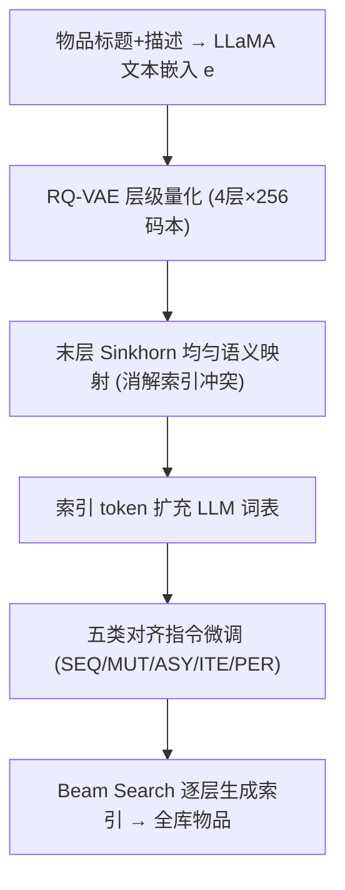
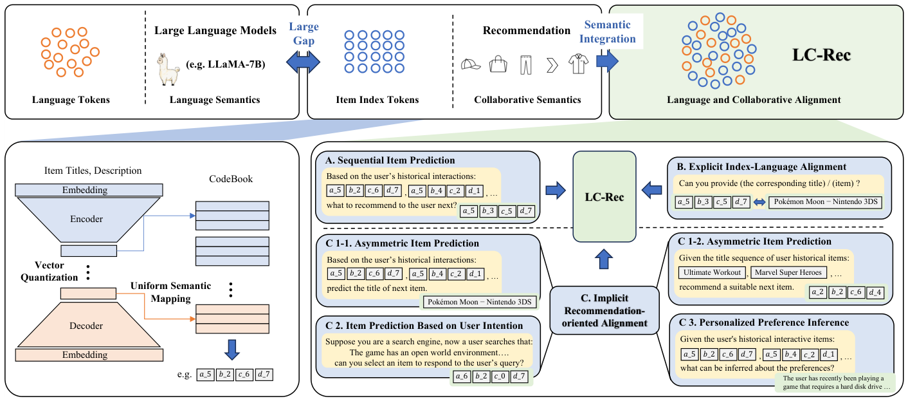

# Adapting Large Language Models by Integrating Collaborative Semantics for Recommendation (通过融合协同语义适配大语言模型用于推荐)

- **会议/期刊**: ICDE 2024
- **作者与机构**: Bowen Zheng, Yupeng Hou, Hongyu Lu, Yu Chen, Wayne Xin Zhao, Ming Chen, Ji-Rong Wen（中国人民大学高瓴人工智能学院、UC San Diego、腾讯微信）
- **推荐链路定位**: 端到端生成式（全库生成式召回，无需候选集）
- **研究方向**: 生成式推荐与离散语义 ID / 大语言模型推荐
- **论文原文**: [https://arxiv.org/abs/2311.09049v4](https://arxiv.org/abs/2311.09049v4)
- **开源代码**: [https://github.com/RUCAIBox/LC-Rec](https://github.com/RUCAIBox/LC-Rec)

## TL;DR (1分钟核心速览)

LLM 词表是语言 token、推荐系统词表是 item ID，二者语义空间割裂，导致基于标题文本的 LLM 推荐只能在小候选集上重排、无法全库生成。LC-Rec 用 RQ-VAE 在 LLaMA 文本嵌入上学习 4 层×256 码本的层级物品索引，并提出 Sinkhorn 均匀语义映射消除 VQ 的「同叶子索引冲突」，再以 SEQ / 互译 / 非对称 / 意图 / 偏好推断五类指令任务做对齐微调。在 Amazon 三子集上采用 Leave-One-Out + **Full-Ranking**（全库未交互排序）评测，平均相对提升 25.5%，Games 上 HR@1 提升 68.62%。

## Background & Motivation (背景与核心矛盾)

- **主流范式**: 序列推荐以 item ID 序列建模（SASRec/BERT4Rec 等）；LLM4Rec 则分两支——把行为「文本化」后做 prompt/指令微调（TALLRec、InstructRec），或构造物品索引后让模型直接生成 ID（P5-CID、TIGER）。
- **前人局限**: ① 文本化路线只用语言语义、丢弃协同信号，且受上下文窗口限制只能对给定候选集打分，无法支撑全库排序；② 索引化路线（P5-CID）仍是「item ID 序列 → item ID」的纯协同映射，与 LLM 的语言空间毫无交集；TIGER 更是从零训练的 Transformer，不继承语言先验。
- **核心洞察 (Key Insight)**: 若索引本身由 LLM 的文本嵌入量化而来，索引 token 就天然带有语言语义；但标准 VQ 会出现**多物品落到同一叶子节点**的索引冲突，而推荐场景要求索引唯一可解码。
- **本文切入点**: 「索引构造（含冲突消解）+ 多任务语义对齐」双管齐下，把物品索引变成 LLM 词表中既含语言又含协同语义的普通 token。

## Method (核心方法设计)

### 1. 整体框架 (Overall Architecture)

先用 LLaMA 编码物品「标题+描述」并 mean-pooling 得文本嵌入 $\boldsymbol{e}$，训练 RQ-VAE 将其量化成$H=4$层、每层$K=256$的码字序列$[c_1,\dots,c_H]$作为物品索引；随后把这约$10^3$ 个索引 token 作为 OOV 追加进 LLaMA 词表，用五类指令任务联合微调；推理时以 beam search（beam=20）逐层生成索引，并把非法索引路径的 logits 置零，实现全库生成式召回。

<figure class="paper-figure" markdown="span">
  <figcaption>图 1：我们 LC-Rec 的整体框架。我们通过基于物品索引和对齐调优整合语言与协同语义，增强 LLMs，从而使其适配推荐系统。</figcaption>
</figure>

### 2. 关键设计拆解 (Key Designs)

1. **RQ-VAE 层级语义索引**：单层 VQ 表达空间不足且索引不唯一。逐层对残差量化：$c_i=\arg\min_k\lVert \boldsymbol{r}_i-\boldsymbol{v}_k^i\rVert_2^2$，$\boldsymbol{r}_{i+1}=\boldsymbol{r}_i-\boldsymbol{v}_{c_i}^i$，重构$\hat{\boldsymbol{z}}=\sum_i \boldsymbol{v}_{c_i}^i$。粗到细的树结构天然适配自回归逐层生成，且小码本即可获得大表达空间。

2. **均匀语义映射 (USM) 消解索引冲突**：已有做法（TIGER 类）在冲突叶子后追加一层随机唯一 ID，引入无语义的噪声分布。LC-Rec 改为在末层施加均匀分布约束，把冲突分配建模为最优传输：$\min_{q}\sum_{\boldsymbol{r}_H\in\mathcal{B}}\sum_{k=1}^{K}q(c_H=k|\boldsymbol{r}_H)\lVert \boldsymbol{r}_H-\boldsymbol{v}_k^H\rVert_2^2$，s.t.$\sum_k q=\frac{|\mathcal{B}|}{K}$，用 Sinkhorn-Knopp 求解，使各码字负载均衡且语义无损。

3. **多粒度对齐指令与训练目标**：仅做 SEQ（索引序列→索引）只是表层拟合。补充 **MUT**（标题↔索引双向互译，类比跨模态互映射）、**ASY**（三变体：索引→标题、索引→描述、标题序列→索引）、**ITE**（由 GPT-3.5 从评论抽取用户意图作 query 检索物品）、**PER**（由索引序列反推显式偏好）。统一为自回归负对数似然 $\mathcal{L}=-\sum_{\langle I,Y\rangle\in\mathcal{B}}\sum_{j=1}^{|Y|}\log P(Y_j|I,Y_{<j})$；每个 epoch 每条样本只采样一种指令模板且仅出现一次以防过拟合。推理复杂度$O(N^2dL)$，经 KV-Cache 后为$O(N^2dL+HNdL)$，$H=4$ 开销极小。

## Experimental Setup & Evaluation Protocol (实验设置与评估协议)

- **数据集与预处理**: Amazon 三子集，按 5-core 过滤低活用户/物品，序列截断至 20：

| 数据集 | #Users | #Items | #Interactions | 稀疏度 | 特征/场景说明 |
| :--- | :---: | :---: | :---: | :---: | :--- |
| Instruments | 24,773 | 9,923 | 206,153 | 99.92% | 乐器，含标题+描述 |
| Arts | 45,142 | 20,957 | 390,832 | 99.96% | 手工艺/缝纫 |
| Games | 50,547 | 16,860 | 452,989 | 99.95% | 电子游戏 |

- **数据划分与防穿越**: `Leave-One-Out`（最后一条测试、倒数第二条验证、其余训练），严格按时间序。
- **排名评测协议**: 无偏 `Full-Ranking`（对全物品集排序，未交互即负样本），指标 HR@{1,5,10}、NDCG@{5,10}；生成式方法 beam size 统一为 20。
- **对比基线与超参**: 8 个基线覆盖 CNN/RNN/Transformer/MLP/内容增强/生成式五类；规模 7B（LLaMA），索引层数 4、码本 256×32 维，RQ-VAE 用 AdamW（lr=1e-3, batch=1024），LLM 微调 lr=5e-5、WD=0.01、总 batch=128、训练 4 epoch。

## Key Experimental Results (实验关键数据)

### 1. 主实验对比 (Main Results)

| 模型 | Instruments HR@1 | HR@10 | NDCG@10 | Arts HR@1 | HR@10 | NDCG@10 | Games HR@1 | HR@10 | NDCG@10 |
| :--- | :---: | :---: | :---: | :---: | :---: | :---: | :---: | :---: | :---: |
| GRU4Rec | 0.0571 | 0.1031 | 0.0765 | 0.0421 | 0.0964 | 0.0659 | 0.0176 | 0.0964 | 0.0502 |
| BERT4Rec | 0.0435 | 0.0822 | 0.0608 | 0.0337 | 0.0713 | 0.0500 | 0.0136 | 0.0763 | 0.0401 |
| SASRec | 0.0503 | 0.0947 | 0.0690 | 0.0225 | 0.1016 | 0.0592 | 0.0145 | 0.0940 | 0.0481 |
| FMLP-Rec | 0.0480 | 0.0988 | 0.0704 | 0.0310 | 0.1046 | 0.0634 | 0.0152 | 0.0930 | 0.0476 |
| S³-Rec | 0.0367 | 0.1136 | 0.0714 | 0.0245 | 0.1051 | 0.0612 | 0.0119 | 0.1002 | 0.0491 |
| P5-CID | 0.0587 | 0.1016 | 0.0768 | 0.0485 | 0.0902 | 0.0664 | 0.0177 | 0.0803 | 0.0437 |
| TIGER | 0.0608 | 0.1064 | 0.0803 | 0.0465 | 0.1012 | 0.0703 | 0.0188 | 0.0939 | 0.0501 |
| **LC-Rec** | **0.0706** | **0.1220** | **0.0926** | **0.0634** | **0.1266** | **0.0906** | **0.0317** | **0.1174** | **0.0681** |
| Improv. | +16.12% | +7.39% | +15.32% | +30.72% | +20.46% | +28.88% | +68.62% | +12.78% | +28.25% |

（Improv. 为相对最强基线的提升；三数据集全指标均为第一，平均相对提升 25.5%。）

### 2. 消融实验 (Ablation Study)

| 配置 | Arts HR@1 | HR@5 | NDCG@5 | NDCG@10 | Games HR@1 | HR@5 | NDCG@5 | NDCG@10 |
| :--- | :---: | :---: | :---: | :---: | :---: | :---: | :---: | :---: |
| SEQ (仅主任务) | 0.0561 | 0.0909 | 0.0740 | 0.0812 | 0.0243 | 0.0626 | 0.0437 | 0.0535 |
| + MUT | 0.0593 | 0.0926 | 0.0765 | 0.0832 | 0.0275 | 0.0703 | 0.0491 | 0.0598 |
| + ASY | 0.0602 | 0.0945 | 0.0776 | 0.0848 | 0.0281 | 0.0725 | 0.0506 | 0.0615 |
| + ITE | 0.0638 | 0.0996 | 0.0813 | 0.0889 | 0.0294 | 0.0770 | 0.0534 | 0.0648 |
| **+ PER (Full)** | **0.0634** | **0.1011** | **0.0828** | **0.0906** | **0.0317** | **0.0800** | **0.0560** | **0.0681** |

### 3. 关键实验发现 (Key Findings)

1. **对齐任务的增益主要来自「隐式推荐导向对齐」而非主任务本身**：从 SEQ 累加到 PER，Games 上 HR@1 由 0.0243 → 0.0317（+30.5%）、NDCG@5 由 0.0437 → 0.0560（+28.1%），且每个任务单独加入均单调增益，说明索引 token 必须先被「翻译」进语言空间才能被 LLM 有效利用。
2. **索引机制本身与对齐任务正交可叠加**：文中图 2 显示，随机索引、Vanilla ID、去掉 USM 的变体在叠加 ALIGN 后均有大幅提升，说明 USM 解决的是索引唯一性、对齐任务解决的是语义可得性，两者缺一不可；索引冲突会造成末层「语义真空」，故 USM 是必要的。
3. **融合协同语义才能区分「难负样本」**：在语义相似负样本判别中（表 V），LC-Rec 在语言相似负样本上 75.73、协同相似负样本上 60.01，均超 SASRec（73.52 / 52.25）与 ChatGPT（60.94 / 51.30）；而直接用标题推理的 LC-Rec (Title) 降至 67.74，证明增益来自索引携带的协同信号而非 LLM 本身的语言能力。

## Highlights & Limitations (亮点、对比与审稿批判)

- **与代表作对比 (vs. Prior Work)**: 对比 TIGER（从零训练 Transformer、追加随机唯一 ID 消冲突）本文保留语言先验且用 Sinkhorn 让末层索引仍具语义；对比 P5-CID（ID→ID 映射，与语言语义绝缘）本文用 MUT/ASY 显式桥接两种语义；对比 InstructRec/TALLRec（只能 Yes/No 或候选集重排）本文实现**全库生成式**召回。
- **可迁移亮点**: ① 用最优传输做「码本负载均衡」可无损移植到任何 RQ-VAE / 语义 ID 生成式推荐（如 TIGER 系、扩散推荐）；② 「仅主任务微调 = 表层拟合，需构造互译辅助任务」这一结论对大模型域适配普遍适用。
- **审稿级局限批判**: ① 依赖 7B LLaMA 与 4 epoch 指令微调，训练/部署成本远超 SASRec 级基线，论文未给出吞吐、显存与延迟的实测对比，也未与参数高效微调（LoRA）对比；② 索引由 LoRA-free 全参微调后的词嵌入固定，物品更新需重跑 RQ-VAE，增量扩展性仅在文中定性声称；③ 评测仅在 Amazon 三子集的 Leave-One-Out 单目标设定上进行，缺少时间切分与冷启动分桶，ITE/PER 的监督信号由 GPT-3.5 生成，存在教师模型偏置风险。

## Rating (四维评分)

- **方法创新性 (Novelty)**: ⭐⭐⭐⭐ （首次把「索引冲突」当作最优传输问题用 Sinkhorn 求解，配合五类对齐任务形成完整的语义融合范式，但 RQ-VAE 与指令微调组件本身为组合式创新）
- **评估协议与实验扎实度 (Protocol & Experiments)**: ⭐⭐⭐⭐ （三数据集 + 无偏 Full-Ranking + 8 基线 + 逐任务消融 + 相似负样本/意图检索/PCA 多维分析，唯缺时间切分与显著性检验）
- **写作与数学规范度 (Clarity & Rigor)**: ⭐⭐⭐⭐ （RQ 与 USM 公式、Algorithm 1、推理复杂度推导清晰，指令模板给全；但 USM 仅用于末层的合理性论证偏经验）
- **工业落地与复现价值 (Industrial & Practical Value)**: ⭐⭐⭐ （代码与数据预处理完整开源，beam search 仅 $H=4$ 层、KV-Cache 后开销可控；但 7B 全参微调与全库生成式服务的工程成本仍偏高）

