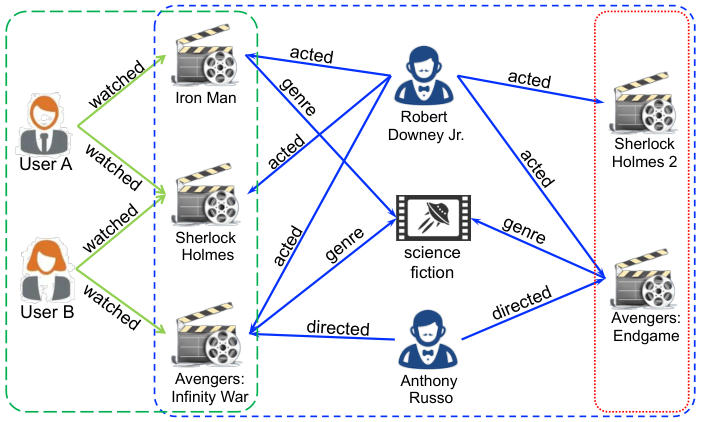
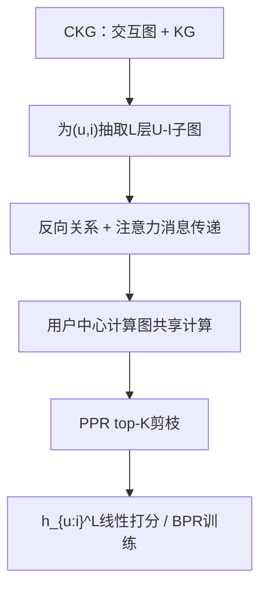

# Knowledge-Enhanced Recommendation with User-Centric Subgraph Network (知识增强的用户中心子图网络推荐)

- **会议/期刊**: IEEE ICDE 2024
- **作者与机构**: Guangyi Liu, Quanming Yao, Yongqi Zhang, Lei Chen；清华大学、第四范式、香港科技大学（广州）
- **推荐链路定位**: 精排 / 全库排序打分
- **研究方向**: 图神经网络与知识图谱推荐 / 冷启动与长尾推荐
- **论文原文**: [https://arxiv.org/abs/2403.14377v1](https://arxiv.org/abs/2403.14377v1)
- **开源代码**: [https://github.com/leolouis14/KUCNet](https://github.com/leolouis14/KUCNet)

## TL;DR (1分钟核心速览)

KUCNet 针对 KG 推荐中节点嵌入缺乏用户个性化、难泛化到新物品/新用户的痛点，为每对用户-物品构造融合协同信号与 KG 属性的 U-I 子图，用注意力 GNN 编码，并将多个子图合并为用户中心计算图、以 Personalized PageRank 剪枝加速。全库排序下 Last-FM 的 Recall@20/NDCG@20 较 KGIN 提升 23.2%/27.1%，新物品场景亦优于 REDGNN。

## Background & Motivation (背景与核心矛盾)

- **主流范式**: KG 推荐多采用 CKE、KGAT、KGIN 等节点嵌入 + 全局图聚合，把 KG 作为物品侧信息增强用户/物品表示。
- **前人局限**: 节点嵌入对同一用户/物品固定，无法针对候选物品做细粒度个性化；全局聚合会引入与当前推荐无关的 KG 噪声，且对新物品/新用户缺乏监督信号。
- **核心洞察 (Key Insight)**: 推荐可视为 CKG 中的链路预测，只需围绕目标 $(u,i)$ 抽取子图，即可同时保留“相似用户也交互过”的协同相似性与“同演员/同类型”的属性相似性；子图分类器不依赖节点 ID，天然具备归纳性。
- **本文切入点**: 用 U-I 子图分类替代全局节点嵌入，并用用户中心计算图共享多条候选物品子图的计算、PPR 剪枝控制规模。

<figure class="paper-figure" markdown="span">
  <figcaption>图 1. 知识图谱增强推荐系统示意图。用户-物品图（绿色）给出两个用户与三个物品之间的交互。知识图谱（蓝色）提供已交互实体作为物品的辅助信息。特别地，有一些新物品（例如新上映电影）未出现在用户-物品图中，但可通过 KG 中的实体与给定物品相连。任务是为 UserA 或 UserB 推荐物品。</figcaption>
</figure>

## Method (核心方法设计)

### 1. 整体框架 (Overall Architecture)

输入为协同知识图谱 CKG（用户-物品交互图与 KG 通过 item-entity 对齐合并）。对每个候选 $(u,i)$，抽取深度$L$的 U-I 子图，加入反向关系后从用户$u$向物品$i$做$L$跳消息传递，注意力为边加权，输出 pair-wise 编码并线性打分。训练用 BPR；推理时把同一用户下多个候选子图合并为“用户中心计算图”，共享公共边，再用 PPR 分数对每个头节点保留 top-$K$ 尾边，最后只对保留子图并行打分。

### 2. 关键设计拆解 (Key Designs)

1. **U-I 子图与注意力消息传递**：节点嵌入的痛点是“同一物品对不同用户同表示”。KUCNet 定义 $G_{u,i|L}=(V_{u,i|L},E_{u,i|L})$，节点到$u$与$i$的最短路径距离之和不超过$L$。消息传递为  
$h^l_{u:o}=\delta(\sum_{(n_s,r,n_o)\in\mathcal{N}^l_o}\alpha^l_{u:sr}W^l(h^{l-1}_{u:s}+h^l_r))$，  
其中边权 $\alpha^l_{u:sr}=\sigma((w^l_\alpha)^\top\mathrm{ReLU}(W^l_{\alpha s}h^{l-1}_{u:s}+W^l_{\alpha r}h^l_r+b_\alpha))$，最终$\hat y_{ui}=w^\top h^L_{u:i}$。直觉是：同一候选物品在不同用户子图中的路径不同，注意力会强调真正支持该次推荐的协同/属性证据。

2. **用户中心计算图与 PPR 剪枝**：逐对子图计算复杂度约 $O(|I|\bar C)$，且热门物品会膨胀子图。作者证明多个 U-I 子图的节点/边是用户中心图$C_{u|L}$的子集，因此在$C_{u|L}$上共享消息，复杂度降为$O(\bar D^L)$。再用 PPR 迭代  
$r_u^{k+1}=(1-\alpha)M r_u^k+\alpha p_u$得到节点对用户$u$的重要性，对每个头节点按尾节点 PPR 保留 top-$K$ 边，剔除无关 KG 噪声。

3. **训练目标、负采样与推理效率**：采用 BPR 损失  
$\mathcal{L}=\sum_{(u,i,j)\in O}-\ln\sigma(\hat y_{ui}-\hat y_{uj})$，  
负例为随机未观测物品；Adam 优化，不学习用户/物品节点嵌入，参数量显著小于 KGAT/KGIN。推理时先在用户中心图上共享计算，再 PPR 剪枝；PPR 为一次性预处理，但全库排序仍需对大量候选打分。

## Experimental Setup & Evaluation Protocol (实验设置与评估协议)

- **数据集与预处理**: 沿用 KGAT/KGIN 的 KG 推荐基准，另用 DisGeNet 做疾病-基因跨域验证。

| 数据集 | #Users | #Items | #Interactions | 稀疏度 | 特征/场景说明 |
| :--- | :---: | :---: | :---: | :---: | :--- |
| Last-FM | 23,566 | 48,123 | 3,034,796 | ~0.267% | 音乐；KG 实体 58,266，关系 9 |
| Amazon-Book | 70,679 | 24,915 | 847,733 | ~0.048% | 图书；KG 实体 88,572，关系 39 |
| Alibaba-iFashion | 114,737 | 30,040 | 1,781,093 | ~0.052% | 时尚穿搭；一阶 outfit 关系占主导 |
| DisGeNet | 13,074 | 8,947 | 130,820 | ~0.112% | 疾病=用户、基因=物品；用于新用户/新物品 |

- **数据划分与防穿越 (Splitting Strategy)**: 传统设定按用户交互做比例划分（KGAT/KGIN 协议），测试物品均出现在训练集；新物品设定随机取 1/5 物品作 $I_{test}$并从训练图移除其全部交互，其余 4/5 为$I_{train}$；DisGeNet 分别按物品/用户做 5 折新物品、新用户划分。
- **排名评测协议 (Ranking Protocol)**: 无偏 `Full-Ranking`：对测试用户给全库物品打分，排除训练正例，测试正例为目标；报告 Recall@20、NDCG@20。训练负采样为随机未交互物品。
- **对比基线与超参设置**: 覆盖 CF（MF/FM/NFM）、KG/CKG（RippleNet、KGNN-LS、CKAN、KGIN、CKE、R-GCN、KGAT）及新物品强基线（PPR、PathSim、REDGNN）。嵌入维度 $d\in\{36,48,64\}$，层数$L\in\{3,4,5\}$，采样数$K\in[20,200]$；报告多次运行标准差，未做$p$ 值显著性检验。

## Key Experimental Results (实验关键数据)

### 1. 主实验对比 (Main Results)

| 方法 | Last-FM R@20 | Last-FM N@20 | Amazon R@20 | Amazon N@20 | Alibaba R@20 | Alibaba N@20 |
| :--- | ---: | ---: | ---: | ---: | ---: | ---: |
| MF | 0.0724 | 0.0617 | 0.1300 | 0.0678 | 0.1095 | 0.0670 |
| FM | 0.0778 | 0.0644 | 0.1345 | 0.0701 | 0.1001 | 0.0602 |
| NFM | 0.0829 | 0.0671 | 0.1366 | 0.0713 | 0.1035 | 0.0654 |
| RippleNet | 0.0791 | 0.0652 | 0.1336 | 0.0694 | 0.0960 | 0.0521 |
| KGNN-LS | 0.0880 | 0.0642 | 0.1362 | 0.0560 | 0.1039 | 0.0557 |
| CKAN | 0.0812 | 0.0660 | 0.1442 | 0.0698 | 0.0970 | 0.0509 |
| KGIN | 0.0978 | 0.0848 | 0.1687 | 0.0915 | **0.1147** | **0.0716** |
| KGAT | 0.0873 | 0.0744 | 0.1487 | 0.0799 | 0.1030 | 0.0627 |
| **KUCNet** | **0.1205** | **0.1078** | **0.1718** | **0.0967** | 0.1031 | 0.0663 |

KUCNet 相对最优基线：Last-FM R@20 **+23.2%**、N@20 **+27.1%**；Amazon R@20 **+1.8%**、N@20 **+5.7%**；Alibaba 则低于 KGIN（R@20 -10.1%、N@20 -7.4%）。

### 2. 消融实验 (Ablation Study)

| 变体 | Last-FM | Amazon-Book | new-Last-FM | new-Amazon-Book |
| :--- | ---: | ---: | ---: | ---: |
| KUCNet-random（随机采样） | 0.1181 | 0.1655 | 0.5293 | 0.2142 |
| KUCNet-w.o.-Attn（去注意力） | 0.1193 | 0.1672 | 0.5348 | 0.2172 |
| **KUCNet** | **0.1205** | **0.1718** | **0.5375** | **0.2237** |

### 3. 关键实验发现 (Key Findings)

1. Last-FM 上 Recall@20 从 KGIN 的 0.0978 提升到 0.1205，说明 pair-specific 子图比全局节点嵌入更能区分同一物品对不同用户的价值；但 Alibaba-iFashion 的 KG 以一阶 outfit 关系为主、语义链路弱，KUCNet 未超过 KGIN，暴露 KG 质量依赖。
2. 消融中去除注意力使 Amazon-Book 从 0.1718 降至 0.1672（-2.7%），随机采样替代 PPR 降至 0.1655（-3.7%）；新物品 new-Amazon 上二者分别降至 0.2172/0.2142，证明 PPR 选边与注意力加权是抗噪关键。
3. 新物品 Last-FM 上 KUCNet R@20/N@20 为 0.5375/0.5573，高于 REDGNN 的 0.5284/0.5425；DisGeNet 新用户设定为 0.2883/0.2274，高于 REDGNN 的 0.2821/0.2154，验证无节点嵌入的子图分类器具备归纳泛化能力。超参上 Last-FM/Amazon 最佳 $L=3$，Alibaba 新物品需$L=5$。

## Highlights & Limitations (亮点、对比与审稿批判)

- **与代表作对比 (vs. Prior Work)**: KGAT 在全局 CKG 上做注意力聚合，KGIN 建模用户意图与关系路径，二者仍依赖节点嵌入；KUCNet 把“为每个候选物品抽子图”作为个性化表示，且用用户中心图共享计算，兼顾效率与归纳性；相较 REDGNN，它针对推荐场景同时保留协同交互与 KG 属性两类证据。
- **可迁移亮点**: 用户中心计算图可迁移到所有 pair-wise 子图打分任务（如 KG 链路预测、会话内候选重排）；PPR top-$K$ 邻域采样可作为通用 KG 去噪模块；注意力边权可直接输出推荐解释路径。
- **审稿级局限批判**: 全库排序推理仍重（论文中 PPR/训练/推理在 Alibaba 上分别约 8/25/46、204/335/304、15/150/42 分钟），线上高并发需额外工程；$K$与$L$数据集敏感，Alibaba 需$L=5$ 且整体收益不稳定；仅离线 Full-Ranking 与标准差报告，缺少显著性检验和大规模在线 A/B。

## Rating (四维评分)

- **方法创新性 (Novelty)**: ⭐⭐⭐⭐ （将子图链路预测迁移到 KG 推荐，用户中心共享计算 + PPR 剪枝有明确增量）
- **评估协议与实验扎实度 (Protocol & Experiments)**: ⭐⭐⭐⭐ （三基准 + 新物品/新用户 + DisGeNet，Full-Ranking 较规范；但缺显著性检验且 Alibaba 收益不佳）
- **写作与数学规范度 (Clarity & Rigor)**: ⭐⭐⭐⭐ （消息传递、注意力、PPR 与复杂度公式清晰，算法流程完整；部分预处理细节依赖前作）
- **工业落地与复现价值 (Industrial & Practical Value)**: ⭐⭐⭐ （代码开源、参数量小、可解释性强；但 PPR 预处理与全库子图推理开销限制大规模部署）

