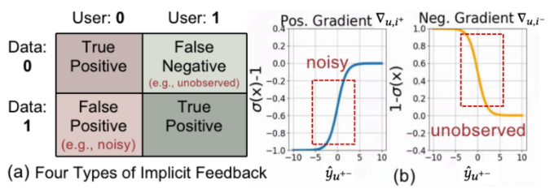
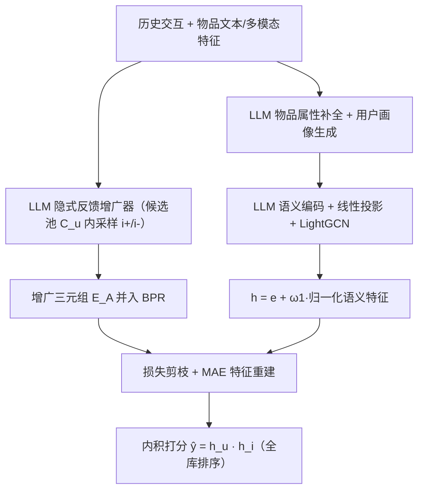
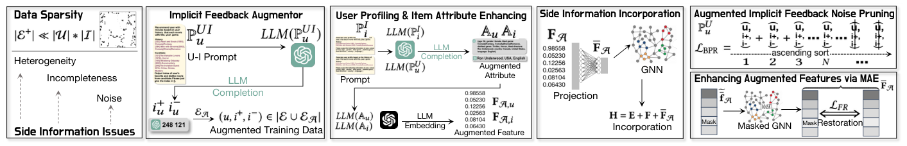

# LLMRec: Large Language Models with Graph Augmentation for Recommendation (大语言模型驱动的推荐图增强框架)

- **会议/期刊**: WSDM 2024 (Oral)；检索目录标识为 ICDE 2024
- **作者与机构**: Wei Wei, Xubin Ren, Jiabin Tang, Chao Huang 等（香港大学）与 Qinyong Wang, Lixin Su, Suqi Cheng, Junfeng Wang, Dawei Yin（百度）
- **推荐链路定位**: 召回（表征学习 / 训练数据增强）
- **研究方向**: 大语言模型推荐 (LLM4Rec) / 自监督与去噪推荐
- **论文原文**: [https://arxiv.org/abs/2311.00423v6](https://arxiv.org/abs/2311.00423v6)
- **开源代码**: [https://github.com/HKUDS/LLMRec](https://github.com/HKUDS/LLMRec)（含增广后的交互与属性数据）

## TL;DR (1分钟核心速览)

针对隐式反馈极度稀疏（Netflix 稀疏度 99.970%）且模态侧信息"噪声大、异构、不完整"的双重痛点，LLMRec 把 LLM 当作**离线数据增广器**：从自然语言侧补出 U-I 三元组边、补全物品属性、生成用户画像，再用**损失剪枝 + MAE 特征重建**压噪。在 Netflix/MovieLens 的 **Full-Ranking** 协议下，R@10 相对最强基线 MICRO/MMSSL 分别提升 **13.95% / 4.88%**，N@20 提升 **20.91% / 10.90%**。

## Background & Motivation (背景与核心矛盾)

- **主流范式**: 以 LightGCN/LATTICE 为编码器，把多模态侧信息（文本 + 海报）作为节点特征注入 ID 嵌入；MMSSL/MICRO 再加跨模态对比自监督信号缓解稀疏。
- **前人局限**: ① 增广只发生在同质关系（i-i、u-u）或对比视图上，**从未直接增广真正决定监督信号的 U-I 交互边**；② 侧信息本身带噪、跨源异构、且用户画像常因隐私缺失，噪声反而污染稀疏交互。
- **核心洞察 (Key Insight)**: 作者从 BPR 梯度入手说明——假正例（误点击）评分偏低、假负例（未交互但可能喜欢）评分偏高，二者梯度幅值大却方向错误（$\nabla_{u,i^+}=\sigma(\hat{y}_{u,i^+}-\hat{y}_{u,i^-})-1$），会把模型显著推向错误方向；而 LLM 的世界知识可把"靠 ID 猜不出"的样本纠正到正确方向。
- **本文切入点**: 不走"LLM 直接当推荐器"的路线，而是保留经典 CF 骨干，用 LLM 增广图结构 + 补全节点语义，再以去噪机制保证增广质量。

<figure class="paper-figure" markdown="span">
  <figcaption>图3：(a) 隐式反馈同时包含假正例和假负例样本。(b) 对于正得分 ˆ𝑦𝑢,𝑖+ 和负得分 ˆ𝑦𝑢,𝑖−，BPR 损失的梯度 ∇ 尽管幅值较大，也可能方向错误，从而显著影响训练的鲁棒性和有效性。</figcaption>
</figure>

## Method (核心方法设计)

### 1. 整体框架 (Overall Architecture)

输入为用户历史交互、物品文本属性与多模态特征。三条 LLM 增广支路并行离线完成：(i) 隐式反馈增广器在基模型给出的候选池 $\mathcal{C}_u$中采样正/负样本，产出增广三元组集$\mathcal{E}_A$；(ii) 物品属性增强生成导演/国家/语言等缺失字段；(iii) 用户画像生成年龄、性别、偏好/厌恶类型等。增广文本经 LLM 编码、线性投影与 LightGCN 编码注入 ID 嵌入，训练时以剪枝后的 BPR 损失 + MAE 特征重建损失联合优化，推理阶段仅保留轻量 GNN 打分，无任何 LLM 在线调用。

<figure class="paper-figure" markdown="span">
  <figcaption>图1：LLMRec 框架：(1) 三类数据增强策略：i) 增强用户-物品交互；ii) 增强物品属性；iii) 用户画像。(2) 增强训练与去噪数据鲁棒化机制。</figcaption>
</figure>

### 2. 关键设计拆解 (Key Designs)

1. **LLM-as-BPR-Sampler（把 LLM 变成知识感知负采样器）**：LLM 无法全库排序，故只在其基模型高分候选池上做"喜欢/不喜欢"的文本推理，得到 $i^+_u,i^-_u=\mathrm{LLM}(\mathrm{P}^{UI}_u)$，并按$\lvert\mathcal{E}_A\rvert=\omega_3\cdot B$ 每 batch 采样注入。直觉：高分区正是假正例/假负例聚集处，LLM 用语义证据在这些"边界样本"上纠偏，比随机增广信息量高得多。
2. **语义特征的可控注入（h = e + 缩放语义）**：不同于把增广特征当作可学习嵌入初始化，本文把 LLM 语义向量视为**加性补充**：$\mathbf{h}_u=\mathbf{e}_u+\omega_1\sum_{k\in\mathcal{M}\cup A_u}\frac{\mathbf{f}^k_u}{\lVert\mathbf{f}^k_u\rVert_2}$（物品同理）。$\omega_1$ 与 L2 归一化共同控制增广语义的话语权，既统一了异构特征的向量空间，又避免噪声特征压垮协同信号。
3. **去噪鲁棒化（剪枝 + MAE）**：按损失升序只保留 $N=(1-\omega_4)\lvert\mathcal{E}\cup\mathcal{E}_A\rvert$个样本的 BPR 项，丢弃损失最大的不可信/冲突样本，防止错误梯度回传；同时对节点特征做掩码重建$\mathcal{L}_{FR}=\frac{1}{\lvert\tilde{\mathcal{V}}\rvert}\sum_{v\in\tilde{\mathcal{V}}}(1-\cos(\tilde{\mathbf{f}}_v,\mathbf{f}_v))^{\gamma}$，让编码器对增广噪声不敏感、保留真实语义。总目标$\mathcal{L}=\mathcal{L}_{BPR}+\lambda\mathcal{L}_{FR}$，训练负采样为增广三元组 + 原图负样本混合；增广全离线（总花费约 39 USD），在线推理与 LightGCN 同阶$O(L\lvert\mathcal{E}\rvert d)$。

## Experimental Setup & Evaluation Protocol (实验设置与评估协议)

- **数据集与预处理**: 两套带多模态侧信息的电影域数据（MovieLens 源自 ML-10M；Netflix 来自 Netflix Prize + 爬取海报），文本 768 维、视觉 512 维（CLIP-ViT），LLM 增广特征 1536 维：

| 数据集 | #Users | #Items | #Interactions | 稀疏度 | 增广边数 / 特征说明 |
| :--- | :---: | :---: | :---: | :---: | :--- |
| Netflix | 13,187 | 17,366 | 68,933 | 99.970% | +26,374；原无用户画像 → LLM 生成 age/gender/liked-genre 等 |
| MovieLens | 12,495 | 10,322 | 57,960 | 99.915% | +24,990；原仅 title/year/genre → LLM 补 director/country/language |

- **数据划分与防穿越 (Splitting Strategy)**: 沿用主流隐式反馈划分（每用户留出部分交互作测试），论文未披露全局时间戳切分；增广数据由 LLM 离线一次性生成，未见测试集信息泄漏描述。
- **排名评测协议 (Ranking Protocol)**: **Full-Ranking 全库未交互排序**（显式规避采样偏置），指标 Recall/NDCG@10,20,50 与 Precision@20，5 次独立运行取均值，对最优基线做 $p$值显著性检验（$p$均$<0.05$，最小$2.8e^{-5}$）。
- **对比基线与超参设置**: 四类基线——纯 CF（MF-BPR / NGCF / LightGCN）、侧信息（VBPR / MMGCN / GRCN）、图增广（LATTICE）、自监督（CLCRec / MMSSL / MICRO）；统一嵌入维度 $d=64$；LLM 端使用 gpt-3.5-turbo（4K/16K）+ text-embedding-ada-002，温度$\tau\in\{0,0.6,0.8,1\}$，top-$p\in\{0,0.1,0.4,1\}$，候选池大小$\lvert\mathcal{C}\rvert\in\{3,10,30\}$。

## Key Experimental Results (实验关键数据)

### 1. 主实验对比 (Main Results)

| 方法 | Netflix R@10 | Netflix N@20 | Netflix R@50 | ML R@10 | ML N@20 | ML R@50 |
| :--- | :---: | :---: | :---: | :---: | :---: | :---: |
| MF-BPR | 0.0282 | 0.0205 | 0.0932 | 0.1890 | 0.0985 | 0.3442 |
| LightGCN | 0.0352 | 0.0238 | 0.1125 | 0.1994 | 0.1005 | 0.3692 |
| GRCN | 0.0379 | 0.0257 | 0.1148 | 0.2384 | 0.1236 | 0.4532 |
| LATTICE | 0.0433 | 0.0259 | 0.1301 | 0.2116 | 0.1268 | 0.4667 |
| MICRO | 0.0466 | 0.0271 | 0.1306 | 0.2150 | **0.1468** | 0.4898 |
| MMSSL | 0.0455 | **0.0287** | 0.1257 | 0.2482 | 0.1310 | 0.4814 |
| **LLMRec** | **0.0531** | **0.0347** | **0.1382** | **0.2603** | **0.1628** | **0.5281** |
| Improv.% | +13.95% | +20.91% | +5.82% | +4.88% | +10.90% | +7.82% |

（P@20 亦全面最优：0.0041 / 0.0186；所有提升均通过 $p<0.05$ 显著性检验）

### 2. 消融实验 (Ablation Study)

| 配置 (Netflix) | R@10 | N@20 | R@50 | 相对变化 (R@10) |
| :--- | :---: | :---: | :---: | :---: |
| w/o U-I 增广 ($\mathcal{E}_A$) | 0.0477 | 0.0317 | 0.1376 | −10.2% |
| w/o 用户画像 ($A_u$) | 0.0423 | 0.0255 | 0.1192 | −20.3% |
| w/o 用户&物品增广 | 0.0309 | 0.0202 | 0.1051 | −41.8% |
| w/o 噪声剪枝 | 0.0504 | 0.0328 | 0.1363 | −5.1% |
| w/o 质量约束 (剪枝+MAE 全去) | 0.0488 | 0.0318 | 0.1279 | −8.1% |
| LLMRec (完整) | **0.0531** | **0.0347** | **0.1382** | — |

### 3. 关键实验发现 (Key Findings)

1. **语义增广 > 边增广**：去掉用户画像使 R@20 从 0.0829 掉到 0.0656（−20.9%），而去掉 U-I 增广仅到 0.0791（−4.6%）；两者齐去则崩至 0.0602。说明在 Full-Ranking 下"补全节点语义"比"多造交互边"更稀缺、更关键，且二者互补。
2. **去噪不是装饰而是必需**：完全不剪枝时 R@10 从 0.0531 降至 0.0504；将剪枝与 MAE 同时移除（w/o-QC）进一步跌至 0.0488（−8.1%），印证了 LLM 增广确实引入假正例，与 3.4 节的梯度方向分析一致。
3. **增广可插拔但有上限**：把 $\mathcal{E}_A,\mathbf{F}_A$ 外挂到 LATTICE/MICRO/MMSSL，R@20 分别提升 **11.40%/9.29%/11.11%**（0.0821/0.0835/0.0833），但均未超过 LLMRec 自身的 0.0829–0.0835 区间上限——说明缺了质量约束与统一语义空间，纯增广无法吃满收益；成本侧用户画像最划算（10.92 USD，CIR 233.79%）。

## Highlights & Limitations (亮点、对比与审稿批判)

- **与代表作对比 (vs. Prior Work)**: 相对 LATTICE（用 i-i 图增广）与 MICRO/MMSSL（用跨模态对比自监督造"伪标签"），LLMRec 的增广**直接落在 U-I 监督信号上**并显式补全缺失属性；相对"LLM-as-Recommender"路线（如 P5/LLM 直接生成推荐），它只让 LLM 做离线增广器，保留成熟 CF 骨干与低推理成本，属于更易落地的折中。
- **可迁移亮点**: ① "在基模型高分候选中做 LLM 正/负采样"这一**边界样本挖掘**范式可平移到 CTR 精排的难负样本构造；② "按损失幅值剪枝 + 掩码重建双重鲁棒化"可直接复用于任何带噪伪标签的蒸馏/增广训练。
- **审稿级局限批判**: ① **候选池自举偏置**——LLM 只能从基模型 Top 候选中选择，天然无法发现基模型完全漏掉的物品，增广会强化原有流行度偏置，缺乏对该偏差的定量分析；② 增广是一次性离线产物，新交互到来需重新调用 LLM，**增量更新成本与时序新鲜度**未评估；③ 仅两个电影域数据集、无冷启动/长尾分桶实验，剪枝超参 $\omega_4$ 在 0 时性能最差说明对噪声比例较敏感，泛化性证据偏薄。

## Rating (四维评分)

- **方法创新性 (Novelty)**: ⭐⭐⭐⭐ （首个把 LLM 增广同时打到交互边与双侧节点属性的框架，梯度方向分析为"为何要增广"提供了少见的第一性论证）
- **评估协议与实验扎实度 (Protocol & Experiments)**: ⭐⭐⭐⭐ （Full-Ranking + 5 次运行 + $p$ 值检验 + 消融/超参/模型无关/成本四类分析俱全，但缺时间切分与分桶分析）
- **写作与数学规范度 (Clarity & Rigor)**: ⭐⭐⭐⭐ （三支路结构与三问三答对应清晰，复杂度分析完整；剪枝公式与 MAE 损失表述略简，增广数据与原始数据的采样配比细节偏少）
- **工业落地与复现价值 (Industrial & Practical Value)**: ⭐⭐⭐⭐ （增广全离线、推理零 LLM 开销、代码与增广数据全开源，成本约 39 USD 可复刻；短板是对闭源 GPT-3.5 版本与提示模板的强依赖）

