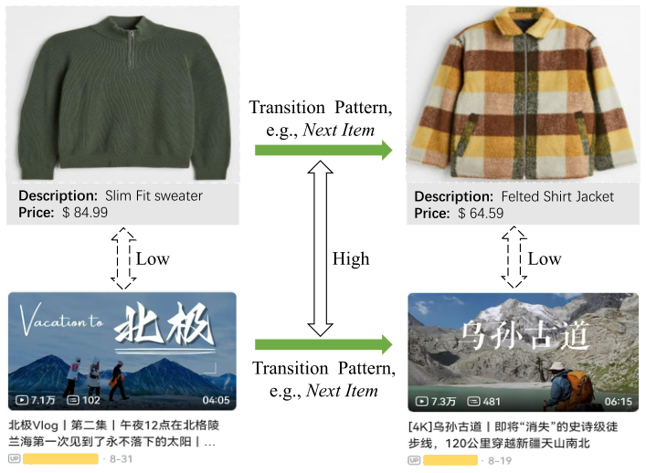
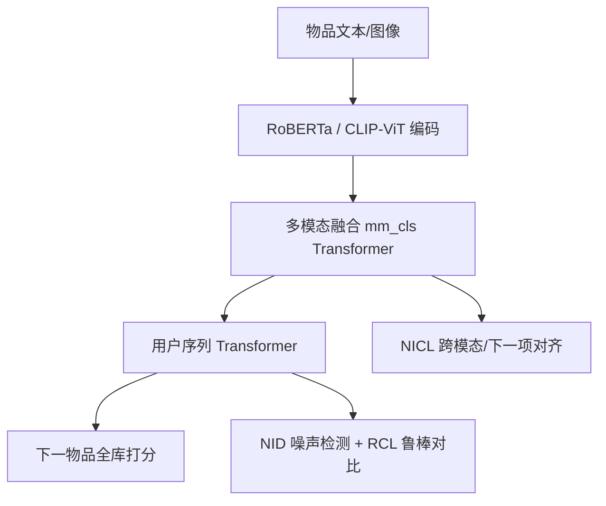
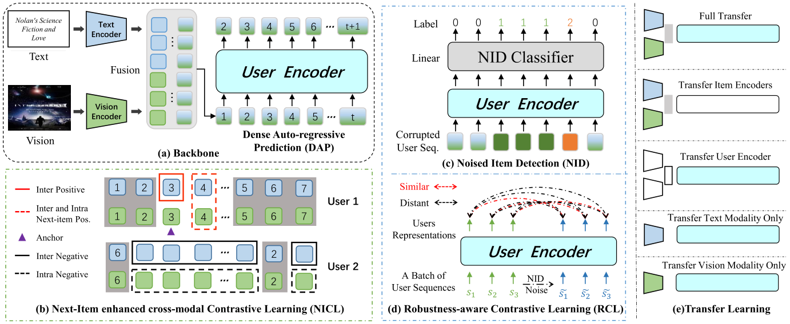

# Multi-Modality is All You Need for Transferable Recommender Systems (多模态即所需：可迁移推荐系统)

- **会议/期刊**: ICDE 2024
- **作者与机构**: Youhua Li 等；上海科技大学、西湖大学、苏州大学、中科院计算所、香港科技大学
- **推荐链路定位**: 召回 / 端到端序列推荐
- **研究方向**: 多模态推荐 / 跨域与多场景推荐
- **论文原文**: [论文原文链接](https://arxiv.org/abs/2312.09602v2)
- **开源代码**: [开源代码仓库链接](https://github.com/ICDE24/PMMRec)

## TL;DR (1分钟核心速览)

本文针对 ID-based 序列推荐“物品 ID 不可跨平台共享、冷启动脆弱”的痛点，提出纯多模态推荐器 PMMRec：仅用文本/图像内容编码物品，以 NICL 对齐跨模态与下一项转移语义，并用 NID/RCL 自监督去噪。在 4 源域 10 目标域、Leave-One-Out + Full-Ranking 协议下，源域 HR@10 最高较最佳基线 +8.50%，目标域 HR@10 最高 +34.77%。

## Background & Motivation (背景与核心矛盾)

- **主流范式**: SASRec/GRU4Rec 等 ID-based 序列推荐为物品分配唯一 ID 并学习 embedding，在多模态场景中常把文本/图像作为 side feature 拼接。
- **前人局限**: ID 无法跨平台共享，迁移时目标域物品 embedding 需重新学习；已有 UniSRec/VQRec 仅用文本且非端到端，MoRec 仅支持单模态，CARCA++ 仍依赖 ID，均难兼顾多模态与可迁移性。
- **核心洞察 (Key Insight)**: 不同平台的内容风格差异大，但“下一物品转移模式”具有共性，因此可把物品内容作为跨域共享的“通用标识”。
- **本文切入点**: 彻底移除物品 ID，构建纯多模态、松耦合、可拆件迁移的序列推荐框架。

<figure class="paper-figure" markdown="span">
  <figcaption>图1. HM数据集与Bili数据集的一个示例。尽管不同平台间的内容相似度可能较低，但不同平台间通用转移模式（如下一项转移）的共性仍然较高，因此有利于跨不同领域和平台迁移知识。上：HM数据集（在线电子商务）。下：Bili数据集（短视频分享）。</figcaption>
</figure>

## Method (核心方法设计)

### 1. 整体框架 (Overall Architecture)

PMMRec 用 RoBERTa 与 CLIP-ViT 分别提取文本 `cls` 与图像 `cls`；融合模块将文本 token、图像 patch 与多模态 `mm_cls` 拼接后过 Transformer，得到物品表示；用户编码器沿用 SASRec 式单向 Transformer。源域预训练采用多任务目标 $\mathcal{L}=\mathcal{L}_{DAP}+\mathcal{L}_{NICL}+\mathcal{L}_{NID}+\mathcal{L}_{RCL}$，目标域仅用下一项预测$\mathcal{L}_{DAP}$ 微调。各组件松耦合，可全量、仅物品编码器、仅用户编码器、仅文本或仅视觉迁移。

<figure class="paper-figure" markdown="span">
  <figcaption>图2. PMMRec的架构。(a)：PMMRec框架的主干，包括物品编码器（文本编码器和视觉编码器）、多模态融合模块和用户编码器。(b)：NICL通过下一项增强的模态内与模态间对比学习实现表示对齐。(c)：NID通过让用户编码器感知合成噪声，使其适应噪声数据。(d)：RCL通过对比原始用户序列与损坏用户序列增强框架鲁棒性。(e)：PMMRec在各种迁移学习设置下实现通用性。</figcaption>
</figure>

### 2. 关键设计拆解 (Key Designs)

1. **NICL：把下一项转移写进跨模态对齐**：VCL 只拉近同一物品的文本-图像，ICL 增加模态内负样本，但仍缺少推荐语义。NICL 进一步把下一物品的文本/图像作为正样本，令物品编码器在无 ID 条件下感知转移模式。设 $\delta(a,b)=\exp(a^\top b)$，则  
   $\mathcal{L}^{T,V}_{i_l^u}=-\log\frac{\delta(t_l^u,v_l^u)+\delta(t_l^u,v_{l+1}^u)+\delta(t_l^u,t_{l+1}^u)}{\delta(t_l^u,v_l^u)+\sum_{i_j^k\in\mathcal{N}_{i_l^u}}[\delta(t_l^u,v_j^k)+\delta(t_l^u,t_j^k)]}$，视觉侧对称。  
   直觉：模态内/间负样本扩大判别空间，下一项正样本把“内容相似”校准为“推荐转移相似”。

2. **NID：让用户编码器主动识别噪声**：对用户序列随机 shuffle 15%、随机替换 5%，构造损坏序列；再用三分类器判断每个位置是原样、打乱还是替换。  
   $\hat{y}_l^c=\mathrm{ReLU}(\tilde{h}_{i_l^u}W+b)$，$\mathcal{L}_{NID}=-\frac{1}{BL}\sum_{u,l}\sum_{k=0}^{2}y_{l,k}^c\log\hat{y}_{l,k}^c$。  
   直觉：让编码器先学会“哪些交互不可信”，再学序列偏好。

3. **RCL、负采样与推理**：RCL 对比原始序列池化表示 $h_u$与损坏序列$\tilde{h}_u$：  
   $\mathcal{L}_{RCL}=-\frac{1}{B}\sum_{u=1}^{B}\log\frac{\exp(h_u^\top\tilde{h}_u)}{\exp(h_u^\top\tilde{h}_u)+\sum_{k\ne u}\exp(h_u^\top\tilde{h}_k)}$。  
   训练负采样采用 in-batch 全物品（排除当前用户已交互项），无需额外 hard-negative 挖掘；推理为 $P(i_{L+1}|s_u)=\mathrm{softmax}(h_{i_L}^\top e_{i_{L+1}})$，对全库物品点积排序。

## Experimental Setup & Evaluation Protocol (实验设置与评估协议)

- **数据集与预处理**: 4 源域 + 10 目标域，均做 `5-core` 过滤；图像统一 $224\times224$，文本/标题截断至 50 词。源域融合 4 平台数据，目标域覆盖电商与短视频。

| 数据集 | #Users | #Items | #Interactions | 稀疏度 | 场景 |
| :--- | ---: | ---: | ---: | ---: | :--- |
| Source-Fused | 600,000 | 232,772 | 6,953,503 | 99.98% | 4 源融合 |
| Bili | 100,000 | 44,887 | 1,537,850 | 99.97% | 短视频 |
| Kwai | 200,000 | 39,410 | 1,512,646 | 99.98% | 短视频 |
| HM | 200,000 | 85,019 | 3,160,543 | 99.98% | 电商 |
| Amazon | 100,000 | 63,456 | 742,464 | 99.98% | 电商 |
| Bili Food | 6,485 | 1,574 | 39,152 | 99.61% | 短视频 |
| Bili Movie | 16,452 | 3,493 | 114,239 | 99.80% | 短视频 |
| Bili Cartoon | 30,102 | 4,702 | 211,497 | 99.84% | 短视频 |
| Kwai Food | 8,549 | 2,097 | 72,741 | 99.59% | 短视频 |
| Kwai Movie | 8,477 | 7,024 | 60,208 | 99.99% | 短视频 |
| Kwai Cartoon | 17,429 | 7,284 | 131,733 | 99.89% | 短视频 |
| HM Clothes | 27,883 | 2,742 | 185,297 | 99.71% | 电商 |
| HM Shoes | 21,666 | 3,743 | 164,621 | 99.81% | 电商 |
| Amazon Clothes | 5,009 | 5,855 | 30,383 | 99.89% | 电商 |
| Amazon Shoes | 15,264 | 16,852 | 93,999 | 99.96% | 电商 |

- **数据划分与防穿越**: 采用 `Leave-One-Out`：每用户最后一项为测试、倒数第二项为验证，其余训练。
- **排名评测协议**: 无偏 `Full-Ranking` 全库排序，报告 HR@10/20/50 与 NDCG@10/20/50；未用 sampled negatives。
- **对比基线与超参**: 基线含 IDSR（GRURec、NextItNet、SASRec）、IDSR+side feature（FDSA、CARCA++）、可迁移 SR（UniSRec、VQRec、MoRec++）。隐藏维 $d=768$，batch size 64，AdamW + early stopping，编码器仅微调顶部 2 层 Transformer；原文未报告显著性检验。

## Key Experimental Results (实验关键数据)

### 1. 主实验对比 (Main Results)

源域 HR@10 对比如下（NDCG@10 另述）：

| 方法（源域） | Bili | Kwai | HM | Amazon | Bili NDCG@10 | Kwai NDCG@10 |
| :--- | ---: | ---: | ---: | ---: | ---: | ---: |
| SASRec | 4.04 | 5.56 | 11.60 | 22.95 | 2.17 | 2.93 |
| FDSA | 4.46 | 5.79 | 11.73 | 20.12 | 2.33 | 3.03 |
| CARCA++ | 5.25 | 6.94 | 14.65 | **23.67** | 2.74 | 3.62 |
| UniSRec | 0.64 | 1.87 | 3.75 | 7.88 | 0.31 | 0.87 |
| VQRec | 1.75 | 2.73 | 6.25 | 21.26 | 0.78 | 1.22 |
| MoRec++ | 4.87 | 6.93 | 14.54 | 23.10 | 2.57 | 3.68 |
| PMMRec | **5.49** | **7.53** | **15.06** | 23.57 | **2.90** | **4.00** |
| HR@10 相对最佳 | +4.57% | +8.50% | +2.80% | -0.42% | — | — |

NDCG@10 上，PMMRec 在 Bili/Kwai/Amazon 为 2.90/4.00/20.84，分别优于最佳基线 2.74/3.68/20.61；HM 为 9.54，略低于 CARCA++ 的 9.63。

### 2. 消融实验 (Ablation Study)

下表为 Bili Movie、Kwai Movie、HM Shoes、Amazon Shoes 四数据集均值：

| 变体 | HR@10 均值 | NDCG@10 均值 | ΔHR@10 |
| :--- | ---: | ---: | ---: |
| w/o NICL | 18.53 | 14.02 | -2.11 |
| only VCL | 19.00 | 14.51 | -1.63 |
| only NCL | 19.72 | 14.93 | -0.91 |
| w/o NID | 19.92 | 15.26 | -0.72 |
| w/o RCL | 20.52 | 15.33 | -0.11 |
| PMMRec | **20.64** | **15.58** | — |

注：Kwai Movie 上 w/o RCL 的 HR@10=8.93 略高于全模型 8.84，说明 RCL 并非每个数据集都单调增益，但整体 NDCG 仍以全模型最佳。

### 3. 关键实验发现 (Key Findings)

1. **复杂内容场景收益更大**：Bili/Kwai 的短视频封面语义更杂，PMMRec 的 HR@10 分别 +4.57%/+8.50%；HM/Amazon 背景更干净，Amazon HR@10 仅 -0.42%，但 NDCG@10 +1.31%、HR@50 +2.74%，说明纯多模态已接近 ID+side-feature 上限。
2. **预训练迁移收益显著且呈非对称性**：全迁移下 Amazon Shoes HR@10 相对最佳基线 +34.77%、HM Clothes +20.07%、Kwai Movie +18.98%；但从简单场景迁往复杂场景（如 HM→Kwai Movie）会退化，说明内容风格鸿沟仍是跨平台瓶颈。
3. **NICL 是主增益，去噪目标补鲁棒性**：去掉 NICL 使四数据集平均 HR@10 由 20.64 降至 18.53；冷启动中 SASRec 在 Bili/Kwai 的 HR@10 仅 0.088/0.031，PMMRec 达 1.024/3.511，体现内容 token 对冷物品的表示扩展能力。

## Highlights & Limitations (亮点、对比与审稿批判)

- **与代表作对比**: UniSRec/VQRec 仅文本、非端到端且无跨模态融合；MoRec++ 有图文融合但缺少 NICL 的下一项语义对齐；CARCA++ 依赖 ID+side feature，无法跨平台迁移。PMMRec 以纯内容表示和松耦合组件同时覆盖多模态/单模态迁移。
- **可迁移亮点**: “下一项正样本 + 模态内负样本”的 NICL 可移植到任意多模态序列召回；NID/RCL 的损坏序列自监督去噪可低成本增强序列鲁棒性。
- **审稿级局限批判**: 依赖 RoBERTa/CLIP-ViT 与 8×A100 预训练，$d=768$ 的在线全库点积开销偏高；噪声比例 15%/5% 为固定超参，且未报告显著性检验，复杂场景间迁移仍不稳定。

## Rating (四维评分)

- **方法创新性 (Novelty)**: ⭐⭐⭐⭐ （纯多模态替代 ID 的思路清晰，NICL 把下一项转移注入跨模态对齐，NID/RCL 双去噪有增量；但对比学习组件本身不算全新。）
- **评估协议与实验扎实度 (Protocol & Experiments)**: ⭐⭐⭐⭐ （4 源 10 目标、5-core、Leave-One-Out、Full-Ranking 较规范，消融与冷启动完整；缺显著性检验和噪声比例敏感性分析。）
- **写作与数学规范度 (Clarity & Rigor)**: ⭐⭐⭐⭐ （框架图与公式定义较清楚，NICL 分子分母设计明确；多迁移设置表格符号略密，部分实验表排版可读性一般。）
- **工业落地与复现价值 (Industrial & Practical Value)**: ⭐⭐⭐⭐ （代码开源、组件可拆件迁移，冷启动收益大；但大模型编码器与全库排序的线上成本需压缩/蒸馏。）

