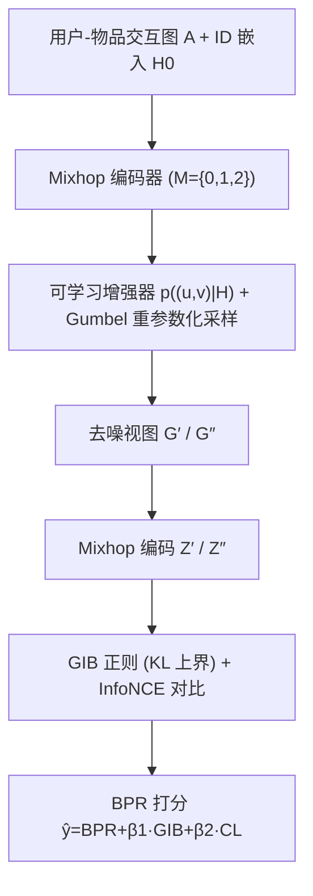
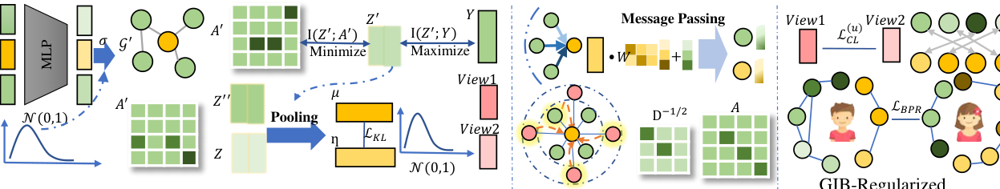

# Graph Augmentation for Recommendation (面向推荐的图增强框架)

- **会议/期刊**: ICDE 2024
- **作者与机构**: Qianru Zhang, Lianghao Xia, Xuheng Cai, Siu-Ming Yiu, Chao Huang (香港大学), Christian S. Jensen (奥尔堡大学)
- **推荐链路定位**: 召回（图协同过滤表征学习）
- **研究方向**: 自监督对比学习与交互去噪 / 图神经网络推荐
- **论文原文**: [https://arxiv.org/abs/2403.16656v1](https://arxiv.org/abs/2403.16656v1)
- **开源代码**: [https://github.com/HKUDS/GraphAug](https://github.com/HKUDS/GraphAug)

## TL;DR (1分钟核心速览)

现有图对比学习（GCL）推荐把「随机删边/加噪」当作增强，却把误点击、流行度偏置等交互噪声一并放大成自监督信号；同时非自适应的 GCN 消息传递加剧过平滑。GraphAug 把增强器变成**可学习的去噪模块**：以 GIB（图信息瓶颈）目标驱动 Gumbel 重参数化边采样，自动蒸馏任务相关信息并生成两个去噪视图，再用 Mixhop 混阶编码器抑制过平滑。在 Gowalla / Retail Rocket / Amazon 上，Full/Sampled 排序评测的 Recall@20 分别达 0.2025 / 0.1463 / 0.2019，较最强基线 NCL 相对提升 8.6% / 5.9% / 5.9%。

## Background & Motivation (背景与核心矛盾)

- **主流范式**: SGL/SLRec 用随机 DropEdge、NodeDrop 造两个视图做 InfoNCE 对齐；HCCF 用超边聚合、NCL 用 EM 聚类构造「局部-全局」视图对比。
- **前人局限一**: 随机扰动对长尾物品极不友好——关键交互模式被删掉后，增强视图本身就是噪声，InfoNCE 的 instance discrimination 反而把噪声"钉"进表征。
- **前人局限二**: 手工设计的聚合器（超边/聚类中心）依赖特定 pretext task，且聚类易偏向高度数节点，噪声输入下自监督方向被带偏；GCN 逐层平滑使节点表征趋同。
- **核心洞察 (Key Insight)**: 增强不该是"加噪"，而应是"信息压缩"——只保留与推荐标签 $Y$互信息高的结构成分，把与输入图$A$ 的冗余互信息压掉，天然对齐 GIB 的 sufficiency/minimality 折中。
- **本文切入点**: 让增强算子 $Aug(G)$ 本身可学习并由 GIB 目标监督，采样过程用重参数化保证可微；编码端用 Mixhop 混合多阶邻域以对抗过平滑。

## Method (核心方法设计)

### 1. 整体框架 (Overall Architecture)

输入用户-物品二部图 $\mathbf{A}$，先用 Mixhop 编码器得到高阶嵌入$\bar{\mathbf{H}}=GE(\mathbf{H}^0)$；可学习增强器以节点嵌入对为输入打分得到边存在概率，再经 Gumbel 重参数化 + 阈值$\xi$二值化为两个独立采样视图$G'=(U\cup V,\mathbf{A}')$、$G''$；两视图经同一 Mixhop 编码器得到$\mathbf{Z}',\mathbf{Z}''$，一方面对$\{Z,Z',Z''\}$做 pooling 得高斯后验$(\mu,\eta)$以计算 GIB 上界（KL 项），另一方面做 InfoNCE 视图对齐；最终与 BPR 主损失联合优化，推理时仅用原图$\mathbf{A}$ 编码一次再做内积打分，不引入额外在线开销。

<figure class="paper-figure" markdown="span">
  <figcaption>图1：GraphAug 框架的整体架构。(i) GIB 正则化的图增强通过集成可学习增强器 Aug(G) 与图采样重参数化实现。(ii) Graph mixhop 编码器能够混合高阶关系以进行自适应消息传递。(iii) GIB 正则化对比优化（LCL）优化 GraphAug。</figcaption>
</figure>

### 2. 关键设计拆解 (Key Designs)

1. **可学习增强器与重参数化边采样**：痛点是把"删边"当增强会误删长尾信号。改为让每条边有可学习的保留概率：先对嵌入加噪与 mask 扰动 $\tilde{\boldsymbol{h}}_u=(\bar{\boldsymbol{h}}_u-\epsilon_u)\cdot m_u+\epsilon_u$，再以$\sigma(\mathrm{MLP}([\tilde{\boldsymbol{h}}_u\|\tilde{\boldsymbol{h}}_v]))$ 建模边概率；采样用 soft-Bernoulli 形式的 Gumbel 重参数化
$\bar{a}'_{u,v}=\sigma\!\left(\tfrac{1}{\tau_1}\left(\log\tfrac{p}{1-p}+\log\tfrac{\epsilon'}{1-\epsilon'}\right)\right),\ a'_{u,v}=\bar{a}'_{u,v}\,\mathbb{I}(\bar{a}'_{u,v}>\xi)$，
使离散图采样可反向传播；直觉是"低相似度边被概率性剔除、潜在高阶边被补回"，即一次端到端去噪。

2. **GIB 增强目标的可算化**：直接优化 $\mathcal{L}_{GIB}=-\mathrm{I}(Z';Y)+\beta\,\mathrm{I}(Z';A)$不可解，作者分别取$\mathrm{I}(Z';Y)$的变分下界（用$-\log q(Y|Z')$近似）与$\mathrm{I}(Z';A)$ 的高斯上界（KL 散度），得到
$\mathcal{L}_{KL}=\tfrac{1}{N}\sum_n\left[-\log q(Y_n|Z')+\beta\,p(Z'|A_n)\log\tfrac{p(Z'|A_n)}{r(Z')}\right]$，
其中 $(\mu,\eta)=\mathrm{Pooling}(\{Z',Z'',Z\})$给出$p(Z'|A_n)=\mathcal{N}(\mu,\eta)$，并以$\beta$ 控制压缩强度。物理意义：视图被压向同一高斯先验，噪声边带来的方差被惩罚，任务相关信息被保留。

3. **Mixhop 混阶传播、损失与开销**：为解过平滑，编码器不做单一邻接幂，而是拼接多阶：
$\boldsymbol{h}'^{(l+1)}_u=\big\|_{m\in\mathcal{M}}\delta\!\left(\sum_{\tilde{a}'^m_{u,v}\neq 0}\tilde{a}'^{m}_{u,v}\mathbf{W}^{(l)}_m\boldsymbol{h}'^{(l)}_v\right),\ \mathcal{M}=\{0,1,2\}$。
总损失 $\mathcal{L}=\mathcal{L}_{BPR}+\beta_1\mathcal{L}_{GIB}+\beta_2\mathcal{L}_{CL}+\beta_3\|\Theta\|_F^2$；对比负采样为批内随机负样本（比例$r$），BPR 用均匀采样负例。复杂度$O(M_{max}L|\tilde{A}|d)+O(B(I+J)d)$，与 LightGCN 同量级；$\tilde{A}^mH$ 用连乘递推避免显式高阶矩阵。

## Experimental Setup & Evaluation Protocol (实验设置与评估协议)

- **数据集与预处理**:

| 数据集 | #Users | #Items | #Interactions | 密度 | 场景 |
| :--- | :---: | :---: | :---: | :---: | :--- |
| Gowalla | 50,821 | 57,440 | 1,172,425 | 4.0e-4 | 签到 POI |
| Retail Rocket | 49,611 | 20,994 | 169,909 | 1.6e-4 | 电商点击/加购/交易 |
| Amazon | 56,027 | 29,525 | 256,036 | 1.5e-4 | 商品评分 |

- **数据划分与防穿越**: 论文正文未显式声明过滤/划分细节；按其 HKUDS 开源管线与同类工作（SGL/NCL/AutoCF）惯例为 `5-core` 过滤 + `Leave-One-Out`（每用户最后 1 次交互作测试）。此处属推断，复现需以仓库配置为准。
- **排名评测协议**: 沿用该系列的 `Sampled Ranking`（每用户 1 正 + 99 随机负，指标 Recall@20/40、NDCG@20/40），非 Full-Ranking；因此绝对值偏高，跨论文比较需注意口径。
- **对比基线与超参**: 五类基线——传统 CF（BiasMF/NCF/AutoR）、GNN（GCMC/PinSage/NGCF/LightGCN/GCCF）、解耦（DGCF/DisenGCN）、生成式 SSL（MHCN/STGCN）、对比 SSL（SGL/SLRec/HCCF/NCL/DGCL/CGI）。$d$搜索 [8,16,32,64]（主表用 32），学习率 0.001，$\tau\in[0.1,0.9]$，$\xi\in[0,0.8]$，$\beta_1\in[1e\!-\!6,1e\!-\!3]$；报告$p$-value（多为$10^{-6}\sim10^{-8}$ 量级）。

## Key Experimental Results (实验关键数据)

### 1. 主实验对比 (Main Results)

| 模型 | Gowalla R@20 | Gowalla N@20 | Retail R@20 | Retail N@20 | Amazon R@20 | Amazon N@20 |
| :--- | :---: | :---: | :---: | :---: | :---: | :---: |
| NCF | 0.1247 | 0.0659 | 0.0812 | 0.0456 | 0.1032 | 0.0453 |
| LightGCN | 0.1799 | 0.1053 | 0.1279 | 0.0708 | 0.1775 | 0.1087 |
| SLRec | 0.1529 | 0.0926 | 0.1268 | 0.0732 | 0.1679 | 0.1045 |
| SGL | 0.1814 | 0.1065 | 0.1376 | 0.0785 | 0.1856 | 0.1033 |
| DGCL | 0.1793 | 0.1067 | 0.1243 | 0.0781 | 0.1675 | 0.0986 |
| HCCF | 0.1818 | 0.1061 | 0.1309 | 0.0576 | 0.1803 | 0.0987 |
| NCL | 0.1865 | 0.1111 | 0.1382 | 0.0813 | 0.1907 | 0.1081 |
| **GraphAug** | **0.2025** | **0.1228** | **0.1463** | **0.0860** | **0.2019** | **0.1287** |
| Improv. vs NCL | +8.58% | +10.53% | +5.86% | +5.78% | +5.87% | +19.06% |

### 2. 消融实验 (Ablation Study)

| 变体 | Gowalla R@20 | Gowalla N@20 | MAD（越大越过平滑越轻） |
| :--- | :---: | :---: | :---: |
| **GraphAug 完整** | **0.2025** | **0.1228** | **0.7215** |
| w/o Mixhop（退化 GCN） | 0.1833 | 0.1172 | 0.5783 |
| w/o GIB（仅随机对比增强） | 图 2 显著下降（未给数值） | 同左 | — |
| w/o CL（无对比、仅 BPR） | 图 2 下降最大 | 同左 | — |

| 增强比例 ξ（Gowalla） | 0.0 | 0.2 | 0.4 | 0.6 | 0.8 |
| :--- | :---: | :---: | :---: | :---: | :---: |
| Recall@20 | 0.1757 | **0.2025** | 0.1975 | 0.1764 | 0.1878 |

### 3. 关键实验发现 (Key Findings)

1. **去噪比"更强增强"更重要**：增强比例 0.2 时最优（0.2025），到 0.6 反而跌到 0.1764（低于完全不增强的 0.1757 附近），说明过度扰动会摧毁协同关系；而 Mixhop 被移除后 NDCG@20 掉 4.6%、MAD 从 0.7215 掉到 0.5783，直接证明混阶传播是抗过平滑的来源。
2. **极端稀疏场景增益最大**：Retail Rocket 密度仅 1.6e-4，GraphAug 相对 NCL 的 Recall@20 增益仍达 5.9% 且 NDCG@20 反超幅度稳定；在最长尾的物品分桶（交互 0–10 组）Recall@40 为 0.0472 vs NCL 0.0450，而在高频桶（40–50）扩大到 0.3000 vs 0.2170（+38%），说明去噪视图放大了有效协同信号。
3. **抗噪更稳但训练更贵**：人为注入 5%–25% 假边时，GraphAug 的 Recall 相对跌幅最小（图 3），优于 NCL/LightGCN；代价是 Gowalla 训练耗时 88.8 分钟，高于 NCL 的 56.8 与 DGCL 的 72.3（低于 HCCF 的 116.7），精度/开销 trade-off 需按场景权衡。

## Highlights & Limitations (亮点、对比与审稿批判)

- **与代表作对比 (vs. Prior Work)**: SGL/SLRec 的增强是"无参数随机扰动"，不知道哪条边该删；HCCF/NCL 靠超边或 EM 聚类引入全局视图，但聚类中心被高度数节点绑架。GraphAug 的核心差异是把增强器参数化并纳入 GIB 目标，等价于"学一个带信息约束的图结构重写器"，同时用 Mixhop 把过平滑从架构层解决，而 NCL 只是靠对比损失间接缓解。
- **可迁移亮点**: (1) Gumbel soft-Bernoulli + 阈值化的可微图采样可直接用于邻居剪枝、序列去噪、KG 边筛选；(2) 用 $\mathcal{N}(\mu,\eta)$逼近$p(Z'|A)$ 使 GIB 落地，是把信息瓶颈接到任意对比推荐框架的通用模板。
- **审稿级局限批判**: ① 评估口径偏弱——未明示过滤/划分细节，且为 99 负样本 Sampled Ranking，缺少 Full-Ranking 与方差/多次运行报告；② GIB 的池化高斯假设较强，$\beta_1$（1e-5 最优）与$\xi$ 的敏感性意味着需要逐数据集调参，加之训练时间比 NCL 高约 56%，在工业亿级图上可扩展性存疑；③ 仅验证静态 CF，未覆盖序列、多模态或多行为场景。

## Rating (四维评分)

- **方法创新性 (Novelty)**: ⭐⭐⭐⭐ （把 GIB 从表征正则升级为"增强器监督信号"，可微图采样与 Mixhop 的组合在 GCL4Rec 中属首次系统化）
- **评估协议与实验扎实度 (Protocol & Experiments)**: ⭐⭐⭐ （数据集与基线覆盖面广、含噪声/稀疏/收敛/耗时多维分析，但划分与负采样细节缺失、仅 Sampled Ranking）
- **写作与数学规范度 (Clarity & Rigor)**: ⭐⭐⭐⭐ （GIB 上下界推导与复杂度分析完整，符号基本一致；个别公式排版与 $W^{(0)}_0$ 置零简化略显跳跃）
- **工业落地与复现价值 (Industrial & Practical Value)**: ⭐⭐⭐⭐ （代码开源、推理端零额外开销、可微采样插件化易接入，但训练开销与超参敏感度是上线前需压缩的点）

