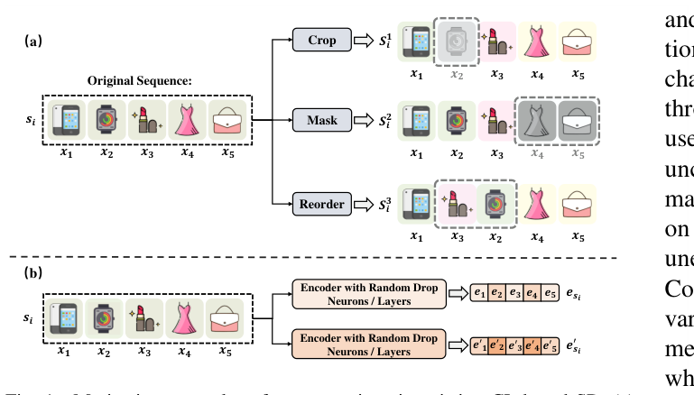
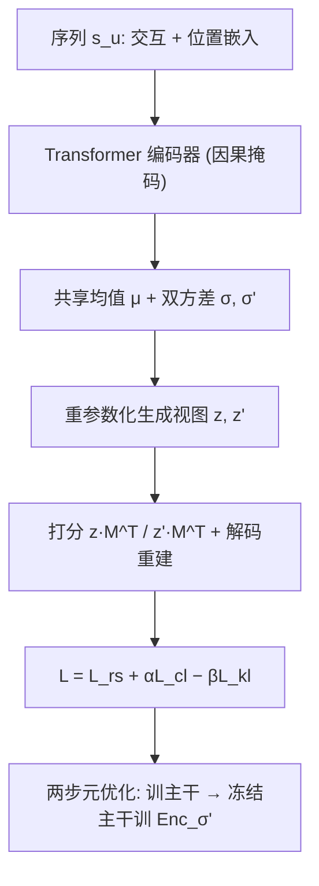
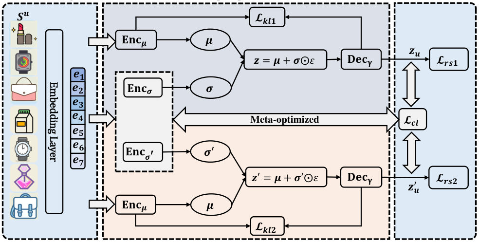

# Meta-optimized Joint Generative and Contrastive Learning for Sequential Recommendation (元优化联合生成式与对比学习的序列推荐)

- **会议/期刊**: ICDE 2024
- **作者与机构**: Yongjing Hao, Pengpeng Zhao, Junhua Fang, Jianfeng Qu 等（苏州大学；Macquarie University；北京航空航天大学；Texas Tech University；香港科技大学）
- **推荐链路定位**: 召回（序列 Next-Item 召回表征学习）
- **研究方向**: 自监督对比学习与交互去噪 / 序列与会话推荐
- **论文原文**: [论文原文链接](https://arxiv.org/abs/2310.13925v1)
- **开源代码**: 原文仅给出匿名仓库（`anonymous.4open.science/status/Meta-SGCL-05B5`），正式仓库暂未公开

## TL;DR (1分钟核心速览)

现有 CL 序列推荐靠随机 crop/mask/reorder 或 dropout 造视图，既破坏序列语义又依赖手工设计。Meta-SGCL 把 VAE 当 Seq2Seq 视图生成器：共享均值 $\mu$、用两个方差$\sigma,\sigma'$ 重参数化出两个保语义视图；用双 ELBO 证明该目标蕴含互信息最大化并落地为 InfoNCE，再用元优化两步策略按下游任务自适应调节视图生成器。三个数据集 Leave-One-Out 全库排序下，HR@10/NDCG@5 较最强基线最高提升 20.84%/25.66%。

## Background & Motivation (背景与核心矛盾)

- **主流范式**: SASRec/BERT4Rec 类自注意力序列模型为主干，S³-Rec、CL4SRec、CoSeRec、DuoRec、ContrastVAE 在其上挂自监督辅助任务以缓解交互稀疏。
- **前人局限**: ① 数据增强（crop/mask/reorder）直接删改 token，破坏序列顺序与共现语义，视图与原序列的"不变量"其实是增强噪声；② 模型增强（drop neuron/layer）丢弃了承载语义的神经元，且增强强度、增强方式是人为规定，与下游推荐目标无关，只能得到次优视图。
- **核心洞察 (Key Insight)**: VAE 的隐变量本身刻画了用户偏好分布，若把单隐变量 ELBO 扩展到两视图结构 $s_u \leftarrow z - z' \rightarrow s_u$，ELBO 会自动多出一项$\mathbb{I}(z,z')$——**对比学习不是外挂正则，而是 ELBO 的自然组成部分**，因此无需任何手工增强。
- **本文切入点**: 用 VAE 的编码器输出两个方差生成两视图（共享 $\mu$ 保语义、仅方差不同产生差异），并以元学习两步更新让视图生成器对齐推荐损失。

<figure class="paper-figure" markdown="span">
  <figcaption>图 1. 现有基于 CL 的 SR 中增强的动机示例：(a) 基于数据的增强和 (b) 基于模型的增强。</figcaption>
</figure>

## Method (核心方法设计)

### 1. 整体框架 (Overall Architecture)

输入用户序列经 embedding + 位置编码进入 Transformer 序列编码器（因果掩码防泄漏），输出特征 $\mathbf{F}^{(l)}$后接两条线性头分别给出共享均值$\mu=\mathrm{Enc}_\mu(\mathbf{F}^{(l)})$与两个方差$\sigma=\mathrm{Enc}_\sigma(\mathbf{F}^{(l)})$、$\sigma'=\mathrm{Enc}_{\sigma'}(\mathbf{F}^{(l)})$；经重参数化得到$z=\mu+\sigma\odot\epsilon$与$z'=\mu+\sigma'\odot\epsilon$两个视图，各自与物品矩阵做内积打分$\hat{y}=z_u M^{\top}$、$\hat{y}'=z_u' M^{\top}$，并由 Transformer 解码器重建序列。训练由交叉熵重建项、KL 项、InfoNCE 项组成，并用"先训主干、再冻结主干单独训$\mathrm{Enc}_{\sigma'}$"的两步元优化闭环。

<figure class="paper-figure" markdown="span">
  <figcaption>图 2. 所提出模型 Meta-SGCL 的概览。Meta-SGCL 包含以下主要组件：嵌入、Seq2Seq 生成器（序列编码器、序列解码器）、生成式增强和训练。</figcaption>
</figure>

### 2. 关键设计拆解 (Key Designs)

1. **双 ELBO 视图生成（Generative-based Augmentation）**：痛点是不许增广破坏语义。把单视图 ELBO 推广到双视图，得
$\log p(s_u,s_u)\ge \mathbb{E}_q[\log p(s_u|z)]-D_{\mathrm{KL}}[q(z|s_u)\|p(z)]+\mathbb{E}_q[\log p(s_u|z')]-D_{\mathrm{KL}}[q(z'|s_u)\|p(z')]+\mathbb{E}_{q(z,z'|s_u)}\log\frac{p(z,z')}{p(z)p(z')}$前四项即两份标准 ELBO，末项取$p(z,z')=q(z,z')$后退化为$\mathbb{I}(z,z')=D_{\mathrm{KL}}[q(z,z')\|q(z)q(z')]$。直觉：最大化两视图互信息＝让同一序列的两种"不确定性采样"在隐空间互认，而共享$\mu$ 保证差异只来自方差维度，序列次序信息零损失。
2. **元优化两步训练（Meta-optimized Two-Step）**：联合训练时 $\sigma'$与重建梯度混在一起，视图质量无法被下游目标评价。第一步用$\mathcal{L}=\mathcal{L}_{rs}+\alpha\mathcal{L}_{cl}-\beta\mathcal{L}_{kl}$反向传播更新$\mathrm{Enc}_\mu,\mathrm{Enc}_\sigma,\mathrm{Dec}_\gamma$；第二步冻结这三者，用第一步得到的$\sigma$重新编码序列、重算$\mathcal{L}'$，仅把梯度回传给元编码器$\mathrm{Enc}_{\sigma'}$。直觉：$\sigma'$ 成为"被推荐损失监督的视图生成器"，第二阶梯度的二阶信息使视图难度自适应数据集，而非固定增强强度。
3. **训练目标、负采样与推理效率**：$\mathcal{L}=\mathcal{L}_{rs}+\alpha\mathcal{L}_{cl}-\beta\mathcal{L}_{kl}$，其中$\mathcal{L}_{rs}$为对全物品的 softmax 交叉熵（**免负采样、全库归一化**），$\mathcal{L}_{cl}$ 用 batch 内负样本的 InfoNCE：
$\mathcal{L}_{cl}=\frac{1}{M}\sum_{u=1}^{M}-\log\frac{\exp(z_u^{\top}z_u'/\tau)}{\exp(z_u^{\top}z_u'/\tau)+\sum_{v\neq u}\exp(z_u^{\top}z_v/\tau)}$
$\beta$兼作 KL 退火系数以压制 VAE 后验坍缩。推理仅保留编码器单次前向（丢弃解码器与$\sigma'$分支），在线开销与 SASRec 同级；复杂度$O(n^2d+nd^2)$，空间$O(Nd+nd+d^2)$。

## Experimental Setup & Evaluation Protocol (实验设置与评估协议)

- **数据集与预处理**（Amazon 二值化，丢弃评分 <4；`5-core` 过滤）：

| 数据集 | #Users | #Items | #Interactions | 稀疏度 | 特征/场景说明 |
| :--- | :---: | :---: | :---: | :---: | :--- |
| Clothing | 39,387 | 23,033 | 278,677 | 99.97% | 电商，平均序列长 7.1 |
| Toys | 19,412 | 11,924 | 167,597 | 99.93% | 电商，平均序列长 8.6 |
| ML-1M | 6,040 | 3,416 | 999,611 | 95.16% | 电影，平均序列长 165.5 |

- **数据划分与防穿越**: `Leave-One-Out`——最后 1 次交互作测试、倒数第 2 次作验证，其余训练；序列截断/补零至 $n=50$（Amazon）/$200$（ML-1M），编码器因果掩码阻断未来信息。
- **排名评测协议**: 无偏 `Full-Ranking`（对全部未交互物品打分排序），报告 HR@5/10、NDCG@5/10；训练端亦为全库 softmax，不使用负采样近似。
- **对比基线与超参**: 8 个基线覆盖非序列（Pop、BPR-MF）、序列（GRU4Rec、Caser、SASRec、BERT4Rec、VSAN）与对比学习（ACVAE、DuoRec、ContrastVAE）三类；$d=64$、lr=0.001、heads=2、dropout=0.2、$\alpha=0.03$、$\beta=0.2/0.3$；早停 100 epoch，V100 单卡。

## Key Experimental Results (实验关键数据)

### 1. 主实验对比 (Main Results)

| Dataset | Metric | GRU4Rec | Caser | SASRec | BERT4Rec | VSAN | ACVAE | DuoRec | ContrastVAE | **Meta-SGCL** | Improv. |
| :--- | :--- | :---: | :---: | :---: | :---: | :---: | :---: | :---: | :---: | :---: | :---: |
| Clothing | HR@5 | 0.0095 | 0.0108 | 0.0168 | 0.0125 | 0.0152 | 0.0164 | 0.0193 | 0.0159 | **0.0216** | +11.92% |
| Clothing | HR@10 | 0.0165 | 0.0174 | 0.0272 | 0.0208 | 0.0246 | 0.0255 | 0.0302 | 0.0283 | **0.0309** | +2.32% |
| Clothing | NDCG@5 | 0.0061 | 0.0067 | 0.0091 | 0.0075 | 0.0090 | 0.0098 | 0.0113 | 0.0102 | **0.0142** | +25.66% |
| Clothing | NDCG@10 | 0.0083 | 0.0098 | 0.0124 | 0.0102 | 0.0106 | 0.0120 | 0.0148 | 0.0135 | **0.0167** | +12.84% |
| Toys | HR@5 | 0.0121 | 0.0205 | 0.0429 | 0.0371 | 0.0472 | 0.0457 | 0.0539 | 0.0548 | **0.0642** | +17.15% |
| Toys | HR@10 | 0.0184 | 0.0333 | 0.0652 | 0.0524 | 0.0689 | 0.0663 | 0.0744 | 0.0760 | **0.0907** | +19.34% |
| Toys | NDCG@5 | 0.0077 | 0.0125 | 0.0248 | 0.0259 | 0.0328 | 0.0291 | 0.0340 | 0.0353 | **0.0420** | +18.98% |
| Toys | NDCG@10 | 0.0097 | 0.0168 | 0.0320 | 0.0309 | 0.0395 | 0.0364 | 0.0406 | 0.0441 | **0.0506** | +14.74% |
| ML-1M | HR@5 | 0.0763 | 0.0816 | 0.1087 | 0.0733 | 0.1210 | 0.1356 | 0.2038 | 0.1152 | **0.2387** | +17.12% |
| ML-1M | HR@10 | 0.1658 | 0.1593 | 0.1904 | 0.1323 | 0.1815 | 0.2033 | 0.2946 | 0.1894 | **0.3560** | +20.84% |
| ML-1M | NDCG@5 | 0.0385 | 0.0372 | 0.0638 | 0.0432 | 0.0634 | 0.0837 | 0.1390 | 0.0687 | **0.1622** | +16.69% |
| ML-1M | NDCG@10 | 0.0671 | 0.0624 | 0.0910 | 0.0619 | 0.0881 | 0.1145 | 0.1680 | 0.0935 | **0.1953** | +16.25% |

### 2. 消融实验 (Ablation Study)

移除 CL 与 KL 后模型退化为 SASRec（`-clkl`）；`-cl` 仅保留 KL/不确定性建模，`-kl` 仅保留对比学习。

| 变体 | Clothing HR@10 / NDCG@10 | Toys HR@10 / NDCG@10 | ML-1M HR@10 / NDCG@10 |
| :--- | :---: | :---: | :---: |
| -clkl (≈SASRec) | 0.0272 / 0.0124 | 0.0652 / 0.0320 | 0.1904 / 0.0910 |
| -cl (仅 KL) | 0.0264 / 0.0155 | 0.0858 / 0.0482 | 0.2685 / 0.1455 |
| -kl (仅 CL) | 0.0265 / 0.0156 | 0.0849 / 0.0477 | 0.2748 / 0.1528 |
| **Meta-SGCL** | **0.0309 / 0.0167** | **0.0907 / 0.0506** | **0.3560 / 0.1953** |

### 3. 关键实验发现 (Key Findings)

1. **双组件是"乘性"而非"加性"增益**：单挂 KL 或单挂 CL 时，ML-1M HR@10 仅 0.2685/0.2748，二者联合后跳到 0.3560（相对最佳单组件 +29.5%），说明生成式重建与互信息最大化分别补足"偏好多样性"与"稀疏监督"，缺一不可。
2. **密度决定偏好哪一支**：稀疏 Toys 上仅 KL（0.0858）优于仅 CL（0.0849），而稠密长序列 ML-1M 上仅 CL（0.2748）反超仅 KL（0.2685）——作者据此主张"$z$ 的不确定性刻画对短序列更关键，视图对比对长序列更有效"，与 ContrastVAE 在 Toys 最强、DuoRec 在 ML-1M 最强的基线格局一致。
3. **提升集中在头部精度而非召回天花板**：Clothing 上 NDCG@5 涨 25.66% 而 HR@10 仅涨 2.32%（0.0302→0.0309），说明生成视图主要修正排序位次；鲁棒性实验注入 10% 噪声时仍超过无噪基线，50% 噪声下衰减也慢于 SASRec/DuoRec，佐证视图生成本质是一种抗噪正则。

## Highlights & Limitations (亮点、对比与审稿批判)

- **与代表作对比 (vs. Prior Work)**: CL4SRec/CoSeRec/DuoRec 的增强是"输入侧随机扰动"或"参数侧随机丢弃"，增强算子先验固定；ContrastVAE 的 VAE 仅做数据+模型增强的堆叠，未给出训练目标的概率解释。Meta-SGCL 的区别在于**增强由 ELBO 推导出来**（末项即互信息），并用元梯度让增强强度成为可学习量，属"目标驱动增强"而非"算子驱动增强"。
- **可迁移亮点**: ① "共享均值 + 双方差重参数化"是极低成本的双视图构造法，可直接替换 SGL/SimGCL 的边/节点 dropout；② 冻结主干单独训增强头的 two-step 策略，可套用到任意"生成式数据增广 + 下游精排"的级联框架。
- **审稿级局限批判**: ① 所谓 meta-optimization 实为"分阶段交替优化 + 独立 $\sigma'$头"，缺 support/query 划分与二阶梯度显式推导，与 MAML 语义有距离，且每步需额外一次前向/反向，训练开销约 2×；② 评估仅 LOO 单目标全库排序，未在采样排序、时序切分或冷启动划分下验证，也未报告多次运行的方差与显著性检验，Table IV 中$h=4$的 NDCG@5 数值（0.1690）疑似笔误；③ 论文主张缓解 posterior collapse，但未给出 KL 值/激活单元数等直接证据；④$\tau$ 的最优值在 Toys（1.0）与 Clothing（0.1）相差一个量级，超参敏感度高，复现需逐数据集调参。

## Rating (四维评分)

- **方法创新性 (Novelty)**: ⭐⭐⭐⭐ （首个把 VAE Seq2Seq 生成器用于序列对比视图，双 ELBO 推导给出"CL = 互信息项"的清晰概率解释，突破手工增强范式）
- **评估协议与实验扎实度 (Protocol & Experiments)**: ⭐⭐⭐ （三域数据集 + 全库排序 + 8 基线 + 消融/噪声/可视化齐全，但缺显著性检验、仅 LOO 单点评测、无采样排序对照）
- **写作与数学规范度 (Clarity & Rigor)**: ⭐⭐⭐ （ELBO 与 InfoNCE 推导完整、符号统一，但"元优化"表述与实现不完全对应，个别表格数值疑有笔误）
- **工业落地与复现价值 (Industrial & Practical Value)**: ⭐⭐⭐ （推理仅保留编码器、开销与 SASRec 同级，易嵌入现有召回链路；但训练需两阶段调参且代码仅有匿名仓库，工程复现成本偏高）

