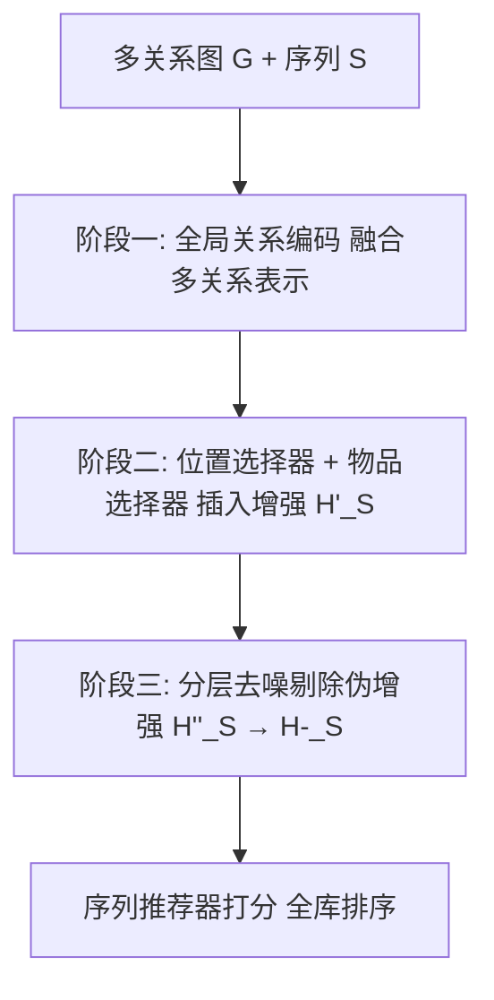

# SSDRec: Self-Augmented Sequence Denoising for Sequential Recommendation (面向序列推荐的自增强序列去噪)

- **会议/期刊**: ICDE 2024
- **作者与机构**: Chi Zhang, Qilong Han, Rui Chen (哈尔滨工程大学)；Xiangyu Zhao (香港城市大学)；Peng Tang (山东大学)
- **推荐链路定位**: 排序前端去噪模块 (作为插件嵌入主流序列推荐器)
- **研究方向**: 自监督对比学习与交互去噪 / 序列与会话推荐
- **论文原文**: [论文原文链接](https://arxiv.org/abs/2403.04278v1)
- **开源代码**: [开源代码仓库链接](https://github.com/zc-97/SSDRec)

## TL;DR (1分钟核心速览)

序列推荐中，现有显式去噪方法仅依赖**单序列内部**信息(顺序性与相似性)，在短序列上易陷入**过度去噪(误删真交互)与不足去噪(漏删噪声)问题(OUPs)**。SSDRec 提出**先去噪前做序列自增强**的三阶段框架：全局关系编码器(1)、自增强选择插入位置与物品(2)、分层去噪并去除伪增强(3)。在 5 个数据集上以 **Full-Ranking** 协议评测，相对最强基线(HSD/DCRec) HR@20 提升 6.4%–9.5%，作为 SASRec 插件平均提升 23.4%–110.6%。

## Background & Motivation (背景与核心矛盾)

- **主流范式**: 隐式去噪(FMLP-Rec 用 FFT 降权噪声)与显式去噪(HSD/DSAN 依据顺序性与相似性直接删噪)均假设"无噪序列体现平滑顺序性和高相似性"。
- **前人局限**: ① 单序列可观测交互太少，尤其短序列上**信号不足以判定噪声归属**；② 误判导致**过度去噪(删掉有效交互)与不足去噪(留下噪声)并存**，图 1 已实证 HSD/STEAM 均存在 OUP。
- **核心洞察 (Key Insight)**: 单序列信息是"信息不完备"，但**跨序列的全局关系(用户相似/相异、物品转移/互斥)可作先验**；在去噪前先"填充"短序列可缓解 OUP 的判定歧义。
- **本文切入点**: 用全局关系图作先验，**先自增强(插入少量物品)再分层去噪**，同时用分层模块回退伪增强，形成"增强→精炼→去噪"闭环。

## Method (核心方法设计)

### 1. 整体框架 (Overall Architecture)

SSDRec 用三阶段闭环：输入用户序列与全体交互构建的**多关系图 $\mathcal{G}$**，阶段一把 5 类关系(用户相似/相异、物品转移/互斥、用户-物品交互)拆成独立关系子图做关系感知消息传递与多关系融合，输出序列物品表示序列$\mathbf{H}_S$；阶段二位置选择器检测"顺序/相似不一致位置"，物品选择器从全库匹配两个物品并左右插入，得到增强序列$\mathbf{H}'_S$；阶段三用同一选择器剔除伪增强后，交给任意显式去噪器(如 HSD)生成无噪子序列$\mathbf{H}^-_S$ 送如 SASRec 的序列推荐器打分。训练时联合优化关系表示、位置/物品选择与排序损失；**推理阶段跳过阶段二增强**(仅用已学习的去噪器)，因增强目的仅在于训练期扩充短序列信息。

### 2. 关键设计拆解 (Key Designs)

1. **全局关系编码器(5 类关系子图先验)**：痛点——单序列无跨序列信号。做法——构建转移(单向，权重 $w^{+}_{ij}=\sum_{u}\frac{n_i-\mathrm{Dis}(v_i,v_j)}{n_i}$)、互斥(无向、共享转移邻居但无转移)、用户相似(Jaccard)、用户相异(不共享物品但共享相似用户)与用户-物品交互子图，各用注意力卷积/GCN 式轻量消息传递分别学习$\mathbf{h}^{+}_v,\mathbf{h}^{-}_v,\mathbf{h}^{u\to v}_v$，再融合得$\mathbf{h}_v=f_v(\mathbf{h}^{+}_v,\mathbf{h}^{-}_v,\mathbf{h}^{u\to v}_v)$。这样短序列里孤立物品也能借全局关系获得可靠语义，为位置选择和插入提供先验。
2. **位置选择器(定位需增强的不一致位置)**：痛点——随机或全位置插入代价大且易引入伪噪。做法——用 Bi-LSTM 双向隐状态判别**顺序性** $\mathbf{r}'_S$与**相似性**$\mathbf{r}''_S$，相乘得一致性分布$\mathbf{r}_S=\mathbf{r}'_S\odot\mathbf{r}''_S$，用 Gumbel-Softmax 可微地挑出"最不一致位置"：$\hat{r}_{s_t}=\frac{\exp((\log r_{s_t}+g_t)/\tau)}{\sum_{s_i}\exp((\log r_{s_i}+g_i)/\tau)}$。高不一致位置即信息最稀缺点，只在其前后插入两枚物品即可显著提升判定质量，避免全序列插入。
3. **物品选择器与分层去噪、训练目标**：同位置上下文向量 $\mathbf{q}^{L},\mathbf{q}^{R}$与全库物品表示$\mathbf{H}_v$内积得分布$\mathbf{k}^{L},\mathbf{k}^{R}$，Gumbel-Softmax 得候选嵌入$\mathbf{h}^{L}_t,\mathbf{h}^{R}_t$，插入成$\mathbf{H}'_S$；阶段三以同一选择器对比原/增强序列$\mathbf{H}''_S=f_{hdm}(\mathbf{H}_S,\mathbf{H}'_S)$，再经去噪器$\mathbf{H}^-_S=f_{den}(\mathbf{H}_S|\mathbf{H}''_S)$。总损失$\mathcal{L}=\mathcal{L}_{rank}+\lambda\mathcal{L}_{rel}$，用量级为$O(|V|)$ 的**全库 softmax + In-batch 负采样**(而非 Ordered 硬负样本)；推理成本仅增加去噪器前向，与 HSD 同阶，**不插入物品**。

## Experimental Setup & Evaluation Protocol (实验设置与评估协议)

- **数据集与预处理**:

| 数据集 | #Users | #Items | #Interactions | Avg.len | 稀疏度 |
| :--- | :---: | :---: | :---: | :---: | :---: |
| Beauty | 22,364 | 12,102 | 198,502 | 8.9 | 99.93% |
| Sports | 35,599 | 18,358 | 296,337 | 8.3 | 99.95% |
| Yelp | 30,495 | 20,062 | 317,078 | 10.4 | 99.95% |
| ML-100K | 944 | 1,350 | 99,287 | 105.3 | 92.21% |
| ML-1M | 6,041 | 3,417 | 999,611 | 165.5 | 95.16% |

均采用 `5-core` 过滤；ML-1M 最大序列长 200、其余 50。

- **数据划分**: `Leave-One-Out`(末位交互作 train/valid/test)。
- **排名评测协议**: `Full-Ranking (全库未交互排序)`，明确规避采样偏差。
- **对照基线与超参**: 传统序列(GRU4Rec/NARM/STAMP/Caser/SASRec/BERT4Rec) + 去噪/去偏(DSAN、FMLP-Rec、HSD、STEAM、DCRec)；$d=100$、batch 256、Adam lr 0.001、早停(valid HR@20 连续 10 轮不升)；显著性$p<0.05$双侧 t 检验；温度$\tau$在$\{10^{-2},\dots,10^{3}\}$ 搜索每 40 batch 退火。

## Key Experimental Results (实验关键数据)

### 1. 主实验对比 (Main Results)

与去噪/去偏 SOTA 对比(表 IV，HR@20 / MRR 加粗最优)：

| Method | ML-100K HR@20 | ML-1M HR@20 | Beauty HR@20 | Sports HR@20 | Yelp HR@20 | ML-100K MRR |
| :--- | :---: | :---: | :---: | :---: | :---: | :---: |
| DSAN | 0.0700 | 0.0651 | 0.0264 | 0.0215 | 0.0541 | 0.0133 |
| FMLP-Rec | 0.0764 | 0.0707 | 0.0284 | 0.0180 | 0.0436 | 0.0160 |
| HSD | 0.1018 | 0.1326 | 0.0674 | 0.0337 | 0.0557 | 0.0234 |
| DCRec | 0.0806 | 0.1111 | 0.0714 | 0.0377 | 0.0611 | 0.0175 |
| STEAM | 0.1220 | 0.0548 | 0.0521 | 0.0251 | 0.0590 | 0.0245 |
| **SSDRec** | **0.1336** | **0.1412** | **0.0776** | **0.0391** | **0.0656** | **0.0290** |
| Improv. | +9.51% | +6.49% | +8.68% | +3.71% | +7.36% | +18.37% |

作为插件接入主流推荐器(表 III)：对 SASRec 平均提升 ML-100K **110.64%**、ML-1M 39.70%、Beauty 39.34%、Sports 51.89%、Yelp 23.40%(均 $p<0.05$)。

### 2. 消融实验 (Ablation Study)

ML-100K 上三阶段拆解(表 V)：

| Variant | HR@10 | HR@20 | N@20 | MRR@20 |
| :--- | :---: | :---: | :---: | :---: |
| w/o SSDRec-1 (无全局关系) | 0.0332 | 0.0707 | 0.0255 | 0.0141 |
| w/o SSDRec-2 (无自增强) | 0.0599 | 0.1178 | 0.0427 | 0.0241 |
| w/o SSDRec-3 (无分层去噪) | 0.0423 | 0.0885 | 0.0294 | 0.0162 |
| HSD (无三阶段, 基线) | 0.0583 | 0.1018 | 0.0401 | 0.0234 |
| **SSDRec** | **0.0795** | **0.1336** | **0.0507** | **0.0290** |

### 3. 关键实验发现 (Key Findings)

1. **全局关系(阶段一)最关键**：移除后 HR@20 从 0.1336 骤降至 0.0707(降 47.1%)，甚至低于 HSD 的 0.1018，说明没有跨序列先验时增强/去噪选择失去监督信号。
2. **自增强有效且非"锦上添花"**：w/o SSDRec-2 得 0.1178，比完整版低 11.8%，比纯 HSD 高 15.7%(证明全局关系有用)，完整版再提升 13.4%——即"先生成增强再判定"确实填平了 OUP。
3. **Transformer 受益最大 + 效率可控**：SASRec 类因注意力先于去噪才能获 110.64% 提升(注意力本身抑制噪声能力有限，靠去噪前置才有效)；训练每 epoch 约 HSD 的 2 倍(ML-1M 119.82s vs 64.61s)，但推理不插物品，Yelp 推理 13.34s 与 HSD 9.90s 接近。

## Highlights & Limitations (亮点、对比与审稿批判)

- **与代表作对比 (vs. Prior Work)**: 相比 HSD/STEAM 仅用单序列"顺序性+相似性"，本文引入**跨序列全局关系图**并在去噪**前**自增强；相比 FMLP-Rec 隐式降权，本文采用**显式删噪 + 伪增强回退**；与 DCRec 的对比学习去偏相比，本文不依赖对齐负样本而直接改造子序列输入。
- **可迁移亮点**: ① "Gumbel-Softmax 硬定位不一致位置"做法可转到会话切分、噪声标签筛选；② "先增强再精炼"范式可套用到长尾冷启动物品表示增强。
- **审稿级局限批判**: ① 全局关系图构建(转移/互斥/相似/相异 4 类子图)与用户-物品图共 $O(\max(|U|,|V|)^2)$建图开销，热搜场景需离线/分片维护；② 阶段二仅插入 2 个物品是效率估计出的超参，序列长度差异大时(如 ML-1M 165 长 vs Sports 8 短)未自适应，且$\tau$ 在大小数据集上最优点不同，超参敏感。

## Rating (四维评分)

- **方法创新性 (Novelty)**: ⭐⭐⭐⭐ （首次将"先去噪前增强"视角引入序列去噪，用 Gumbel-Softmax 实现可微的位置/物品选择，机制新颖但理论分析较弱）
- **评估协议与实验扎实度 (Protocol & Experiments)**: ⭐⭐⭐⭐ （5 数据集 + Full-Ranking + 双侧 t 检验 + 三阶段消融完整，缺采样排序对照与线上 A/B）
- **写作与数学规范度 (Clarity & Rigor)**: ⭐⭐⭐⭐ （三阶段公式清晰、复杂度分析到位；少量符号在图中与正文混用，权重公式叙述略显松散）
- **工业落地与复现价值 (Industrial & Practical Value)**: ⭐⭐⭐⭐ （代码开源、明确推理不插物品便于上线，但全局关系图构建与两倍训练开销对大规模场景仍是门槛）

