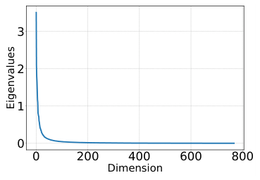
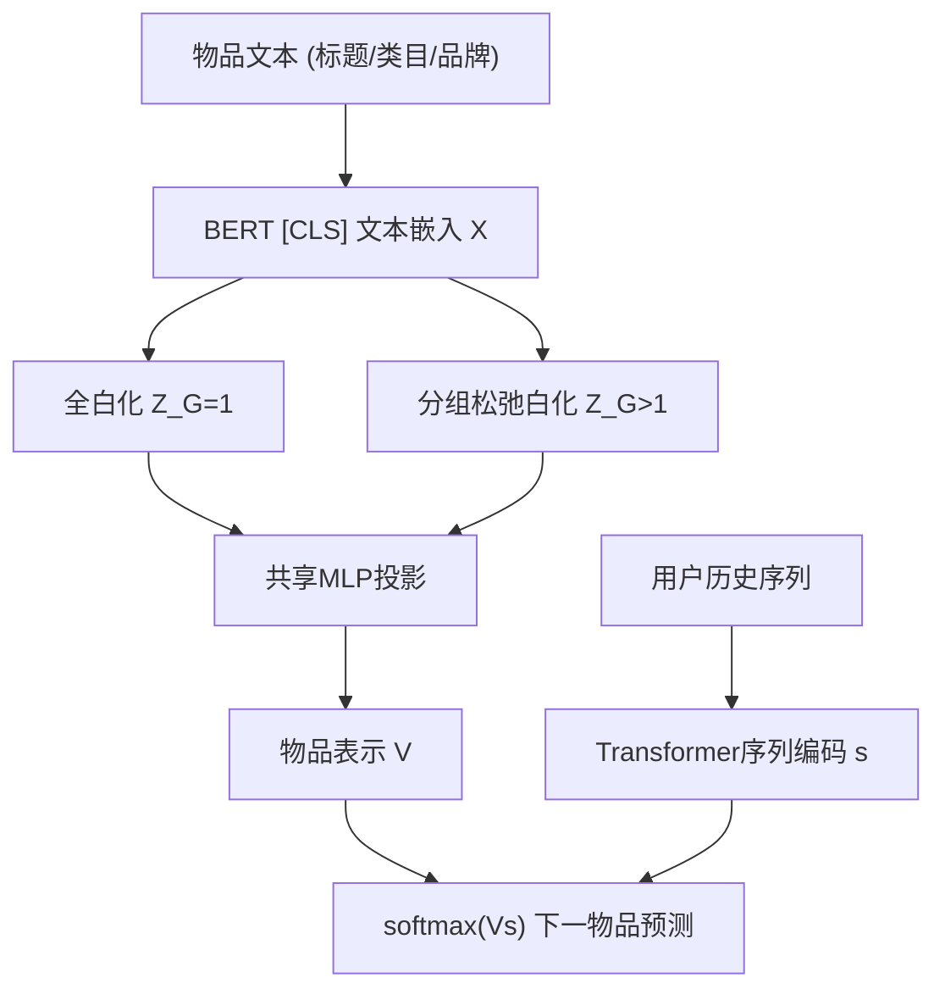
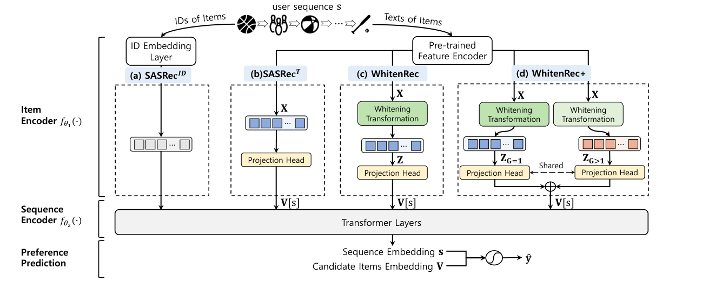

# Are ID Embeddings Necessary? Whitening Pre-trained Text Embeddings for Effective Sequential Recommendation (ID嵌入真的必要吗？面向有效序列推荐的预训练文本嵌入白化)

- **会议/期刊**: ICDE 2024
- **作者与机构**: Lingzi Zhang, Xin Zhou, Zhiwei Zeng, Zhiqi Shen；南洋理工大学、阿里-NTU联合研究院
- **推荐链路定位**: 召回（Next-Item）/端到端序列建模
- **研究方向**: 序列与会话推荐 / 冷启动推荐
- **论文原文**: [https://arxiv.org/abs/2402.10602v1](https://arxiv.org/abs/2402.10602v1)
- **开源代码**: 暂未开源

## TL;DR (1分钟核心速览)

针对预训练文本嵌入各向异性强（物品间平均余弦相似度>0.8）、纯文本序列推荐难以区分物品的问题，本文提出ZCA白化WhitenRec与全/松弛白化集成WhitenRec+。在4个数据集、5-core、Leave-One-Out、Full-Ranking协议下，WhitenRec+的R@20较最佳基线最高提升7.2%（Tools），冷启动Tools R@20较UniSRecT提升80.2%，证明ID嵌入并非必需。

## Background & Motivation (背景与核心矛盾)

- **主流范式**: SASRec类模型依赖随机初始化的ID嵌入；文本增强方法通常将BERT文本嵌入与ID嵌入拼接或对齐，仍将ID视为推荐核心。
- **前人局限**: 纯文本SASRecT在Arts/Toys/Tools多数指标不如SASRecID；BERT [CLS]嵌入呈各向异性，奇异值快速衰减且物品对平均余弦达0.84–0.85，语义不同物品在空间中高度拥挤。
- **核心洞察 (Key Insight)**: 白化可将各向异性文本分布转为各向同性高斯分布，去除轴间相关性，提升用户表示均匀性与嵌入矩阵条件数，从而让纯文本序列模型超过ID+文本模型。
- **本文切入点**: 先用全白化解决退化，再用分组松弛白化保留语义流形，并集成全白化与松弛白化双分支。

<figure class="paper-figure" markdown="span">
  <figcaption>图 2. Arts 数据集中物品文本嵌入的归一化奇异值。为简洁起见，我们省略其他数据集的图，因为它们呈现相似趋势。</figcaption>
</figure>
图 2：Arts数据集物品文本嵌入的归一化奇异值，呈现明显各向异性。

## Method (核心方法设计)

### 1. 整体框架 (Overall Architecture)

输入物品文本描述，经BERT取[CLS]得到$\mathbf{X}\in\mathbb{R}^{d_t\times|\mathcal{I}|}$；先做ZCA白化得到$\mathbf{Z}$，再经共享两层MLP投影为物品表示$\mathbf{V}$；用户序列经Transformer编码为$\mathbf{s}$，以$\hat{\mathbf{y}}=\mathrm{softmax}(\mathbf{V}\mathbf{s})$预测下一物品。WhitenRec+并行使用全白化$G=1$与松弛白化$G>1$两路表示，经共享投影后逐元素相加。训练采用全库softmax交叉熵，无额外负采样；白化为预计算步骤，不增加在线推理分支。

<figure class="paper-figure" markdown="span">
  <figcaption>图 1. 顺序推荐方法四种变体 SASRecID、SASRecT、WhitenRec 和 WhitenRec+ 的总体框架。每种方法由物品编码器、序列编码器和偏好预测层三个组件组成。</figcaption>
</figure>
图 1：SASRecID、SASRecT、WhitenRec、WhitenRec+的总体框架。

### 2. 关键设计拆解 (Key Designs)

1. **ZCA全白化（去各向异性）**：痛点来自文本嵌入维度高度相关、物品难区分。对中心化文本矩阵做$\mathbf{Z}=\Phi(\mathbf{X}-\mu\mathbf{1}^{\top})$，其中$\Phi=\mathbf{D}\Lambda^{-1/2}\mathbf{D}^{\top}$，使$\mathbf{Z}\mathbf{Z}^{\top}=\mathbf{I}_{d_t}$。直觉是消除轴间相关并把物品均匀铺在球面，提升表示均匀性与训练条件数。
2. **分组松弛白化（保留语义流形）**：全白化可能破坏相似文本物品的邻接结构。将$d_t$维切成$G$组，每组独立做ZCA：$\mathbf{Y}^{[h]}=\mathrm{ZCA}(\mathbf{X}^{[h]})$；$G$越大白化越弱、语义保留越多，但过弱会重新聚集。WhitenRec+用共享投影后求和$\mathbf{V}=f_{\theta_1}(\mathbf{Z}_{G=1})+f_{\theta_1}(\mathbf{Z}_{G>1})$，全白化分支保判别性，松弛分支保语义。
3. **训练目标、负采样与推理效率**：总损失为全库softmax交叉熵$\mathcal{L}=-\log \hat{y}_{y}$，不使用Uniform/In-batch负采样。总时间复杂度$O(|s|d_t d+|s|d^2+|s|^2d)$；白化可离线预计算，Tools上参数量1.4M（UniSRec为2.9M），每epoch约63–64s（UniSRec约90s）。

## Experimental Setup & Evaluation Protocol (实验设置与评估协议)

- **数据集与预处理**: 采用5-core过滤，保留交互数≥5的用户和物品。

| 数据集 | #Users | #Items | #Interactions | 密度 | 特征/场景说明 |
| :--- | :---: | :---: | :---: | :---: | :--- |
| Arts | 45,486 | 21,019 | 349,664 | 0.0366% | Amazon Arts/Crafts |
| Toys | 85,694 | 40,483 | 618,738 | 0.0178% | Amazon Toys/Games |
| Tools | 90,599 | 36,244 | 623,248 | 0.0190% | Amazon Tools/Instruments |
| Food | 28,988 | 12,910 | 274,509 | 0.0734% | Allrecipes食谱 |

- **数据划分与防穿越 (Splitting Strategy)**: 采用`Leave-One-Out`：每个用户最后1个交互作测试、倒数第2个作验证、其余训练；冷启动设置随机移除15%物品及其全部交互，验证/测试保留含冷物品的目标序列。
- **排名评测协议 (Ranking Protocol)**: 无偏`Full-Ranking`，在完整物品集上排序且不采样；报告R@20/50与N@20/50。
- **对比基线与超参设置**: 对比BM3、SASRecID、CL4SRec、SASRecT、SASRecT+ID、FDSA、UniSRec(T/T+ID)、VQRec等；嵌入维度$d=300$，最大序列长度50，batch=1024，2层Transformer/2头，投影头MLP-2，Adam，早停；显著性用配对t检验$p<0.01$。

## Key Experimental Results (实验关键数据)

### 1. 主实验对比 (Main Results)

表 1：暖启动主实验（R@20 / N@20），粗体为最优，Δ为WhitenRec+相对最佳基线的提升。

| 模型 | Arts R@20 | Arts N@20 | Toys R@20 | Toys N@20 | Tools R@20 | Tools N@20 | Food R@20 | Food N@20 |
| :--- | :---: | :---: | :---: | :---: | :---: | :---: | :---: | :---: |
| BM3 | 0.1233 | 0.0642 | 0.0965 | 0.0478 | 0.0530 | 0.0299 | 0.0540 | 0.0215 |
| SASRecID | 0.1410 | 0.0776 | 0.1121 | 0.0467 | 0.0712 | 0.0418 | 0.0520 | 0.0208 |
| CL4SRec | 0.1388 | 0.0653 | 0.1094 | 0.0426 | 0.0781 | 0.0385 | 0.0531 | 0.0214 |
| SASRecT | 0.1476 | 0.0721 | 0.0983 | 0.0429 | 0.0739 | 0.0386 | 0.0541 | 0.0220 |
| SASRecT+ID | 0.1435 | 0.0766 | 0.1163 | 0.0511 | 0.0728 | 0.0445 | 0.0547 | 0.0222 |
| FDSA | 0.1284 | 0.0785 | 0.0895 | 0.0475 | 0.0633 | 0.0432 | 0.0518 | 0.0210 |
| UniSRec(T+ID) | 0.1611 | 0.0774 | **0.1257** | 0.0513 | 0.0828 | 0.0420 | 0.0555 | 0.0223 |
| VQRec | 0.1390 | 0.0734 | 0.1075 | 0.0468 | 0.0734 | 0.0423 | 0.0471 | 0.0189 |
| WhitenRec | 0.1625 | 0.0796 | 0.1201 | 0.0521 | 0.0861 | 0.0453 | 0.0569 | 0.0227 |
| **WhitenRec+** | **0.1688** | **0.0810** | **0.1257** | **0.0537** | **0.0888** | **0.0462** | **0.0586** | **0.0234** |
| **Δ vs 最佳基线** | +4.8% | +3.2% | 0.0% | +4.7% | +7.2% | +3.8% | +5.6% | +4.9% |

### 2. 消融实验 (Ablation Study)

表 2：核心组件消融（Arts/Toys/Tools，R@20 / N@20）。

| 变体 | Arts R@20 | Arts N@20 | Toys R@20 | Toys N@20 | Tools R@20 | Tools N@20 | 说明 |
| :--- | :---: | :---: | :---: | :---: | :---: | :---: | :--- |
| SASRecT | 0.1476 | 0.0721 | 0.0983 | 0.0429 | 0.0739 | 0.0386 | 纯文本，无白化 |
| WhitenRec | 0.1625 | 0.0796 | 0.1201 | 0.0521 | 0.0861 | 0.0453 | 全白化$G=1$ |
| WhitenRec+ | **0.1688** | **0.0810** | **0.1257** | **0.0537** | **0.0888** | **0.0462** | 全白化+松弛白化集成 |

### 3. 关键实验发现 (Key Findings)

1. **白化是纯文本序列推荐的关键增益**：WhitenRec将R@20从SASRecT的0.1476/0.0983/0.0739提升至0.1625/0.1201/0.0861，Arts/Toys/Tools分别+10.1%/+22.2%/+16.5%，说明去除各向异性比单纯增加ID嵌入更有效。
2. **双分支集成进一步增益且利好冷启动**：WhitenRec+较WhitenRec在Arts/Toys/Tools R@20再+3.9%/+4.7%/+3.1%；冷启动Tools R@20达0.0537，较UniSRecT的0.0298提升80.2%，Arts/Toys分别提升12.3%/20.6%。
3. **ZCA优于参数化白化，且加回ID反而掉点**：Arts R@20上ZCA为0.1688，PW仅0.1243、PCA为0.1283；WhitenRec+加入ID后Arts从0.1688降至0.1434、Tools从0.0888降至0.0741，支持“ID嵌入非必要”的核心论点。

## Highlights & Limitations (亮点、对比与审稿批判)

- **与代表作对比 (vs. Prior Work)**: SASRecT直接使用BERT文本但未处理各向异性；UniSRec用参数化线性白化和MoE适配器，但PW无法保证输出真正去相关，本文ZCA在Arts R@20高约35.8%（0.1688 vs 0.1243）；S3-Rec/FDSA依赖属性预测或特征注意力，未从文本几何退化角度切入。
- **可迁移亮点**: 对物品文本、多模态内容嵌入预计算ZCA/分组白化，可作为即插即用预处理；共享投影后逐元素求和的双白化集成，可用于冷启动与跨域文本表示。
- **审稿级局限批判**: 分组数$G$数据集相关（Food最优为64），全白化仍可能破坏语义流形；仅在4个公开数据集验证，无线上A/B；依赖BERT离线编码，协方差白化预计算有$O(d^3)$开销；ID与白化文本的最优融合方式未充分探索，且暂未开源代码。

## Rating (四维评分)

- **方法创新性 (Novelty)**: ⭐⭐⭐⭐ （从文本各向异性角度重审ID必要性，全/松弛白化集成有新意，但白化本身非全新）
- **评估协议与实验扎实度 (Protocol & Experiments)**: ⭐⭐⭐⭐⭐ （4数据集、5-core、Leave-One-Out、Full-Ranking、冷启动与$p<0.01$显著性检验完整）
- **写作与数学规范度 (Clarity & Rigor)**: ⭐⭐⭐⭐ （均匀性、条件数与信息重构分析清晰，公式与复杂度交代充分）
- **工业落地与复现价值 (Industrial & Practical Value)**: ⭐⭐⭐⭐ （白化可离线预计算、参数量更少且利好冷启动；但依赖BERT且暂无开源代码）

