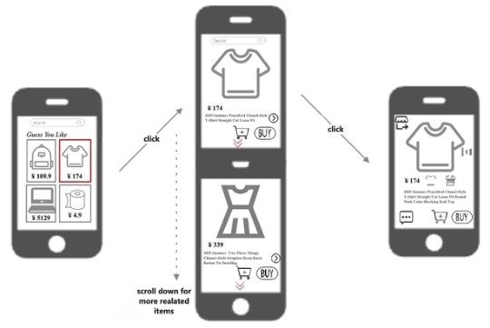
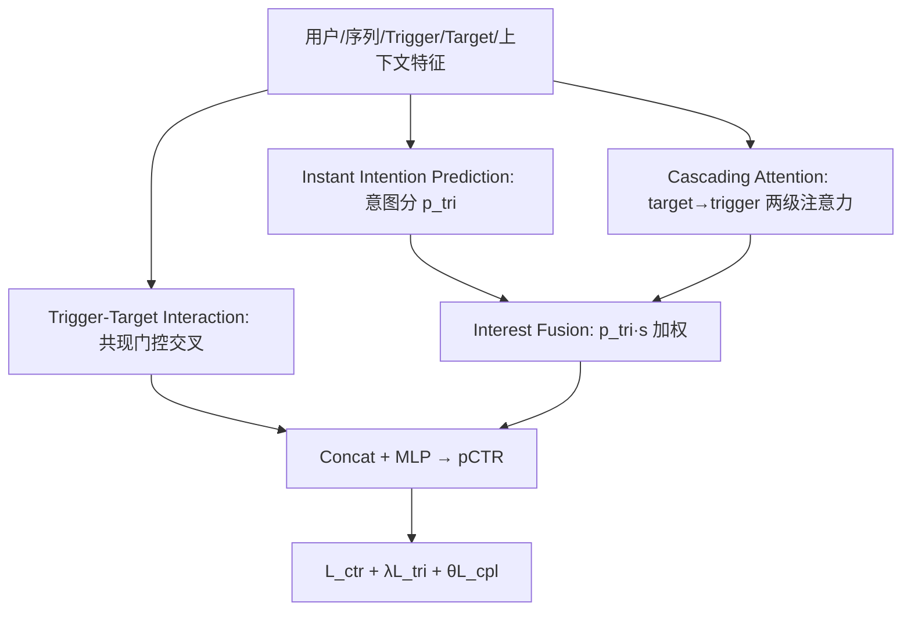

# Cascading Relevance-driven Recommendation Network for CTR Prediction in Trigger-Introduced Recommendation (触发式推荐中级联相关性驱动 CTR 网络)

- **会议/期刊**: ICDE 2026
- **作者与机构**: Kaixuan Chen, Wenwen Wang, Xing Fang, Yang Huang, Jing Wang（阿里巴巴淘天集团）
- **推荐链路定位**: 精排（TIR 场景下的 CTR 预估）
- **研究方向**: CTR/CVR 预估与特征交叉 / 序列与会话推荐
- **论文原文**: [https://arxiv.org/abs/2608.22973v1](https://arxiv.org/abs/2608.22973v1)
- **开源代码**: [https://github.com/a-little-cabbage/CRRN](https://github.com/a-little-cabbage/CRRN)

## TL;DR (1分钟核心速览)

触发式推荐（TIR）中用户点击的 trigger item 承载"模糊而强烈"的即时兴趣，但现有 TIR 方法（DIHN/DIAN/DEI²N）只着力于"意图强度估计"，忽视了 trigger 与候选 target 之间的**相关性学习**。CRRN 用门控式显隐交叉层、级联注意力兴趣融合（用预测意图分与余弦相似度加权 instant/personalized 兴趣）与类目辅助成对损失显式强化相关性，在 4.5 亿样本工业集与 2655 万公共集上 AUC 相对提升 6.31%/7.18%，线上 A/B pCTR +3.87%。

## Background & Motivation (背景与核心矛盾)

- **主流范式**: 工业精排以 DIN/SIM 式行为序列注意力建模长期偏好，TIR 变体（DIHN、DIAN、DEI²N）额外引入 trigger 特征估计"即时兴趣强度"并按权重融合两路兴趣。
- **前人局限**: ①trigger 与 target 仅做简单拼接或逐元素相乘，无法表达"同款/同类/跨类"这种高阶交叉语义；②意图分被当作唯一融合开关，当 trigger 与 target 高度相似时仍按同一权重缩放，**触发相关性的强弱信号被稀释**。
- **核心洞察 (Key Insight)**: 作者统计 trigger–target 类目共现的 CTR 矩阵（图 3），发现对角线上（同类别）平均 CTR 显著高于其他位置，说明"相关性"本身是独立的强信号，而非意图分的附属品。
- **本文切入点**: 把相关性从隐式的注意力权重里"提"出来，一路放进特征交叉的 gate，一路放进注意力融合的加权项，最后再放进损失函数的偏序关系里。

<figure class="paper-figure" markdown="span">
  <figcaption>图1. TIR 场景示意图。左：首页推荐；中：触发诱导推荐；右：详情推荐。</figcaption>
</figure>

## Method (核心方法设计)

### 1. 整体框架 (Overall Architecture)

输入五类特征：用户画像 $\mathbf{E}_u$、行为序列$\mathbf{E}_{seq}$（长度 100）、trigger$\mathbf{E}_t$、target$\mathbf{E}_i$、上下文$\mathbf{E}_c$。主链路分三支并行：Trigger-Target Interaction 层用共现特征$\mathbf{E}_{co}$（同类目/同品牌/同价位）驱动双层门控，对$\mathbf{E}_t \odot \mathbf{E}_i$做个性化重标定得到$\mathbf{V}_{in}$；Cascading Interest Fusion 先用 target 作 query 聚合行为序列得$\mathbf{V}_{tar}$，再以 trigger 作 query 二次注意力得$\mathbf{V}_{tri}$，并用预测意图分$\hat{p}_{tri}$与余弦相似度$s$自适应加权成$\mathbf{V}_{fuse}$；训练侧叠加 CTR 主损失、意图辅助损失与类目辅助成对损失。三支输出与原始特征拼接后经 MLP 输出点击概率，意图标签仅在训练期使用，推理零开销。

### 2. 关键设计拆解 (Key Designs)

1. **Trigger-Target Interaction（显隐混合交叉门控）**：痛点是把两物品特征直接相乘只能表达"共同激活"，无法区分"同类目强相关"与"跨类目弱相关"。做法是用共现特征生成逐维门控再乘回交叉项：$\mathbf{V}_{in} = \mathrm{gate}(\mathbf{E}_{co}) \odot \mathbf{E}_t \odot \mathbf{E}_i$，其中$\mathrm{gate}(\mathbf{x}) = \sigma(\mathbf{W}_1 \cdot \mathrm{ReLU}(\mathbf{W}_0\mathbf{x}+\mathbf{b}_0)+\mathbf{b}_1)$。物理直觉：$\mathbf{E}_t \odot \mathbf{E}_i$提供稠密交叉基底，$\mathrm{gate}(\mathbf{E}_{co})$ 提供稀疏、可解释的语义闸门，避免高阶交叉网络在 trigger 稀疏特征上过拟合。

2. **Cascading Interest Fusion（级联注意力 + 意图/相似度双门控）**：痛点是把 trigger 与 target 的注意力输出简单拼接会"淹没"trigger。先把 target 当 query 聚合行为序列：$\mathbf{V}_{tar}=\mathrm{MHA}(\mathbf{Q}=\mathbf{E}_i,\mathbf{K}=\mathbf{V}=\mathbf{E}_{seq})$，再令 trigger 作 query 对$\mathbf{V}_{tar}$二次注意力得$\mathbf{V}_{tri}$，形成 user→target→trigger 的三元级联；最终$\mathbf{V}_{fuse} = \hat{p}_{tri}\cdot s(\mathbf{E}_t,\mathbf{E}_i)\cdot\mathbf{V}_{tri} + (1-\hat{p}_{tri})(1-s)\cdot\mathbf{V}_{tar}$，$s=\cos(\mathbf{E}_t,\mathbf{E}_i)$。直觉：意图分管"用户此刻有多想买"，相似度管"这个候选有多像 trigger"，二者同向增强 trigger 兴趣、反向则回退到个性化兴趣，天然形成"相关性 vs 探索"的连续谱。意图标签定义为"页面内点击了与 trigger 同类目的商品"，由$\mathcal{L}_{tri}$ 监督。

3. **Category-assisted Pairwise Loss 与总目标**：注意力对相关性的刻画过于隐式，故在损失中植入四段偏序：$\text{相关点击} \succ \text{不相关点击} \succ \text{相关曝光} \succ \text{不相关曝光}$，用成对 logistic 形式 $\mathcal{L}_{cpl}=-\frac{1}{N^2}\sum_{i,j}\left[y^p\log(\hat{y}_i-\hat{y}_j)+(1-y^p)\log(1-(\hat{y}_i-\hat{y}_j))\right]$约束打分差。总损失$\mathcal{L}=\mathcal{L}_{ctr}+\lambda\mathcal{L}_{tri}+\theta\mathcal{L}_{cpl}$，$\lambda=0.2,\theta=0.5$。训练用 Adagrad（lr 0.001，decay 0.95）、batch 1024、4 epoch；无额外负采样设计，成对项在 batch 内枚举。推理仅增加一个 MLP 与一次余弦，L20 上时延 45ms（基线 42ms），满足 150ms 服务约束。

## Experimental Setup & Evaluation Protocol (实验设置与评估协议)

- **数据集与预处理**:

| 数据集 | #Users | #Items | #Interactions | 稀疏度 | 特征/场景说明 |
| :--- | :---: | :---: | :---: | :---: | :--- |
| Industrial (Tmall) | 7,692,277 | 22,512,661 | 449,786,531 | ≈2.6e-6 | 2025-08-20~10-20 全量日志，含用户/序列/trigger/target/上下文五类特征 |
| Public (Alibaba Ad) | 1,366,056 | 846,812 | 26,557,962 | ≈2.3e-5 | 非原生 TIR，按 DIHN 方案把样本前 4 小时内最近点击物品定义为 trigger，无 trigger 样本丢弃 |

- **数据划分与防穿越**: 工业集为**全局时间戳切分**——8/20–10/20 训练，10/20 与 10/21 分别作验证/测试（各约 700 万样本）；公共集沿用 DIHN 划分，未见 5-core 过滤。
- **排名评测协议**: 属**CTR 二分类点式评估**，指标为 `AUC` 与 `RelaImpr`（$\text{RelaImpr}=(\frac{\text{AUC}_{\text{model}}-0.5}{\text{AUC}_{\text{base}}-0.5}-1)\times100\%$，base=DIN+TRA），**未采用 Full-Ranking 全库排序**，亦未报告校准指标（PCOC/ECE）。
- **对比基线与超参**: 5 个 TIR 系 SOTA——Wide&Deep+TIR、DIN+TAR、DIHN、DIAN、DEI²N；序列长度 100，不足 mask、超出截断；未报告 embedding 维度与显著性检验。

## Key Experimental Results (实验关键数据)

### 1. 主实验对比 (Main Results)

| Model | Industrial AUC | RelaImpr | Public AUC | RelaImpr |
| :--- | :---: | :---: | :---: | :---: |
| Wide&Deep+TIR | 0.6634 | -0.85% | 0.6310 | -3.03% |
| DIN+TAR | 0.6648 | 0.00% | 0.6351 | 0.00% |
| DIHN (WWW'22) | 0.6664 | +0.97% | 0.6388 | +2.74% |
| DIAN (WWW'23) | 0.6693 | +2.73% | 0.6408 | +4.22% |
| DEI²N (WSDM'24) | 0.6723 | +4.55% | 0.6428 | +5.70% |
| **CRRN (Ours)** | **0.6752** | **+6.31%** | **0.6448** | **+7.18%** |

### 2. 消融实验 (Ablation Study)

| 变体 | TTI | CIF | CPL | AUC | RelaImpr |
| :--- | :---: | :---: | :---: | :---: | :---: |
| Baseline (DIN+TRA) | ✗ | ✗ | ✗ | 0.6648 | 0.00% |
| B + TTI | ✓ | ✗ | ✗ | 0.6702 | +3.27% |
| B + CIF | ✗ | ✓ | ✗ | 0.6726 | +4.73% |
| B + CPL | ✗ | ✗ | ✓ | 0.6691 | +2.61% |
| **CRRN** | ✓ | ✓ | ✓ | **0.6752** | **+6.31%** |
| CRRN-price（意图标签换价位） | ✓ | ✓ | ✓ | 0.6735 | +5.28% |
| CRRN-brand | ✓ | ✓ | ✓ | 0.6721 | +4.43% |
| CRRN-shop | ✓ | ✓ | ✓ | 0.6718 | +4.25% |
| CRRN-MLP（相似度换 MLP） | ✓ | ✓ | ✓ | 0.6739 | +5.52% |
| CRRN-bilinear | ✓ | ✓ | ✓ | 0.6747 | +6.01% |
| CRRN-CL（对比预训练） | ✓ | ✓ | ✓ | 0.6743 | +5.76% |

### 3. 关键实验发现 (Key Findings)

1. **三模块互补而非冗余**：单模块增益为 +0.54/+0.78/+0.43（绝对 AUC），全模型 +1.04，超过任一单模块之和的上限区间（RelaImpr 6.31% > 4.73%），说明 CIF 提供的"意图×相似度"双门控与 CPL 的显式偏序约束作用于不同信号面；其中 CIF 单项贡献最大，印证"融合策略比交叉特征更关键"。
2. **相关性定义的粒度决定收益上限**：意图标签取类目（0.6752）显著优于价位/品牌/店铺（0.6735/0.6721/0.6718），与特征重要性排序完全一致（category coaction 0.0071 > price 0.0026 > brand 0.0011 > shop 0.00079）。品牌/店铺覆盖的商品过于发散，无法刻画"即时兴趣"的窄带粒度——这是 TIR 与常规推荐的关键分布差异。
3. **固定度量优于可学习度量**：相似度用不可学习余弦（0.6752）优于双线性（0.6747）、对比预训练（0.6743）与 MLP（0.6739），印证可学习度量会把 trigger-target 相似度"带偏"到用户偏好方向，破坏其作为语义锚点的作用。线上侧，CRRN 把同类别推荐占比从 40.51% 拉到 67.45%、跨类目从 52.33% 压到 11.24%，但刻意保留 11.24% 多样性以避免"满屏同款"疲劳；IPV +5.75%、PV +3.25%、CTR 3.11%→3.23%（+3.87%）。

## Highlights & Limitations (亮点、对比与审稿批判)

- **与代表作对比 (vs. Prior Work)**: 相较 DIHN/DIAN 只在"意图强度"上做加法（意图网络 → 双分支加权 → 时序演化），CRRN 首次把"相关性"当作独立可监督对象（特征门控 + 融合权重 + 损失偏序三重注入）；相较 R3S 依赖语义相似度而丢弃行为序列，CRRN 通过级联注意力同时保留长序列表征。
- **可迁移亮点**: ①"target→trigger"两级级联注意力可作为通用 query 级联范式，迁移到搜索后推荐、跨场景承接页等双 query 场景；②用不可学习余弦做门控权重，是抑制可学习度量漂移的低成本正则技巧。
- **审稿级局限批判**: ①公共集 trigger 由"4 小时窗口 + 最近点击"启发式构造，并非原生 TIR 分布，且评估仅 AUC，缺少 Full-Ranking、校准（PCOC）与冷启动分桶，对精排排序质量与偏差鲁棒性的说服力有限；②CPL 直接对打分差取 $\log(\hat{y}_i-\hat{y}_j)$而无 sigmoid 压缩，差值为负或接近 0 时数值不稳定，$N^2$ 全对枚举的复杂度与实际训练耗时（134 min 与 DIHN 持平）之间存在表述张力；③类目信号被重复使用三次（共现门控、意图标签、CPL 相关性定义），存在信号同源与标签泄漏风险，在需要跨类目探索的场景可能过度收敛；时间分析仅 1 epoch，未报告 embedding 维度与显著性检验。

## Rating (四维评分)

- **方法创新性 (Novelty)**: ⭐⭐⭐ （门控交叉、级联注意力与成对损失均为既有组件的组合式创新，但"相关性作为独立监督对象"的建模视角有清晰增量）
- **评估协议与实验扎实度 (Protocol & Experiments)**: ⭐⭐⭐⭐ （4.5 亿工业样本 + 时间切分 + 7 天线上 A/B 与细粒度类目统计，链路完整；但指标仅 AUC、公共集 trigger 为启发式构造）
- **写作与数学规范度 (Clarity & Rigor)**: ⭐⭐⭐ （三模块表述清楚、公式编号完整，但式 11 的成对形式缺 sigmoid、式 8/9 的权重项未归一化，符号与意图标签定义交代偏简）
- **工业落地与复现价值 (Industrial & Practical Value)**: ⭐⭐⭐⭐⭐ （已在线服务、推理仅 +2ms，代码开源，模块可插拔且不依赖额外特征工程，工程迁移成本低）

