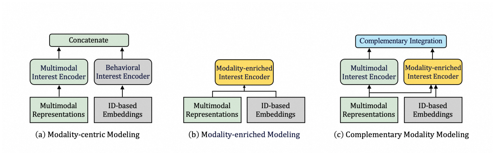
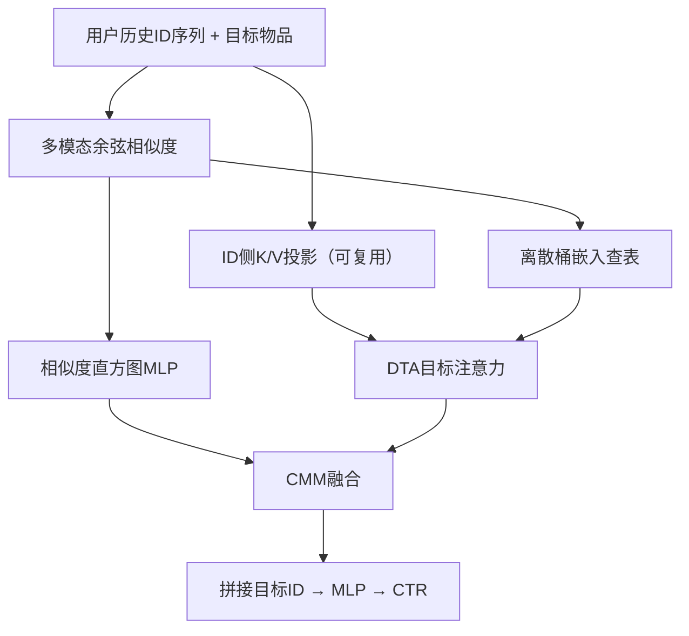
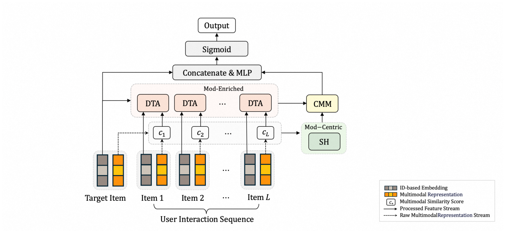

# Decoupled Multimodal Fusion for User Interest Modeling in Click-Through Rate Prediction（面向CTR预测用户兴趣建模的解耦多模态融合）

- **会议/期刊**: ICDE 2026
- **作者与机构**: Alin Fan, Hanqing Li, Sihan Lu, Jingsong Yuan, Jiandong Zhang；阿里巴巴国际数字商业集团、中国人民大学
- **推荐链路定位**: 精排
- **研究方向**: CTR/CVR预估与特征交叉 / 多模态推荐
- **论文原文**: [论文原文链接](https://arxiv.org/abs/2510.11066v3)
- **开源代码**: 暂未开源

## TL;DR (1分钟核心速览)

针对多模态CTR中“ID行为信号与内容语义割裂”以及目标感知相似度导致K/V逐候选重算的痛点，DMF用解耦目标注意力DTA将多模态相似度离散为可复用查表嵌入，并以CMM融合语义直方图与行为级兴趣。在Amazon与Lazada工业数据上，DMF相对SASRec的AUC提升4.75%/1.72%，线上CTCVR +5.30%、GMV +7.43%。

## Background & Motivation (背景与核心矛盾)

- **主流范式**: 工业CTR采用两阶段框架：冻结RoBERTa/ViT等多模态编码器，将ID序列与多模态表示通过相似度直方图或注意力侧信息融合。
- **前人局限**: ① 现有方法多为“以模态为中心”，ID嵌入与多模态表示独立编码，难以捕捉内容语义与行为信号的细粒度交互；② 若把目标-历史相似度作为target-aware侧信息输入Target Attention，则每个候选物品都需重算K/V，在上千候选的精排场景不可接受。
- **核心洞察 (Key Insight)**: 多模态相似度是目标感知特征，但ID侧K/V是目标无关节点，可跨候选复用；只需将相似度用离散桶嵌入注入，即可兼顾表达力与缓存复用。
- **本文切入点**: 提出DTA解耦融合，并用CMM统一“语义泛化”与“行为个性化”两条路径。

<figure class="paper-figure" markdown="span">
  <figcaption>图 1. (a) 以模态为中心的建模：基于 ID 的嵌入和多模态表示独立编码，在用户兴趣建模过程中没有细粒度交互。 (b) 模态增强建模：多模态表示作为侧信息集成到兴趣编码器中，在用户兴趣建模过程中实现内容语义与行为信号之间的细粒度交互。 (c) 互补模态建模（CMM）：一种结构化融合策略，结合以模态为中心和模态增强的路径。这种混合方法产生全面的使用</figcaption>
</figure>

## Method (核心方法设计)

### 1. 整体框架 (Overall Architecture)

DMF先由冻结多模态编码器得到目标与历史物品表示，计算余弦相似度；相似度一路进入直方图MLP得到模态中心兴趣，另一路离散化后查表得到K/V增强嵌入，与ID侧可复用K/V逐元素相加后做目标注意力，得到模态增强兴趣；CMM按权重$\alpha$融合两路用户表示，再与目标ID拼接经MLP输出CTR。训练用BCE，推理复用$K_{id},V_{id}$，仅查表与注意力增量计算。

<figure class="paper-figure" markdown="span">
  <figcaption>图 2. DMF 框架。多模态表示用于计算目标物品与每个历史交互物品之间的相似度分数。这些分数被离散化并映射为可学习的嵌入，作为 DTA 模块的输入，而 SH（相似度直方图）直接作用于原始相似度分数。Mod-Centric 和 Mod-Enriched 分别表示以模态为中心和模态增强的建模策略。得到的用户兴趣表示由 CMM 模块融合，并与目标物品结合用于 CTR 预测。</figcaption>
</figure>

### 2. 关键设计拆解 (Key Designs)

1. **Target-aware多模态相似度侧信息**：直接拼接原始多模态向量会受语义空间错位影响，本文以目标-历史余弦相似度作为对齐代理：$c_j=\frac{m_c^\top m_j}{\|m_c\|_2\|m_j\|_2}$，$c_j\in[-1,1]$。相似度只保留关系信号，避免跨空间硬对齐，同时天然适配CTR目标感知建模。

2. **Decoupled Target Attention (DTA)**：早期融合把$c_j$与ID嵌入先拼接再投影，使K/V成为target-aware节点，需对$B$个候选重复计算；DTA将相似度等频离散为$b_j=\mathrm{bucket}(c_j)$，查表得$e^{K}_{b_j},e^{V}_{b_j}$，再令$K_{DTA}=K_{id}+E^{K}_{sim}$、$V_{DTA}=V_{id}+E^{V}_{sim}$，其中$K_{id}=SW_k^\top,V_{id}=SW_v^\top$可跨候选复用。查表为常时操作，避免线性投影的$B$倍重算；论文还给出粗桶容量足够时与早期融合近似等价的定理。

3. **Complementary Modality Modeling (CMM)**：仅做行为级融合会低估多模态整体兴趣，仅做直方图又缺少细粒度行为交互。CMM令$r_u=\alpha r_{me}+(1-\alpha)r_{mc}$：$r_{me}$来自DTA，强调“哪些语义相关物品在行为上更重要”；$r_{mc}$来自相似度直方图MLP，提供稀疏行为下的语义先验。损失为常规BCE：$\mathcal{L}=-\frac{1}{|\mathcal{D}|}\sum_i[y_i\log\hat{y}_i+(1-y_i)\log(1-\hat{y}_i)]$；负样本为训练样本内随机采样，无额外难负采样。

## Experimental Setup & Evaluation Protocol (实验设置与评估协议)

- **数据集与预处理**:

| 数据集 | #Users | #Items | #Samples | 稀疏度/密度 | 特征/场景说明 |
| :--- | :---: | :---: | :---: | :---: | :--- |
| Amazon Electronics | 192k | 63k | 1.7M | 5-core过滤 | 评论文本+图片，用户时序交互 |
| Industry (Lazada泰国) | 8.7M | 20.9M | 469M | 工业日志 | 近100次交互，多模态冻结表示 |

- **数据划分与防穿越 (Splitting Strategy)**: Amazon按用户交互时序，以第$T$个交互为正、随机另一交互为负；工业数据按全局时间切分，前19天训练、第20天测试。
- **排名评测协议 (Ranking Protocol)**: 点式CTR评估，**非Full-Ranking全库排序**；采用采样负例的AUC与GAUC，线上看CTCVR/GMV。工业场景中AUC/GAUC提升0.1%即视为显著。
- **对比基线与超参设置**: 基线含SASRec、DIN、TA、BFSMF、SIMTIER、MAKE；ID嵌入32维，Amazon注意力4头/32维、batch 128，工业4头/128维、batch 1024，桶数$M=35$，5次运行取均值±std。

## Key Experimental Results (实验关键数据)

### 1. 主实验对比 (Main Results)

| 模型 | Amazon AUC (Δ vs SASRec) | Industry AUC (Δ) | Industry GAUC (Δ) |
| :--- | :---: | :---: | :---: |
| SASRec | 0.7776 (-) | 0.6491 (-) | 0.6048 (-) |
| DIN | 0.7806 (+0.30%) | 0.6508 (+0.17%) | 0.6058 (+0.10%) |
| TA | 0.7798 (+0.22%) | 0.6538 (+0.47%) | 0.6080 (+0.32%) |
| BFSMF | 0.7823 (+0.47%) | 0.6579 (+0.88%) | 0.6109 (+0.61%) |
| SIMTIER | 0.8090 (+3.14%) | 0.6629 (+1.38%) | 0.6135 (+0.87%) |
| MAKE | 0.8145 (+3.69%) | 0.6623 (+1.32%) | 0.6154 (+1.06%) |
| DTA | 0.8214 (+4.38%) | 0.6645 (+1.54%) | 0.6158 (+1.10%) |
| **DMF** | **0.8251 (+4.75%)** | **0.6663 (+1.72%)** | **0.6177 (+1.29%)** |

### 2. 消融实验 (Ablation Study)

| 变体 | Industry AUC | Industry GAUC | ΔAUC vs DTA |
| :--- | :---: | :---: | :---: |
| TA early | 0.6644 | 0.6159 | -0.01% |
| TA late | 0.6615 | 0.6145 | -0.30% |
| DTA non-invasive | 0.6624 | 0.6129 | -0.21% |
| **DTA** | **0.6645** | **0.6158** | - |

### 3. 关键实验发现 (Key Findings)

- DMF在Amazon上AUC 0.8251，较最强多模态基线MAKE高0.0106（相对+1.30%）；工业AUC 0.6663、GAUC 0.6177均最优，说明DTA细粒度融合与CMM语义泛化互补有效。
- 早期融合TA_early的AUC 0.6644与DTA 0.6645几乎持平，但DTA在1200候选、长度400、128维下吞吐高200%，K/V计算FLOPs由13.10G降至0.13G（约100×），证明解耦主要收益在推理可复用。
- CMM的$\alpha$呈数据分布依赖：Amazon短序列用户占84.75%，最优$\alpha=0.3$；工业长序列用户占89.35%，最优$\alpha=0.7$；$\alpha=0$始终最差，说明纯语义直方图不足以个性化，纯行为融合又缺少稀疏场景鲁棒性。

## Highlights & Limitations (亮点、对比与审稿批判)

- **与代表作对比 (vs. Prior Work)**: 相比SIMTIER/MAKE，DMF不再把多模态仅作为独立直方图或预训练迁移，而将其作为target-aware侧信息注入注意力；相比TA/DIN，DTA保留目标注意力表达力，同时让ID侧K/V可缓存复用，避开早期融合的$B$倍重算。
- **可迁移亮点**: “target-agnostic主干+target-aware离散查表注入”可迁移到价格、类目、地理位置等目标相关侧信息；CMM的$\alpha$按用户活跃度分段设置也适合冷启动/低活用户场景。
- **审稿级局限批判**: 多模态表示仍冻结且依赖余弦相似度，编码器偏差会直接传导；离线仅报告采样负例AUC/GAUC，缺少Full-Ranking与冷启动分桶，线上A/B也仅单市场12天。理论等价性只针对简化线性融合，未覆盖完整注意力泛化误差。

## Rating (四维评分)

- **方法创新性 (Novelty)**: ⭐⭐⭐⭐ （解耦目标注意力把target-aware侧信息转为可复用查表，工程与建模结合巧妙，理论证明稍简化）
- **评估协议与实验扎实度 (Protocol & Experiments)**: ⭐⭐⭐⭐ （公有+工业数据、5次运行与线上A/B较完整，但缺全库排序和冷启动分桶）
- **写作与数学规范度 (Clarity & Rigor)**: ⭐⭐⭐⭐ （DTA公式、FLOPs与复杂度对比清楚，等价性定理适用范围有限）
- **工业落地与复现价值 (Industrial & Practical Value)**: ⭐⭐⭐⭐⭐ （Lazada上线，CTCVR +5.30%、GMV +7.43%，吞吐3倍且延迟近零增量，复现价值高但未开源）

