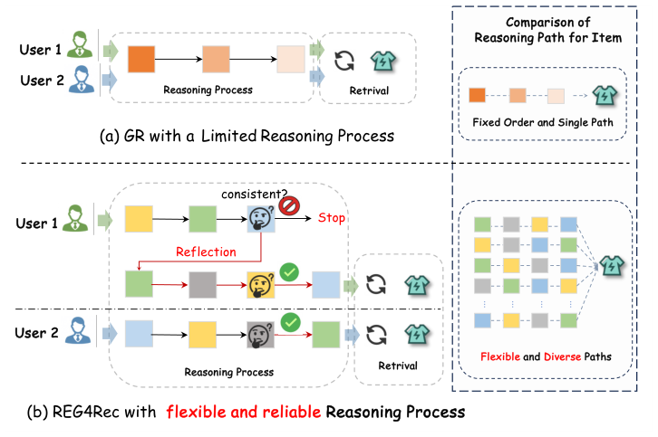
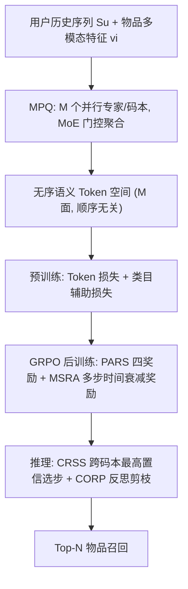

# REG4Rec: Reasoning-Enhanced Generative Model for Large-Scale Recommendation Systems (面向大规模推荐系统的推理增强生成式模型)

- **会议/期刊**: ICDE 2026
- **作者与机构**: Haibo Xing, Hao Deng, Yucheng Mao, Jinxin Hu, Xiaoyi Zeng 等（阿里巴巴集团）；Jing Zhang（武汉大学）
- **推荐链路定位**: 召回（生成式端到端 Token 生成召回）
- **研究方向**: 生成式推荐与离散语义 ID / 强化学习与动态探索推荐
- **论文原文**: [arXiv:2508.15308v4](https://arxiv.org/abs/2508.15308v4)
- **开源代码**: 暂未开源

## TL;DR (1分钟核心速览)

现有推理增强生成式推荐 (GR) 把物品压成**唯一固定顺序**的语义 Token 序列，导致推理路径单一、且缺乏校验机制而噪声失控。REG4Rec 用 MoE 并行量化码本 (MPQ) 为每个物品生成**无序多面**语义 Token，构造组合爆炸式推理空间；再用 GRPO 偏好对齐 (PARS) 与多步奖励增强 (MSRA) 训练、推理时用一致性自反思剪枝 (CORP) 剔除低置信路径。在三域 Amazon 与 57 亿交互的阿里广告工业数据上，Full-Ranking R@5 相对最强基线提升 4.97%~16.59%，线上 A/B 广告收入 +5.60%、GMV +3.29%。

## Background & Motivation (背景与核心矛盾)

- **主流范式**: TIGER / COBRA 等 GR 模型用 RQ-VAE 把物品编码为**固定层级顺序**的语义 ID，自回归逐步生成目标物品 Token；ReaRec、STREAM 进一步在中间插入推理步骤（隐式或文本相似物品路径）。
- **前人局限**: ① **路径多样性缺失**——物品被确定性地压成唯一 Token 序列，而同一物品可因品牌/款式/价格等不同维度被不同用户偏好，固定序列使探索空间坍缩；② **可靠性缺失**——没有任何机制评估推理步的可信度，错误步骤沿自回归链条传播放大。
- **核心洞察 (Key Insight)**: LLM 的两个成功要素——**分支式多步探索**与**自我反思修正**——可以迁移到 GR：只要物品的语义表示本身就是多面且无序的，就能组合出巨量候选路径，并用"类别语义一致性"作为可验证的反思信号。
- **本文切入点**: 以 MPQ 生成无序语义 Token 空间 + 置信度动态选择解码 (CRSS) 打通路径多样性；以奖励驱动的后训练与推理期剪枝保证可靠性。

<figure class="paper-figure" markdown="span">
  <figcaption>图 1. GR 中推理过程的比较：(a) 推理过程受限的 GR；(b) 我们的 REG4Rec 能够实现多样化且可靠的推理过程，从而更好地捕捉用户意图的多样性。</figcaption>
</figure>

## Method (核心方法设计)

### 1. 整体框架 (Overall Architecture)

三阶段闭环：**码本构建**阶段用多模态特征（Qwen3-Embedding 7B 文本 + Pailitao v8 图像，256 维）训练 M 个并行自编码专家及其码本，MoE 门控聚合为物品表示；**训练**阶段先做 Token+类目双任务预训练，再用 GRPO 后训练（PARS 四类奖励 + MSRA 未来窗口奖励）优化解码策略；**推理**阶段以 CRSS 逐步选取跨码本最高置信 Token，beam search 中由 CORP 依据相邻步类目分布 JS 散度剪枝并回滚，输出 Top-N 推荐。

### 2. 关键设计拆解 (Key Designs)

1. **MPQ：MoE 并行量化码本（打开推理空间）**：RQ-VAE 的残差层级强制 Token 有序，越靠后的码本只能编码残差细节。MPQ 改为 M 个**并列且顺序无关**的专家，各自独立量化一个语义维度 $c_i^r = \arg\min_j \lVert e_i^r - z_j^r \rVert_2$，再经路由门控聚合$q_i = \sum_{r=1}^{M} h_r(v_i)\, z_i^r$。训练目标$\mathcal{L} = \mathcal{L}_{recon} + \alpha \mathcal{L}_{orth}$，其中$\mathcal{L}_{orth} = \lVert \bar{W}^{\top}\bar{W} - I \rVert_F^2$强制各码本投影矩阵近正交，从而保证各面互补而非冗余——这是"路径组合数从 1 条变$M!$ 量级"的根本来源。
2. **CRSS：置信度推理步选择（把无序变成可控解码）**：无序空间无法直接自回归。CRSS 在每步对全部活跃码本并行预测，取全局最高置信 Token，已用码本即时移出候选集 $c_j = \arg\max_{C_k \in \mathcal{C}_{val}}\big(\arg\max_{c\in C_k} S(c)\big)$。这样每一步既是"最可靠"的，又自然保持各面不重复采样，兼顾精度与探索。
3. **PARS/MSRA/CORP 与训练目标**：PARS 用 GRPO 目标 $\mathcal{J}(\theta)=\mathbb{E}\big[\frac{1}{G}\sum_i \min(\rho_i A_i, \text{clip}(\rho_i,1-\epsilon,1+\epsilon)A_i) - \beta D_{KL}\big]$（$\rho_i=\pi_\theta/\pi_{\theta_{old}}$，$A_i$为组内标准化优势），奖励由**步命中**（无序 Token 集合匹配率）、**类目命中**、**步一致性**（$1-\frac{1}{M-1}\sum JS(\tilde{p}_i\|\tilde{p}_{i+1})$）与**容错全局路径奖励**（允许$d$个 Token 错仍能 Top-N 召回）四项相加构成；MSRA 把监督目标从单一$i_{T+1}$扩展到未来$h$步并做时间衰减$\gamma^{msra}=\frac{\sum_{j=1}^{h} w^{j-1}\gamma^{(j)}}{\sum_{j=1}^{h} w^{j-1}}$（$h=3,w=0.8$）；CORP 即把"步一致性"从奖励搬到推理，当$JS(\tilde{p}_i\|\tilde{p}_{i+s})>\theta=0.06$判定路径不可信，终止并回滚重生成。损失为$\mathcal{L}_{token}+\lambda\mathcal{L}_{cate}$ 预训练 + GRPO 后训练，**无需负采样**（全库 Softmax 生成式检索）；训练侧用 LADQ 逐层动态 fp32/bf16/fp8 量化控制器降本。

## Experimental Setup & Evaluation Protocol (实验设置与评估协议)

- **数据集与预处理**: Amazon 三域按时间排序、**剔除交互数 < 5 的用户**（5-core），工业数据来自阿里广告平台首页/详情页/互动游戏多场景日志。

| 数据集 | #Users | #Items | #Interactions | 稀疏度/密度 | 特征/场景说明 |
| :--- | :---: | :---: | :---: | :---: | :--- |
| Beauty | 22,363 | 12,101 | 198,360 | 99.93% 稀疏 | 文本+图像，美妆评论 |
| Sports | 35,598 | 18,357 | 296,175 | 99.95% 稀疏 | 运动户外 |
| Toys | 35,598 | 18,357 | 167,526 | 99.97% 稀疏 | 玩具游戏 |
| Industrial | 35,154,135 | 48,106,880 | 5,730,321,793 | 99.67% 稀疏 | 阿里广告多场景，2024.10–2025.05 |

- **数据划分与防穿越**: 公开集采用标准 **Leave-One-Out**（最后 1 条测试、倒数第 2 条验证、其余训练）；工业集按时间日志切分。
- **排名评测协议**: 指标 R@{5,10} 与 N@{5,10}，沿用 TIGER/COBRA 的**全库 Full-Ranking**（对全部未交互物品按 $p(i|S_u)$ 降序排序），非采样排序；生成式检索本身无负采样。
- **对比基线与超参**: 6 个基线覆盖 Transformer 序列 (SASRec, S³-Rec)、GR (TIGER, COBRA) 与推理增强 (ReaRec, STREAM)；输入维 128、隐层 640、1 层编码器 + 2 层解码器；MPQ 用 **8 码本 × 300 码字**，$\alpha=0.001$；GRPO clip$\epsilon=0.15$；线上 A/B 于 2025.07.18–22 对 15% 用户随机分流，显著性$p<0.05$。

## Key Experimental Results (实验关键数据)

### 1. 主实验对比 (Main Results)

| 数据集 | 指标 | SASRec | S³-Rec | TIGER | COBRA | ReaRec | STREAM | **REG4Rec** | Improv. |
| :--- | :--- | :---: | :---: | :---: | :---: | :---: | :---: | :---: | :---: |
| Beauty | R@5 | 0.0387 | 0.0387 | 0.0454 | 0.0537 | 0.0431 | 0.0538 | **0.0586** | +8.92% |
| Beauty | N@10 | 0.0318 | 0.0327 | 0.0384 | 0.0456 | 0.0375 | 0.0422 | **0.0493** | +8.11% |
| Sports | R@5 | 0.0233 | 0.0251 | 0.0264 | 0.0305 | 0.0256 | 0.0324 | **0.0372** | +14.81% |
| Sports | N@10 | 0.0192 | 0.0204 | 0.0225 | 0.0257 | 0.0219 | 0.0271 | **0.0296** | +9.23% |
| Toys | R@5 | 0.0463 | 0.0443 | 0.0521 | 0.0619 | 0.0552 | 0.0644 | **0.0676** | +4.97% |
| Toys | N@10 | 0.0374 | 0.0376 | 0.0432 | 0.0515 | 0.0435 | 0.0502 | **0.0574** | +11.46% |
| Industrial | R@5 | 0.0658 | 0.0759 | 0.0903 | 0.0963 | 0.0742 | 0.0981 | **0.1094** | +11.52% |
| Industrial | N@10 | 0.0564 | 0.0628 | 0.0715 | 0.0785 | 0.0603 | 0.0804 | **0.0890** | +10.70% |

平均相对提升：R@5 **+10.06%**、N@5 **+7.30%**、R@10 **+11.01%**、N@10 **+9.88%**；最高单点 +16.59%（Sports R@10）。

### 2. 消融实验 (Ablation Study)

| 变体 (Industrial) | R@5 | N@5 | R@10 | N@10 | 平均掉点 |
| :--- | :---: | :---: | :---: | :---: | :---: |
| **REG4Rec 完整** | **0.1094** | **0.0738** | **0.1569** | **0.0890** | — |
| w/o MPQ（退化为 RQ-VAE） | 0.1042 | 0.0690 | 0.1505 | 0.0838 | −5.03% |
| w/o CRSS（固定码本顺序） | 0.1068 | 0.0706 | 0.1538 | 0.0857 | −2.84% |
| w/o PARS（去 RL 后训练） | 0.1010 | 0.0677 | 0.1455 | 0.0819 | **−7.80%** |
| w/o MSRA（单步奖励） | 0.1059 | 0.0706 | 0.1487 | 0.0831 | −3.66%(N@5)/−5.73%(N@10) |
| w/o CORP（无反思剪枝） | 0.1032 | 0.0695 | 0.1504 | 0.0853 | −5.73%(N@5)/−4.15%(N@10) |

训练加速（Table IV）：LADQ 达 4.5 QPS，较 fp32 **+32.3%** 吞吐，R@5 仅 −1.3%；而 bf16 +47.1% QPS 但 R@5 崩 −34.7%、fp8 崩 −57.9%。

### 3. 关键实验发现 (Key Findings)

1. **可靠性比多样性更值钱**：移除 PARS 掉点 7.80%，是移除 MPQ（5.03%）的 1.5 倍；说明"无序多面语义"只有配上奖励筛选才释放价值——单纯扩大路径空间会被噪声稀释。
2. **反思机制精准作用于头部命中**：w/o CORP 在 N@5 掉 5.73%、N@10 仅掉 4.15%，MSRA 则相反（N@10 掉 5.73% > N@5 掉 3.66%），证明 CORP 是"精确兴趣收敛器"，MSRA 是"长尾泛化扩展器"，两者功能互补而非冗余。
3. **推理步数可扩展且收益单调**：推理步从 2 增到 12，R@K/N@K 单调上升，性能未饱和；超参上 $\theta=0.06$（+3.07%）、$w=0.8$（+1.66%）、$h=3$ 为拐点，进一步收紧/加长反被噪声反噬。

## Highlights & Limitations (亮点、对比与审稿批判)

- **与代表作对比 (vs. Prior Work)**: 相较 TIGER/COBRA 的**固定残差层级语义 ID**，MPQ 将 Token 空间变为无序多面；相较 STREAM 的**预定义文本相似物品路径**，REG4Rec 的路径由置信度动态组合，且首次为 GR 引入"可验证的一致性奖励 + 推理期剪枝"闭环；相较 ReaRec 的**隐式中间态**，本文路径具备可解释的类目级语义锚点。
- **可迁移亮点**: ① 用**辅助类目预测分布的 JS 散度**当作廉价的自监督置信度信号，几乎零额外标注即可做推理剪枝/早停；② LADQ 的逐层敏感性采样 + 混合精度分配策略可直接复用到其他大规模生成式推荐的离线训练。
- **审稿级局限批判**: ① 训练链路过重（MPQ 预训练 + 双任务预训练 + GRPO 采样 G 条路径 + CORP 回滚），论文未给出端到端训练成本与推理延迟的绝对值，仅报吞吐 QPS；② 奖励函数四项手工设计、超参（$\theta, w, h$）均在工业集上调优，跨域迁移时缺乏自适应奖励机制（作者亦在结论中承认），且公开集 Full-Ranking 未报显著性检验细节。

## Rating (四维评分)

- **方法创新性 (Novelty)**: ⭐⭐⭐⭐ （把 RQ-VAE 的层级有序瓶颈改写为 MoE 无序多面码本，并用 GRPO + JS 一致性反思闭合"多样性—可靠性"两难，思路清晰但组件多为已有技术组合）
- **评估协议与实验扎实度 (Protocol & Experiments)**: ⭐⭐⭐⭐ （三公开集 + 57 亿交互工业集 Full-Ranking、5 组消融、4 组超参敏感度、LADQ 效率表与线上 A/B 一应俱全，唯缺显著性检验与延迟数据）
- **写作与数学规范度 (Clarity & Rigor)**: ⭐⭐⭐ （公式体系完整、四类奖励定义明确，但正文存在符号笔误与重复段落，部分超参命名前后不一致）
- **工业落地与复现价值 (Industrial & Practical Value)**: ⭐⭐⭐⭐ （已上线阿里广告并获 +5.60% 收入，LADQ 以 1.3% 精度损失换 32.3% 训练加速，实战价值高；但未开源，复现门槛偏高）

---

**图表引用说明**：图 1 直观对比了传统 GR 单路径推理与 REG4Rec 多路径 + 反思的差异，故置于 Background 末；图 2 为包含 MPQ/CRSS/PARS/MSRA/CORP 的完整架构图，故置于整体框架之后。原文图 6（推理步数扩展曲线）与图 5（超参敏感度）的结论已以文字形式并入 Key Findings，不再单独占位。

