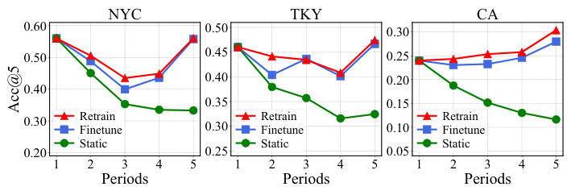
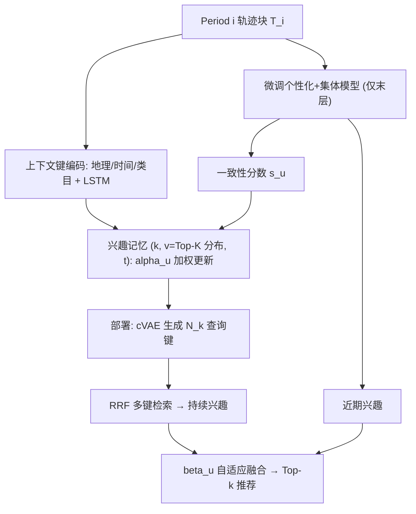

# Efficient Model-Agnostic Continual Learning for Next POI Recommendation (面向下一兴趣点推荐的高效模型无关持续学习)

- **会议/期刊**: ICDE 2026
- **作者与机构**: Chenhao Wang, Shanshan Feng, Lisi Chen, Fan Li, Shuo Shang（电子科技大学、武汉大学、香港理工大学）
- **推荐链路定位**: 精排（可作为任意 NPR 骨干的在线增量插件，端到端出 Top-k POI）
- **研究方向**: 时空轨迹与 POI 推荐 / 序列与会话推荐
- **论文原文**: [论文原文链接](https://arxiv.org/abs/2511.08941v2)
- **开源代码**: [GIRAM](https://github.com/chwang0721/GIRAM)

## TL;DR (1分钟核心速览)

现有 Next-POI 模型一次性静态训练，无法跟进用户时空兴趣漂移；全量重训代价高，仅在新数据上微调又会灾难性遗忘。作者定义「持续 Next-POI 推荐 (CNPR)」新任务，提出模型无关框架 GIRAM：用分布型用户兴趣记忆保存历史偏好，以解耦的上下文键编码 + cVAE 多键生成检索召回「持续兴趣」，再用一致性分数自适应融合近期兴趣。在 NYC/TKY/CA 三数据集、三种异构骨干（RNN/GCN-Transformer/扩散）下，以 Acc@k、MRR 全库排序评估，平均 Acc@5 相对最强基线提升 3.1%–25.5%，更新耗时仅略高于微调。

## Background & Motivation (背景与核心矛盾)

- **主流范式**: RNN（ST-RNN/Flashback）、Transformer（GETNext）、GNN 与扩散（DiffPOI）在固定数据块上训练一次即部署，参数此后冻结。
- **前人局限**: ① 静态模型随时间性能单调衰减（图 2 中第 5 期与静态模型差距远大于第 2 期）；② 仅用新块微调（Finetune）弱于全量重训（Retrain），历史偏好在反向传播中被覆盖；③ 电商类持续学习方法（ADER/IncCTR/ReLoop2）依赖离散 item 频次与隐状态回放，无法建模签到数据的时空-类目三元上下文。
- **核心洞察 (Key Insight)**: 人的移动兴趣是「上下文敏感但部分持续」的——把历史偏好压缩为以时空类目为键、以 Top-K 预测分布为值的用户级记忆，即可在不重训的前提下近似 Retrain 的知识保留度。
- **本文切入点**: 让「持续兴趣」与「近期兴趣」由一个可解释的标量（用户与群体模型输出的一致性）动态配比，而非固定权重或全参数更新。

<figure class="paper-figure" markdown="span">
  <figcaption>图 2. Static、Finetune 和 Retrain 方法在 NYC、TKY 和 CA 数据集上的性能比较。</figcaption>
</figure>

## Method (核心方法设计)

### 1. 整体框架 (Overall Architecture)

GIRAM 是外挂式双阶段框架：**更新阶段**在每个新数据块上先微调个性化模型（用户嵌入可训）与集体模型（用户嵌入冻结），用两者输出余弦一致性 $s_u$调制记忆写入强度，把键（上下文编码）、值（Top-K 稀疏预测分布）、时间戳三元组写入用户兴趣记忆；**部署阶段**用条件 VAE 由当前轨迹键生成$N_k$个查询键，经 RRF 检索记忆得到持续兴趣向量，再与个性化模型的近期兴趣按$s_u$派生的$\beta_u$ 加权融合，输出 Top-k POI。骨干（Flashback/GETNext/DiffPOI）无需改结构。

### 2. 关键设计拆解 (Key Designs)

1. **分布型兴趣记忆 + 解耦键编码**：前人直接复用骨干隐状态作查询/回放键，与输出线性耦合、冗余且受训练质量支配。本文把值设为稀疏分布 $v_i=\mathrm{TopK}(\mathrm{Softmax}(V_\theta(T_i)))$（$K=50$），键则由地理（归一化经纬度 + 网格区域 ID）、时间（hour/weekday 离散嵌入 + 多频$\sin(2\pi\omega\tau),\cos(2\pi\omega\tau)$周期编码）、类目（原始 ID + ChatGPT 派生的粗粒度类目）拼接后经 LSTM 编码：$k=\mathrm{LSTM}(\mathrm{Linear}(\Theta\|\Phi\|\Omega))$。分布值天然抗标签噪声，解耦键使框架对任意骨干即插即用。

2. **生成式多键检索 (cVAE + RRF)**：单键检索只覆盖兴趣的一个侧面。用条件 VAE 采样潜变量 $z=\mu+\epsilon\odot\sigma$解码出$N_k$个键，损失$\mathcal{L}=\mathcal{L}_{recon}+\eta\mathcal{L}_{KL}+\lambda\mathcal{L}_{div}$，其中$\mathcal{L}_{div}=\sum_{i<j}1/(\|k_i-k_j\|^2+\epsilon)$显式惩罚键塌缩。检索端用 RRF 融合多查询排名：$\mathrm{RRF}(m)=\sum_{k\in K}1/(\mathrm{rank}_{k,m}+a)$，softmax 归一后加权记忆值得到$I_{sustained}$——排名融合比分数相加更抗键间尺度差异。

3. **一致性分数驱动的更新与融合**：$\alpha_u=\alpha_{base}+\gamma(s_u-s_{mean})$、$\beta_u=\beta_{base}+\gamma(s_u-s_{mean})$，$s_u=\cos(x_u^c,x_u^p)$。高一致性（用户随大流，如夏季去海滩）加重近期权重、加快记忆覆写；低一致性（冬季仍跑公园的爱好者）则保留长历史。记忆写入采用「相似度超阈值$\delta$则软更新，否则插入或淘汰最旧项」，显存恒为$O(|U|N_u(d_k+K))$，更新复杂度$O(|T|(\bar n d_v+(\bar n+N_u)d_k))$，训练负采样沿用各骨干原设定（BPR 类采样，无需额外负采样）。

## Experimental Setup & Evaluation Protocol (实验设置与评估协议)

- **数据集与预处理**（过滤 <10 条签到）：

| 数据集 | #Users | #Items(POI) | #Interactions | 稀疏度/密度 | 特征/场景说明 |
| :--- | :---: | :---: | :---: | :---: | :--- |
| NYC | 1,083 | 5,135 | 144,268 | 2.6% | Foursquare，经纬度+类目，2012/04–2013/02 |
| TKY | 2,293 | 7,873 | 440,783 | 2.4% | Foursquare 东京，轨迹 47,731 |
| CA | 6,592 | 14,027 | 338,612 | 0.37% | Gowalla 加州，用户多、最稀疏 |

- **数据划分与防穿越 (Splitting Strategy)**: 按时间排序，最早 50% 为基块 $T_0$，其余等分为 5 个增量块；块内按**一周间隔**切轨迹（单点轨迹丢弃）。在$T_i$上更新，$T_{i+1}$ 随机对半作验证/测试，严格未来块评估。
- **排名评测协议 (Ranking Protocol)**: Acc@5/10/20 与 MRR，正样本排名在全 POI 库上计算（论文未引入采样候选截断，属全库排序口径）。
- **对比基线与超参设置**: Static / Finetune / Retrain（参考，不参与排名）/ ADER / IncCTR / ReLoop2 / CMuST / URCL；三种骨干分别验证架构无关性。嵌入维度 16、latent 128、$\gamma=0.5$、$\eta=1$、$\lambda=0.1$、$a=50$、$N_k=20$、$\delta=0.95$、$N_u=100$(NYC/TKY)/$20$(CA)。

## Key Experimental Results (实验关键数据)

### 1. 主实验对比 (Main Results)

| 骨干/数据集 | 方法 | Acc@5 | Acc@10 | MRR | Improv.(Acc@5) |
| :--- | :--- | :---: | :---: | :---: | :---: |
| Flashback/NYC | Static | 0.3680 | 0.4306 | 0.2688 | −24.6% |
| | Finetune | 0.4704 | 0.5300 | 0.3354 | −6.5% |
| | ADER | 0.4762 | 0.5362 | 0.3404 | −5.3% |
| | IncCTR | 0.4701 | 0.5348 | 0.3314 | −6.5% |
| | ReLoop2 | 0.4729 | 0.5469 | 0.3422 | −6.0% |
| | CMuST | 0.4849 | 0.5510 | 0.3360 | −3.6% |
| | Retrain (参考) | 0.4875 | 0.5526 | 0.3453 | −3.1% |
| | **GIRAM** | **0.5030** | **0.5704** | **0.3610** | — (+3.2% vs Retrain) |
| Flashback/TKY | ReLoop2 (最优基线) | 0.4479 | 0.5264 | 0.3299 | −3.0% |
| | **GIRAM** | **0.4618** | **0.5418** | **0.3331** | — |
| Flashback/CA | Retrain (参考) | 0.2647 | 0.3193 | 0.1950 | −4.5% |
| | **GIRAM** | **0.2773** | **0.3327** | **0.2028** | — |
| GETNext/NYC | Retrain (参考) | 0.4843 | 0.5640 | 0.3362 | −0.7% |
| | **GIRAM** | **0.4877** | 0.5496 | **0.3535** | — (MRR +5.1%) |
| DiffPOI/NYC | Retrain (参考) | 0.4070 | 0.4335 | 0.3773 | −25.5% |
| | **GIRAM** | **0.5107** | **0.5417** | **0.4697** | — (+24.5% MRR) |

### 2. 消融实验 (Ablation Study)

| 变体 (Flashback) | NYC Acc@5 | TKY Acc@5 | CA Acc@5 | 说明 |
| :--- | :---: | :---: | :---: | :--- |
| w/o CKE（用骨干隐状态作键） | 0.4750 | 0.4272 | 0.2518 | 上下文解耦编码有效性 |
| w/o GKR（单键检索） | 0.4848 | 0.4305 | 0.2620 | 多键生成检索贡献 |
| w/o CS（固定 $\alpha_{base},\beta_{base}$） | 0.4869 | 0.4466 | 0.2670 | 一致性自适应必要性 |
| w/o SI（去持续兴趣） | 0.4704 | 0.4271 | 0.2473 | 记忆主导作用 |
| w/o RI（去近期兴趣） | 0.4757 | 0.4395 | 0.2535 | 近期信号不可缺 |
| GIRAM-AE（自编码替代 cVAE） | 0.4909 | 0.4397 | 0.2602 | 确定性生成多样性不足 |
| GIRAM-GAN（GAN 替代 cVAE） | 0.4930 | 0.4569 | 0.2708 | 模式坍缩不稳定 |
| **GIRAM** | **0.5030** | **0.4618** | **0.2773** | — |

### 3. 关键实验发现 (Key Findings)

1. **提出越难的骨干收益越大**：DiffPOI/NYC 上 Acc@5 从 Retrain 的 0.4070 提升到 0.5107（+25.5%）、MRR +24.5%，因其「单条签到序列」假设无法覆盖多样兴趣，恰由上下文键记忆补齐；而 Flashback/NYC 仅 +3.2%，说明框架收益来自「历史信息组织方式」而非单纯参数扩容。
2. **持续兴趣是承重墙，但离开近期兴趣同样塌陷**：w/o SI 在 Flashback/NYC 掉 6.5%（0.5030→0.4704），在 DiffPOI/NYC 掉 24.3%（0.5107→0.3866）；w/o RI 掉 5.4%，验证 $\beta_u$ 双向配比不可退化为任何一端。
3. **生成多样性要「恰到好处」**：去掉多键检索 CA 掉 5.5%（0.2773→0.2620，最稀疏数据集最敏感）；cVAE 优于 AE(+2.5%) 与 GAN(+1.9%)；超参上 $N_k=20$（Flashback）、$\delta=0.95$、$\alpha_{base}=\beta_{base}=0.5$近最优，$N_u$ 在 NYC/TKY 于 50 饱和、CA 于 20 饱和，键太多引入噪声。

## Highlights & Limitations (亮点、对比与审稿批判)

- **与代表作对比 (vs. Prior Work)**: 相比 ADER/ReLoop2 的「样本级回放」，GIRAM 回放的是用户级**分布型兴趣模式**而非原始轨迹，故存储与用户数解耦度更高；相比 IncCTR 的教师-学生蒸馏，它不需要额外对齐损失即可跨架构迁移；相比 CMuST/URCL 这类连续时空预测方法，它显式建模离散 POI 的时空-类目三元上下文与用户个性化记忆。
- **可迁移亮点**: ① 「冻结用户嵌入的集体模型 vs 可训个性化模型」的余弦一致性可作为通用「跟风 vs 独特」个性化温度，可直接移植到新闻/短视频兴趣融合；② Top-K 稀疏分布作记忆值 + RRF 多查询融合，可低成本替换向量库 top-1 检索。
- **审稿级局限批判**: ① 更新阶段需同时微调两个模型并逐用户算一致性，实际开销为 Finetune 的近似 2 倍量级，且一致性分数依赖块内群体分布，冷启动用户 $s_u$估计不稳；② 记忆容量$N_u$与阈值$\delta$ 需按数据集调（100 vs 20），缺乏自适应淘汰策略的理论保障；③ 仅离线三个 Foursquare/Gowalla 子集，无线上 A/B，也未与 LLM4POI 等大模型方案对比。

## Rating (四维评分)

- **方法创新性 (Novelty)**: ⭐⭐⭐⭐ （首次系统定义 CNPR 任务，记忆值分布化 + cVAE 多键检索 + 一致性双端调制三者组合新颖，但各组件本身均有先例）
- **评估协议与实验扎实度 (Protocol & Experiments)**: ⭐⭐⭐⭐ （三数据集 × 三异构骨干 × 5 时间块 + 消融/效率/超参/案例齐全，但缺显著性检验与线上验证）
- **写作与数学规范度 (Clarity & Rigor)**: ⭐⭐⭐⭐ （四组件公式与两段伪代码、时间/空间复杂度分析完备，记忆更新与融合共享 $\gamma$ 的符号略含混）
- **工业落地与复现价值 (Industrial & Practical Value)**: ⭐⭐⭐⭐ （代码开源、骨架无侵入、更新耗时接近 Finetune 且显存低于 ADER/ReLoop2，但按周重训 + 双模型微调的工程成本仍需压缩）

