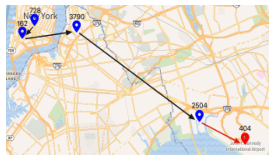
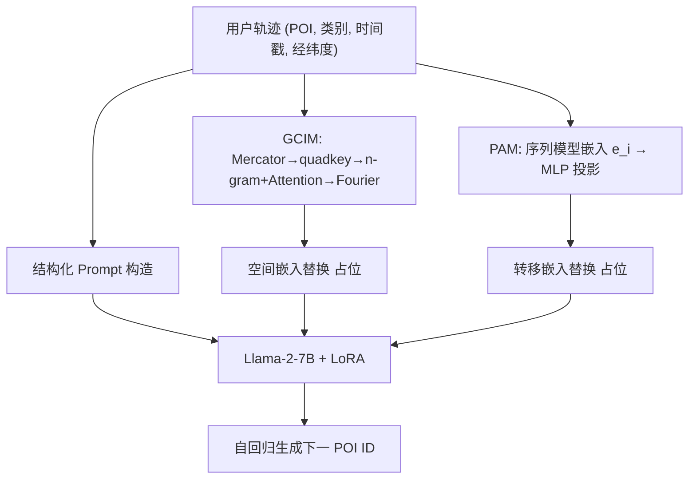
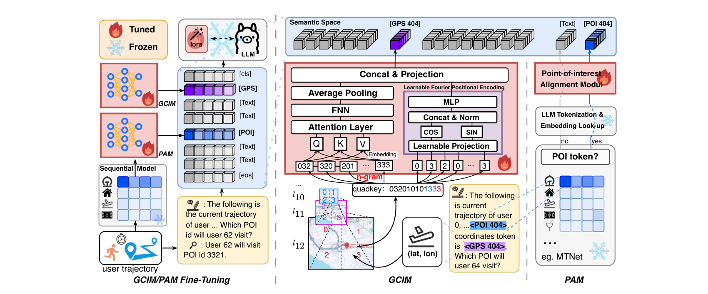

# Geography-Aware Large Language Models for Next POI Recommendation (地理感知大语言模型用于下一兴趣点推荐)

- **会议/期刊**: ICDE 2026 (arXiv:2505.13526, 2025-05)
- **作者与机构**: Zhao Liu, Wei Liu, Huaijie Zhu, Jianxing Yu, Jian Yin, Shun Wang (中山大学)；Wang-Chien Lee (宾州州立大学)
- **推荐链路定位**: 生成式端到端（LLM 直接生成 POI ID，召回+精排合一）
- **研究方向**: 时空轨迹与 POI 推荐 / 大语言模型推荐
- **论文原文**: [https://arxiv.org/abs/2505.13526v1](https://arxiv.org/abs/2505.13526v1)
- **开源代码**: [匿名评审仓库 GA-LLM-D2408](https://anonymous.4open.science/r/GA-LLM-D2408)

## TL;DR (1分钟核心速览)

纯文本 LLM 做 Next-POI 推荐有两处硬伤：高精度 GPS 坐标分词后 token 爆炸且缺乏空间感知，导致"错得离谱"的远端幻觉；prompt 长度受限使其看不到全局 POI 转移关系，目标不在历史轨迹中就无法推断。GA-LLM 用 **GCIM**（quadkey 层次网格 + n-gram 自注意力 + 可学习傅里叶编码）把坐标压成紧凑空间嵌入，用 **PAM**（MLP 投影 MTNet 等序列模型的 POI 嵌入）注入转移知识，两者直接替换 LLM 输入中的占位 token。在 NYC/TKY/CA 三个 Foursquare/Gowalla 数据集的 Acc@1 上较次优基线提升 16.19%/14.73%/16.69%，较同门 LLM4POI 在 CA 上提升 24.26%。

## Background & Motivation (背景与核心矛盾)

- **主流范式**: 序列/图模型（STHGCN 超图、ROTAN 旋转时间注意力、MTNet 移动树）建模时空轨迹；LLM4POI 则把轨迹写成文本 prompt，让 LLM 直接生成 POI ID。
- **前人局限 1（空间失感）**: 坐标如 `(40.8130989074707, -74.00180053710938)` 分词后产生 36 个 token，精度噪声大、出现频次低，LLM 无法学到空间邻近性，反而把预测甩到几百公里外。
- **前人局限 2（转移缺失）**: prompt 只能塞进少量相似轨迹，模型严重依赖"目标 POI 恰好出现在输入里"——NYC/TKY/CA 分别有 75.8%/73.5%/55.6% 的样本满足该条件，一旦缺失就退化为抄最近一次签到（图 1(b)：该预测 JFK 机场却输出了 AirTrain 站）。
- **核心洞察 (Key Insight)**: 图 1(a) 定量证实纯文本 LLM 的错误预测到真值的平均距离显著大于序列模型——**不是错得多，而是错得不合地理常识**；因此空间与转移信号必须以连续嵌入而非自然语言描述注入。
- **本文切入点**: 双模块各管一件事——GCIM 编码"点在哪"，PAM 编码"点与点怎么跳"，二者统一投影进 LLM 词嵌入空间后仅用 LoRA 微调。

<figure class="paper-figure" markdown="span">
  <figcaption>图 1：纯文本 LLM 在 POI 推荐中的局限性示意图。(a) 在 NYC、CA 和 TKY 数据集上，纯文本 LLM 与序列模型对错误预测 POI 到其正确 POI 的平均误差距离。(b) 案例研究：无输入上下文时纯文本 LLM 无法预测 POI 404，而我们的模型利用转移关系进行准确预测。</figcaption>
</figure>

## Method (核心方法设计)

### 1. 整体框架 (Overall Architecture)

用户轨迹被改写为结构化 prompt：`At [t], user [u] visited p, represented as <POI [p]>, with category [c], located at <GPS [g]>`。其中 `<GPS [g]>` 与 `<POI [p]>` 并非普通文本 token，而是由 GCIM / PAM 生成、经投影后**直接替换对应位置的词嵌入**（与 [cls]/[eos]/文本嵌入拼接后送入 LLM）。基座为 Llama-2-7b-longlora-32k，仅 LoRA 参数与两个模块可训练，输出端自回归生成 `POI id 3321`。因为坐标与 POI 都不再占用文本 token，单 query 的 check-in 数量远少于 LLM4POI 的 200 条，训练与推理同时变快。

<figure class="paper-figure" markdown="span">
  <figcaption>图 2：GA-LLM 框架概览。左侧展示工作流，其中用户轨迹被转换为用于 LLM 微调的查询。中间突出 GCIM 模块，通过 quadkey 系统编码 GPS 数据，并将其与 LLM 的语义空间对齐。右侧展示 PAM 模块，将来自序列模型（如 MTNet）的 POI 嵌入与 LLM 的语义空间对齐。</figcaption>
</figure>

### 2. 关键设计拆解 (Key Designs)

1. **GCIM：把连续坐标变成层次化空间词**。痛点：原始经纬度既稀疏又长。做法是 Mercator 投影到 $2^l\times256$网格并转为 base-4 quadkey 串$S=(s_1,\dots,s_L)$，使相邻坐标共享长前缀，天然平滑；再对$S$ 取重叠 n-gram + 位置编码 + 自注意力捕捉细粒度局部模式，并叠加**可学习傅里叶编码**补全全局多频结构：
$$F(S)=\frac{1}{\sqrt{M}}\Big[\cos(S W_s^{\top})\ \|\ \sin(S W_s^{\top})\Big],\quad W_s\in\mathbb{R}^{\frac{M}{2}\times L}$$
两路拼接的直觉是：n-gram/注意力给"街区内"的相对关系，傅里叶基给"整城尺度"的绝对位置，$W_s$的核宽$\gamma$ 控制空间平滑度。

2. **PAM：把已学好的转移关系"接线"进语义空间**。痛点：图/序列模型产出的 $d$维 POI 嵌入与 LLM 的$D$维语义空间不兼容；E4SRec 式"每个 POI 一个新 token"在 POI 稠密的 NYC 会因初始化不可分而失效。PAM 只学一个投影层$h_i=\mathrm{MLP}(e_i)$，与文本嵌入$h_{\text{text}}$拼接为$h=h_{\text{text}}\cup h_i$。直觉：转移知识本就在低维协同空间中被 MTNet 学好，无需 LLM 重新学，只做坐标系对齐即可泛化到未见 POI。

3. **训练目标、负采样与推理效率**：无对比损失、无负采样，标准答案段自回归交叉熵；PAM 的 $e_i$ 来自冻结（或预训练）的 MTNet，构成两阶段训练。推理单次前向即可产出 POI ID，全库隐式排序，GCIM/PAM 带来的额外开销仅为 MLP 前向。

## Experimental Setup & Evaluation Protocol (实验设置与评估协议)

- **数据集与预处理**（过滤掉签到数 < 10 的用户与 POI）：

| 数据集 | #Users | #Items(POI) | #Interactions | 稀疏度/密度 | 特征/场景说明 |
| :--- | :---: | :---: | :---: | :---: | :--- |
| Foursquare-NYC | 1,048 | 4,981 | 103,941 | 密度 ≈ 1.99% | 城市紧凑、POI 高度稠密，含 318 类 |
| Foursquare-TKY | 2,282 | 7,833 | 405,000 | 密度 ≈ 2.27% | 签到最丰富、地理多样性高 |
| Gowalla-CA | 3,957 | 9,690 | 238,369 | 密度 ≈ 0.62% | 覆盖加州+内华达，空间跨度大、最稀疏 |

- **数据划分与防穿越**: 按时间戳 **chronological 80%/10%/10%** 全局切分（沿用 STHGCN 协议），严格保证测试集在未来。
- **排名评测协议**: **Full-Catalog 生成式全库排序**——模型直接生成 POI ID，与全库唯一真值比对，无候选采样、无负采样。指标仅 **Acc@1**；原文将其表述为"extreme position bias"设定下的 QA 式评估（即正确答案只有 1 个位置，Top-1 命中即命中）。**注意：未报告 Acc@5/Acc@10/MRR**，因此与采用采样排序的序列基线并非完全同一打分口径。
- **对比基线与超参**: 基线涵盖传统 (FPMC/PRME)、RNN (LSTM)、时空 (STAN/PLSPL/STGCN)、图 (STHGCN)、Transformer (GETNext/MTNet/ROTAN) 与 LLM (LLM4POI) 五类。基座 Llama-2-7b-longlora-32k，lr $2\times10^{-5}$，20 warm-up，无 weight decay，单卡 batch=1，最大长度 32,768，微调 3 epoch，NVIDIA A800；显著性$p\le0.05$。

## Key Experimental Results (实验关键数据)

### 1. 主实验对比 (Main Results)

| Model | NYC Acc@1 | TKY Acc@1 | CA Acc@1 |
| :--- | :---: | :---: | :---: |
| FPMC | 0.1003 | 0.0814 | 0.0383 |
| LSTM | 0.1305 | 0.1335 | 0.0665 |
| STAN | 0.2231 | 0.1963 | 0.1104 |
| GETNext | 0.2435 | 0.2254 | 0.1357 |
| STHGCN | 0.2734 | 0.2950 | 0.1730 |
| ROTAN | 0.3106 | 0.2458 | **0.2199** (次优) |
| LLM4POI | 0.3372 | 0.3035 | 0.2065 |
| **GA-LLM** | **0.3919** | **0.3482** | **0.2566** |
| Improv. (vs 次优) | **+16.19%** | **+14.73%** | **+16.69%** |

### 2. 消融实验 (Ablation Study)

| 变体 | NYC | TKY | CA | ΔCA |
| :--- | :---: | :---: | :---: | :---: |
| Full GA-LLM | **0.3919** | **0.3482** | **0.2566** | — |
| w/o GCIM | 0.3729 | 0.3370 | 0.2402 | −1.64pt |
| w/o Fourier（仅留 quadkey+n-gram） | 0.3800 | 0.3435 | 0.2467 | −0.99pt |
| w/o PAM | 0.3826 | 0.3429 | 0.2499 | −0.67pt |
| token-based POI（E4SRec 式） | 0.3389 | — | 0.2226 | −3.40pt |

### 3. 关键实验发现 (Key Findings)

1. **GCIM 是增益主引擎，且主要修正"错得不合理"**：移除 GCIM 在 NYC/CA 上分别掉 1.90/1.64 个百分点；更关键的是 CA 上错误预测到真值的**平均误差距离从 61.38 km 降到 37.63 km**（图 5），CDF 曲线整体左移——空间编码并非提高"猜中率"，而是把预测约束进合理地理邻域，抑制 LLM 幻觉。
2. **转移知识确实补上了"目标不在输入中"的短板**：PAM 移除仅掉 0.53–0.93pt，但在"目标 POI 未出现在 prompt"的子集上，CA 的正确率从 2.85% 提升到 4.36%；同时 token 化 POI 方案虽然依赖 MTNet 初始化在稀疏 CA 反超 w/o GCIM（0.2226），却在稠密 NYC 大幅落后 PAM（0.3389 vs 0.3729），说明"投影对齐"比"新增词表 token"更能分辨近邻 POI。
3. **GCIM 学到的是城市无关的空间先验**：跨城冷启动实验中，TKY 训练→NYC 测试达 0.4059 Acc@1，**高于 NYC 自训自测的 0.3826**；CA 训练→TKY 测试亦从 LLM4POI 的 0.2600 提升到 0.3065，印证 quadkey 层次网格提供的全局空间模式可跨区域迁移，而非记忆本地 POI 共现。

## Highlights & Limitations (亮点、对比与审稿批判)

- **与代表作对比**: 相比 **LLM4POI**（同为 LLM 直接生成 POI ID），本文不做相似轨迹检索、不让坐标进文本，而是两个连续嵌入注入，CA 上领先 24.26%；相比 **ROTAN/MTNet** 这类纯序列模型，本文不重造时空编码器，而是"借"其嵌入补 LLM 的转移盲区，兼得语义泛化与协同信号；相比 **E4SRec** 的 POI-as-token，PAM 用共享投影层避免了稠密城市场景下的词表膨胀与嵌入不可分。
- **可迁移亮点**: (i) quadkey + 可学习傅里叶位置编码可平移到任何需要连续坐标的 LLM 任务（配送路径、轨迹生成、出行时长预估）；(ii) "冻结成熟序列模型 + MLP 对齐进 LLM 语义空间"是一种极低成本的领域知识注入范式，比 instruction tuning 便宜得多。
- **审稿级局限批判**: (i) 仅报 Acc@1、无 Acc@5/10 与 MRR，且"生成 ID"与基线"全库打分"是否完全同口径未加说明，跨表数值对比需谨慎；(ii) PAM 的上限被外部序列模型（MTNet）质量锁死，且需两阶段训练，端到端联合优化缺失；(iii) 效率分析只与 LLM4POI 比（图 7），未与 ROTAN/MTNet 的毫秒级在线推理对比，7B LoRA 对真实 LBS 请求仍偏重；(iv) 未做长尾/冷启动用户分桶与方差报告，CA 稀疏场景的稳健性证据偏弱。

## Rating (四维评分)

- **方法创新性 (Novelty)**: ⭐⭐⭐⭐ （quadkey 层次网格与可学习傅里叶位置编码的组合虽属工程拼装，但"空间嵌入 + 转移嵌入双占位替换"的注入方式在 POI-LLM 上确为清晰增量，且有误差距离这一物理可解释证据）
- **评估协议与实验扎实度 (Protocol & Experiments)**: ⭐⭐⭐ （三数据集 + 时间切分 + 11 个基线 + 消融/跨城/效率四组分析较完整，但仅 Acc@1 单指标、缺 Top-K 与采样排序对照、无置信区间）
- **写作与数学规范度 (Clarity & Rigor)**: ⭐⭐⭐⭐ （GCIM/PAM 公式与符号定义清楚，Mercator→quadkey→Fourier 流水线可复现；但 PAM 与 GCIM 的"拼接"细节及 $\gamma$ 敏感度缺少讨论）
- **工业落地与复现价值 (Industrial & Practical Value)**: ⭐⭐⭐（提供匿名代码，模块 plug-in 化、可复用现成序列模型嵌入，落地门槛低；但 7B 模型 + 两阶段训练与线上毫秒级延迟之间仍有明显鸿沟）

