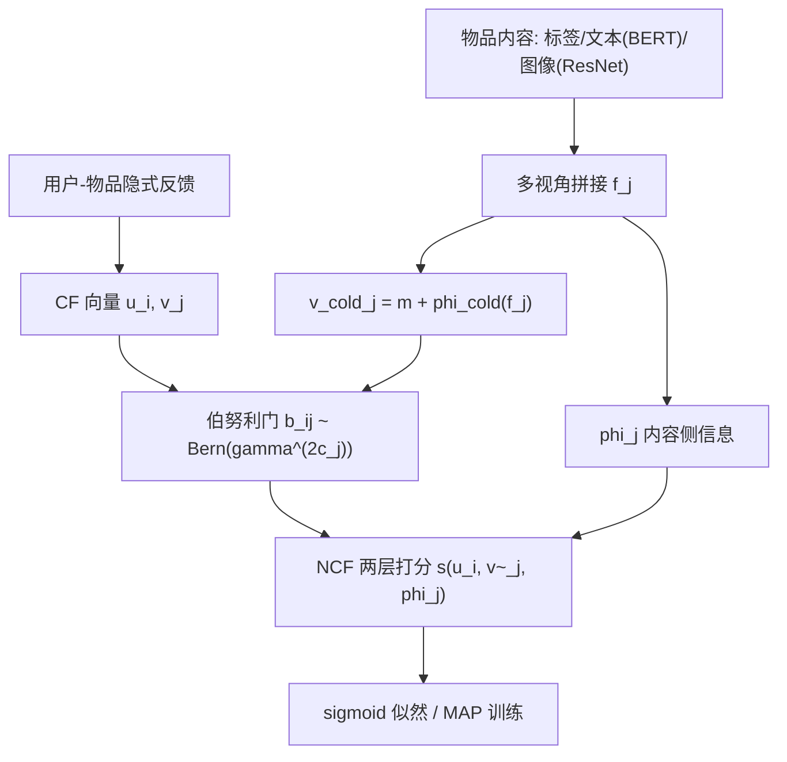

# Cold Item Integration in Deep Hybrid Recommenders via Tunable Stochastic Gates (基于可调随机门的深度混合推荐冷物品集成)

- **会议/期刊**: IEEE ICDM 2021
- **作者与机构**: Oren Barkan, Roy Hirsch, Ori Katz, Avi Caciularu, Jonathan Weill, Noam Koenigstein（The Open University / Tel-Aviv University / Technion / Bar-Ilan University / Microsoft）
- **推荐链路定位**: 召回（冷启动物品入池表征）
- **研究方向**: 冷启动与长尾推荐 / 多模态推荐
- **论文原文**: [https://arxiv.org/abs/2112.07615v1](https://arxiv.org/abs/2112.07615v1)
- **开源代码**: 暂未开源

## TL;DR (1分钟核心速览)

本文指出混合推荐的一个被忽视矛盾：内容表征在热物品上只是 CF 的“修正项”，一旦物品完全冷启动、CF 向量缺失，内容侧从未被训练去“顶替”CF，因而冷物品推荐次优。作者提出 CWH：用可调伯努利随机门 $b_{ij}$在训练中人为把热物品“打成冷物品”，并配一路专用的 CF 补偿表征$v_j^{cold}=\boldsymbol{m}+\phi_{\theta_{cold}}(f_j)$，使热/冷精度可通过单一旋钮$\gamma$ 连续权衡。在 Movies/CiteULike/Apps 三域目标物品排序协议（HR@20、MRR@20）下，统一测试集 MRR@20 达 2.691/2.414/3.308，相对最强基线提升 10.7%–114.6%。

## Background & Motivation (背景与核心矛盾)

- **主流范式**: 深度混合推荐（CTR/CDL/CVAE、CB2CF）把 BERT/ResNet 等内容向量与用户-物品交互共训，内容用于增强热物品表征，或在推理期为冷物品回归一个 CF 向量。
- **前人局限**: (1) CTR/CDL 用超参平衡 MF 与 CB 目标，但该超参对冷物品收益近乎为零——CB 分支始终只学“残差修正”；(2) CB2CF 两阶段只服务完全冷物品，热物品仍用旧 CF 向量，冷/热表征空间割裂，工业系统难以在同一排序列表内混排。
- **核心洞察 (Key Insight)**: 训练集按定义不含完全冷物品，因此模型从未被“强迫”单独使用 $\phi_j$；一旦$v_j$ 缺失，输入分布发生训练-推理偏移（train-test discrepancy），这是混合模型冷启动失效的根因，而非内容不够好。
- **本文切入点**: 主动在训练中注入“假冷物品”，用一个可调随机门控制注入强度，让模型同时学会两种模式。

## Method (核心方法设计)

### 1. 整体框架 (Overall Architecture)

物品 $j$的多源内容（标签类别、文本、图像）分别经线性层 / BERT-Base / ResNet18 编码为 100 维，拼接得多视角$f_j$；$f_j$分两路：一路经$\phi_{\theta_\phi}$得内容表征$\phi_j$（热物品的侧信息），另一路由$\phi_{\theta_{cold}}$加全局偏置$\boldsymbol{m}$得 CF 补偿向量$v_j^{cold}$。训练时对每个$(i,j)$采样伯努利门$b_{ij}$，以$\tilde{v}_j=(1-b_{ij})v_j+b_{ij}v_j^{cold}$送入 NCF 式两层打分网络；推理时热物品令$b=0$、冷物品令$b=1$，同一套参数直接混排，无需分阶段映射。

### 2. 关键设计拆解 (Key Designs)

1. **随机门控冷启动模拟 (Stochastic Cold Gate)**：痛点是冷物品在训练中不可见，$\phi$与$v$的角色冲突（修正 vs. 顶替）。CWH 改写似然为混合输入形式$p(y_{ij}\mid\cdot)=\sigma\big(y_{ij}\,s(u_i,\,(1-b_{ij})v_j+b_{ij}v_j^{cold},\,\phi_j)\big)$，其中$b_{ij}\sim\mathrm{Bernoulli}(p_b)$。当$b=1$ 时模型被迫仅凭内容构造出“本应来自交互”的坐标，等价于对输入做结构化 dropout，从物理上消除训练-推理分布偏移。
2. **双路内容表征与全局偏置 (Dual Content Representation)**：$\phi_{\theta_\phi}$与$\phi_{\theta_{cold}}$结构相同但参数独立——前者学“增量信息”（继续与真实$v_j$拼接），后者学“替代信息”$v_j^{cold}=\boldsymbol{m}+\phi_{\theta_{cold}}(f_j)$。$\boldsymbol{m}\in\mathbb{R}^d$ 是与物品无关的可学习全局锚点，为完全无交互的物品提供一个先验落点，避免冷物品向量在 CF 空间漂移；这也是它与“直接置零 + 内容向量”式消融（CB-only）的本质差别。
3. **基于流行度的曝光率与训练目标**：数据呈幂律分布，热门物品垄断了内容曝光，长尾内容学不到补偿能力。作者令 $p_b(\gamma,c_j)=\gamma^{2c_j}$，$c_j\in[0,1]$为 min-max 归一化流行度、$\gamma\in[0,1]$为业务旋钮：$c_j>1/2$的热门物品被“打成冷”的概率低于$\gamma$，$c_j<1/2$的长尾物品高于$\gamma$，从而均衡内容曝光。总损失为带正态先验的 MAP：$\mathcal{L}=-\sum_{(i,j)}\log\sigma(y_{ij}s_{ij})+\frac{\tau}{2}\big(\|\theta_s\|_2^2+\|\theta_{cold}\|_2^2+\|\theta_\phi\|_2^2+\sum_i\|u_i\|_2^2+\sum_j\|v_j\|_2^2+\sum_k\|\theta_k\|_2^2\big)$，负样本按 NCF 式随机采样（非难负采样），Adam、batch=32、$\tau=10^{-5}$、50–60 epoch 收敛；推理开销与普通 NCF 相同，冷物品仅多一次前向编码。

## Experimental Setup & Evaluation Protocol (实验设置与评估协议)

- **数据集与预处理**: 三个跨域数据，均为隐式反馈（MovieLens ≥3.5 星视为正）。

| 数据集 | #Users | #Items | #Interactions | 稀疏度 | 特征/场景说明 |
| :--- | :---: | :---: | :---: | :---: | :--- |
| Movies | 247K | 34K | 22M | ≈0.26% | IMDB 剧情/演员/导演/类型/语言/年份/标签 + 海报图 |
| CiteULike | 5.5K | 17K | 205K | ≈0.22% | 标题/摘要/标签（CiteULike-a dense fold） |
| Apps | —（5M 会话） | 33K | 20M | — | 微软商店会话共点击，标题/描述/发布日/标签/图标 |

- **数据划分与防穿越 (Splitting Strategy)**: 保留交互数 ≥8 的用户（8-core）；每用户随机抽 2 个测试、2 个验证物品；再整体抽 20% 物品**删除其全部交互**作为“完全冷物品”，一半入验证、一半入测试（互斥）。冷物品按流行度分层抽样（排序后每隔 10 个取 1 个入测试、其相邻者入验证，不同偏移构成不同折），保证冷/热集合流行度分布一致，规避 Dacrema 等人指出的流行度偏置；10 次不同划分取均值。
- **排名评测协议 (Ranking Protocol)**: 目标物品排序（每测试对仅 1 个正样本，对未交互物品做全库排序），报告 HR@20、MRR@20（×100）；分 Warm / Cold / Unified（90% 热 + 10% 冷）三种测试集。原文未显式声明候选池规模，属协议描述的薄弱点。
- **对比基线与超参设置**: CF-only（NCF，仅 P2）、CB-only（置 $V,v^{cold},m=0$）、CB2CF、ItemKNN-CFCBF（冷物品用内容近邻热物品 CF 向量加权）；所有混合基线共享同一 BERT/ResNet 骨干，$d=d_\phi=100$，超参在独立验证集上早停调优。

## Key Experimental Results (实验关键数据)

### 1. 主实验对比 (Main Results)

MRR@20（×100），CWH 取验证集最优 $\gamma^*$（Apps 0.6 / CiteULike 0.2 / Movies 0.6）：

| 数据集 | 测试集 | CB-only | CB2CF | ItemKNN | **CWH** | Improv.% |
| :--- | :--- | :---: | :---: | :---: | :---: | :---: |
| Apps | Warm | 2.697 | 2.667 | 1.906 | **3.371** | +25.0% |
| Apps | Cold | 2.941 | 1.421 | 1.281 | **3.291** | +11.9% |
| Apps | Unified | 2.988 | 2.044 | 1.594 | **3.308** | +10.7% |
| CiteULike | Warm | 1.417 | 0.928 | 0.817 | **1.780** | +25.6% |
| CiteULike | Cold | 0.834 | 1.101 | 0.894 | **3.049** | +176.9% |
| CiteULike | Unified | 1.125 | 1.015 | 0.855 | **2.414** | +114.6% |
| Movies | Warm | 1.306 | 2.639 | 2.686 | **2.962** | +10.3% |
| Movies | Cold | 1.835 | 1.148 | 1.470 | **2.418** | +31.8% |
| Movies | Unified | 1.581 | 1.863 | 2.078 | **2.691** | +29.5% |

`Improv.%` 相对各测试集最强基线（加粗为最优）。

### 2. 消融实验 (Ablation Study)

| 变体 | Warm | Cold | 结论 |
| :--- | :---: | :---: | :--- |
| CB-only（去 CF 分支，$\gamma$ 失效） | 1.306 (Movies) | 1.835 | 无 CF 主干，热物品大幅掉点 |
| $\gamma=0$（关随机门＝常规 hybrid） | 同上表 Warm 附近 | 显著低于$\gamma^*$ | 门控是冷物品收益的主因（图 3） |
| $\gamma=1$（全程假冷） | 与 Cold 曲线重合 | 同 Warm 曲线 | 退化为纯 CB，热物品精度崩塌 |
| CWH（$\gamma^*$） | **2.962** | **2.418** | 双路表征 + 门控缺一不可 |

### 3. 关键实验发现 (Key Findings)

1. **冷热矛盾被定量证实**：图 3 显示 HR@20 随 $\gamma$单调分化——$\gamma=1$时热/冷曲线完全重合（模型只看内容，退化为 CB）；$\gamma=0$时热物品尚可但冷物品显著劣化。说明“混合模型自动兼顾冷启动”是错觉，$\gamma$ 才是真正起作用的自由度。
2. **双路表征比单路内容强得多，且在冷启动上放大**：CiteULike 冷集从 CB-only 的 0.834、CB2CF 的 1.101 跃升到 3.049（+177%），远超热集 +25.6% 的增幅；说明增益主要来自“内容顶替 CF”而非“内容增强 CF”，与动机分析一致。
3. **混合基线存在强烈数据集依赖**：CB2CF/ItemKNN 在 Movies 冷集（1.148/1.470）明显弱于 CB-only（1.835），却在 CiteULike 上优于 CB-only，而 CWH 在 3×3 全部 9 个格子中均最优，稳定性来自统一训练的冷热同空间表征。图 4 的流行度分层（剔除 Top-$r$物品，$r\in\{0,40,100,200,500\}$）进一步显示 CWH 在多数流行度区间优于 CF-only 与 CB-only，长尾段优势最明显。

## Highlights & Limitations (亮点、对比与审稿批判)

- **与代表作对比 (vs. Prior Work)**: 相较 CTR/CDL 用损失权重平衡双目标（对冷物品几乎无效），CWH 把平衡做进**输入分布**（门控采样）而非损失权重；相较 CB2CF 的两阶段“内容→CF”回归（热/冷表征空间割裂），CWH 单模型端到端混排；相较 ItemKNN-CFCBF 的近邻插值（依赖内容相似度质量），CWH 用可学习补偿网络 + 全局锚点 $\boldsymbol{m}$。
- **可迁移亮点**: (1) “用随机门在训练期伪造推理期缺失模态”的思路可直接迁移到缺失特征/缺失域的鲁棒推荐与多场景建模；(2) 流行度感知的采样概率 $p_b=\gamma^{2c_j}$ 是一种轻量的长尾曝光均衡技巧，可替代复杂的重加权损失。
- **审稿级局限批判**: (1) 评测协议描述不严谨——未说明候选项规模与是否过滤训练集已交互物品，MRR@20 的绝对值（1–3 量级）暗示候选集较小，跨论文可比性存疑；(2) $\gamma$需要在含冷物品的验证集上网格搜索，而真实系统中冷物品比例与流行度分布持续漂移，$\gamma^*$的时效性与在线自适应未讨论；(3) 内容侧依赖 BERT/ResNet 前向，冷物品入池延迟未做工程测量，且$p_b$ 的形式（指数 2）作者自承缺乏理论依据。

## Rating (四维评分)

- **方法创新性 (Novelty)**: ⭐⭐⭐⭐ （把冷启动问题重构为“训练-推理输入分布偏移”，随机门 + 双路内容表征的组合简洁且击中要害，虽无理论证明但直觉清晰）
- **评估协议与实验扎实度 (Protocol & Experiments)**: ⭐⭐⭐⭐ （三域数据、流行度分层抽样冷物品、10 折均值、冷/热/统一三视角报告扎实；扣分在候选池与负采样细节缺失、无显著性检验）
- **写作与数学规范度 (Clarity & Rigor)**: ⭐⭐⭐⭐ （公式链条与符号定义完整、图 1 与式 (5) 一一对应；但对 $p_b$ 设计与 CB-only 退化的论证偏经验化）
- **工业落地与复现价值 (Industrial & Practical Value)**: ⭐⭐⭐⭐ （单模型混排、推理开销等同 NCF、$\gamma$ 直接对应“新品扶持力度”这一业务语义，落地价值高；未开源、缺线上 A/B 验证）

