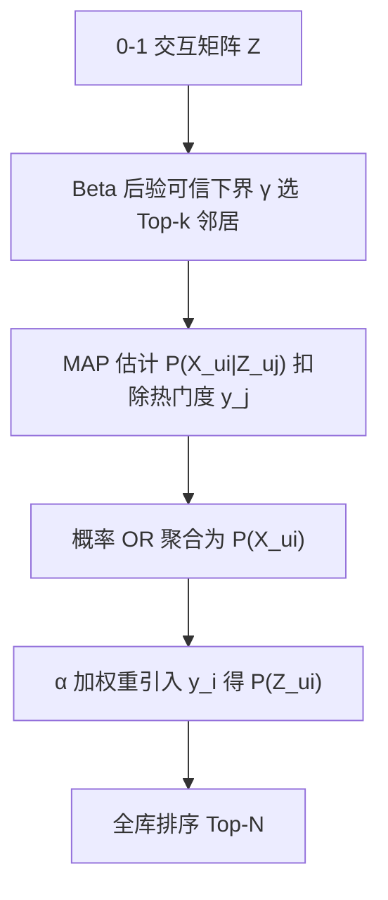

# A probabilistic perspective on nearest neighbor for implicit recommendation (隐式推荐最近邻的概率视角)

- **会议/期刊**: International Journal of Data Science and Analytics, 16:217–235, 2023
- **作者与机构**: Domokos M. Kelen, András A. Benczúr（匈牙利 SZTAKI 计算机科学与控制研究所 / ELKH）
- **推荐链路定位**: 召回（Item-based CF 打分）
- **研究方向**: 协同过滤与双塔召回 / 去偏与可信推荐
- **论文原文**: [论文原文链接](https://eprints.sztaki.hu/10559/1/Kelen_217_33165608_ny.pdf)
- **开源代码**: [proto-n/probabilistic_knn](https://github.com/proto-n/probabilistic_knn)

## TL;DR (1分钟核心速览)

Item-KNN 在隐式反馈推荐中长期"能打但说不清"：相似度、shrink、TF-IDF 全是 ad hoc 启发式，且强热门偏置无理论解释。本文把相似度定义为条件概率 $P(Z_{u,i}=1\mid Z_{u,j}=1)$，用 Beta-二项后验与**可信区间下界**选邻居（替代 shrink），把经典求和预测式解释为**独立预测子的概率 OR**（从而解释偏置来源），再把交互建模为"个人品味$\vee$ 热门度"并用 MAP 闭式解剥离热门度。在 5 个数据集的无偏 Full-Ranking 协议下，NDCG@50 相对最优 Item-KNN 基线提升 1.2%–5.6%，且在 Amazon Video / Epinions 上超过 SLIM、MultVAE 等强基线。

## Background & Motivation (背景与核心矛盾)

- **主流范式**: 非序列、长期画像场景仍以 Item-KNN（Cosine / Jaccard / Asymmetric Cosine + TF-IDF + shrink）为强基线，[Dacrema 2019] 的复现实验反复证明复杂神经模型并未显著超越它。
- **前人局限一**: 相似度函数缺乏统计基础；低支撑物品的相似度方差极大，只能靠 shrink 这类"魔法常数"压噪声，无法自适应样本量。
- **前人局限二**: 预测式 $\hat{z}_{u,i}=\sum_{j\in n(i)}sim(i,j)z_{u,j}$ 与 TF-IDF 逆频率缩放均是启发式，热门偏置**为何产生、如何定量去除**没有解释，长尾曝光被系统性挤压。
- **核心洞察 (Key Insight)**: 把"看过 $j$是否导致/预示会看$i$"视为伯努利事件，则经典求和式恰是"至少一个邻居成立"的**概率 OR 的一阶展开**；而 OR 的独立性假设会把每个邻居携带的公共热门分量$Y_i$重复计入$k$ 次——这正是偏置的数学根源。
- **本文切入点**: 全流程用贝叶斯工具重写 KNN：可信区间选邻居 → 概率 OR 聚合 → 显式拆分 $X_{u,i}\vee Y_i$ 并只对个人品味做推断。

## Method (核心方法设计)

### 1. 整体框架 (Overall Architecture)

模型对每个候选物品 $i$分五步闭式求解：(1) 对每个候选邻居$j$计算条件概率的 Beta 后验可信区间下界$\gamma_{u,i}$，用其排序并取 Top-$k$；(2) 对选中邻居用 MAP 估计$P(X_{u,i}\mid Z_{u,j}=1)$，其中已扣除热门分量$y_i$；(3) 用概率 OR 把$k$个邻居聚合成个人品味概率$P(X_{u,i})$；(4) 通过$\alpha$加权把热门度$y_i$重新并入，得到最终$P(Z_{u,i}=1)$；(5) 全库打分排序。全程无梯度训练，仅需 Beta 分位数查表与稀疏矩阵-向量乘法，复杂度与经典 KNN 同阶。

### 2. 关键设计拆解 (Key Designs)

1. **相似度 = 条件概率 + 可信区间下界（替代 shrink）**：朴素估计 $\sum_u z_{u,i}z_{u,j}/t_j$无视样本量，低频物品相似度虚高。本文设$Z_{u,i}\sim \text{Bernoulli}$、参数取$\text{Beta}(a,b)$共轭先验，后验均值即$\frac{t_{i,j}+a}{t_j+b}$（$a\ll b$时退化为 shrink）；再用后验分布的下侧分位点作为排序分数$\gamma_{u,i}=B^{-1}(q,\,t_{i,j}+a,\,t_j-t_{i,j}+b)$，把"估计不确定性"直接变成对稀疏邻居的折扣，$q=0.5$ 时即恢复为点估计。
2. **预测 = 概率 OR（解释并暴露偏置）**：设事件 $Z_{u,j}\!\twoheadrightarrow\! Z_{u,i}$表示$j$是$i$的独立成因，则$P(Z_{u,i})\approx 1-\prod_{j\in n_u^+(i)}\big(1-P(Z_{u,i}\mid Z_{u,j}=1)\big)$。一阶展开即$\sum_{j}sim(i,j)z_{u,j}-\Delta$，$\Delta$为二阶以上交项；实验证明$\Delta$可忽略，故经典求和式是 OR 的合理近似，但 OR 的独立性假设会把公共项$Y_i$计入$k$次，导致$k$越大越热门（Fig. 3 实测验证）。实现上用$1-\exp\big(\sum_j z_{u,j}\log(1-p_j)\big)$ 化为矩阵-向量乘，保持原复杂度。
3. **热门度/品味解耦与 MAP 闭式推断**：设 $Z_{u,i}=X_{u,i}\vee Y_i$，$P(Z_{u,i}=1\mid x,y)=x_{u,i}+y_i-x_{u,i}y_i$，其中$y_i=c\,t_i/|U|$（$c$控制偏置强度，$c=0$退化为无去偏）。因$X$的后验不再共轭，作者给出 MAP 的解析根$\hat{x}=\frac{-c_2-\sqrt{c_2^2-4c_1c_3}}{2c_1}$，其中$c_1=(a'+b'+r)(y-1)$、$c_2=(a'+r)(y-1)+(a'+b')y$、$c_3=a'y$，$a'=a-1,\,b'=b+s-1$，$r=\sum_u z_{u,i}z_{u,j}$、$s=t_j$。最终以$\alpha$控制重新并入的热门度，$\alpha\!\to\!0$ 表示几乎不再回填。
4. **训练与开销**：无损失函数、无负采样（隐式矩阵 0/1 直接计数），全部为计数统计 + 一次 Beta 分位数查表 + 稀疏矩阵乘；超参为 $k,b_1,b_2,c,\alpha,q$，均可在验证集网格搜索。

## Experimental Setup & Evaluation Protocol (实验设置与评估协议)

- **数据集与预处理**（全部把显式评分二值化为交互，与评分值无关）：

| 数据集 | #Users | #Items | #Interactions | 密度 | 说明 |
| :--- | :---: | :---: | :---: | :---: | :--- |
| Amazon Books | 56,257 | 50,154 | 1,418,076 | 0.00050 | 仅取 5 星，再做 10-core |
| Amazon Video | 3,113 | 5,860 | 22,184 | 0.00122 | 过滤 <5 评分用户 |
| HetRec | 2,044 | 5,351 | 71,680 | 0.00336 | 异构信息融合数据集 |
| MovieLens 1M | 6,013 | 3,231 | 225,473 | 0.00962 | 经典电影评分 |
| Epinions | 40,163 | 139,738 | 664,823 | 0.00012 | 极稀疏，商品评论 |

- **数据划分与防穿越**: 主用**按用户随机比例划分**（Books: 90%/5%/5%；Video、HetRec: 60%/20%/20%；ML-1M: 70%/20%/10%）；Epinions 采用**每用户随机留一**（留 1 验证 + 1 测试）。非时间戳切分，属随机切分设定。
- **排名评测协议**: **Full-Ranking（全库未交互物品排序，不采样）**，指标 NDCG@50 / Recall@50（另报 @20），因此不存在采样负例导致的指标虚高问题。
- **对比基线与超参**: 基线取自 Dacrema 框架并**在与本文完全相同的划分上重跑**——5 种 Item-KNN 相似度、P3α/RP3β（随机游走）、iALS、EASE$^R$、SLIM-ElasticNet、MultVAE；统一以验证集 NDCG@50 调参。最优$k$从 10 到 757，$c\in[0.95,4.81]$，$\alpha$多接近 0（0.00–0.21），$q\in[10^{-4},0.1]$。

## Key Experimental Results (实验关键数据)

### 1. 主实验对比 (Main Results)

| 方法 | Books N@50 | Video N@50 | Epinions N@50 | HetRec N@50 | ML1M N@50 | HetRec R@50 | ML1M R@50 |
| :--- | :---: | :---: | :---: | :---: | :---: | :---: | :---: |
| Item-KNN Cosine | 0.1785 | 0.1822 | 0.0394 | 0.2255 | 0.2724 | 0.3701 | 0.4464 |
| Item-KNN Asymmetric | 0.1809 | 0.1966 | 0.0427 | 0.2245 | 0.2705 | 0.3749 | 0.4436 |
| iALS | 0.1287 | 0.1857 | 0.0422 | 0.2360 | 0.2672 | **0.3990** | 0.4444 |
| P3α | 0.1812 | 0.1929 | 0.0410 | 0.2235 | 0.2747 | 0.3863 | **0.4564** |
| RP3β | 0.1864 | 0.1835 | 0.0398 | 0.2255 | 0.2828 | 0.3878 | 0.4658 |
| EASE$^R$ | 0.1515 | 0.1815 | – | 0.2115 | 0.2787 | 0.3511 | 0.4517 |
| SLIM-ElasticNet | **0.1935** | 0.2008 | 0.0444 | **0.2399** | **0.2927** | 0.3886 | 0.4654 |
| MultVAE | 0.1097 | 0.1512 | 0.0403 | 0.2110 | 0.2806 | 0.3773 | **0.4724** |
| **Ours** | 0.1842 | **0.2022** | **0.0451** | 0.2368 | 0.2812 | 0.3886 | 0.4564 |
| **Improv. vs 最优 KNN** | **+1.2%** | **+2.8%** | **+5.6%** | **+5.0%** | **+3.2%** | +3.7% | +2.2% |

### 2. 消融与机制验证 (Ablation)

| 配置 | HetRec N@50 | ML-1M N@50 | Book N@50 | 结论 |
| :--- | :---: | :---: | :---: | :--- |
| 经典求和集成 (Eq.4) | 0.2190 | 0.2710 | 0.1560 | 基线 |
| 概率 OR 集成 (Eq.11，无去偏) | 0.2200 | 0.2700 | 0.1590 | 比值 0.996–1.019，几乎等价 |
| 加入负向预测子 ($Z_{u,j}=0$) | — | — | — | 性能下降 ≥50%，且推荐平均热门度 0.4263→0.2073 |
| 去偏强度 $c=0$（关热门度解耦） | 推荐热门度随$k$单调上升 | — | — | 验证"OR 重复计入$Y_i$" |
| 全模型 $c\approx1.25,\ \alpha\approx0$ | 0.2368 | 0.2812 | 0.1842 | 最优 |

### 3. 关键实验发现 (Key Findings)

1. **OR 与 Sum 几乎等价（比值 0.996–1.019）**：这从数值上证实经典 KNN 求和式就是概率 OR 的一阶近似，$\Delta$ 项在真实数据中确实可忽略——理论解释站得住，同时也说明"换聚合式"本身不是涨点来源，**涨点来自邻居选择与热门度剥离**。
2. **去偏是主要增益来源**：$c=0$时推荐平均热门度随邻居数$k$单调上升（印证 Eq.20 的重复计数论证）；$c\approx1.25$时该曲线在初始上升后**趋于平坦**，且 NDCG 同步提升，说明把$Y_i$剥离后留下的$X_{u,i}$是更纯的品味信号。$\alpha\approx0$ 表明"去偏后不必回填热门度"。
3. **负向预测子是陷阱**：尽管大量 $Z_{u,j}=0$事件的估计预测力很高并挤进 Top-$k$（低热门物品尤甚，50 百分位后骤降），纳入后精度损失过半、推荐平均热门度从 0.4263 跌到 0.2073——高频共现中的"未交互"多为伪相关，且离线指标与数据分布同构，过度去偏反而掉点。

## Highlights & Limitations (亮点、对比与审稿批判)

- **与代表作对比 (vs. Prior Work)**: 相比 Bell & Koren 的相似度学习（仅适用显式评分回归），本文给出隐式反馈的贝叶斯对应物；相比 [22] 用 TF-IDF 幂函数启发式压热门，本文的逆频率缩放由 $y_i=c\,t_i/|U|$ 与后验推断导出，斜率可解释、可调；相比同期的概率 KNN 工作 [21]（对类别变量做边缘化），本文用二项变量 + OR 组合，形式更简洁且能直接建模热门偏置。
- **可迁移亮点**: (1) 用**后验下侧分位点**替代 shrink/置信惩罚，可迁移到任何基于共现统计的召回（如序列共现、图邻居采样权重）；(2) "公共因子被独立性假设重复计入 $k$ 次"的分析范式，可直接用于解释多路召回融合、集成打分中的流行度放大。
- **审稿级局限批判**: (1) 只处理二值反馈，忽略交互次数/时长，信息利用率低于加权模型；(2) 超参多达 6 个且跨数据集最优值差异极大（$k$从 10 到 757、$b_2$ 从 4 到 242），实际部署调参成本高；(3) 仅在随机切分的离线全库排序上验证，缺乏时间切分与线上 A/B，且 SLIM-ElasticNet 在 Books/HetRec/ML-1M 三个数据集上仍优于本文，声称的"全面超越"需谨慎解读。

## Rating (四维评分)

- **方法创新性 (Novelty)**: ⭐⭐⭐⭐ （把 KNN 的三个启发式组件统一进贝叶斯框架，OR 解释与热门度重复计数的论证颇具洞察力，但本质仍是线性共现模型的重新参数化）
- **评估协议与实验扎实度 (Protocol & Experiments)**: ⭐⭐⭐⭐ （5 个数据集、无偏 Full-Ranking、基线在同一切分上重跑且有机制验证实验；扣分在于随机切分、无显著性检验、缺时间切分）
- **写作与数学规范度 (Clarity & Rigor)**: ⭐⭐⭐⭐ （后验推导与 MAP 闭式解证明完整严谨，但全文存在大段重复段落，符号表与正文略有冗余）
- **工业落地与复现价值 (Industrial & Practical Value)**: ⭐⭐⭐⭐ （代码与切分全开源，训练零梯度、推理与经典 KNN 同阶稀疏矩阵乘，可直接替换现有 Item-CF 召回层；超参敏感是主要工程障碍）

